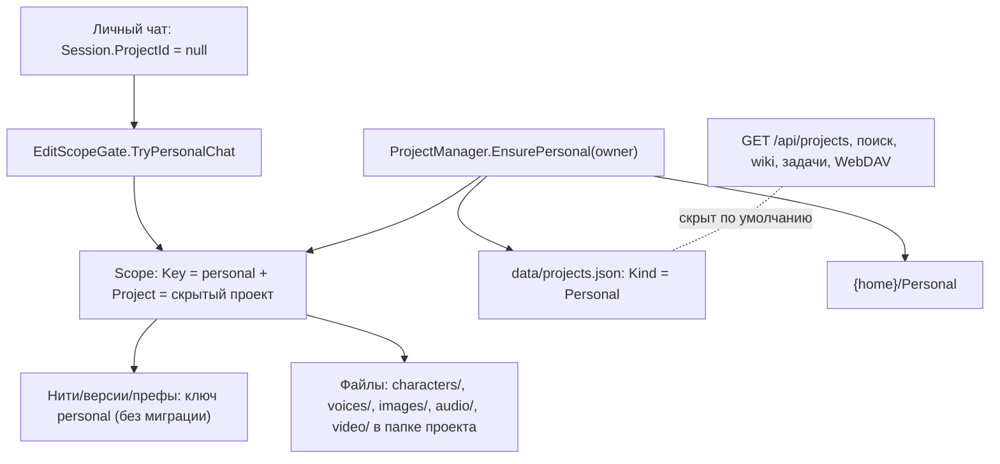

# ADR-040: скрытый проект «Личное» для личных чатов (Ф2 медиа-редакторов)

- **Статус:** предложено, ждёт решений Андрея по разделу «Открытые вопросы». Код не писался. Предложено 2026-11-13 (задача 5dacf319).
- **Вход:** решение Андрея «скрытый проект „Личное“ на пользователя: личные чаты используют его папку для персонажей, голосов, файлов, сохранения и фильмов»; разрез `docs/research/image-editor-personal-chats-cut-2026-09.md`; [ADR-016](ADR-016-local-project.md) (локальный проект), [ADR-021](ADR-021-audio-editor-and-generation-panel.md), [ADR-022](ADR-022-video-editor.md). Код сверен по `master` d4cd253bb.
- **Связано:** Ф1 (ветка `feat/personal-local-media`) снимает запрет локальных видео/звука/«Увеличить» для личных чатов и **с этим ADR не пересекается**: Ф1 не требует папки. Прямые инструменты local-media в личных чатах по-прежнему не нужны.

## Контекст

У личного чата `Session.ProjectId == null`. Из-за этого три медиа-редактора (картинки, звук, видео) держат «личную область» (`ImageEditScope` / `AudioEditScope` / `VideoEditScope`: `Key == "personal"`, `Project == null`). Всё, что читает или пишет диск проекта, в такой области отказывает ДО обращения к `RootPath`:

| Пробел | Где сейчас отказ |
|---|---|
| персонажи, подстановка лица (`characters/<slug>/`) | `CharacterStore` работает от `RootPath`; ручки `characters*` есть только в `api/projects/{pid}/image-editor`, у `PersonalImageEditorController` их нет |
| голоса (`voices/`, библиотека «Голоса») | `VoiceLibrary.ProjectOnly…`, `PersonalAudioEditorController` отвечает `available:false` |
| входы из файлов (образцы, кадр A/B, звук из файла, куски склейки) | `AudioOpInputs.cs:116` «у личного чата путей проекта нет», `AudioConcatService.cs:173/227` |
| сохранение результата | «скачать её может только человек» (`ImageEditorToolset.cs:614`, `AudioEditorToolset.cs:469/488/563`) |
| фильмы, «сохранить сцену» | `personal_scope_no_films` (`FilmService.cs:45`, `VideoSceneService.cs:54`, `VideoEditorToolset.cs:739`, `PersonalFilmController`) |
| локальный движок | `LocalAudioEngine.cs:46`, `LocalVideoEngine.cs:92` — `scope.IsPersonal || scope.Project is not {}` (этот пункт трогает Ф1, не Ф2) |

Рабочая папка личного чата уже есть: `SessionManager.ResolveChatRoot` → `{домашняя папка владельца}/Chats` (создаётся лениво; для container-пользователей — внутри `Sandbox:ProjectsRoot`). Но это папка процесса `claude`, не проект: у неё нет записи в сторе, владельца-проекта, прав и путей «от корня проекта».

## Решение (кратко)

1. На каждого пользователя — **один скрытый проект** `Kind = Personal` в обычном `data/projects.json`, с настоящей папкой на диске. Создаётся **лениво**, при первой потребности.
2. **Ключ области остаётся `"personal"`.** Подмена касается только `Project`: у личной области `Project` перестаёт быть `null` и указывает на скрытый проект. Все нити, версии, префы, задачи, трата, избранное ключуются по `"personal"` и **не мигрируют**.
3. Подмена — **только для медиа-подсистем**. `Session.ProjectId` у личного чата остаётся `null`; «чат вне проекта» везде вне медиа сохраняет прежний смысл.
4. Проект **не виден ни в одном пользовательском списке и не достижим через `api/projects/{id}/…`**: скрытость держит сам `ProjectManager` (fail-closed), а не фильтры в каждом месте.
5. Нормальная папка — не общая, шаринг запрещён, права — только владелец.



## 1. Где лежит папка

- **Путь:** `{UserHomeResolver.Resolve(user)}/Personal` (рядом с `Chats`, не внутри неё). Домашняя папка резолвится тем же `UserHomeResolver`, что и для «Нового проекта» и `ResolveChatRoot`: у container-пользователя она внутри `Sandbox:ProjectsRoot` (`EnsureRootAllowed` проходит), у local — `DefaultProjectsPath/{username}` или override конфига.
  - Почему не `Chats`: это рабочая папка процесса `claude`, в ней оседает мусор агента; имена `characters/`, `voices/`, `video/` могут столкнуться с чужими файлами, а `GetChatRoot` обещает «рабочая папка чата», а не «папка проекта». Снаружи `Chats` корень проекта сделал бы всё содержимое чатов видимым в `FilesController` / WebDAV.
  - Почему не точка `.personal`: `ShowHiddenFiles`, git-игноры и `FileWatcher` по-разному обходят dot-папки; скрытость обеспечивает запись в сторе, а не имя папки.
- **Как создаётся:** `ProjectManager.EnsurePersonal(ownerId)` — идемпотентно, под per-владельцем семафором (паттерн `DefaultAssistantProvisioner._locks`): перечитать → если записи с `Kind == Personal` и этим владельцем нет — `Directory.CreateDirectory` + запись в стор. Корень-коллизия: если путь занят обычным проектом владельца (`EnsureRootFree`), берём `Personal-2`… (в записи хранится фактический `RootPath`, путь не вычисляется заново).
- **Lazy, не при регистрации.** Причины: (а) существующим пользователям запись всё равно надо создавать, значит нужен ленивый путь; (б) подавляющее большинство пользователей медиа в личных чатах не используют; (в) отсутствие побочных эффектов в `UsersController.Create` и `DefaultAssistantProvisioner`. Точки вызова — только записывающие: гейт области личного чата при первом запросе, который требует диск (`TryPersonalChat` получает `Project`), и MCP-инструмент медиа с таким аргументом. GET-путь, который только перечисляет, папку **не создаёт** (тот же принцип, что у провижнера ассистента: мутация не должна жить на GET).
- **Поле в модели:** `Project.Kind` (`Regular = 0`, `Personal = 1`; числа закреплены явно, как у `ProjectIconKind`). Отсутствие поля в старом `projects.json` читается как `Regular`. Альтернатива — булев `IsPersonal`; enum выбран, чтобы не плодить булевы при следующей служебной разновидности.
- **Инвариант:** не более одной записи `Kind == Personal` на владельца. Держит `EnsurePersonal` под семафором + проверка на `Load` (при дубле — оставить старейшую, остальное логировать).
- **Бэкапы:** `BackupCore` бэкапит `data/` и транскрипты профилей, но **не папки проектов** (`BackupService` берёт `RootPath` проектов только для `ValidateBackupPath`, чтобы путь бэкапа не оказался внутри проекта). Для скрытого проекта это значит: (а) запись переживает бэкап вместе с `projects.json`; (б) файлы (фото персонажей, сохранённые результаты) в бэкап не попадают — **как у любого проекта**; (в) путь `{home}/Personal` защищён от выбора в качестве пути бэкапа без доработок — **поэтому `GetAll()` для `ValidateBackupPath` обязан включать скрытый проект** (см. п. 2). Расширять бэкап на папки проектов — отдельное решение, не часть Ф2 (вопрос 6).
- **Деплой:** папка вне каталога выкатки и вне `data/`, поэтому выкатка и откат файлов не трогают. Запись — в `data/projects.json`. **Риск отката** (см. «Риски», п. 1): бинарник до фичи ничего не знает о `Kind` и покажет «Личное» в списке; снять риск порядком выкатки — сначала фильтр, потом создание.

## 2. Как проект скрывается

Принцип: **скрытость — свойство слоя хранения, список по умолчанию её соблюдает.** Ставить `if (p.Kind == Personal) continue;` в каждом из ~45 мест рискованно: новый код, написанный через полгода, забудет фильтр, и проект всплывёт. Поэтому:

- `ProjectManager.GetAll()`, `GetByOwner()`, `GetAccessible()` **по умолчанию не отдают** `Kind == Personal`.
- Добавляются явные `GetAllIncludingPersonal()` / `GetPersonalOf(ownerId)` — для немногих мест инфраструктуры (список ниже). Читать «Личное» может только тот, кто написал это слово в коде.
- `GetById(id)` и `GetByRootPath(path)` **не меняются** (внутренние точки по известному id нужны гейтам области и `LoraTrainingFinisher`), но **пользовательский вход закрывается централизованно**: общий проверяльщик доступа к проекту (`ProjectAccess.Check` / `IProjectAccess`, через который идут `api/projects/{projectId}/…`) для `Kind == Personal` отвечает «нет доступа» (в HTTP — 404, как для чужого проекта). Единственный доступ — `IPersonalProject.Resolve(ownerId)` для гейтов медиа-областей.
- `IProjectManager` (Core, шов для Notes) наследует это поведение автоматически — `ProjectManagerAdapter` просто пробрасывает; отдельный флаг ему не нужен.
- Архитектурный тест (строка в `Architecture.Tests`): прямое обращение к внутреннему словарю `_projects` разрешено только внутри `ProjectManager`; вне него — только через публичные методы. Тест на «личного проекта нет в ответах»: сид пользователя с личным проектом + проход по всем публичным перечислениям.

**Все места в коде, где проекты перечисляются** (найдены грепом по `GetAll/GetByOwner/GetAccessible/GetByRootPath`; «скрыть» = достаточно поведения по умолчанию, «включить» = нужен явный `…IncludingPersonal`):

| Место | Что делает | Решение |
|---|---|---|
| `ProjectsController.GetAll` (`:137`) + `GET/PUT/DELETE api/projects/{id}`, `SetMembers` | список проектов, карточка, шаринг | скрыть; шаринг и правка — отказ по `Kind` |
| `HomeController` (`:29`) | словарь id→имя для ленты | скрыть (у личных чатов `ProjectId == null`) |
| `WorkspaceToolset` `projects_list` (`:479`) | MCP «Список проектов» | скрыть; `tasks_list_projects` — тоже |
| `UnifiedSearchService` / `search_unified` | поиск по заметкам и задачам | скрыть: через `NotesService.SourcesFor` и имена проектов задач |
| `NotesService` (`:250`), `WikiController` (`:154`), `NoteExpiryService` (`:44`), `NoteTaskSyncService`, `WikiSourceHome` | источники заметок `notes/` проекта, разделы вики `projects/{id}`, уборка временных заметок | скрыть: у «Личного» нет ни заметок, ни раздела вики (ключ `personal` вики — **другое** и остаётся личным разделом). Уборка временных заметок на скрытый проект не нужна |
| `TasksController` (`:1388`), `MyTasksQuery`, `FeatureQueueService`, `ReviewTreePool`, `TaskExecutionService` | задачи по проектам | скрыть; задачи личных чатов остаются `ProjectId == null` |
| `PersonasController` (`:164`, `:1351`, `:1543`), `PersonasCrudService` (`:348`, `:1061`), `PersonaBindingsService` (`:663`), `PersonaAgentFileSync` (`:236,391,410,450`), `PersonaAutomationService`, `PersonasToolset` | привязка персон к проектам, файлы агентов в `.claude/agents` проекта | скрыть: персона не привязывается к «Личному», файлы агентов туда не пишутся |
| `DailyBriefingService` (`:252`), `DossierAutoImporter`, `DossierCaptureService`, `DossiersController` | сводка дня, досье изменений | скрыть |
| `TelemetryController` (`:67`), `ServerMetrics` (теги проекта) | статистика и метрики | скрыть; не светить id скрытого проекта в метках (`MetricTagGuard`) |
| `ProjectBackgroundBackfill`, `ProjectIconMigration`, `ProjectBackgroundWriterAdapter` | генерация фона и значка (платный LLM) | **скрыть строго** — иначе на «Личное» сгенерируется фон за деньги |
| `ProjectKnowledgeSyncService`, `UserKnowledgeCascade`, `DifyDatasetId` | датасеты Dify на папку проекта | скрыть: датасета не заводим, `KnowledgeRoot` для `Kind == Personal` → null |
| `CodeGraphService` (`:400`), `ProjectServices*`, `DevServerService`, `ProjectServiceDiscovery`, `SessionHandsController`, `ProjectRunCaller` | граф кода, dev-серверы, «руки» | скрыть: нет |
| `GitAutoCommitService`, `HumanEditCommitter` (`:142`), `CommitAttributionService` (`:85`), `WorktreeCleanupService` (`:85`), `GitController` | git-операции проекта | скрыть (папка не репозиторий и не должна им становиться) |
| `FileWatcherService`, `ProjectFileSessionsIndex`, `ChatArchiveService` (`:107`), `ChatSubjectSweeper` (`:96`), `ProjectsController` (счётчики сессий) | обход проектов и чатов | скрыть; чатов у «Личного» нет |
| `WebDavHandler` (`:137`, `:361`), `FilesController`, `FileService` | файловый доступ извне и в UI | скрыть; просмотр личной папки — отдельное решение (вопрос 3) |
| `SphereManager` (`:57`), `ProjectGroupsController`, `ProjectMembershipService` (`:184`), `McpServersController` (`:242`) | сферы, группы, участники, MCP на проекте | скрыть: `GroupId = null`, участников нет |
| `UsersController.Delete`, `UserKnowledgeCascade` | удаление пользователя | **включить** (см. п. 3) |
| `BackupService.ValidateBackupPath` (`:82`) | путь бэкапа не внутри проекта | **включить** |
| `LoraTrainingFinisher` (`:68,77,93,105`), `ImageThreadPathTracker` (`:44`), `ProjectRootLookup` | обучение LoRA персонажа, трекер путей версий, поиск проекта по корню | **включить**: они обязаны видеть `characters/` скрытого проекта |
| `ImageEditScopeGate`, `AudioEditScopeGate`, `VideoEditScopeGate`, `PersonalFolderResolver` | гейты областей | **включить**: единственный легальный потребитель (`GetPersonalOf`) |
| Фронт: сайдбар, переключатель проектов, выбор проекта в формах (≈23 файла используют `api/projects`) | списки в UI | отдельной фильтрации не нужно, если сервер не отдаёт; **проверить** отдельно, нет ли списков проектов, собираемых по `session.projectId`/задачам (шаг Ф2-1) |

Не проверено глубоко (оценка по заголовкам, не по чтению тел): `PersonaAutomationService`, `TaskExecutionService`, `DossiersController`, `SessionHandsController` — в шаге Ф2-1 каждое пройти по коду и подтвердить решение.

## 3. Права

- **Владелец** — пользователь; `Project.OwnerId = userId`. `Members` пуст всегда.
- **Шаринг:** `SetMembers`/приглашения — отказ с кодом `personal_project_not_shareable` (сервер, 409/400); `ProjectAccess.IsShared` для `Kind == Personal` возвращает `false` независимо от `Members`; `SharedProjectsGate` («shared-projects») на скрытый проект не влияет, `OwnerHasMembers` его не видит. Проект не может быть выбран ни «участником», ни в списке «доступных мне» (`GetAccessible` его не отдаёт).
- **Админ:** обычного доступа через API нет, как и к чужим личным чатам (админ **не** обходит `SessionAccess.CanSee` для приватных чатов). Прямой доступ к диску у администратора сервера есть, как и ко всем папкам проектов; специальных ручек не заводим.
- **Кто видит:** только владелец и только через медиа-панели (списки персонажей/голосов, версии, фильмы) и агент личного чата. Агент видит файлы через MCP-инструменты медиа (они резолвят `Project` из области), а не через `wsp.files_*` — те работают по `projectId` и скрытого не знают.
- **Удаление пользователя.** Сейчас `UsersController.Delete` удаляет запись пользователя и вызывает каскад знаний; записи проектов пользователя из стора **не удаляются** (проверено по `UsersController`, `UserKnowledgeCascade`; отдельного каскада проектов не нашёл — требует подтверждения при реализации). Для скрытого проекта предлагается: каскад (шаг Ф2-1) **удаляет запись** `Kind == Personal` (иначе «осиротевшая» запись всплывёт у пользователя с переиспользованным id — вряд ли, id — Guid, но запись мусорная), а **папку не удаляет**, как у обычных проектов (файлы пользователя ≠ данные приложения). Нити и версии в хранилищах вертикалей по ключу `personal` и `tenant` — отдельный вопрос существующего каскада, Ф2 его не меняет. Вопрос 5: удалять ли папку.
- **Смена имени пользователя** (`UsersController.Update`) корень не затрагивает: путь хранится в записи как есть и не пересчитывается.

## 4. Как личные чаты ссылаются на проект

**Решение: подмена `Project` в области — только для медиа-подсистем.** `Session.ProjectId` остаётся `null`.

```
ImageEditScope.Of(session)           // как сейчас: Key="personal", Project=null — для сопоставления по ключу
gate.TryPersonalChat(...)            // новое: scope = Of(session) with { TenantOwnerId, Project = personal.GetPersonalOf(owner) /*EnsurePersonal*/ }
IsPersonal                           // остаётся «ключ личный» — нужен для ключей хранилищ и текстов
scope.HasFolder => Project is not null   // новый признак: «есть диск, можно читать/писать»
```

Что меняется в коде медиа: проверки вида `scope.IsPersonal || scope.Project is not {} …` (`LocalAudioEngine:46`, `LocalVideoEngine:92`, `AudioConcatService:173/227`, `AudioOpInputs:116`, `VideoSceneService:54`, `FilmService:45`, `VideoEditorToolset:739`) заменяются на `!scope.HasFolder`; тексты «скачать может только человек» → «сохранить в проект/в Личное». Отдельная проверка `IsPersonal` для **ключей** (`ProjectIdOf`, трата, префы, `Key == "personal"`) остаётся: нити по-прежнему ключуются `"personal"`, трата личной области по-прежнему пишется без проекта (`ProjectIdOf` → `null`), чтобы статистика проекта не получила «Личное».

**Почему не полная подмена (`Session.ProjectId = personalId`):**
1. Личные чаты были бы внезапно «чатами проекта»: список «Чаты», вкладки, права (`SessionAccess`), счётчики `CountByProject`, ветвление, `CliRoute.GetChatRoot` (cwd стал бы `Personal`, но не `Chats`), транскрипты, git-бар, `ChatsController` (`ProjectId is null && OwnerId == UserId`), контекст-хуки и экраны проекта.
2. Нити ключуются `"personal"` специально (ветвление личного чата копирует нити по владельцу, ключ «на чат» терял бы версии) — полная подмена потребовала бы миграции всех нитей.
3. Откат тривиален: достаточно вернуть `Project = null` в гейте.

**Что остаётся «чат вне проекта» (не трогаем):**
- контекст-хуки `ChatContext`/`*StateContributor`: ключи по-прежнему `personal`; хук добавляет блок «папка проекта доступна» только когда `HasFolder`;
- MCP-инструменты `wsp`/`tasks`/`notes`: личный чат по-прежнему работает с личными задачами/заметками, `wsp.files_*` в скрытый проект не ходит (его id не отдаётся ни одним списком);
- Git-бар: у личного чата git-репозитория нет, у «Личного» его тоже нет (git-сервисы скрыты);
- права на файлы: `PermissionRules` в личном чате — как сейчас; запись в `Personal` делает сервер (без Bash агента), поэтому права процесса `claude` на неё не расширяются (что агент **читает** файлы скрытого проекта по абсолютному пути из tool-результата — отдельное решение, вопрос 4);
- коды `personal_scope_*`: `personal_scope_no_films` исчезает для случая `HasFolder`; остаётся как отказ при невозможности создать папку (нет домашней папки у container-пользователя, нет места); `local_unavailable_personal` — снимает Ф1, не Ф2; `PersonalScopeReason` — вариант текста «папка недоступна».

## 5. Существующие личные нити

**Лежат как есть — миграции нет.** Ключ остаётся `"personal"`, нити, версии, история задач, избранное, префы, трата, события SignalR ключуются им и не меняются. Новая функциональность аддитивна: после первого `EnsurePersonal` появляются каталоги `characters/`, `voices/`, `video/` и файлы-результаты; старые версии остаются в хранилищах вертикалей, а не в папке.

Тонкость: «сохранить в проект» для **старой** личной версии теперь возможно, потому что `Project != null`: копировать байты версии в `Personal/<images|audio|video>/` (имя занято → `.v2`, перезаписи нет — как у `video_save_scene`). Этого достаточно, переноса версий не нужно.

Откат (идемпотентность): папка и запись в сторе безопасно переживают откат кода; после отката область снова `Project == null`. Повторный запуск `EnsurePersonal` — no-op. Данные в `Personal/` никогда не удаляются кодом ADR.

## 6. Риски и отвергнутые альтернативы

**Риски.**
1. **Откат бинарника показывает скрытый проект** во всех списках старого кода (поле `Kind` игнорируется). Снимается порядком выкатки: релиз A — поле `Kind`, фильтр, закрытый вход, *без* `EnsurePersonal`; релиз B — создание и все `HasFolder`. Откат с B на A безопасен.
2. **Утечка через новый код**, забывший фильтр. Смягчается: скрыто по умолчанию, архитектурный тест, правило в `CLAUDE.md` ядра.
3. **Платные побочные эффекты** (фон, значок через LLM; Dify-датасет; персоны-агенты) — закрыты явной таблицей п. 2.
4. **Container-пользователь без настроенной домашней папки** (`UserHomeResolver.NotConfiguredMessage`): `EnsurePersonal` падает → медиа-панель в личном чате показывает «папка недоступна» вместо крэша.
5. **Гонки создания** (два параллельных запроса): семафор на владельца + инвариант «одна запись».
6. **Конфликт имени папки** (пользователь уже завёл обычный проект на `{home}/Personal`): суффикс `-2`.
7. **Права на файлы:** папка принадлежит процессу сервера, как и остальные; пользователь с `ExecutionEnvironment = container` читает её через путь песочницы, не напрямую.
8. **Рост нагрузки на `projects.json`:** пишется целиком (`Save()`), +1 запись на пользователя — пренебрежимо.

**Отвергнутые варианты.**
- **Папка на чат** (`Chats/<sessionId>/…`): ветвление личного чата копирует нити по владельцу, а не по чату (см. комментарий в `ImageEditScope`); персонажи и голоса должны быть общими между чатами владельца, иначе их пришлось бы заводить заново в каждом чате.
- **Общая папка без проекта** (`{home}/Personal` и прямые пути в `CharacterStore`/`VoiceLibrary`): каждый потребитель (персонажи, LoRA-финишер, трекер путей версий, гейты, бэкап) ждёт `Project` и его `RootPath`; без записи пришлось бы дублировать резолв пути в 6+ местах, а права и безопасность (`ProjectAccess`, символические ссылки в `CharacterStore`) переписывать заново.
- **Виртуальный проект без диска** (запись в сторе без `RootPath`): все файловые операции отказывают на «нет папки» — это и есть сегодняшний пробел.
- **Просто сменить `Session.ProjectId` у личных чатов на id скрытого проекта** — см. п. 4.
- **Тот же проект, что `Chats`** (`RootPath = {home}/Chats`): см. п. 1 — смешивает мусор агента с данными, открывает чат-папку в файловом интерфейсе.

## 7. Разбивка Ф2-кода (заготовка, не запускать)

Порядок и владение файлами; размер — оценка в строках кода с тестами.

| Шаг | Что | Файлы (владение) | Тесты | Размер |
|---|---|---|---|---|
| **Ф2-1** модель и сторож | `Project.Kind`, `ProjectManager.EnsurePersonal/GetPersonalOf`, скрытие по умолчанию в `GetAll/GetByOwner/GetAccessible`, закрытый вход в `ProjectAccess`, `UsersController` каскад, явные `…IncludingPersonal` в Backup/LoRA/трекер | `Core/Models/Project.cs`, `Services/ProjectManager.cs`, `Services/Access/*`, `Controllers/UsersController.cs`, `Services/Backup/BackupService.cs`, `ProjectsController`, ревизия таблицы п. 2 | юнит `ProjectManager` (создание, идемпотентность, гонка, дубль), `ProjectAccess` (404 для `Personal`), `Architecture.Tests` (нет `_projects` снаружи), «нигде не светится» (таблица п. 2) | M (~450) |
| **Ф2-2** область | `HasFolder`, `TryPersonalChat` кладёт `Project`, замена `IsPersonal … Project is not {}` во всех движках/сервисах, тексты | `*EditScope.cs`, три `*EditScopeGate`, движки, `AudioConcatService`, `AudioOpInputs`, `VideoSceneService`, `FilmService`, тексты тулсетов | юниты по областям (с папкой/без), регрессия «ключ остаётся personal», контракт `ProjectIdOf` | M (~400) |
| **Ф2-3** сохранение и входы из файлов | «Сохранить» (картинки/аудио/видео) в `Personal/<вид>/`; образцы, кадр A/B, звук из файла, куски склейки; копирование старых личных версий | `ImageEditor`/`AudioEditor`/`VideoEditor`: `…Save*`, `AudioOpInputs`, `AudioConcatService`, `VideoSceneService` | сохранение, `.v2`-коллизия, запрет выхода из корня и symlink, склейка из файлов | L (~700) |
| **Ф2-4** персонажи и подстановка лица | Личные ручки `characters*`, LoRA-обучение и версии; `character` в `image_generate`; `LoraTrainingFinisher` видит личный проект | `PersonalImageEditorController`, `CharacterStore`-вызовы, `Image*Toolset`, `LoraTrainingFinisher`, `ImageThreadPathTracker` | CRUD персонажа в личной области, подстановка лица, LoRA-финишер | M (~500) |
| **Ф2-5** голоса | Личная библиотека голосов, `audio_voices`, TTS-клон | `PersonalAudioEditorController`, `AudioVoicesController`, `VoiceLibrary`, `AudioEditorToolset` | CRUD голоса, `cloneVoice` с проектным голосом | S (~250) |
| **Ф2-6** фильмы и «сохранить сцену» | Личные фильмы в `Personal/video/`, `personal_scope_no_films` убрать, `PersonalFilmController` отдаёт проектную реализацию | `PersonalFilmController`, `FilmService`, `FilmHttp`, `VideoEditorToolset`, `VideoEditorRoutes` | сборка фильма, сохранение сцены, переименование/удаление | M (~450) |
| **Ф2-7** фронт | Включить панели «Персонажи», «Голоса», «Фильмы», «Сохранить» для личных чатов; тексты; верификация, что скрытый проект не светится в UI | `frontend/src/features/{imageEditor,audioEditor,videoEditor}`, контекст-хуки | компонентные + e2e | M–L (~600) |
| **Ф2-8** выкатка | релизы A/B (п. 6, риск 1), проверка отката | `deploy`, документация | smoke на проде | S |

Порядок: Ф2-1 → Ф2-2 → {Ф2-3, Ф2-4, Ф2-5 параллельно после Ф2-2} → Ф2-6 → Ф2-7. Ф2-1 — релиз A (без `EnsurePersonal`), Ф2-2+ — релиз B. Файлы вертикалей не пересекаются между Ф2-3/4/5 (картинки/звук/видео), общий — только `Ф2-2`.

## 8. Открытые вопросы к Андрею

1. **Путь папки.** `{home}/Personal` (рядом с `Chats`, рекомендую) — или внутри `Chats`, или другое имя («Личное»)? От этого зависит, увидит ли агент личного чата файлы без доп. прав.
2. **Видимость администратору.** Админ не видит личный проект ни в каких списках (рекомендую) — или нужен режим «посмотреть чужой личный проект» для поддержки?
3. **Просмотр папки.** Нужен ли пользователю доступ к `Personal` вне медиа-панелей (раздел «Мои файлы», WebDAV, скачивание), или достаточно панелей персонажей/голосов/фильмов?
4. **Агент и файлы.** Разрешить агенту личного чата читать/писать файлы в `Personal` (Read/Bash по пути) или только через MCP-инструменты медиа?
5. **Удаление пользователя.** Удалять ли папку `Personal` при удалении пользователя (рекомендую: нет, как у обычных проектов; запись в сторе — да).
6. **Бэкап файлов.** Включать ли папку `Personal` в бэкап (сейчас файлы проектов вне бэкапа; персонажи и фото — данные, которые жалко потерять) — отдельной задачей или вместе с Ф2?
7. **Порядок выкатки.** Подтвердить схему «релиз A (скрытие) → релиз B (создание)» как обязательную, а не «всё одним релизом».
