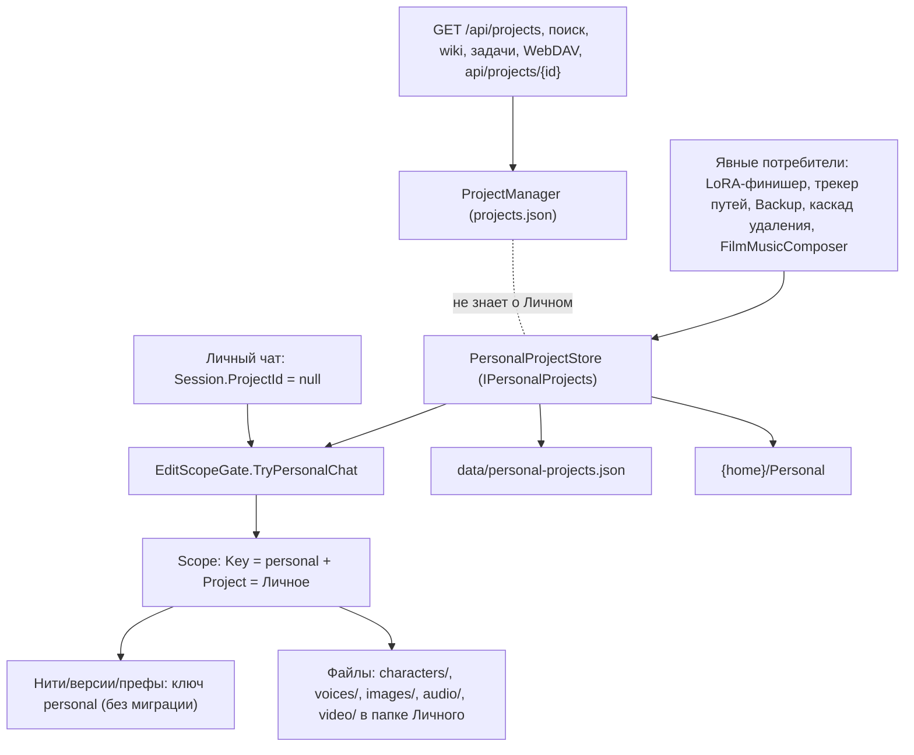

# ADR-040: проект «Личное» для личных чатов в отдельном сторе (Ф2 медиа-редакторов)

- **Статус:** принято 2026-11-13 (решения Андрея — в разделе «Решения Андрея»). Код Ф2 начат отдельной веткой. Предложено 2026-11-13 (задача 5dacf319); **v2 от 2026-11-13** — «Личное» хранится не в `projects.json`, а в отдельном `data/personal-projects.json` (решение Андрея, задача d706672b).
- **Вход:** решение Андрея «проект „Личное“ на пользователя: личные чаты используют его папку для персонажей, голосов, файлов, сохранения и фильмов»; разрез `docs/research/image-editor-personal-chats-cut-2026-09.md`; [ADR-016](ADR-016-local-project.md) (локальный проект), [ADR-021](ADR-021-audio-editor-and-generation-panel.md), [ADR-022](ADR-022-video-editor.md). Код сверен по `master` d4cd253bb.
- **Связано:** Ф1 (ветка `feat/personal-local-media`) снимает запрет локальных видео/звука/«Увеличить» для личных чатов и **с этим ADR не пересекается**: Ф1 не требует папки. Прямые инструменты local-media в личных чатах по-прежнему не нужны.

## Решения Андрея (2026-11-13)

Все рекомендации по вопросам 1–6 приняты:

1. Путь папки — `{home}/Personal`.
2. Администратор «Личное» не видит ни в каких списках.
3. Раздела «Мои файлы» на первом шаге нет (`ImageThreadPathTracker.Retarget`, WebDAV и `FileWatcher` для «Личного» не подключаются).
4. Агент работает с файлами «Личного» только через MCP-инструменты медиа.
5. При удалении пользователя запись из `personal-projects.json` удаляется (`DeleteOf`), папка остаётся.
6. Бэкап папки `Personal` — отдельной задачей после Ф2, не часть этого ADR.
7. Хранение — отдельный `data/personal-projects.json`, выкатка одним релизом (закрыто в v2).

Ф1 влита в master (`2f70b7c77`) и выкатывается из чата «Локальные медиа». Ф2-код идёт в ветке `feat/personal-project-folder` от этого master, без мержа и выкатки до решения Андрея.

## Что изменилось в v2

| Было (v1) | Стало (v2) | Почему |
|---|---|---|
| запись `Kind = Personal` в общем `data/projects.json`, скрытие в `ProjectManager` | отдельный стор `PersonalProjectStore` поверх `data/personal-projects.json`, `projects.json` не меняется | старый бинарник после отката читает `projects.json` и показал бы «Личное» как обычный проект (и `ProjectBackgroundBackfill` мог бы запустить платную генерацию фона). Файл, которого он не знает, он не читает: скрытие получается само |
| ~40 мест «скрыть» + архитектурный тест на `_projects` | ничего скрывать не нужно; ~10 мест «подключить явно» (§2) | «Личное» просто не лежит в сторе, который перечисляют |
| релиз A (скрытие) → релиз B (создание) | один релиз на любом стенде | откат на бинарник до фичи безопасен без второго релиза (§6) |
| `GetById` не меняется, вход закрыт в `ProjectAccess` | `GetById` fail-closed: смотрит только в `projects.json`; отдельный `GetByIdIncludingPersonal` (§2) | закрыть вход одним местом вместо «закрыть в каждом из 251 вызова» |

## Контекст

У личного чата `Session.ProjectId == null`. Из-за этого три медиа-редактора (картинки, звук, видео) держат «личную область» (`ImageEditScope` / `AudioEditScope` / `VideoEditScope`: `Key == "personal"`, `Project == null`). Всё, что читает или пишет диск проекта, в такой области отказывает ДО обращения к `RootPath`:

| Пробел | Где сейчас отказ |
|---|---|
| персонажи, подстановка лица (`characters/<slug>/`) | `CharacterStore` работает от `RootPath`; ручки `characters*` есть только в `api/projects/{pid}/image-editor`, у `PersonalImageEditorController` их нет |
| голоса (`voices/`, библиотека «Голоса») | `VoiceLibrary.ProjectOnly…`, `PersonalAudioEditorController` отвечает `available:false` |
| входы из файлов (образцы, кадр A/B, звук из файла, куски склейки) | `AudioOpInputs.cs:116` «у личного чата путей проекта нет», `AudioConcatService.cs:173/227` |
| сохранение результата | «скачать её может только человек» (`ImageEditorToolset.cs:614`, `AudioEditorToolset.cs:469/488/563`) |
| фильмы, «сохранить сцену» | `personal_scope_no_films` (`FilmService.cs:45`, `VideoSceneService.cs:54`, `VideoEditorToolset.cs:739`, `PersonalFilmController`) |
| локальный движок | `LocalAudioEngine.cs:46`, `LocalVideoEngine.cs:92` — `scope.IsPersonal || scope.Project is not {}` (этот пункт трогает Ф1, не Ф2) |

Рабочая папка личного чата уже есть: `SessionManager.ResolveChatRoot` → `{домашняя папка владельца}/Chats` (создаётся лениво; для container-пользователей — внутри `Sandbox:ProjectsRoot`). Но это папка процесса `claude`, не проект: у неё нет записи в сторе, владельца-проекта, прав и путей «от корня проекта».

## Решение (кратко)

1. На каждого пользователя — **один проект «Личное»** с настоящей папкой на диске, лежащий в **отдельном сторе** `PersonalProjectStore` (`data/personal-projects.json`, одна запись на владельца). Модель — тот же `Project`; `Kind = Personal` остаётся маркером. Создаётся **лениво**, при первой потребности.
2. **Ключ области остаётся `"personal"`.** Подмена касается только `Project`: у личной области `Project` перестаёт быть `null` и указывает на проект «Личное». Все нити, версии, префы, задачи, трата, избранное ключуются по `"personal"` и **не мигрируют**.
3. Подмена — **только для медиа-подсистем**. `Session.ProjectId` у личного чата остаётся `null`; «чат вне проекта» везде вне медиа сохраняет прежний смысл.
4. «Личное» **не видно ни в одном перечислении и не достижимо через `api/projects/{id}/…`**, потому что **его нет в `ProjectManager`**: `GetAll/GetByOwner/GetAccessible/GetById/GetByRootPath` смотрят только в `projects.json`. Скрытие — не фильтр, а свойство хранилища (fail-closed по построению). Явный доступ — `IPersonalProjects.GetPersonalOf` / `EnsurePersonalAsync` / `GetByIdIncludingPersonal` для короткого списка мест (§2).
5. Папка не общая, шаринг невозможен (членов нет, `api/projects/{id}` её не достигает), права — только владелец.



## 1. Хранение и папка

### 1.1. Стор `PersonalProjectStore`

- **Файл:** `{каталог DataPath}/personal-projects.json` — путь вычисляется как у остальных сторов (`Path.GetDirectoryName(config["DataPath"] ?? …/data/projects.json)`, образец — `Program.cs:180`, `ChangelogService.cs:31`), то есть рядом с `projects.json`.
- **Формат:** `List<Project>`, не более одной записи на `OwnerId`; `Kind = Personal` у каждой (маркер для защиты в глубину: код, получивший `Project`, может отличить «Личное»).
- **Запись:** `JsonFileStore.Save` — сериализация во временный файл + fsync + замена (`JsonFileStore.cs`, заголовочный комментарий): крэш посреди записи целевой файл не портит. Конкурентная запись — `lock (_saveLock)` как у `ProjectManager.Save()` (`ProjectManager.cs:941`), «локов `JsonFileStore` не берёт — синхронизация на стороне вызывающих». Мутации редки (создание записи, правки метаданных), нагрузка пренебрежимо мала.
- **Чтение:** `JsonFileStore.Load` — битая запись пропускается (копия исходника `.partial-*.bak`), повреждённый файл целиком переименовывается в `.corrupt-*.bak`, состояние поднимается из прошлого `.bak`, иначе пусто + алерт `DataLossSink`. Для стора «Личного» «пусто» безопасно: следующий `EnsurePersonalAsync` пересоздаёт запись по тому же пути (папка и файлы на диске не потеряны — см. §6, риск 5).
- **Интерфейс:** `IPersonalProjects` в Core (вертикали медиа не ссылаются на Main, как `IProjectRootLookup`); реализация — `PersonalProjectStore` в Main (`Services/Composition`). Методы:
  - `Project? GetPersonalOf(string ownerId)` — только чтение, не создаёт;
  - `Task<Project> EnsurePersonalAsync(string ownerId, CancellationToken)` — идемпотентно, под per-владельцем семафором (паттерн `DefaultAssistantProvisioner._locks`);
  - `Project? GetByIdIncludingPersonal(string id)` — запись «Личного» по id либо `null`;
  - `IReadOnlyCollection<Project> GetAllPersonal()` — для немногих инфраструктурных потребителей (Backup, LoRA-финишер);
  - `bool DeleteOf(string ownerId)` — для каскада удаления пользователя (запись, не папка).
- **Что остаётся в `ProjectManager`:** ничего нового. `ProjectManager` не ссылается на стор «Личного» в перечислениях (единственное исключение — `EnsureRootFree`, см. 1.3).

### 1.2. Где лежит папка

- **Путь:** `{UserHomeResolver.Resolve(user)}/Personal` (рядом с `Chats`, не внутри неё). Домашняя папка резолвится тем же `UserHomeResolver`, что и для «Нового проекта» и `ResolveChatRoot`: у container-пользователя она внутри `Sandbox:ProjectsRoot` (`EnsureRootAllowed` проходит), у local — `DefaultProjectsPath/{username}` или override конфига.
  - Почему не `Chats`: это рабочая папка процесса `claude`, в ней оседает мусор агента; имена `characters/`, `voices/`, `video/` могут столкнуться с чужими файлами; снаружи `Chats` корень проекта сделал бы всё содержимое чатов видимым в `FilesController` / WebDAV.
  - Почему не точка `.personal`: `ShowHiddenFiles`, git-игноры и `FileWatcher` по-разному обходят dot-папки; скрытость обеспечивает запись в сторе, а не имя папки.
- **Как создаётся:** `EnsurePersonalAsync(ownerId)`: под семафором перечитать → если записи с этим владельцем нет — `Directory.CreateDirectory` + запись в стор. Если запись есть, но папка исчезла (или путь недопустим для container-пользователя, например после восстановления бэкапа на другой машине) — пересоздать папку по записанному пути, а при недопустимом пути пересчитать путь и обновить запись.
- **Lazy, не при регистрации.** Причины: (а) существующим пользователям запись всё равно надо создавать, значит нужен ленивый путь; (б) подавляющее большинство пользователей медиа в личных чатах не используют; (в) нет побочных эффектов в `UsersController.Create` и `DefaultAssistantProvisioner`. Точки вызова — только записывающие: гейт области личного чата при первом запросе, которому нужен диск, и MCP-инструмент медиа с таким аргументом. GET-путь, который только перечисляет, папку **не создаёт** (мутация не должна жить на GET).
- **Инвариант «одна запись на владельца»:** держит `EnsurePersonalAsync` под семафором + проверка при `Load` (при дубле — оставить старейшую запись, остальное логировать). Дубль возможен только при ручной правке файла.

### 1.3. Корень-коллизия

- **Создание «Личного» поверх существующего пути:** если путь `{home}/Personal` занят — каталогом (пользователь сам создал папку `Personal`) это нормально, берём его; если его `FolderKey` совпадает с корнем обычного проекта владельца (`ProjectCapabilities.FolderKey`), берём `Personal-2`… (фактический `RootPath` хранится в записи и заново не вычисляется).
- **Обратная коллизия (находка v2):** `ProjectManager.EnsureRootFree` перебирает только `_projects`. Пользователь, подключивший как обычный проект папку `{home}/Personal`, получил бы «близнеца» «Личного»: общая папка, и тогда `ProjectKnowledgeSyncService` завёл бы Dify-датасет на корень с персонажами и фото, а `GetByRootPath`-каскады путали бы владельцев. Поэтому `EnsureRootFree` (`ProjectManager.cs:101`) дополнительно сверяется с корнем «Личного» этого владельца (узкая зависимость от `IPersonalProjects`) и отвечает «Эта папка занята служебным проектом». Это единственное место `ProjectManager`, которое знает о «Личном» (шаг Ф2-1).
- **Вложенность:** обычный проект на `{home}` (родитель `Personal`) допустим и сегодня; его `FileService` покажет `Personal/` как подпапку. Это доступ того же владельца к собственным файлам, не утечка; не блокируем.

### 1.4. Бэкап (проверено по коду)

**`data/personal-projects.json` попадает в бэкап вместе с `data/` без доработок.**

- Состав — по `BackupCore` (снапшот и zip используют один перечислитель): обход `ctx.DataDir` целиком (`BackupCore.cs:236-263`), файл отбирается `BackupPaths.ShouldInclude(relative)` (`BackupPaths.cs:33`). Фильтр — **чёрный список**: исключаются `.credentials.json`, `*.tmp`, `*.part`, `*.corrupt-*`, `*.partial-*` (копии исходника при частичном подъёме стора), `backup-state.json`, `.post-restore`, PID-реестр, `logs/`, `sandbox-tmp/`, кеши, папки архивов/секретов, реестр секретов `InstanceSecretFiles.Names` (`jwt-secret.txt`, `vapid-keys.json`, `module-keys.json`, `mcp-secrets.json`, `plugin-secrets.json`) и профили claude кроме `projects/**`. `personal-projects.json` ни под одно правило не попадает (лежит в корне data, не в `ProfileRoots`, не секрет, не временный) → включается. Копии `personal-projects.json.partial-*.bak` / `.corrupt-*.bak` исключены, как у всех сторов — штатно.
- Шаг «закрепить»: строка в тестах `BackupPaths.ShouldInclude` (`personal-projects.json` → `true`, `personal-projects.json.partial-….bak` → `false`) — в Ф2-1, чтобы будущее изменение фильтра не вычеркнуло файл молча.
- **Что в бэкап не попадает:** сама папка `{home}/Personal` (файлы персонажей, фото, сохранённые результаты) — она вне `data/`, как у любого проекта: `BackupService` берёт `RootPath` проектов только для `ValidateBackupPath`. Расширять бэкап на папки проектов — отдельное решение (вопрос 6).
- **Восстановление:** после restore запись стора вернётся, а папки на новой машине может не быть → `EnsurePersonalAsync` пересоздаёт её (п. 1.2); файлы пользователя восстанавливаются только если папка бэкапилась отдельно.
- **`BackupService.ValidateBackupPath` (`BackupService.cs:82`):** `roots = projects.GetAll()…` — это перечисление «Личного» не отдаёт, поэтому путь архива внутри `{home}/Personal` прошёл бы проверку «не внутри проекта». Добавить `GetAllPersonal()` в список корней (шаг Ф2-1).

## 2. Где «Личное» нужно подключить явно

Принцип: **«Личное» не в `ProjectManager`, поэтому всё, что перечисляет или ищет проекты по id/RootPath/имени, его не видит — и это правильно.** Явный доступ нужен лишь тем, кто *обязан* работать с папкой «Личного» (медиа-подсистемам) или чистить за ним. Таких мест немного; новый код забудет подключить «Личное» → получит «проекта нет» (безопасный отказ), а не утечку.

### 2.1. Явный список (подключить)

| Место | Что делает сейчас | Что нужно |
|---|---|---|
| `ImageEditScopeGate`, `AudioEditScopeGate`, `VideoEditScopeGate` (`TryPersonalChat`) | собирают область личного чата с `Project = null` | `EnsurePersonalAsync/GetPersonalOf` → `Project` в области; доступ — «вызывающий = владелец чата», **не** через `IProjectAccess.Resolve` (он по id, см. 2.3). Исключения в `DirectProjectAccessAllowList.txt` остаются как есть (личная ветка уже учтена) |
| `PersonalFolderResolver` (новый компонент Ф2: единая точка «папка личной области») | **в `master` и ветках его нет** (проверено `git grep`); в ADR v1 имя использовалось как существующее | завести в Ф2-2: обёртка над `IPersonalProjects` с кодами отказа `personal_scope_*` («папка недоступна»). Единственный легальный потребитель стора из медиа-кода |
| MCP-тулсеты `ImageEditorToolset.TryResolve` (`:908`), `AudioEditorToolset` (`:721`), `VideoEditorToolset` (`:758`) | личный чат → `Scope.Of(session)` без проекта | у личного чата брать область через тот же гейт/`PersonalFolderResolver`; для проектного чата без изменений (`GetById` по `owned.ProjectId` — проектный путь) |
| `LoraTrainingFinisher` (`:60,68,77,93,105,119`) | `projects.GetById` и `projects.GetAll()` для персонажей/задач обучения | объединить перебор проектов с `GetAllPersonal()`, а `GetById` → `GetByIdIncludingPersonal` (иначе обучение LoRA личного персонажа не завершится, а «удаляется» не вычистится) |
| `ImageThreadPathTracker.Retarget` (`:44`) | `projects.GetByRootPath(root)` → владельцы для переноса путей нитей при переименовании файла | для «Личного» нужно только если файловое API «Личного» появится (вопрос 3); на первом шаге файла-переименований из UI нет → **не подключать**, зафиксировать «подключить вместе с разделом „Мои файлы“» |
| `FilmMusicComposer` (`:90`) | `projects.GetById(projectId)` по событию фильма | фильм личной области → `GetByIdIncludingPersonal` (шаг Ф2-6) |
| `ImageFrameSource` (`:36`), `AudioTrackSource` (`:52`) | `projects.GetById(scopeKey)` для области проектного чата; для `personal` ветка пропускается по ключу | личная ветка: брать корень из `scope.Project` (шаги Ф2-3/Ф2-5); `GetById` не расширять |
| `BackupService.ValidateBackupPath` (`:82`) | `projects.GetAll()` как «корни проектов» | добавить `GetAllPersonal()` (см. 1.4) |
| `ProjectManager.EnsureRootFree` (`:101`) | дубль корня среди проектов владельца | сверка с корнем «Личного» (1.3) |
| Каскад удаления пользователя (`UsersController.Delete` `:97` → `UserKnowledgeCascade.CleanupAsync`) | удаляет пользователя и знания; записей проектов **не** удаляет (проверено, отдельного каскада проектов нет) | `IPersonalProjects.DeleteOf(user.Id)` — запись стора «Личного» удаляется; папка не трогается (вопрос 5). Обычные проекты каскад по-прежнему не удаляет — не меняем |
| Контекст-хуки `*StateContributor` | блок про папку при `HasFolder` | только `scope.Project` из области; стора не знают |

### 2.2. Что подключать **не** нужно (проверено по коду)

Всё, что перечисляет проекты через `ProjectManager`, «Личного» не видит. Полная таблица — в **Приложении А**: по ней видно, что добавлять ничего не нужно. Отдельно отмечены места, из которых «Личное» *не должно* быть достижимо и которые «закрыты по построению»:

- **`LocalImageAdopter` (`:25-27`), `LocalAudioAdopter` (`:41-43`):** `session.ProjectId == adoption.ProjectId` + `GetById` — это усыновление локальных результатов проектного чата; у личного чата `ProjectId == null`, в эти ветки он не заходит (Ф1 решает личные локальные медиа отдельно).
- **`LocalMediaProjectAccess` (`:17,30`), `LocalMediaToolset` (`:445`):** local-media в личных чатах не нужен (см. «Связано»).

### 2.3. Проверка путей «по id» и «по RootPath» (находка v2, обязательная)

Цель: убедиться, что «Личное» нельзя достичь пользовательским вводом (id проекта, имя, путь), и что ни одно «внутри проекта?» не примет путь «Личного» за чужой.

**Вывод: пропустить «Личное» нечем — ни один найденный путь не обращается к стору «Личного».** Детали:

| Путь | Как работает | Итог для «Личного» |
|---|---|---|
| `ProjectAccessService.Resolve(caller, projectId)` (`ProjectAccessService.cs:21`) | `projects.GetById(id)` → `ProjectAccess.Can(null, …)` → `null` | **fail-closed**: id «Личного» → `null` → отказ (404) во всех контроллерах `api/projects/{projectId}/…` с `[ProjectScope]`. `ResolveSession` (`:42`): личный чат (`ProjectId == null`) идёт по ветке «владение чатом» — как сейчас |
| `ProjectScope`-фильтры и контроллеры `api/projects/{id}/…` | идут через `IProjectAccess` (сторож `DirectProjectAccessGuardTests` запрещает прямые вызовы `ProjectAccess.Can/Check` вне allow-list) | закрыто тем же `GetById`; `GetProject` в `FilesController` (`:45,57`) — `KeyNotFoundException` → 404 |
| `FilesController`, `GetProjectByOfficeToken` (`:57`) | `GetById` + `access.Resolve(..., Write)` | 404, id «Личного» неизвестен |
| WebDAV (`WebDavHandler.cs:137,361`) | `projects.GetAccessible(userId)` по **имени** проекта | в списке «Личного» нет; имя «Личное» не резолвится, коллизий имён с обычным проектом нет |
| `ProjectManager.GetByName` (`:91`) | поиск по имени | вызовов вне самого класса нет; «Личное» не находит |
| `GetByRootPath` — `FileService.OwnerOf` (`FileService.cs:37`), `CodeGraphService` (`:400`), `ProjectKnowledgeSyncService` (`:282,300,422`), `UserKnowledgeCascade` (`:67`), `DossierAutoExportGate`, `DossiersController` (`:150`), `ProjectsController` (`:431`), `ProjectRootLookup` | ищут проекты по корню папки | «Личное» не найдут: ни датасета Dify, ни графа кода, ни досье, ни «владельца корня» для git. Для `FileService.OwnerOf` это значит: git-операции в папке «Личного» «без владельца» — но git для «Личного» и не нужен (git-сервисы к нему не ходят). Для `ImageThreadPathTracker` — см. 2.1 |
| `FileWatcherService.Watch` (`:123`) | `GetById(projectId)` → вотчер на `RootPath` | вотчер на «Личное» не заводится (id неизвестен); внешних правок папки сервер не отслеживает — как у не открытых проектов; нужно ли — решается вместе с вопросом 3 |
| `PathGuards.IsInside` / `SafePath` / `FileService.SafeJoinPublic` | чистые функции «путь внутри корня», корень передаёт вызывающий | собственной выборки проектов не делают: путь «Личного» будет проверяться против `Project.RootPath` из `scope.Project` (медиа), а не против списка проектов; чужой проект «Личным» не станет |
| `SandboxManager` | монтирует `Sandbox:ProjectsRoot` целиком (`/projects`, `:187`) | container-агент **физически** видит `{home}/Personal` внутри `ProjectsRoot` (как и папки других своих проектов) — относится к вопросу 4 |
| `PermissionRules` | в `backend` отдельного файла с таким именем нет (проверено `git ls-files`); права агента определяются `cwd` процесса и песочницей | расширения прав на «Личное» не нужно: сервер пишет в папку сам, не агент |
| `PersonaAgentFileSync`, `GitAutoCommitService`, `HumanEditCommitter`, `WorktreeCleanupService`, `GitController` | ходят по проектам из `ProjectManager` | «Личное» не видят: файлов агентов, коммитов и воркдеревьев в нём нет |
| `UsersController.Update` (смена имени) | перерасчёта корней нет | корень «Личного» хранится как есть и не пересчитывается |

**Единственный путь, который мог бы привести к «Личному» по id, — `GetByIdIncludingPersonal`, и он вызывается только из явного списка 2.1 (LoRA-финишер, `FilmMusicComposer`, область медиа), где id берётся из *серверного* состояния (задача обучения, событие фильма, область личного чата), а не из пользовательского ввода.** Новый вызов — это осознанная строка в коде; на него добавляется сторож (шаг Ф2-1, см. §7): `GetByIdIncludingPersonal`/`GetAllPersonal` разрешены только в allow-list файлов (как `DirectProjectAccessAllowList.txt`).

### 2.4. Решение по `GetById`: два стора или отдельный метод

| Вариант | Плюсы | Минусы |
|---|---|---|
| **А.** `ProjectManager.GetById` смотрит в оба стора | старые вызовы `GetById` продолжают работать для «Личного» (LoRA, `FilmMusicComposer`) | `ProjectAccessService.Resolve` и ещё ~250 мест (`GetById` из пользовательского `{projectId}`) начинают отдавать «Личное»: `ProjectAccess.Check` для владельца пройдёт → открываются `PUT/DELETE api/projects/{id}`, шаринг, `FilesController`, git, фон/значок (платная генерация), `api/projects/{id}/image-editor` и т. д. Пришлось бы закрывать в каждом контроллере — ровно та хрупкость, от которой уходим |
| **Б (выбрано).** `GetById` — только `projects.json`; `GetByIdIncludingPersonal` — отдельный метод на `IPersonalProjects` | fail-closed по умолчанию; новый код получает «проекта нет», а не доступ; места из 2.1 осознанны и найдены грепом; сторож на новые вызовы | ~4–5 мест надо поправить явно (LoRA-финишер, `FilmMusicComposer`, тулсеты, гейты) — но именно они и *обязаны* знать про «Личное» |

Выбран **Б**: безопаснее при любой ошибке реализации (забыли подключить → отказ «нет папки», а не доступ). `IProjectManager` (Core, шов Notes) наследует поведение автоматически и расширения не получает.

## 3. Права

- **Владелец** — пользователь; `Project.OwnerId = userId`. `Members` пуст всегда.
- **Шаринг:** невозможен по построению — `api/projects/{id}/members` и приглашения «Личного» не достигают (id неизвестен `ProjectManager`). `SharedProjectsGate` и `OwnerHasMembers` стор «Личного» не видят; `GetAccessible` его не отдаёт.
- **Админ:** доступа через API нет (как и к чужим личным чатам: админ **не** обходит `SessionAccess.CanSee` для приватных чатов). Прямой доступ к диску у администратора сервера есть, как и ко всем папкам проектов; специальных ручек не заводим.
- **Кто видит:** только владелец и только через медиа-панели (списки персонажей/голосов, версии, фильмы) и агент личного чата. Агент видит файлы через MCP-инструменты медиа (они резолвят `Project` из области), а не через `wsp.files_*` — те работают по `projectId` и скрытого не знают.
- **Удаление пользователя.** `UsersController.Delete` удаляет запись пользователя и вызывает каскад знаний; записи проектов пользователя **не удаляются** (проверено по `UsersController.cs:97-130`, `UserKnowledgeCascade`). Для «Личного»: каскад вызывает `IPersonalProjects.DeleteOf(userId)` — **запись стора удаляется**, **папка не трогается** (как у обычных проектов: файлы пользователя ≠ данные приложения). Нити и версии вертикалей по ключу `personal`/`tenant` — вопрос существующего каскада, Ф2 его не меняет.
- **Смена имени пользователя** (`UsersController.Update`) корень не затрагивает: путь хранится в записи как есть и не пересчитывается.

## 4. Как личные чаты ссылаются на проект

**Решение: подмена `Project` в области — только для медиа-подсистем.** `Session.ProjectId` остаётся `null`.

```
ImageEditScope.Of(session)           // как сейчас: Key="personal", Project=null — для сопоставления по ключу
gate.TryPersonalChat(...)            // новое: scope = Of(session) with { TenantOwnerId, Project = personal.EnsurePersonalAsync(owner) }
IsPersonal                           // остаётся «ключ личный» — нужен для ключей хранилищ и текстов
scope.HasFolder => Project is not null   // новый признак: «есть диск, можно читать/писать»
```

Что меняется в коде медиа: проверки вида `scope.IsPersonal || scope.Project is not {} …` (`LocalAudioEngine:46`, `LocalVideoEngine:92`, `AudioConcatService:173/227`, `AudioOpInputs:116`, `VideoSceneService:54`, `FilmService:45`, `VideoEditorToolset:739`) заменяются на `!scope.HasFolder`; тексты «скачать может только человек» → «сохранить в проект/в Личное». Отдельная проверка `IsPersonal` для **ключей** (`ProjectIdOf`, трата, префы, `Key == "personal"`) остаётся: нити по-прежнему ключуются `"personal"`, трата личной области по-прежнему пишется без проекта (`ProjectIdOf` → `null`), чтобы статистика проекта не получила «Личное».

**Почему не полная подмена (`Session.ProjectId = personalId`):**
1. Личные чаты стали бы «чатами проекта»: список «Чаты», вкладки, права (`SessionAccess`), счётчики `CountByProject`, ветвление, `CliRoute.GetChatRoot` (cwd стал бы `Personal`, но не `Chats`), транскрипты, git-бар, `ChatsController` (`ProjectId is null && OwnerId == UserId`), контекст-хуки и экраны проекта. Плюс в v2: `ProjectManager.GetById(session.ProjectId)` вернул бы `null` для такого чата — сломались бы все проектные пути сессий (`ProjectAccessService.ResolveSession` и др.).
2. Нити ключуются `"personal"` специально (ветвление личного чата копирует нити по владельцу, ключ «на чат» терял бы версии) — полная подмена потребовала бы миграции всех нитей.
3. Откат тривиален: достаточно вернуть `Project = null` в гейте.

**Что остаётся «чат вне проекта» (не трогаем):**
- контекст-хуки `ChatContext`/`*StateContributor`: ключи по-прежнему `personal`; хук добавляет блок «папка проекта доступна» только когда `HasFolder`;
- MCP-инструменты `wsp`/`tasks`/`notes`: личный чат по-прежнему работает с личными задачами/заметками, `wsp.files_*` в «Личное» не ходит (id не отдаётся ни одним списком);
- Git-бар: у личного чата git-репозитория нет, у «Личного» его тоже нет;
- права на файлы: запись в `Personal` делает сервер (без Bash агента), права процесса `claude` не расширяются (читает ли агент файлы «Личного» по абсолютному пути из tool-результата — вопрос 4);
- коды `personal_scope_*`: `personal_scope_no_films` исчезает для случая `HasFolder`; остаётся как отказ при невозможности создать папку (нет домашней папки у container-пользователя, нет места); `local_unavailable_personal` — снимает Ф1, не Ф2; `PersonalScopeReason` — вариант текста «папка недоступна».

## 5. Существующие личные нити

**Лежат как есть — миграции нет.** Ключ остаётся `"personal"`, нити, версии, история задач, избранное, префы, трата, события SignalR ключуются им и не меняются. Новая функциональность аддитивна: после первого `EnsurePersonalAsync` появляются каталоги `characters/`, `voices/`, `video/` и файлы-результаты; старые версии остаются в хранилищах вертикалей, а не в папке.

«Сохранить в проект» для **старой** личной версии теперь возможно, потому что `Project != null`: копировать байты версии в `Personal/<images|audio|video>/` (имя занято → `.v2`, перезаписи нет — как у `video_save_scene`). Переноса версий не нужно.

Откат: папка и запись в `personal-projects.json` безопасно переживают откат кода; после отката старый бинарник файл не читает, область снова `Project == null`. Повторная выкатка — `EnsurePersonalAsync` no-op, всё подхватывается. Данные в `Personal/` никогда не удаляются кодом ADR.

## 6. Выкатка, риски и отвергнутые альтернативы

### 6.1. Выкатка

**Один релиз, на любом стенде.** Схема «релиз A (скрытие) → релиз B (создание)» из v1 снята: скрытие в v2 не код, а свойство отдельного файла, поэтому разделять релизы не нужно. Стенд, получивший фичу и откатившийся на бинарник до неё, ничего лишнего не увидит (риск 1).

### 6.2. Откат

- **Откат кода (бинарник до фичи):** старый `ProjectManager` читает только `projects.json`; `personal-projects.json` ему неизвестен и игнорируется. «Личное» не появляется ни в одном списке, фон/значок для него не запускаются (записи в `projects.json` нет → `ProjectBackgroundBackfill` её не видит). Папка `{home}/Personal` и файл `personal-projects.json` **остаются** на диске нетронутыми; личные чаты возвращаются к `Project == null` (медиа-панели «без папки» — состояние до Ф2).
- **Повторная выкатка:** новый код читает `personal-projects.json`, `EnsurePersonalAsync` находит запись и папку — всё подхватывается, дублей нет.
- **Откат данных** (`data/` из бэкапа): файл возвращается вместе с остальным `data/`; папки может не быть → пересоздаётся (п. 1.2).
- Файл `personal-projects.json` бэкапится вместе с `data/` (п. 1.4), поэтому восстановление «из бэкапа до фичи» файл тоже убирает — это штатно: запись пересоздастся по тому же пути лениво.

### 6.3. Риски

1. **Откат бинарника** — закрыт отдельным файлом (6.2). Остаточное: ни старый бинарник, ни старый `Backup` не ломаются, но *старый* `Backup` положит файл в архив как неизвестный файл `data/` — безвредно.
2. **Утечка «Личного» в чужие перечисления** — исключена построением (нет в `ProjectManager`). Остаётся риск **обратный**: забытое явное подключение (2.1) → отказ «папка недоступна» у потребителя; ловится тестами по списку 2.1 и сторожем на `GetByIdIncludingPersonal`/`GetAllPersonal`.
3. **Платные побочные эффекты** (фон, значок через LLM; Dify-датасет; персоны-агенты) — недостижимы: `ProjectBackgroundBackfill`, `ProjectIconMigration`, `ProjectKnowledgeSyncService` читают `ProjectManager`.
4. **Container-пользователь без настроенной домашней папки** (`UserHomeResolver.NotConfiguredMessage`): `EnsurePersonalAsync` падает → медиа-панель в личном чате показывает «папка недоступна» вместо крэша.
5. **Битый или потерянный `personal-projects.json`:** `JsonFileStore.Load` — поэлементный подъём / откат на `.bak` / пустое состояние + алерт; запись «Личного» пересоздаётся лениво **по тому же пути** (по соглашению имени `{home}/Personal`), поэтому файлы на диске не теряются. Если пользователь успел переименовать папку — файлы останутся в старой, новая запись укажет на новую (потеря связи, но не данных); ловится алертом `DataLossSink`.
6. **Конкурентная запись в файл:** `lock (_saveLock)` на запись + атомарная замена через `JsonFileStore.Save` (tmp → fsync → Move) + per-владельцем семафор для создания; повторяет `ProjectManager`/`DefaultAssistantProvisioner`. Писатель один — процесс сервера.
7. **Дубль записи на владельца** — инвариант в `EnsurePersonalAsync` и на `Load` (оставляется старейшая, остальные логируются).
8. **Корень-коллизия** — `Personal-2` при создании; обратное направление закрыто в `EnsureRootFree` (1.3). Остаётся: пользователь вручную положил в `{home}/Personal` чужие файлы — это его папка, ничего не ломается.
9. **Права на файлы:** папка принадлежит процессу сервера, как и остальные; container-пользователь читает её через путь песочницы, не напрямую.
10. **Нагрузка:** отдельный маленький файл (одна запись на владельца, пишется при создании и редких правках), `projects.json` не растёт и не пересохраняется.
11. **Бэкап папки:** файлы «Личного» (персонажи, фото) вне бэкапа — как у любого проекта (вопрос 6); без отдельного решения потеря диска = потеря персонажей.
12. **Восстановление на другой машине:** запись хранит абсолютный `RootPath`; `EnsurePersonalAsync` пересчитывает недопустимый путь (п. 1.2).

### 6.4. Отвергнутые варианты

- **Запись «Личного» в `projects.json` + скрытие по `Kind` (v1):** откат на бинарник до фичи показывает «Личное» в списках и запускает платный фон; требует схемы «два релиза» и ~40 мест фильтрации.
- **Папка на чат** (`Chats/<sessionId>/…`): ветвление личного чата копирует нити по владельцу, а не по чату (см. комментарий в `ImageEditScope`); персонажи и голоса должны быть общими между чатами владельца.
- **Общая папка без проекта** (`{home}/Personal` и прямые пути в `CharacterStore`/`VoiceLibrary`): каждый потребитель ждёт `Project` и его `RootPath`; без записи пришлось бы дублировать резолв пути в 6+ местах.
- **Виртуальный проект без диска** (запись без `RootPath`): все файловые операции отказывают на «нет папки» — это и есть сегодняшний пробел.
- **Сменить `Session.ProjectId` у личных чатов на id «Личного»:** см. п. 4.
- **Тот же проект, что `Chats`** (`RootPath = {home}/Chats`): смешивает мусор агента с данными, открывает чат-папку в файловом интерфейсе.
- **`GetById` по двум сторам** — см. 2.4.

## 7. Разбивка Ф2-кода

Порядок и владение файлами; размер — оценка в строках кода с тестами.

| Шаг | Что | Файлы (владение) | Тесты | Размер |
|---|---|---|---|---|
| **Ф2-1** стор и сторож | `PersonalProjectStore` + `IPersonalProjects` (Core), DI; `Project.Kind` (маркер); `EnsurePersonalAsync/GetPersonalOf/GetByIdIncludingPersonal/GetAllPersonal/DeleteOf`; `EnsureRootFree` сверяется с корнем «Личного»; `UsersController` каскад; `BackupService.ValidateBackupPath` + строка в тестах `BackupPaths`; сторож на вызовы `…IncludingPersonal`/`GetAllPersonal` | `Core/Models/Project.cs`, `Core/Services/IPersonalProjects.cs`, `Services/Composition/PersonalProjectStore.cs`, `Services/ProjectManager.cs` (только `EnsureRootFree`), `Controllers/UsersController.cs`, `Services/Backup/BackupService.cs`, `Guards.Tests` | юнит стора (создание, идемпотентность, гонка, дубль, битый файл, `GetPersonalOf` не создаёт), `EnsureRootFree`, `ShouldInclude(personal-projects.json)`, «`GetAll/GetByOwner/GetAccessible/GetById` не отдают „Личное“» (регрессия на 2.3), каскад удаления | M (~350) |
| **Ф2-2** область | `HasFolder`, `PersonalFolderResolver`, `TryPersonalChat` кладёт `Project`, тулсеты берут личную область через гейт, замена `IsPersonal … Project is not {}` во всех движках/сервисах, тексты | `*EditScope.cs`, три `*EditScopeGate`, `*EditorToolset.TryResolve`, движки, `AudioConcatService`, `AudioOpInputs`, `VideoSceneService`, `FilmService`, тексты тулсетов | юниты по областям (с папкой/без), регрессия «ключ остаётся personal», контракт `ProjectIdOf` | M (~400) |
| **Ф2-3** сохранение и входы из файлов | «Сохранить» (картинки/аудио/видео) в `Personal/<вид>/`; образцы, кадр A/B, звук из файла, куски склейки; `ImageFrameSource`/`AudioTrackSource` личная ветка; копирование старых личных версий | `ImageEditor`/`AudioEditor`/`VideoEditor`: `…Save*`, `AudioOpInputs`, `AudioConcatService`, `VideoSceneService` | сохранение, `.v2`-коллизия, запрет выхода из корня и symlink, склейка из файлов | L (~700) |
| **Ф2-4** персонажи и подстановка лица | Личные ручки `characters*`, LoRA-обучение и версии; `character` в `image_generate`; `LoraTrainingFinisher` видит «Личное» (`GetAllPersonal`, `GetByIdIncludingPersonal`) | `PersonalImageEditorController`, `CharacterStore`-вызовы, `Image*Toolset`, `LoraTrainingFinisher` | CRUD персонажа в личной области, подстановка лица, LoRA-финишер | M (~500) |
| **Ф2-5** голоса | Личная библиотека голосов, `audio_voices`, TTS-клон | `PersonalAudioEditorController`, `AudioVoicesController`, `VoiceLibrary`, `AudioEditorToolset` | CRUD голоса, `cloneVoice` с проектным голосом | S (~250) |
| **Ф2-6** фильмы и «сохранить сцену» | Личные фильмы в `Personal/video/`, `personal_scope_no_films` убрать, `PersonalFilmController` отдаёт проектную реализацию; `FilmMusicComposer` → `GetByIdIncludingPersonal` | `PersonalFilmController`, `FilmService`, `FilmHttp`, `VideoEditorToolset`, `VideoEditorRoutes`, `FilmMusicComposer` | сборка фильма, сохранение сцены, переименование/удаление | M (~450) |
| **Ф2-7** фронт | Включить панели «Персонажи», «Голоса», «Фильмы», «Сохранить» для личных чатов; тексты; проверка, что «Личное» не светится в UI (его и не отдаёт ни один список) | `frontend/src/features/{imageEditor,audioEditor,videoEditor}`, контекст-хуки | компонентные + e2e | M–L (~600) |
| **Ф2-8** выкатка | один релиз; smoke: создание «Личного» на стенде, откат на предыдущий бинарник → «Личное» не видно, повторная выкатка → подхватилось | `deploy`, документация | smoke на проде | S |

**Что реально сделано в Ф2-2 (расхождения с текстом ADR):**

- `PersonalFolderResolver` лежит в Core (`Services/PersonalFolderResolver.cs`, namespace `Services.Composition`): `Find(ownerId)` — запись есть и папка на диске, ничего не создаёт; `EnsureAsync` — создаёт лениво, сбой папки → `null` (код/текст отказа — `UnavailableCode`/`UnavailableText`). `EnsureAsync` в Ф2-2 никто не вызывает: диск нужен только сохранению и входам из файлов (Ф2-3+), там он и подключается.
- Гейты (`TryPersonalChat`) и `TryResolve` тулсетов кладут `Project` через `Find`, а не `EnsurePersonalAsync`: гейт зовётся с GET-путей, MCP-вызов папку не создаёт. До Ф2-3 `Project` у личной области в проде остаётся `null` (папку никто не создаёт).
- Проверки «есть диск» заменены на `!HasFolder` только в `LocalAudioEngine`/`LocalVideoEngine` (поведение то же: личная область с папкой по-прежнему пускает local). `AudioConcatService:173/227`, `AudioOpInputs:116` (входы из файлов — Ф2-3), `VideoSceneService` (фильм/папка/кадр-файл), `FilmService.ProjectOf`, `VideoEditorToolset` (папка, `DescribeState`, `FilmsRefusal`), `VideoContextKind`, `VideoFrameReader` оставлены прежним отказом/веткой «рабочая папка загрузок» — замена открыла бы Ф2-3/Ф2-6 раньше срока. `VideoContextKind` различает «Личное» по `Project.Kind`.
- Ключи не тронуты: `Job.Scope.Project?.Id` в запросах локальных движков (`AudioEditJobService`, `VideoEditJobService`) заменён на `ProjectIdOf(Key)`, а `ImageContextKind` берёт ключ префов из `Session.ProjectId ?? personal` — иначе id «Личного» утёк бы в метку происхождения и ключ префов.
- Остальные `scope.Project is null`-отказы вертикалей (персонажи, образцы, файл нити, подстановка лица, голоса, `ProjectFileContextKind`) сняты автоматически, когда у области есть папка; живыми они становятся вместе с Ф2-3…Ф2-5 (папка до них не создаётся). Тексты «скачать может только человек» не менялись: сохранения в Личное ещё нет.

Порядок: Ф2-1 → Ф2-2 → {Ф2-3, Ф2-4, Ф2-5 параллельно после Ф2-2} → Ф2-6 → Ф2-7 → Ф2-8. Файлы вертикалей не пересекаются между Ф2-3/4/5 (картинки/звук/видео), общий — только Ф2-2. Шаг «бэкап» отдельным не выделяется: фильтр уже пропускает файл (п. 1.4), правка — одна строка теста и `ValidateBackupPath` в Ф2-1.

## 8. Вопросы к Андрею (закрыты 2026-11-13: приняты все рекомендации)

К каждому вписана рекомендация Артёма (технический консультант по инфраструктуре).

1. **Путь папки.** `{home}/Personal` (рядом с `Chats`) — или внутри `Chats`, или другое имя («Личное»)?
   **Рекомендация Артёма:** `{home}/Personal`. Внутри `Chats` — смешение с мусором процесса `claude` и риск открыть содержимое чатов через файловый интерфейс; кириллическое имя — лишние проблемы с путями в песочнице и скриптах. Латиница в имени папки, «Личное» — в интерфейсе.
2. **Видимость администратору.** Админ не видит «Личное» ни в каких списках — или нужен режим «посмотреть чужое Личное» для поддержки?
   **Рекомендация Артёма:** не видит. Для поддержки у администратора и так есть доступ к диску; отдельная ручка расширяет поверхность доступа к чужим файлам без нужды.
3. **Просмотр папки.** Нужен ли пользователю доступ к `Personal` вне медиа-панелей (раздел «Мои файлы», WebDAV, скачивание)?
   **Рекомендация Артёма:** на первом шаге — нет, только панели. Раздел «Мои файлы» тянет за собой `FilesController`/WebDAV/`FileWatcher`/`ImageThreadPathTracker` и явные подключения; делать отдельной фичей после Ф2.
4. **Агент и файлы.** Разрешить агенту личного чата читать/писать файлы в `Personal` (Read/Bash по пути) или только через MCP-инструменты медиа?
   **Рекомендация Артёма:** только через MCP-инструменты медиа. Прямой доступ расширил бы права процесса; учесть, что у container-пользователя `Personal` в смонтированном `/projects` физически виден (2.3), но без инструкции и намерений агента — это не часть контракта.
5. **Удаление пользователя.** Удалять ли папку `Personal`?
   **Рекомендация Артёма:** папку не удалять, как у обычных проектов; запись `personal-projects.json` удалять (каскад `DeleteOf`). Удаление файлов пользователя — необратимое действие, его можно сделать вручную.
6. **Бэкап файлов.** Включать ли папку `Personal` в бэкап (сейчас файлы проектов вне бэкапа; персонажи и фото — данные, которые жалко потерять)?
   **Рекомендация Артёма:** отдельной задачей после Ф2 — общий вопрос «бэкап папок проектов», а не специальный случай одного проекта; до этого — держать в уме, что потеря диска = потеря персонажей. Сам `personal-projects.json` в бэкап уже едет (1.4).
7. ~~**Порядок выкатки.**~~ **Закрыто (v2):** один релиз на любом стенде — откат на бинарник до фичи безопасен, потому что «Личное» лежит в файле, которого старый бинарник не читает (6.2).

## Приложение А. Все места перечисления проектов (аудит «добавлять ничего не нужно»)

Найдены грепом по `GetAll/GetByOwner/GetAccessible/GetByRootPath/GetByName`. В v2 все они читают `ProjectManager` (`projects.json`), в котором «Личного» нет, поэтому **никакого изменения кода не требуется**. Колонка «Итог» — что произойдёт с «Личным».

| Место | Что делает | Итог |
|---|---|---|
| `ProjectsController.GetAll` (`:137`) + `GET/PUT/DELETE api/projects/{id}`, `SetMembers` | список проектов, карточка, шаринг | «Личного» нет; по id — 404 |
| `HomeController` (`:29`) | словарь id→имя для ленты | нет; у личных чатов `ProjectId == null` |
| `WorkspaceToolset` `projects_list` (`:479`), `tasks_list_projects` | MCP «Список проектов» | нет |
| `UnifiedSearchService` / `search_unified` | поиск по заметкам и задачам | нет (через `NotesService.SourcesFor` и имена проектов задач) |
| `NotesService` (`:250`), `WikiController` (`:154`), `NoteExpiryService` (`:44`), `NoteTaskSyncService`, `WikiSourceHome` | источники заметок `notes/` проекта, разделы вики `projects/{id}`, уборка временных заметок | нет; ключ `personal` вики — **другое**, личный раздел остаётся как есть |
| `TasksController` (`:1388`), `MyTasksQuery`, `FeatureQueueService`, `ReviewTreePool`, `TaskExecutionService` | задачи по проектам | нет; задачи личных чатов остаются `ProjectId == null` |
| `PersonasController` (`:164`, `:1351`, `:1543`), `PersonasCrudService`, `PersonaBindingsService`, `PersonaAgentFileSync`, `PersonaAutomationService`, `PersonasToolset` | привязка персон к проектам, файлы агентов в `.claude/agents` проекта | нет: персона не привяжется к «Личному», файлы агентов туда не пишутся |
| `DailyBriefingService` (`:252`), `DossierAutoImporter`, `DossierCaptureService`, `DossiersController` | сводка дня, досье изменений | нет |
| `TelemetryController` (`:67`), `ServerMetrics` | статистика и метрики | нет; id «Личного» в метках не появляется (трата личной области — `ProjectIdOf` → `null`) |
| `ProjectBackgroundBackfill`, `ProjectIconMigration`, `ProjectBackgroundWriterAdapter` | генерация фона и значка (платный LLM) | **нет** — платной генерации для «Личного» не будет, в том числе после отката/повторной выкатки |
| `ProjectKnowledgeSyncService`, `UserKnowledgeCascade`, `DifyDatasetId` | датасеты Dify на папку проекта | нет: датасета не заводится |
| `CodeGraphService` (`:400`), `ProjectServices*`, `DevServerService`, `ProjectServiceDiscovery`, `SessionHandsController`, `ProjectRunCaller` | граф кода, dev-серверы, «руки» | нет |
| `GitAutoCommitService`, `HumanEditCommitter` (`:142`), `CommitAttributionService` (`:85`), `WorktreeCleanupService` (`:85`), `GitController` | git-операции проекта | нет: папка не репозиторий |
| `FileWatcherService`, `ProjectFileSessionsIndex`, `ChatArchiveService` (`:107`), `ChatSubjectSweeper` (`:96`), `ProjectsController` (счётчики сессий) | обход проектов и чатов | нет; чатов у «Личного» нет |
| `WebDavHandler` (`:137`, `:361`), `FilesController`, `FileService` | файловый доступ извне и в UI | нет; просмотр личной папки — вопрос 3 |
| `SphereManager` (`:57`), `ProjectGroupsController`, `ProjectMembershipService` (`:184`), `McpServersController` (`:242`) | сферы, группы, участники, MCP на проекте | нет: `GroupId = null`, участников нет |
| `SharedProjectsGate` | рубильник общих проектов | не видит |
| Фронт: сайдбар, переключатель проектов, выбор проекта в формах (≈23 файла используют `api/projects`) | списки в UI | сервер не отдаёт, фильтровать нечего; проверить, нет ли списков, собираемых по `session.projectId`/задачам (у личных чатов он `null`) — шаг Ф2-7 |

Не проверено глубоко (оценка по заголовкам, не по телам методов): `PersonaAutomationService`, `TaskExecutionService`, `DossiersController`, `SessionHandsController` — в шаге Ф2-1 пройти по коду и подтвердить, что они не берут проект «в обход» `ProjectManager` (например, из собственной копии списка).
