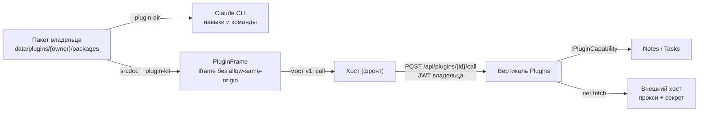

# Плагины (ClaudeHomeServer.Plugins)

> Карта фичи. Почему решено именно так и что отвергнуто — в
> [ADR-031](../adr/ADR-031-plugins.md); здесь — устройство, контракты и правила для правок.
> Статус: решение принято на бумаге, код идёт по плану эпика (пачки A → B → C1 → C2 → D1 → D2).
> Читать перед правками в вертикали `Plugins`, в доставке `--plugin-dir` в `ClaudeSession`
> и во фронте `features/plugins/`.

## Что это

Плагин — пакет владельца, который одним согласием человека добавляет навыки и slash-команды
агенту, панели в интерфейс и ссылки на нужные MCP-серверы и секреты. Собрать пакет может
агент (build-it-yourself), установить — только человек.

Своего рантайма нет: каждый вклад едет на уже существующем механизме.



## Где живёт

| Слой | Что | Файлы (по плану) |
|---|---|---|
| Core | модели `PluginManifest`/`PluginInstall` (манифест и запись установки), швы `IPluginDirSource`/`IPluginCapability`, `ProjectCapabilities.Plugins` | `Core/Models/Plugins/PluginManifest.cs`, `Core/Models/Plugins/PluginInstall.cs`, `Core/Services/Plugins/IPluginDirSource.cs`, `Core/Services/Plugins/IPluginCapability.cs`, `Core/Models/ProjectCapabilities.cs` |
| Вертикаль | `PluginsSubsystem` (ключ `plugins`), `PluginStore`, валидатор пакета, REST установки и согласия, мост, прокси `net:`, тулсет `plugins` | `backend/ClaudeHomeServer.Plugins/` |
| Llm | `--plugin-dir` по `IPluginDirSource`, опциональная зависимость | `Llm/Claude/ClaudeSession.cs` |
| Execution | read-only mount `data/plugins` + правило `DockerPathMapper` одной правкой | `DockerPathMapper.cs` |
| Владельцы данных | регистрация обработчиков `notes:read`, `tasks:read` | вертикали Notes, Tasks |
| Фронт | экран «Плагины», диалог согласия, `PluginFrame`, мост, черновики | `frontend/src/features/plugins/` |

Флаги: `plugins-mvp`, `plugins-build-yourself`. Тумблер подсистемы: `Subsystems:plugins:Enabled`.

## Хранилище

```
data/plugins/{ownerId}/
  packages/{id}/{version}/   — неизменяемые пакеты
  installed.json             — id + version + sha256, granted, enabled, источник строкой
  _drafts/{slug}/            — черновики агента
```

Пакет: `.claude-plugin/plugin.json` (нативный CLI, **обязателен** — из него CLI берёт имя
пакета) + `ccs-plugin.json` (наш манифест с `id`/`contributes`/`permissions`) + `skills/`,
`commands/`, `panel/`. Корневой `plugin.json` — не нативный манифест (R10-1). Всё прочее
валидатор отклоняет. Формат манифеста — ADR-031 §2.2, allow-list файлов — §2.3.

## MCP-тулсет `plugins` (черновики build-it-yourself, шаг 4.1)

Агент собирает плагин ТОЛЬКО через MCP-тулсет `plugins` (маршрут `POST /mcp/plugins/{sessionId}`,
хвост = id чата), который пишет в черновик владельца `data/plugins/{owner}/_drafts/{slug}/`.
Встроенные Write/Edit не годятся: в контейнере каталог не смонтирован на запись, у local-владельцев
Write пишет куда угодно. Инструментов установки/согласия/выдачи прав у агента нет по построению —
принять и выдать права может только человек кнопкой (шаг 4.3).

5 инструментов (имена не однокоренные, чтобы модель их не путала): `draft_create` (шаблон:
`ccs-plugin.json` + `.claude-plugin/plugin.json` с `name = slug`, version 0.1.0, contributes пуст;
повторный create того же slug → `already-exists`, а не перезапись), `draft_write_file` (относительный
путь, только через `SafePath.Join`; запись в запрещённые места — deny-list/symlink/вне allow-list —
и превышение лимитов → отказ с тем же кодом проблемы, что у валидатора; перезапись допустима — так
агент правит), `draft_validate` (валидатор пакета, тот же код, что при установке), `draft_preview`
(сводка «что будет после установки»: вклады, запрошенные права, секреты — только имена и признак
обязательного, дерево файлов, результат последней проверки; без содержимого секретов и без
хостовых путей), `draft_delete_file`.

Инварианты (нарушение = дефект):
- **Состав `tools/list` (5) не зависит от флага, хода и сессии** (инвариант
  `McpToolsetStabilityTests`): иначе перезапуск процесса CLI со всеми MCP-серверами. Флаг
  `plugins-build-yourself`, выключенная подсистема и локальный проект (`ProjectCapabilities`)
  проверяет бэкенд на ВЫЗОВЕ — честный отказ с причиной, не исключение.
- **Владелец — из claim `sub` сервисного JWT**, не из аргументов; черновики владельца A
  недоступны владельцу B (изоляция по OwnerId).
- **Валидатор пакета — единственный арбитр:** тулсет применяет те же коды проблем (allow-list,
  deny-list, лимиты) на записи, но не ослабляет правил — атака через недоверенное содержимое
  (агент записывает прочитанный текст) отбивается тем же, что при установке.

## Наблюдатель черновиков: живая перезагрузка (шаг 4.2)

`PluginDraftWatcher` (hosted-сервис) следит за `data/plugins/{owner}/_drafts/`: когда агент пишет
файлы в черновик, открытая у человека карточка с предпросмотром обновляется сама. Наблюдение —
через Core-примитив [RecursiveDirectoryWatcher](../backend/ClaudeHomeServer.Core/Services/Files/RecursiveDirectoryWatcher.cs)
(один inotify-экземпляр на процесс, слежка по перечню каталогов —
[file-watching.md](file-watching.md)), а не `FileSystemWatcher` с `IncludeSubdirectories`.

- **Один наблюдатель на процесс** (не на владельца): корень `data/plugins`, служебные `packages`/
  `_uploads` исключены по именем, подписываются только `_drafts`.
- **Событие `plugin_draft_changed`** (`slug` + монотонная ревизия, без содержимого/хостовых
  путей) — через `ISessionBroadcaster.ToOwner` ТОЛЬКО владельцу черновика; чужой владелец не
  получает. Дебаунс 300 мс per (owner, slug): запись десяти файлов подряд → одно-два события.
- **Гейт:** события — только тем, у кого включён `plugins-build-yourself`; подсистема выключена
  → наблюдатель не стартует, приложение поднимается. Нет `_drafts` → не падает, создание
  подхватывает сам примитив (авто-подписка на новые каталоги).

## Мост панели v1 — коротко

- Приём: `e.source === win && e.origin === 'null'` + `msg.source === 'ccs-plugin'` + `msg.v === 1`.
- Фрейм → хост: `ready`, `call {id, op, args}`, `resize {height}` (высота контента: хост ставит её фрейму, порог 48, потолок 20 000, не чаще раза за кадр; прокручивает панель хост — обёртка фрейма внутри карточки, внутренний документ не скроллится).
- Хост → фрейм: `init`, `result {id, ok, data | error}`, `theme`, `context`.
- id плагина и контекст слота к вызову добавляет хост, не фрейм. Право проверяет сервер на
  каждом вызове.
- Внутри v1 изменения только аддитивные; ломающее — v2 рядом с v1.
- Событие `plugins_changed` (ADR-031 §2.4): установка/секреты плагина изменились — идёт `ISessionBroadcaster.ToOwner` владельцу, **без полезной нагрузки**; фронт перечитывает `GET /api/plugins`, и панель подхватывает новую версию/права/секреты без ручного переоткрытия.

### Риск: общий браузер у двух владельцев

Что есть по коду (не выдумано):

- **Канал привязан к окну, а не к сессии.** Хост принимает сообщение, только если
  `e.source` — окно именно этой панели (`frames[0]` своей оболочки) и `origin === 'null'`
  (`frontend/src/features/plugins/bridge.ts:83-84`, `panelWindowOf` — там же `:114`). Сессии/владельца в сообщении нет.
- **`targetOrigin` — `'*'` в обе стороны.** Хост → панель: `win.postMessage(msg, '*')`
  (`PluginFrame.tsx:185`); панель → хост: `(window.top || window.parent).postMessage(msg, '*')`
  (`plugin-kit.js:50`). Назвать origin нельзя: у sandbox-iframe без `allow-same-origin`
  он непрозрачный. Адресат — конкретное окно, поэтому сообщение доходит только до него.
- **Вкладки не пересекаются.** `postMessage` ходит внутри дерева окон одной вкладки: две
  вкладки (в т. ч. с разными аккаунтами) обменяться сообщениями моста не могут.
- **Панель не видит хранилища хоста.** Токен `cc_token` лежит в `localStorage` («запомнить
  меня») или `sessionStorage` (`api.ts:583-588`), у панели opaque origin — прочитать его она
  не может. Вызов на сервер делает хост своим токеном (`frontend/src/features/plugins/PluginFrame.tsx:307`), право и
  владельца проверяет сервер на каждом вызове.
- **Id плагина подставляет хост, а не панель.** Вызов уходит как
  `api.plugins.call(p.id, {capability: msg.op, args, projectId})` (`PluginFrame.tsx:307-311`, `projectId` — проект слота или `null`), где `p` —
  плагин этой оболочки: панель передаёт только `op` и `args` и не может вызвать capability
  от имени другого плагина. Межплагинная эскалация по мосту невозможна.

Что общее у двух владельцев в одном браузерном профиле — не мост, а хранилище хоста: при
входе с «запомнить меня» токен один на все вкладки профиля, и смена токена в одной
подхватывается остальными через событие `storage` (`offline.ts:76`). Вызов панели уйдёт
с тем токеном, который актуален в момент вызова; серверная проверка владельца при этом
остаётся последней защитой.

Вывод: по мосту риск закрыт (канал не пересекает окна/вкладки, данные хоста панели не
доступны). Остаточный риск лежит в хосте — общий токен профиля, а не в плагинах; изоляция
двух людей за одной машиной — отдельные профили браузера или вход без «запомнить меня».

### Ошибки `net.fetch`

- HTTP-ошибка внешнего хоста (4xx/5xx) — **не сбой моста**: приходит как успешный
  `net.fetch` с полем `status` в результате; решать, что с ней делать, должна панель.
- Сетевые отказы — сбой с кодом: `forbidden_address` (адрес резолвится в приватный/запрещённый),
  `dns_failed` (DNS не ответил); обрыв, редирект на другой хост и пр. — `upstream`
  (`PluginNetProxy.cs`).

Полная схема, операции MVP и коды ошибок — ADR-031 §3. Справочник шима для авторов панелей
(API `ccsPlugin`, правило высоты, набор классов, шрифт) — [plugin-kit.md](../features/plugin-kit.md).

## Панель плагина в рельсе — коротко

У каждой панели плагина своя карточка в рельсе (ключ `plugin:{publisher}/{slug}:{panelId}`,
без версии). Карточка — обычная панель через `PanelShell`; управление (перезагрузка, «Права…»)
— в шапке через `PanelHeaderSlot`. Скролл один — у обёртки фрейма (документ хоста, наш стиль
полосы); оболочка и внутренний документ `overflow:hidden`. На мобиле — одна вкладка «Плагины»
с переключателем. Старый слот `pluginPanels` упразднён. Живое обновление: `plugins_changed` →
`GET /api/plugins`; ключ фрейма несёт версию и права, сборка мусора — по диффу.
Подробности — ADR-031 §3.7.

## Права — коротко

`notes:read`, `tasks:read`, `net:{exact-host}`, `secret:{name}`. Манифест несёт `requested`,
человек выдаёт `granted` при установке; расширение прав при обновлении — повторное согласие.
Права защищают мост панели, агента они не ограничивают (ADR-031 §4).

## Валидатор: ложные срабатывания и лимит контекста

**Ложные срабатывания `allowed-tools` (M10.1/M10.2).** Проверка исполняемых `.md`
(`PluginPackageValidator.CheckExecutableMd`) сознательно пере-аппроксимирует:
- `allowed-tools` — `Contains` по всему тексту: даже *упоминание* ключа в описании навыка
  отбивает установку (ложное срабатывание). Цена низкая: ключ и упоминание дают одно и то
  же (Bash без запроса), так что отбить оба — правильно.
- Обратный слеш во фронтматтере (M10.2) — ЛЮБОЙ `\` во фронтматтере (включая `description`)
  отбивает. Ложное срабатывание на легитимный эскейп, но цена низкая (навык просто не
  устанавливается, с читаемым сообщением).

Оба ложных срабатывания — осознанный компромисс: дешевле отбить валидный навык, чем
пропустить исполняемый ключ (RCE). Сообщение отказа раздельное для каждой причины
(«Ключ allowed-tools» vs «Обратный слеш во фронтматтере»).

**Лимит контекста от навыков (ADR-031 §2.2).** Каждый установленный плагин добавляет свои
навыки/команды в контекст сессии (CLI грузит их на старте процесса). Потолок на число
плагинов и число байт описаний на сессию, прежде чем prefix cache обнуляется, — отдельная
задача: простой замер в начале фичи. Пока потолок не задан; MVP опирается на лимит пакета
`PluginPackageValidator.MaxTotalSizeBytes` (20 МБ) и `MaxFileCount` (500).

## Правила для правок

- Никакого серверного кода плагина в процессе бэкенда.
- Пакеты — только в `data/plugins/{owner}`. Не в `~/.claude/skills` и не в
  `data/claude-profiles/*/plugins`: эти каталоги общие на инстанс, и `SyncDirs` зеркалит
  `plugins` между профилями.
- Набор `--plugin-dir` — от свойств сессии, не от хода; применение — со следующего хода:
  CLI перезапускается при изменении состава `--plugin-dir`, иначе переиспользует существующий процесс.
- Install, approve и grant — только пользовательский JWT. У тулсета `plugins` таких
  инструментов нет; состав `tools/list` не зависит от флага и хода.
- Локальные проекты — через `ProjectCapabilities`, без инлайнового `if (project.IsLocal)`.
- Источник установки — строка; новое значение enum в формате файла запрещено (урок `McpCatalogRef`).
- Plugins не ссылается на Notes и Tasks: право регистрирует владелец данных через Core-шов.
- Плагины профиля CLI (`installed_plugins.json`, читает `SkillsService`) и плагины владельца —
  разные источники, в API и UI метятся явно.
- Шаблон черновика build-yourself (шаг 4.1) сразу создаёт `.claude-plugin/plugin.json`
  с `name = slug` (R10-1: без нативного манифеста CLI назовёт пакет именем каталога, и
  привязка навыка по slug ломается) — `PluginDraftService.Create`.

## Сторожа

`SubsystemBoundaryTests` и `SubsystemBoundaryCoverageTests` (строка `typeof(...).Assembly` в
статических конструкторах), `IlBoundaryRegressionTests`, `McpToolsetStabilityTests` (тулсет
`plugins`), `DockerPathMapperTests`, `ProjectCapabilitiesTests`, `BackupRoundTripTests`.
Перечень новых тестов по шагам — в плане эпика.
