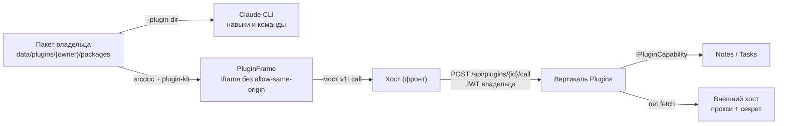

# Плагины (ClaudeHomeServer.Plugins)

> Карта фичи. Почему решено именно так и что отвергнуто — в
> [ADR-031](../adr/ADR-031-plugins.md); здесь — устройство, контракты и правила для правок.
> Статус: решение принято на бумаге, код идёт по плану эпика (пачки A → B → C1 → C2 → D1 → D2).
> Читать перед правками в вертикали `Plugins`, в доставке `--plugin-dir` в `ClaudeSession`
> и во фронте `features/plugins/`.

## Что это

Плагин — пакет владельца, который одним согласием человека добавляет навыки и slash-команды
агенту, панели в интерфейс и ссылки на нужные MCP-серверы и секреты. Собрать пакет может
агент (build-it-yourself), установить — только человек.

Своего рантайма нет: каждый вклад едет на уже существующем механизме.



## Где живёт

| Слой | Что | Файлы (по плану) |
|---|---|---|
| Core | модели `PluginManifest`/`PluginInstall` (манифест и запись установки), швы `IPluginDirSource`/`IPluginCapability`, `ProjectCapabilities.Plugins` | `Core/Models/Plugins/PluginManifest.cs`, `Core/Models/Plugins/PluginInstall.cs`, `Core/Services/Plugins/IPluginDirSource.cs`, `Core/Services/Plugins/IPluginCapability.cs`, `Core/Models/ProjectCapabilities.cs` |
| Вертикаль | `PluginsSubsystem` (ключ `plugins`), `PluginStore`, валидатор пакета, REST установки и согласия, мост, прокси `net:`, тулсет `plugins` | `backend/ClaudeHomeServer.Plugins/` |
| Llm | `--plugin-dir` по `IPluginDirSource`, опциональная зависимость | `Llm/Claude/ClaudeSession.cs` |
| Execution | read-only mount `data/plugins` + правило `DockerPathMapper` одной правкой | `DockerPathMapper.cs` |
| Владельцы данных | регистрация обработчиков `notes:read`, `tasks:read` | вертикали Notes, Tasks |
| Фронт | экран «Плагины», диалог согласия, `PluginFrame`, мост, черновики | `frontend/src/features/plugins/` |

Флаги: `plugins-mvp`, `plugins-build-yourself`. Тумблер подсистемы: `Subsystems:plugins:Enabled`.

## Хранилище

```
data/plugins/{ownerId}/
  packages/{id}/{version}/   — неизменяемые пакеты
  installed.json             — id + version + sha256, granted, enabled, источник строкой
  _drafts/{slug}/            — черновики агента
```

Пакет: `plugin.json` (нативный CLI) + `ccs-plugin.json` (наш манифест с `contributes` и
`permissions`) + `skills/`, `commands/`, `panel/`. Всё прочее валидатор отклоняет. Формат
манифеста — ADR-031 §2.2, allow-list файлов — §2.3.

## Мост панели v1 — коротко

- Приём: `e.source === win && e.origin === 'null'` + `msg.source === 'ccs-plugin'` + `msg.v === 1`.
- Фрейм → хост: `ready`, `call {id, op, args}`, `resize {height}`.
- Хост → фрейм: `init`, `result {id, ok, data | error}`, `theme`, `context`.
- id плагина и контекст слота к вызову добавляет хост, не фрейм. Право проверяет сервер на
  каждом вызове.
- Внутри v1 изменения только аддитивные; ломающее — v2 рядом с v1.

Полная схема, операции MVP и коды ошибок — ADR-031 §3.

## Права — коротко

`notes:read`, `tasks:read`, `net:{exact-host}`, `secret:{name}`. Манифест несёт `requested`,
человек выдаёт `granted` при установке; расширение прав при обновлении — повторное согласие.
Права защищают мост панели, агента они не ограничивают (ADR-031 §4).

## Валидатор: ложные срабатывания и лимит контекста

**Ложные срабатывания `allowed-tools` (M10.1/M10.2).** Проверка исполняемых `.md`
(`PluginPackageValidator.CheckExecutableMd`) сознательно пере-аппроксимирует:
- `allowed-tools` — `Contains` по всему тексту: даже *упоминание* ключа в описании навыка
  отбивает установку (ложное срабатывание). Цена низкая: ключ и упоминание дают одно и то
  же (Bash без запроса), так что отбить оба — правильно.
- Обратный слеш во фронтматтере (M10.2) — ЛЮБОЙ `\` во фронтматтере (включая `description`)
  отбивает. Ложное срабатывание на легитимный эскейп, но цена низкая (навык просто не
  устанавливается, с читаемым сообщением).

Оба ложных срабатывания — осознанный компромисс: дешевле отбить валидный навык, чем
пропустить исполняемый ключ (RCE). Сообщение отказа раздельное для каждой причины
(«Ключ allowed-tools» vs «Обратный слеш во фронтматтере»).

**Лимит контекста от навыков (ADR-031 §2.2).** Каждый установленный плагин добавляет свои
навыки/команды в контекст сессии (CLI грузит их на старте процесса). Потолок на число
плагинов и число байт описаний на сессию, прежде чем prefix cache обнуляется, — отдельная
задача: простой замер в начале фичи. Пока потолок не задан; MVP опирается на лимит пакета
`PluginPackageValidator.MaxTotalSizeBytes` (20 МБ) и `MaxFileCount` (500).

## Правила для правок

- Никакого серверного кода плагина в процессе бэкенда.
- Пакеты — только в `data/plugins/{owner}`. Не в `~/.claude/skills` и не в
  `data/claude-profiles/*/plugins`: эти каталоги общие на инстанс, и `SyncDirs` зеркалит
  `plugins` между профилями.
- Набор `--plugin-dir` — от свойств сессии, не от хода; применение — со следующего хода:
  CLI перезапускается при изменении состава `--plugin-dir`, иначе переиспользует существующий процесс.
- Install, approve и grant — только пользовательский JWT. У тулсета `plugins` таких
  инструментов нет; состав `tools/list` не зависит от флага и хода.
- Локальные проекты — через `ProjectCapabilities`, без инлайнового `if (project.IsLocal)`.
- Источник установки — строка; новое значение enum в формате файла запрещено (урок `McpCatalogRef`).
- Plugins не ссылается на Notes и Tasks: право регистрирует владелец данных через Core-шов.
- Плагины профиля CLI (`installed_plugins.json`, читает `SkillsService`) и плагины владельца —
  разные источники, в API и UI метятся явно.

## Сторожа

`SubsystemBoundaryTests` и `SubsystemBoundaryCoverageTests` (строка `typeof(...).Assembly` в
статических конструкторах), `IlBoundaryRegressionTests`, `McpToolsetStabilityTests` (тулсет
`plugins`), `DockerPathMapperTests`, `ProjectCapabilitiesTests`, `BackupRoundTripTests`.
Перечень новых тестов по шагам — в плане эпика.
