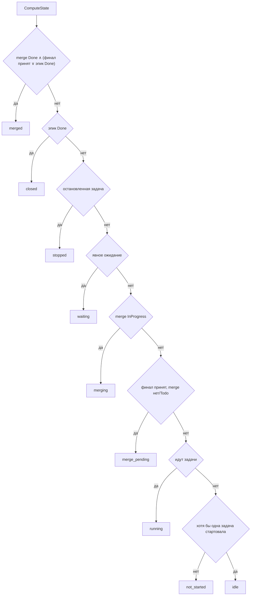
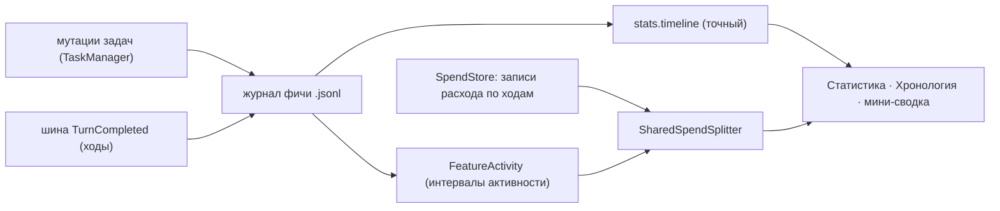

# «Обзор фич»: страница фичи, панель в чате, журнал, статистика и расход

> Решения — [ADR-031](../adr/ADR-031-feature-as-dimension.md) (§1–§6, «Волна 2», «Волна 3: состояние, журнал, статистика, расход, прогресс»);
> контракт агрегата и индекса — [turn-plan-feature-mode.md](turn-plan-feature-mode.md);
> макеты — [features-overview-3-final.md](../mockups/features-overview-3-final.md) / [html](../mockups/features-overview-3-final.html),
> панель — [feature-banner-1.md](../mockups/feature-banner-1.md), попап — [turn-plan-feature-popup-1.md](../mockups/turn-plan-feature-popup-1.md).

## Зачем

Фичу команда ведёт задачами трекера (эпик + дочерние), а её чаты разбросаны по списку
сессий. «Обзор фич» даёт второе измерение — «по фичам» — и одну страницу, где видно:
на каком этапе фича, сколько шагов принято, кто и сколько работал, сколько это стоит.

Фича остаётся задачей-эпиком: ни у `Session`, ни у `TaskItem` поля «фича» нет, членство
«чат → фича» вычисляется (ADR-031 §1). Единственное новое хранилище — журнал событий
фичи (append-only файл); расход читается из уже существующего `SpendStore` — отдельного
учёта по фичам нет.

## Что видит человек

**Страница фичи** (открывается из плашки фичи в чате, шторки «где мы» или фасета «Фичи»
в списке сессий; монтируется в рабочей области — [FeatureCenter.tsx](../../frontend/src/components/feature/FeatureCenter.tsx)).
Вкладки — один словарь названий ([featurePage.ts](../../frontend/src/lib/featurePage.ts)),
порядок и источник данных:

| Вкладка | Что показывает | Источник |
|---|---|---|
| «Хронология» (по умолчанию) | этапы, лента времени, цепочки шагов и витки | `run.stages`, `stats.timeline`, `run.stepChains` |
| «Планы и макеты» | разрез/план/консультации фичи, макеты из `docs/mockups` | `plans`, `mockups` |
| «Чаты» | чаты фичи с ролями (куратор/оркестратор/исполнитель) и моделью | `chats` |
| «Задачи» | задачи фичи, фильтр | `run` + трекер |
| «События» | лента событий | `events`, `eventsTotal` |
| «Статистика» | время, разрезы, «Дольше всех», токены, деньги, доля общих чатов | `stats` |

Выбранная вкладка живёт в сторе модуля и сохраняется при скрытии страницы; смена фичи
сбрасывает её к «Хронологии».

**Панель фичи в чате** ([FeatureBanner.tsx](../../frontend/src/components/chat/feature/FeatureBanner.tsx)):
строка с точками этапов (конвейер — [FeatureRail.tsx](../../frontend/src/components/chat/feature/FeatureRail.tsx)),
слова «где мы» — из той же функции `statusPhrase`, что и пилюля ([pillModel.ts](../../frontend/src/components/chat/feature/pillModel.ts));
тап по «где мы» открывает шторку ([FeatureBannerSheet.tsx](../../frontend/src/components/chat/feature/FeatureBannerSheet.tsx)),
клик по точке этапа ведёт на «Хронологию» у этого этапа. В шапке чата, куда перешли из
фичи, стоит чип «← к фиче {название}» ([featureBackNav.ts](../../frontend/src/lib/featureBackNav.ts)) —
возврат открывает ту же вкладку, с которой ушли.

**Попап «Исполнение фичи»** и **короткая карточка плана в ленте** — одно тело
([FeatureModeBody.tsx](../../frontend/src/components/chat/feature/FeatureModeBody.tsx)):
тег статуса, строка состояния, компактные этапы с исполнителями и чипами моделей,
подвал «Открыть страницу фичи →». Данные — только из списка `GET features?sessionId=`,
без догрузки `features/{id}`.

## Состояния фичи (`state`)

Девять значений, одна точка правды — `FeatureProjector.ComputeState`
([FeatureProjector.cs:1475](../../backend/ClaudeHomeServer.Tasks/Projector/FeatureProjector.cs));
значения объявлены в [FeatureRun.cs:373](../../backend/ClaudeHomeServer.Tasks/Projector/FeatureRun.cs).
Приоритет: первый совпавший побеждает. `bucket` строки индекса и порядок `OrderRuns`
выводятся из `state` — отдельного расчёта группы нет.

| `state` | откуда берётся |
|---|---|
| `merged` | merge-задача `Done` и (финал принят ∨ эпик `Done`). Частичный мерж (merge `Done`, финал не принят, эпик открыт) фичу не смерживает |
| `closed` | эпик `Done` и не `merged` — решение человека «фича закончена» |
| `stopped` | есть остановленная задача (тревога `kind=stopped`) |
| `waiting` | явное ожидание человека (тревога `kind=wait`, кроме ожидания «мерж») |
| `merging` | merge-задача запущена (`InProgress`) — мерж идёт |
| `merge_pending` | финал принят, merge-задачи нет или она `Todo` — ждём запуска мержа |
| `running` | идут задачи (`now` не пуст) |
| `not_started` | ни одна задача фичи не стартовала (нет ни одного `ClaudeStartedAt`) |
| `idle` | ничего не идёт, не ждёт и не закрыто |

Что это меняет для человека: идущий мерж больше не выглядит как «ждёт вас».
Тревога `kind=merge` остаётся только при `merge_pending` (нет merge-задачи);
при `merging` тревоги нет. Б1b и фронтовый читатель `kind` (Ф-mk) — один пакет:
по отдельности в master не вливать (старый фронт потеряет плашку «ждёт вас»).

## Честный прогресс (`stepProgress`)

Единица учёта — **шаг** (код `stepRef`; шаг без `stepRef` ключуется id задачи). Считает
бэк — одна чистая функция `FeatureStepAccounting.Build` ([FeatureStepAccounting.cs](../../backend/ClaudeHomeServer.Tasks/Projector/FeatureStepAccounting.cs)),
полный run и индекс получают одни и те же числа. Поля
([FeatureRun.cs:354](../../backend/ClaudeHomeServer.Tasks/Projector/FeatureRun.cs)):

| Поле | Смысл |
|---|---|
| `total` | знаменатель: объединение `planSteps` всех планов фичи + реально заведённые шаги |
| `accepted` | шаг принят: последний виток `accepted`/`accepted_with_remarks` и доработка закрыта |
| `review` | шаг на ревью (последний виток — открытый возврат) |
| `work` | шаг в работе (идущая задача шага или открытая доработка) |
| `notCreated` | шаг назван в плане, но задачи с таким `stepRef` нет |
| `withdrawn` | шаг снят с выкладки — вне знаменателя и вне линий |
| `unlinkedReworks` | доработки без привязки (ни `stepRef`, ни `reviewOf`) — новой цепочки не заводят |
| `planState` | по доле планов со списками (решение Александра, шов 63a69b77 п.2а): `pending` — задач `role=plan` нет, или у всех пустой `planSteps`; `partial` — списки есть только у части планов; `cut` — у всех; `done` — `cut`, `total > 0` и все шаги приняты. Снятые (`withdrawn`) планы в маппинг не входят: снятый старый план не держит фичу в `partial` |

Корзины взаимоисключающие: `total = accepted + review + work + notCreated`.
`StepsOpen = total − accepted` (это же `review + work + notCreated`); `withdrawn`
из этой формулы не вычитается — снятые шаги и так не входят в `total`.

Порядок витка внутри цепочки — **по завершению**: `(CompletedAt ?? +∞, TaskStart)`.
Идущий виток (без `CompletedAt`) считается последним, поэтому шаг с открытым
возвратом честно числится «на ревью». Порядок задач (`ordered`) остаётся по старту:
там нужны длительность и шапка. Снятая доработка шаг не снимает: шаг снят, только
если последний виток `withdrawn` или снята сама задача-шаг. Ключи шагов сравнивает
один `StringComparer.OrdinalIgnoreCase` (+ `Trim`) — и в проекторе, и в гарде дублей
плана; «Б1» и «б1» — один шаг.

Строку рисует **один форматтер** на все шесть мест —
[featureProgress.ts](../../frontend/src/lib/featureProgress.ts):
`FeaturePageHeader`, «Хронология», плашка чата, шторка, пилюля, группа «Фичи»
([FeatureGroupHeader.tsx](../../frontend/src/components/FeatureGroupHeader.tsx)).
Формат: `принято N из T · R в ревью · W в работе · ∅N не заведено · план не разобран · X снято · Y без привязки` —
ненулевые части, склейка « · ». Чего **не бывает**: голого «N из M» без слов (читается
как «сделано»); «всё готово» без чисел («готово» — только когда `accepted == total`,
`total > 0` и план не `pending`); глифа ↺ в прогрессе (он занят возвратами в итоге
смерженной фичи).

## Журнал событий фичи

**Хранилище:** `data/feature-journal/{ownerId}/{featureId}.jsonl`, append-only, путь
через `SafePath.Join`, id по белому списку `FeatureIdPattern` (и при записи, и при
чтении — иначе `../<чужой>/<id>` читал бы журнал чужого владельца). Вся логика —
внутри вертикали `Tasks` ([FeatureJournalStore.cs](../../backend/ClaudeHomeServer.Tasks/Journal/FeatureJournalStore.cs)).
Бэкап: новый каталог в `data/` попадает в архив по умолчанию, `BackupSchema.Version`
не поднят — формат существующих данных не менялся.

**Виды строк** (`v:1`): `created`, `started`, `stopped`, `stop_cleared`, `waiting`,
`waiting_cleared`, `device_wait`, `device_wait_cleared`, `status`, `verdict`, `dropped`,
`turn`. Переходы пишет `TaskManager` во всех мутаторах — сравнением снимка «до/после»
(не на `SaveNow`); ходы — подписчик `TurnCompleted` на шине ([FeatureTurnJournalSubscriber.cs](../../backend/ClaudeHomeServer.Tasks/Journal/FeatureTurnJournalSubscriber.cs)),
который переводит сессию в задачу через `LinkedSessionId` своей вертикали. Ходы общих
(оркестраторских) чатов в журнал фичи не пишутся. Ошибка записи не роняет мутацию.

**Потолок и обрезка:** 20 000 строк на фичу. При переполнении перестают писаться только
`turn`-записи (переходы редки — их число по мутациям, не по ходам); чтение возвращает
`truncated = lines ≥ MaxLines`. Каскад удаления журнала — только при удалении эпика:
удаление шага, ревью или консультации историю фичи не стирает.

**Дедуп ходов** — при чтении, по `(sessionId, turnSeq)`; у записей без хода (`turnSeq = 0`)
— по `(sessionId, startedAt)`.

**«Полный журнал»**: журнал начинается с `created` и не обрезан. Только тогда
`stats.source = "journal"`. Фичи, начатые до выкатки журнала, и обрезанные журналы —
целиком `approx`, гибрида нет.

**«≈» в интерфейсе** — не «источник неточный», а «доля/минуты оценочные»:
`approx` ставится, когда точный расчёт невозможен (неполный журнал или дневная свёртка).
Значки точности — «по журналу» / «≈ по задачам (≈)» / «журнал обрезан»
([FeatureStatsTab.tsx](../../frontend/src/components/feature/FeatureStatsTab.tsx)).
Интервалы берутся из журнала везде, где он полный: огрублять точное ради метки незачем.

## Статистика и расход

`stats` есть **только** в `GET /api/tasks/features/{featureId}` — в индексе и списке
его нет: `FeatureRun` остаётся лёгким (ловушка `SlimRun`: поля копируются явно).

- **Лента времени** ([FeatureTimeline.cs](../../backend/ClaudeHomeServer.Tasks/Projector/FeatureTimeline.cs)):
  границы — от `CreatedAt` эпика до момента мержа/закрытия (иначе — сейчас); сегменты
  `work | waiting | idle | error | notWorking`, склеенные, потолок 500; в `approx`
  различимы только `work`/`notWorking` (ожидание, простой и ошибки — `null`).
  Минуты считаются одним правилом округления в обоих режимах.
  `AgentsSum` — агентные минуты **внутри окна фичи** `[from, to]`: сумма периодов задач
  (параллельные складываются — в отличие от `workWall`, который остаётся объединением),
  обрезанная по границам окна перед суммой. Без обрезки незакрытый `started`-период
  закрытой фичи наращивал бы число каждый день после закрытия.
- **Разрезы** ([FeatureBreakdown.cs](../../backend/ClaudeHomeServer.Tasks/Projector/FeatureBreakdown.cs)):
  по персонам, моделям и ролям, с `chatIds`; токены — «вход + выход» крупно, кэш
  отдельно; «Дольше всех сейчас» — самая долгая идущая задача (`longestNow`).
- **Токены и деньги** ([ISpendFeatureReader.cs](../../backend/ClaudeHomeServer.Core/Services/Spend/ISpendFeatureReader.cs)):
  срез = задачи фичи **или** её ключевой чат, при этом ось исключения (общие чаты)
  **главнее** обеих осей: запись общего чата не входит в личный расход фичи, даже
  если несёт `TaskId` её задачи. Фильтр по `OwnerId`, скан за один проход (`Slice`).
  Цена ненадёжна — `SpendCostReliability.IsUnreliable` (список из конфига
  `Spend:UnreliableCostModels`, дефолт `deepseek`, `glm`); такие модели не входят в
  сумму, но их токены остаются: `costPartial = true`, модели — в `hiddenCostModels`.
  `Source = free` (локальные) — надёжный 0, проверяется раньше «ненадёжно».
  Подсистема `Spend` выключена → шов не зарегистрирован → `stats.spend = null`, а не 0.
- **Деление расхода общего чата** ([SharedSpendSplitter.cs](../../backend/ClaudeHomeServer.Tasks/Projector/SharedSpendSplitter.cs)).
  «Общий чат» — чат, который состоит в двух и более фичах. Его расход не приписывается
  каждой фиче целиком (двойной счёт), а делится между фичами, **активными на момент
  хода**: фича активна, если над ней работали или её ждали (интервалы активности
  строит один модуль — [FeatureActivity.cs](../../backend/ClaudeHomeServer.Tasks/Projector/FeatureActivity.cs),
  half-open `[from, to)`).

  Почему сумма долей равна расходу чата: каждый ход делится **отдельно** и **полностью**.
  Для хода и каждого поля токенов активные фичи этого чата упорядочиваются по id,
  `base = x / N`, `r = x % N`; первые `r` фич получают `base + 1`, остальные — `base`.
  Сумма долей — ровно `x`, без округления (деньги — `decimal`, проверка сохранения
  с допуском 1e-9). Если активных фич нет — ход не распределяется никуда: он остаётся
  в расходе чата и не попадает ни в одну фичу (отдельного числа «нераспределённого
  расхода» в этой волне нет — это аддитивное поле, и место ему в сводке владельца,
  а не в фиче).

  Знаменатель — **состав конкретного чата** `M[c]`, а не объединение участниц запроса:
  если чат `c1` состоит в `{F, G}`, а `c2` — в `{F, H}`, ход из `c1` делится на 2,
  а не на 3. Метку `method` тоже решает чат: `journal`, если журналы всех участниц
  полные и среди записей чата в окне нет дневных строк; иначе `approx`. Итог фичи —
  `journal`, только если `journal` получили все её общие чаты. Дневные свёртки
  (`IsDaily`) делятся между фичами, активными в любой момент суток `[d, d+1)`, и
  всегда `approx`.

  Источник интервалов активности выбирается **по участнице**: у одной фичи общий чат
  может делиться по журнальным интервалам, у другой — по приближённым. В общем чате
  доли тогда считаются в разных системах отсчёта, но сумма долей всегда равна расходу
  чата — деление полного по построению. Смешение возникает только когда у одной из
  фич журнал неполный (фичи, начатые до журнала), и со временем исчезает: у фич,
  начатых после запуска журнала, полные журналы у всех участниц.

## Планы и макеты

`plans[]` — задачи ролей `cut`, `plan`, `consult` фичи (порядок: cut → plan → consult,
внутри роли — по `CreatedAt`), с `hasText` и путями макетов из `linkedFiles`
([FeatureProjector.cs:615](../../backend/ClaudeHomeServer.Tasks/Projector/FeatureProjector.cs)).

`mockups[]` — из каталога `docs/mockups` (Master-only: макет из worktree виден после
мержа; путь из `linkedFiles`, которого нет на диске, отдаётся с `exists: false`).
Связь макета с фичей — шапка записки `**Фича:** … **Статус:** … **Файлы:** …`
(ADR-031, «Волна 3: макеты фичи»). Локальный проект (файлы на устройстве) —
`mockups: []` и `mockupsUnavailable: "device"` до любого обращения к Docs.

## Фич-флаги

Оба — dark launch, выключены по умолчанию, стадия `dev`
([FeatureFlag.cs](../../backend/ClaudeHomeServer.Core/Models/FeatureFlag.cs)):

- `features-overview` — фасет «Фичи» в списке сессий и плашка фичи в чате;
- `turn-plan-feature-mode` — режим «Исполнение фичи» в «Плане хода» (карточка фичи в чате).

Флагами закрыт только UI: эндпоинты `features`, `features/index`, `features/{id}` от
них не зависят, а журнал пишется всегда.

## Где что в коде

| Часть | Файл |
|---|---|
| состояния, прогресс, цепочки шагов | [FeatureProjector.cs](../../backend/ClaudeHomeServer.Tasks/Projector/FeatureProjector.cs), [FeatureRun.cs](../../backend/ClaudeHomeServer.Tasks/Projector/FeatureRun.cs), [FeatureStepAccounting.cs](../../backend/ClaudeHomeServer.Tasks/Projector/FeatureStepAccounting.cs) |
| индекс «чат → фичи», членство | [FeatureIndex.cs](../../backend/ClaudeHomeServer.Tasks/Projector/FeatureIndex.cs), [FeatureChatMembership.cs](../../backend/ClaudeHomeServer.Tasks/Projector/FeatureChatMembership.cs) |
| лента событий | [FeatureEvents.cs](../../backend/ClaudeHomeServer.Tasks/Projector/FeatureEvents.cs) |
| журнал | [Journal/FeatureJournalStore.cs](../../backend/ClaudeHomeServer.Tasks/Journal/FeatureJournalStore.cs), [Journal/FeatureTurnJournalSubscriber.cs](../../backend/ClaudeHomeServer.Tasks/Journal/FeatureTurnJournalSubscriber.cs) |
| активность, лента времени, разрезы | [FeatureActivity.cs](../../backend/ClaudeHomeServer.Tasks/Projector/FeatureActivity.cs), [FeatureTimeline.cs](../../backend/ClaudeHomeServer.Tasks/Projector/FeatureTimeline.cs), [FeatureBreakdown.cs](../../backend/ClaudeHomeServer.Tasks/Projector/FeatureBreakdown.cs), [FeatureTimeMath.cs](../../backend/ClaudeHomeServer.Tasks/Projector/FeatureTimeMath.cs) |
| деление общего расхода | [SharedSpendSplitter.cs](../../backend/ClaudeHomeServer.Tasks/Projector/SharedSpendSplitter.cs); шов и надёжность цены — [Core/Services/Spend/ISpendFeatureReader.cs](../../backend/ClaudeHomeServer.Core/Services/Spend/ISpendFeatureReader.cs), [SpendCostReliability.cs](../../backend/ClaudeHomeServer.Core/Services/Spend/SpendCostReliability.cs); реализация — [SpendFeatureReader.cs](../../backend/ClaudeHomeServer.Spend/SpendFeatureReader.cs) |
| ручки REST | [Controllers/TasksController.cs](../../backend/ClaudeHomeServer/Controllers/TasksController.cs) |
| страница фичи | [components/feature/](../../frontend/src/components/feature/) (`FeatureCenter`, `FeaturePage`, `FeaturePageTabs`, `FeatureTimelineTab`, `FeatureStatsTab`, `FeaturePlansTab`, …) |
| панель и попап в чате | [components/chat/feature/](../../frontend/src/components/chat/feature/) (`FeatureBanner`, `FeatureBannerSheet`, `FeatureModeBody`, `FeatureRunView`, `pillModel`) |
| прогресс, возврат к фиче, роль чата | [lib/featureProgress.ts](../../frontend/src/lib/featureProgress.ts), [lib/featureBackNav.ts](../../frontend/src/lib/featureBackNav.ts), [lib/featureChatRole.ts](../../frontend/src/lib/featureChatRole.ts) |
