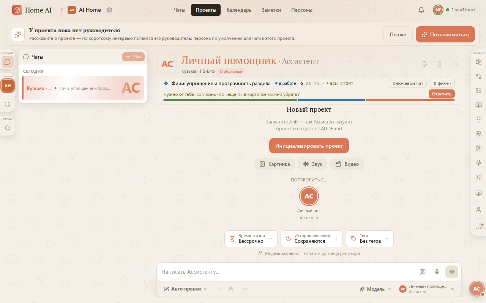
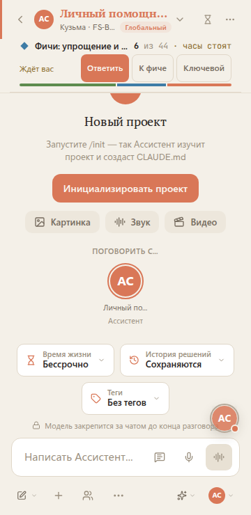
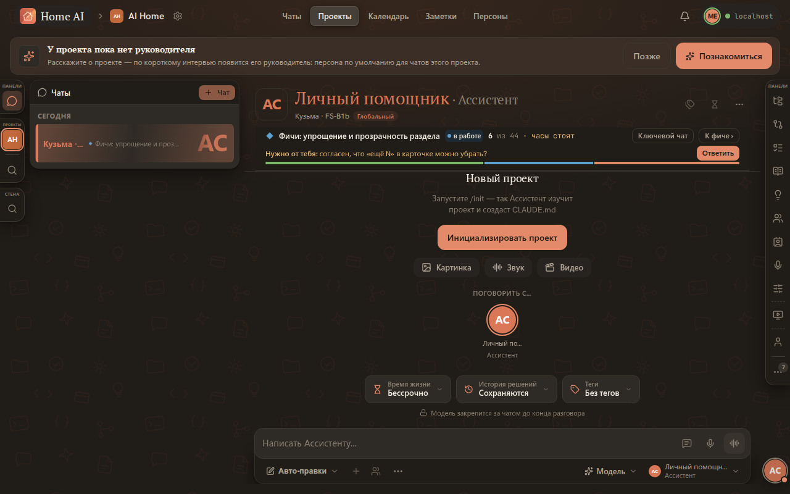
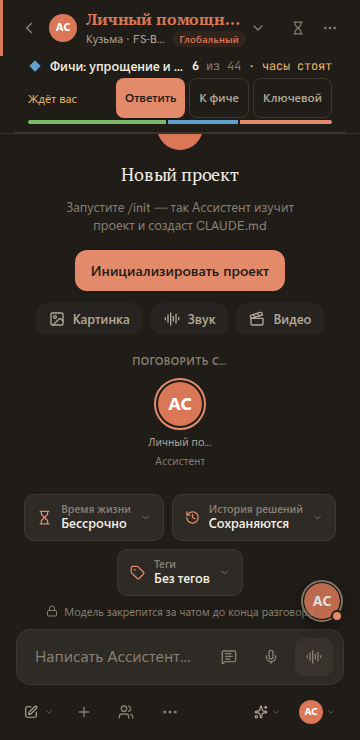
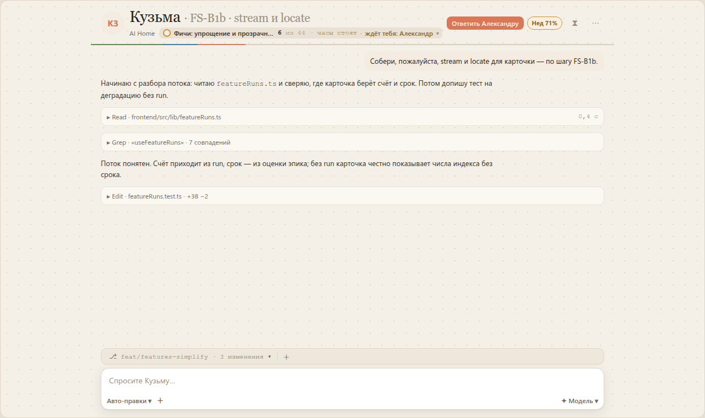
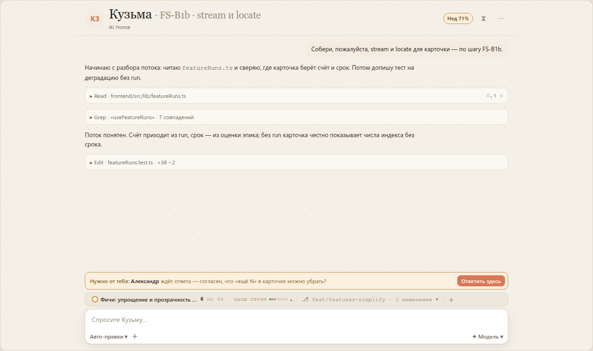
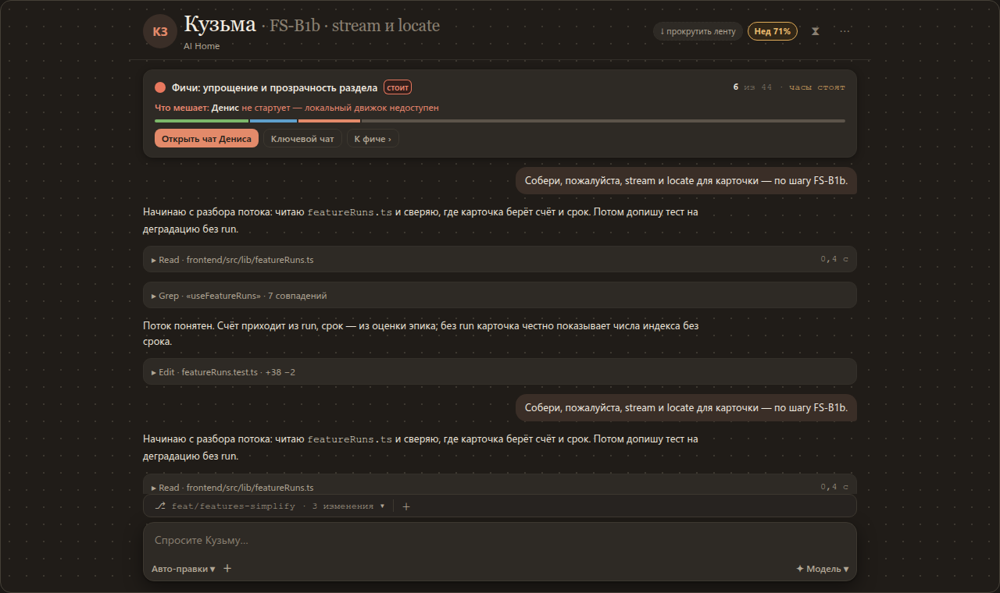

# Фича в чате: как вписать её в шапку и композер (3 варианта)

- **Задача:** 4bd58ad8 (запрос Андрея 11.11, после выкатки «Фичи: упрощение»)
- **Макет:** [chat-feature-fit-v1.html](chat-feature-fit-v1.html) — «как сейчас» и варианты А/Б/В; переключаются состояние фичи (идёт, ждёт тебя, стоит, смержена), тема и ширина 1280/360. Адрес вида `?v=a&s=wait&theme=dark&w=360`.
- **Статус:** предложение. Код продукта не меняется. Данные карточки (`featureChatCardModel`) те же, меняются только подача и место.

## 1. Как сейчас

Кадры сняты с живого стенда (сборка `master` 11.11, `FeatureChatCard` в слоте `featureBar`). Ручки фич подменены фикстурой, поэтому имён персон нет.

| | 1280 | 360 |
|---|---|---|
| светлая |  |  |
| тёмная |  |  |

Ещё два кадра: «идёт» — [live-run-light-1280](assets/chat-feature-fit/live-run-light-1280.png), «стоит» — [live-stop-dark-360](assets/chat-feature-fit/live-stop-dark-360.png). Высота карточки по замеру 71 px на 1280 и 77 px на 360.

**Как устроена страница чата.** Шапка-герой (`ChatHeaderBar`, остров) стоит прямо на холсте и не имеет своего фона. Поля у неё 12/18/10, аватар, заголовок `FONT.serif` 28/500, под ним строка-подзаголовок 12 px (проект, бейджи), справа иконки 32 px без рамок. Нижняя линия `C.borderLight` появляется только при прокрутке. Колонка ограничена `CHAT_MAX_W` 950. Композер — остров: над полем строка контекста (ADR-023) высотой 30/32 px, `R.lg`, `C.bgPanel`, рамка `C.border`; само поле — `C.bgWhite`, `R.xxl`, `SHADOW.island`. На 360 вместо героя тулбар `TB.heightMobile` 56 с заголовком 16 px.

## 2. Что выбивается

1. **Отдельная плашка.** Шапка прозрачна, а карточка заливает полосу `C.bgMain` и замыкает её линией `C.border`. Под героем получается вторая шапка, приклеенная снизу. На холсте с узором заливка видна как ровная бежевая лента.
2. **Двойные поля.** Обёртка острова даёт 18 px, карточка добавляет ещё `TB.padX` 16. Текст фичи начинается в 34 px от края, заголовок чата — в 18. Левый край ступенькой.
3. **Высоты вне ритма.** Строки 28 + 24 и полоса 4 не совпадают ни с сеткой шапки (52/56), ни со строкой контекста (30/32).
4. **Две разные кромки.** У шапки `C.borderLight`, и только при прокрутке. У карточки всегда `C.border`.
5. **Кнопки в рамках.** «Ключевой чат» и «К фиче ›» — `Button xs ghost` с рамкой, а все действия шапки — иконки без рамок. Полоса читается как чужая панель инструментов.
6. **Три сигнала одного состояния.** В «ждёт» глиф — синий ромб (`C.info`), тег — «в работе» на `C.infoBg` с синей точкой, фраза — янтарная «Нужно от тебя» (`C.warningText`). Тег и фраза говорят противоположное: «в работе» против «ждут тебя».
7. **Голос.** На 1280 фраза «Нужно от тебя», на 360 — «Ждёт вас».
8. **Трекер 4 px на всю колонку** — самый яркий объект экрана: четыре цвета на 950 px перебивают и заголовок, и ленту.
9. **360.** Во второй строке пять объектов: фраза, «Ответить», «К фиче», «Ключевой» и иногда «ещё N», все по 40 px. Фраза сжимается до двух слов. Карточка забирает 77 px из примерно 560, что остаются под ленту.
10. **Иерархия.** Название фичи набрано sans 13/600 — так же, как имя файла. Под serif-заголовком 28 оно не читается ни как «контекст чата», ни как отдельный объект.

Пункты 6–7 относятся к словам и тонам модели, а не к месту карточки. Их стоит отдать Софье (словарь) и Александру (тон глифа «ждёт» общий для всего раздела фич). В макете тон тревоги везде один — тон фразы.

## 3. Варианты

### А · фича — подзаголовок шапки (рекомендую)

У чата фичи строка под заголовком говорит, чей это чат: глиф · название · «6 из 44 · ≈ 2 д» · слово состояния. Своей полосы, фона и рамки нет. Нижняя кромка шапки становится полосой трекера 2 px: это место и так занимала линия.

- **За 5 секунд:** этап и остаток видны в подзаголовке. «ждёт тебя: Александр» или «стоит: Денис» написаны тоном тревоги в той же строке. На 1280 в правом кластере шапки стоит `Button xs primary` с действием тревоги.
- **Под рукой:** клик по строке открывает поповер ([кадр](assets/chat-feature-fit/a-wait-light-1280-open.png)): полная фраза с вопросом, трекер 4 px, счёт, «действие · Ключевой чат · К фиче ›».
- **360:** под именем чата строка 11 px — точка тона и «6/44 · ≈ 2 д» либо «ждёт тебя: Александр». Тап по блоку заголовка (цель ≥ 40) открывает шторку с кнопками 40 px ([кадр](assets/chat-feature-fit/a-wait-dark-360.png), [шторка](assets/chat-feature-fit/a-wait-dark-360-open.png)). Шапка не растёт: 56 + 2.
- **Плюсы:** к шапке ничего не добавляется, лента получает обратно 66–77 px. Новых поверхностей нет: типографика героя, кромка, поповер. Иерархия честная — чат в заголовке, фича как его контекст.
- **Минусы:** текст вопроса виден только по клику. На 360 действие тревоги — два тапа. Имя проекта из подзаголовка уходит: в чате фичи оно и так есть в хлебных крошках.

### Б · фича у композера

Фича становится первым чипом строки контекста («где работаем», рядом с её же веткой) с мини-трекером 40 px. Когда фича ждёт или стоит, над строкой появляется плашка тоном warning/danger с кнопкой («Ответить здесь»).

- **За 5 секунд:** счёт и срок в чипе. Просьба стоит над полем ввода, где на неё и отвечают.
- **Под рукой:** действие тревоги — в плашке; клик по чипу открывает поповер вверх с «Ключевой чат» и «К фиче ›».
- **360:** чип «● 6/44 ▴» (32 px — как вся строка контекста), плашка в одну строку.
- **Плюсы:** шапку не трогаем; просьба там, где отвечают.
- **Минусы:** низ экрана на 360 и так самый тесный, а теперь там плашка, строка и поле. При прокрутке вверх фича не видна, хотя это шапочная информация «чей чат». Лестнице схлопывания ADR-023 нужна новая ступень. Строка контекста описывает ход, а фича — чат, и такой вариант смешивает слои, которые ADR-023 развёл.

### В · карточка-остров в ленте

Фича становится первой карточкой ленты и говорит её языком (`C.bgCard`, `R.xl`, `C.borderLight`, `SHADOW.card`). При прокрутке карточка сжимается в закреплённую строку 36 px; на 360 это 44 px, и там она свёрнута сразу.

- **За 5 секунд:** всё сразу и полностью — вопрос, причина, трекер, счёт.
- **Под рукой:** все действия в развёрнутом виде; в свёрнутом — действие тревоги и «Подробнее».
- **Плюсы:** выглядит «своей»; есть место под полный текст.
- **Минусы:** закреплённый остров над лентой — та же третья полоса между шапкой и сообщениями, только в другом виде. Карточка читается как сообщение, и непонятно, кто его написал. Появляется состояние «свёрнута/развёрнута», от которого v5 сознательно ушёл.

## 4. Рекомендация: А

Карточка выбивается не из-за цвета или кнопок, а потому что фича живёт отдельным слоем между шапкой и лентой. Вариант А убирает этот слой: фича становится частью того, что у чата уже есть, — подзаголовка и нижней кромки. Высота возвращается ленте, обе темы держатся сами (новых поверхностей нет), на 360 шапка не растёт. Тревога не теряется: слово и тон стоят в строке, которую видно всегда, а на 1280 действие тревоги — одна кнопка в шапке. За полный текст вопроса платим одним кликом, и это честная цена: вопрос целиком живёт на странице фичи и в чате того, кто спрашивает.

Из Б стоит взять одну деталь, но отдельным решением: «Ответить здесь» в чате, где ждут, — это фокус поля ввода. Так уже работает и сейчас.

## 5. Спецификация варианта А (для Киры)

Контролы только из `components/ui/`, новых токенов нет.

| Элемент | Компонент | Токены и размеры |
|---|---|---|
| Строка фичи (1280) | `button` строки подзаголовка — `PressableArea` или `Button variant="ghost"` без рамки, если в ui-kit есть безрамочный вариант; иначе одна новая строка в `ui/` (предложить Глебу) | `FS.sm` 12, текст `C.textSecondary`; название 600 `C.textPrimary`, обрезка многоточием, полное в `title`; счёт `FONT.mono` `FS.sm`, число 700 `C.textHeading`, «часы стоят» `C.warningText`; поля `2px SP.xs+2`; `R.sm`; hover — фон `C.bgSelected`; focus — `SHADOW.focus` |
| Слово состояния | текст | идёт — `C.textSecondary`; ждёт — `C.warningText` 600 «ждёт тебя: {Имя}»; стоит — `C.dangerText` 600 «стоит: {Имя}»; смержена — `C.successText` |
| Глиф | `FeatureGlyph` 14 | тон — по тону фразы (решение по п. 6 раздела 2 за Александром) |
| Кромка-трекер | `FeatureTrackerBar` | высота 2, зазор 0, без скругления, на ширину колонки шапки; у смерженной — обычная линия `C.borderLight` при прокрутке |
| Действие тревоги (1280) | `Button size="xs" variant="primary"` | первым в правом кластере шапки; маршрут — `onAction` из `FeatureChatCard` |
| Поповер (1280) | `Menu`/поповер из ui | `C.bgCard`, рамка `C.borderLight`, `R.xl`, `SHADOW.dropdown`, ширина 400, поля `SP.md SP.lg-2`; внутри: название 13/600, фраза 12/1.45 тоном, трекер 4 px, счёт, ряд `Button xs`: действие primary · «Ключевой чат» ghost · «К фиче ›» ghost (или `Badge accent` «это ключевой чат») |
| 360: цель | весь блок заголовка тулбара | `minHeight` 40, `aria-haspopup="dialog"`, `aria-expanded` |
| 360: строка | текст | `FS.xs` 11: точка 6 px тоном · «6/44 · ≈ 2 д» либо «ждёт тебя: {Имя}» |
| 360: шторка | мобильная шторка ui (`Modal` в режиме sheet) | `R.sheet`, `SHADOW.sheet`, кнопки на всю ширину, `minHeight` 40 |

**Состояния.** Идёт · ждёт тебя · стоит · смержена (без трекера) · run ещё грузится: счёт из индекса, без срока, как сейчас · несколько фич: «ещё N» последней кнопкой поповера · чат вне фичи: подзаголовок как сейчас, кромка — обычная линия. Esc и клик мимо закрывают поповер, фокус возвращается на строку. Тёмная тема — те же токены, проверено кадрами макета.

## 6. Проверка макета

Скрипт `.cc-attachments/chat-feature-fit/shoot.mjs` (Playwright, Chromium) снимает 4 варианта × 4 состояния × 2 темы × 2 ширины плюс открытые поповер и шторку. Ошибок консоли 0. На 360 целей меньше 40 px в вариантах А и В нет; исключение — чипы строки контекста (32 px, конвенция ADR-023), на них же опирается чип варианта Б. Живые кадры «как сейчас» снимает `.cc-attachments/chat-feature-fit/live.mjs` с дев-стенда.
