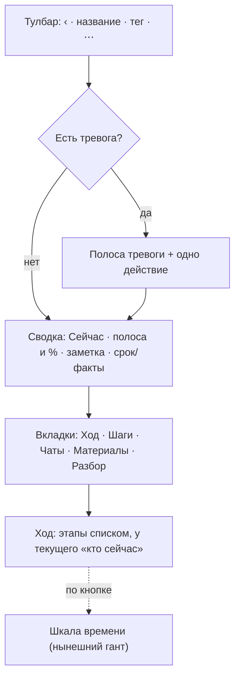

# Раздел «Фичи» проще · v1: регулярный первый экран

- **Фича:** 11041582-a74b-4f54-9d6d-6c0e3e610245
- **Статус:** черновик
- **Файлы:** features-simplify-v1.html, features-simplify-v1-proposal.md

Задача дизайна 9b7b723d (role=design). Код продукта не меняется: только аудит, рекомендации и макет. Шаги, которые воспользуются макетом, ещё не разрезаны. Их разрежут после интервью с Андреем.

## 0. С чего начинаю

29.10 был аудит **страницы** фичи: [feature-page-simplify-v1](feature-page-simplify-v1-proposal.md), 14 противоречий и сценарий A. С тех пор он почти целиком **внедрён** (коммиты Ш1–Ш8, ноябрь):
- одна тревога под тулбаром;
- сводка В2 «Трек»;
- процент только по трекеру;
- «Задачи» стали «Шагами», «События» — «Историей», «Планы и макеты» — «Материалами»;
- «Статистика» без hero и таблицы этапов;
- один `formatDuration`.

Эту работу я не повторяю. Здесь три новых вопроса:
1. Что осталось перегружено **после** внедрения.
2. Что не так со **списком фич** — его в прошлый раз не разбирали.
3. Как выглядит экран для **регулярной** работы: «зашёл на минуту — понял, за мной ли ход, и ушёл».

**Как смотрела.** По коду `master` (d8c117511): `components/feature/*`, `FeatureGroupHeader.tsx`, `SessionList.tsx` (режим «Фичи»), `FilterBar.tsx`, `chat/feature/FeatureBanner.tsx`. Разведчик прошёл по импортам, ключевые места я сверила сама. Живой стенд в этот раз **не поднимала**: снимки «как сейчас» на копии данных — первым делом в v2, вместе с интервью. Это ограничение аудита: частоты в таблицах ниже — моя гипотеза по сценарию, а не замер.

## 1. Инвентаризация

Частота — для сценария «веду 2–5 фич, захожу несколько раз в день». **Е** — ежедневно, **Ч** — часто, но не каждый день, **Р** — редко (разбор, после мержа). **Дубль** — что повторяет.

### 1.1. Список фич

Отдельного экрана нет: это режим группировки «Фичи» в списке чатов (`SessionList`, `groupBy='features'`).

| # | Блок | Что показывает | Частота | Дубль |
|---|---|---|---|---|
| Л1 | Фильтр видов (`FilterBar`) | 9 чипов: ждут вас · остановлены · идут · в очереди · на паузе · черновики · не начаты · смержены · закрытые; счётчики; «N из M»; «Сбросить» | Р (кроме «ждут вас») | — |
| Л2 | Строка «Показаны» | чипы выбранных видов с крестиками и «Сбросить» | Р | повторяет Л1 |
| Л3 | Строка фичи, строка 1 | глиф, название, давность (прячется при наведении) | Е | глиф повторяет фразу в строке 2 |
| Л4 | Строка фичи, строка 2 | стопка аватаров; «Сейчас **Имя** +N» / «в очереди · N из M» / «смержена…»; `N %`; ⚠N расхождений трекера | Е — фраза и %; Р — аватары и ⚠ | аватары повторяют «Сейчас Имя +N» |
| Л5 | Полоса трекера `FeatureTrackerBar` | корзины шагов | Е | повторяет `N %` (оставляем оба, см. R2) |
| Л6 | Кромка тревоги 3 px | жёлтая — ждёт, красная — стоит | Е | — |
| Л7 | Быстрое действие при наведении | «Ответить» / «К мержу» / «Ключевой чат», только десктоп | Ч | повторяет тревогу страницы |
| Л8 | Дерево чатов под фичей, «ещё N» | чаты группы | Ч | повторяет вкладку «Чаты» страницы |
| Л9 | «Закрытые · N · на втором плане» и «Без фичи» | закрытые группы компактно; чаты вне фич | Р / Ч | — |
| Л10 | Пустые состояния | «Фич пока нет», «Открытых фич нет. Последняя смержена…», «Под фильтр ничего не попало» | — | — |
| Л11 | Баннер фичи в чате (`FeatureBanner`) | тревога или название, %, статус, срок, полоса; раскрытие «Подробнее» | Е | повторяет сводку страницы — и правильно: это вход из чата |

### 1.2. Страница фичи: всегда видно

| # | Блок | Что показывает | Частота | Дубль |
|---|---|---|---|---|
| С1 | Шапка `CenterViewShell` | «Назад» / «Чат» / «К списку», глиф, название | Е | — |
| С2 | Тулбар | тег статуса, «Пауза» (десктоп), главное действие («Мерж…» / «Ответить…» / «Снять паузу» / «Запустить» / «Открыть ключевой чат»), «Возобновить», ⋯ | Е — тег; Ч — действие | главное действие повторяет С3 и С4 |
| С2⋯ | Меню ⋯ | «В очередь…», «Поставить на паузу…» (мобила), «Вынуть из очереди», «Запустить вне очереди…», «Скопировать ветку», «Открыть эпик в „Задачах“», «Закрыть фичу…», «Возобновить фичу» (мобила) | Р | «Скопировать ветку» повторяет строку ветки в сводке |
| С3 | Тревога | «ждёт ответа N» / «стоит N» / «молчит» / мерж / пауза / очередь, кнопка действия | Е | — (единственная, после Ш4) |

### 1.3. Страница фичи: сводка (над вкладкой «Хронология»)

| # | Блок | Частота | Дубль |
|---|---|---|---|
| С4 | Тег состояния и «обновлено» | Р | **тег — второй раз после тулбара (С2)** |
| С5 | «Сейчас» и подстрока, кнопка «Ответить …»; на мобиле ещё «Мерж…» и «Открыть финальное ревью» | Е | **кнопки — третий раз после С2 и С3** |
| С6 | Список активных (`ActiveList`) | Ч | частично повторяет «Сейчас» |
| С7 | «Готовность»: подпись, полоса, легенда, факт трекера, чипы «ещё не начато» | Е — полоса и %; Р — чипы | — |
| С8 | «Срок»: оценка, хвост, источник, примечание, альтернатива с вердиктом, «почему» | Е — дата; Р — всё остальное | — |
| С9 | Голос ведущего или «ведущий без заметки» | Е | — |
| С10 | Ветка с копированием | Р | **повторяет пункт ⋯** |
| С11 | Итоги «с начала · работа · возвраты · Статистика ›» | Ч | — |

### 1.4. Вкладки

| # | Вкладка | Что внутри | Частота | Дубль |
|---|---|---|---|---|
| В1 | Хронология (по умолчанию) | ⓘ; ось времени; метки мержа и волна; 7–8 строк этапов с дорожкой, «≈» длительностью, интервалами и паузами; раскрытие этапа: у «Производства» карточки шагов (`FeatureProdCardsView`), у остальных исполнители (`ExecutorRow` → `FeatureStepDetails`); поповер, превью и шторка интервала; «хвосты после мержа» | Е — какой этап и кто; Р — ось, интервалы, паузы | карточки шагов «Производства» повторяют В3 |
| В2 | Материалы | документы, прочие документы, макеты; читалка плана | Ч | — |
| В3 | Шаги | фильтры-корзины (все · корзины трекера · в master · снято · служебные), строки шагов, «Показать все» | Ч | цепочки шагов те же, что в карточках В1 |
| В4 | Чаты | живые чаты с ролью и моделью, «Архивные · N» | Ч | **повторяет дерево чатов в списке (Л8)** |
| В5 | История | лента событий по дням, «Показать все · N» | Р | — |
| В6 | Статистика | строка анализа; `AccuracyBadges` «≈ по задачам»; плитки; «Главные потери»; `TaskButtons` (этап → задача); «Кто и на чём работал» (ось: персоны / модели / роли × мера: время / токены / деньги, кольцо, таблица или карточки, чаты строки); «Подробнее» | Р | строка анализа повторяет тревогу С3; `TaskButtons` повторяют переходы из В3 |

Про «4 вида разбивки». Мёртвых компонентов нет. `FeatureBreakdownTable` и `FeatureBreakdownCards` — один и тот же блок в версиях для десктопа и мобилы, `FeatureBreakdownChats` вложен в оба. Перегружает не число компонентов, а **9 сочетаний** (3 оси × 3 меры) в одном блоке.

## 2. Диагноз перегруза

Противоречий в числах после Ш1–Ш8 почти не осталось. Остался перегруз другого рода: **одно действие и одно состояние нарисованы в нескольких местах**, а **инструменты разбора стоят на месте ежедневных**.

| # | Где | Что не так |
|---|---|---|
| Д1 | Тег состояния | Тулбар (С2) и сводка (С4). На десктопе оба видны одновременно. |
| Д2 | Главное действие | «Мерж…» в тулбаре, в тревоге и в сводке (на мобиле). «Ответить» в тревоге и в сводке. До 3 одинаковых кнопок на первом экране 360. |
| Д3 | Сводка | 7 зон (С4–С11). На 360 «Хронология» начинается за первым экраном. «Срок» на 6 строк, хотя ежедневно нужна одна дата. |
| Д4 | «Хронология» | Ось времени, метки мержа, интервалы и паузы — инструмент **разбора**. Ежедневно нужно: какой этап, кто сейчас, что дальше. На 360 дорожка шириной ~150 px почти ничего не говорит. |
| Д5 | Шаги в двух видах | Карточки «Производства» (В1) и вкладка «Шаги» (В3) строятся из одних `stepChains` разной вёрсткой. |
| Д6 | Шесть вкладок | Две из них — ретроспектива: «История» и «Статистика». На 360 ряд прокручивается вбок, «Статистика» за краем. |
| Д7 | «Статистика» | 9 сочетаний разбивки; плашка точности; переходы «этап → задача»; строка анализа повторяет тревогу. |
| Д8 | Список: фильтр | 9 чипов на вопрос, у которого каждый день два ответа: «что ждёт меня» и «что идёт». |
| Д9 | Список: строка фичи | 3 строки (с полосой) и 8 элементов: аватары, ⚠N, давность, глиф, быстрое действие. Пять фич с раскрытыми чатами занимают больше экрана. |
| Д10 | Список: порядок | Фичи идут в порядке бэка. Фича, которая ждёт вас, не обязательно вверху: её выделяет только кромка 3 px. |
| Д11 | Чаты в двух местах | Дерево под фичей в списке (Л8) и вкладка «Чаты» (В4). |

**Где информация прячется.** Это обратная сторона:
- Тревога «молчит / стоит» в **списке** видна только кромкой, без текста — текст есть только на странице.
- Фича в очереди не показывает, за какой фичей она стоит.
- Расхождение трекера (⚠N) есть в строке списка, но на первом экране страницы его нет: только в легенде «Готовности».

## 3. Рекомендации

Формат: **что делаем → что теряем и почему это допустимо.** Номера R совпадают с метками в макете.

### Список фич

**R1. Фильтр: три пресета вместо девяти чипов.** Над списком сегмент «Меня ждут N · В работе N · Все N»:
- «Меня ждут» = ждут вас + остановлены;
- «В работе» = идут + в очереди + на паузе;
- «Все» = открытые.

Тонкий выбор по 9 видам остаётся в поповере фильтра (`FilterBar`), строку «Показаны» (Л2) убираем: выбор уже виден на сегменте. Пресет по умолчанию — «Меня ждут», если там не 0, иначе «В работе».
*Теряем:* выбор «только на паузе» в один клик, теперь он в поповере. Нужен он редко.

**R2. Строка фичи — две строки и тонкая полоса:**
- строка 1: название и `N %` моно;
- строка 2: одна фраза состояния. Для тревоги она с текстом: «Ждёт вас 12 мин · Майя», «Стоит 2 ч · Тимур не отвечает». Для очереди: «В очереди · 1 из 2 · после „Общих проектов“»;
- полоса 3 px.

Убираем стопку аватаров (имя уже в фразе), ⚠N (переезжает на страницу, см. R12) и давность (у живой фичи её заменяет фраза, у закрытой давность остаётся). Глиф остаётся только у закрытых и черновиков: там фразы нет.
*Теряем:* аватары всех участников — на ежедневный вопрос «кто сейчас» отвечает имя в фразе. ⚠ в списке — это сигнал для разбора, ежедневно он не нужен.

**R3. Порядок: «ждут вас → стоят → идут → очередь → пауза → черновики»; закрытые и смерженные — свёрнутым разделом «Закрытые и смерженные · N».** Дерево чатов под фичей по умолчанию свёрнуто. Раскрыта только фича, которая ждёт вас, и открытая сейчас.
*Теряем:* «последние по активности» сверху. Это вопрос к Андрею (В-3).

**Быстрое действие при наведении (Л7)** оставляем: на десктопе оно экономит переход, а на 360 его и так нет.

### Страница фичи

**R4. Тег состояния — только в тулбаре.** Из сводки убираем тег и «обновлено» (С4). «Обновлено» уходит в `title` тега.
*Ничего не теряем:* тулбар видно всегда.

**R5. Меню ⋯ без изменений, кроме ветки.** Строку ветки (С10) из сводки убираем, остаётся пункт «Скопировать ветку».
*Теряем:* имя ветки на виду. Нужно оно только при ручном мерже.

**R6. Главное действие — в одном месте.** Есть тревога — действие только в её полосе. В тулбаре и сводке, включая мобильные «Мерж…» и «Открыть финальное ревью», дублей нет. Тревоги нет — в тулбаре остаётся «Открыть ключевой чат» / «Снять паузу» / «Запустить фичу».
*Ничего не теряем:* полоса тревоги на всех вкладках и над сводкой. На 360 она на первом экране.

**R7. Сводка — четыре строки.**
1. «Сейчас **Имя** делает … · с ЧЧ:ММ».
2. Полоса трекера с `N %` и легенда (пустые корзины скрыты).
3. Заметка ведущего, 2 строки, раскрывается по нажатию.
4. Факты: «срок ≈ 3 дн · почему › · с начала · работа · возвраты».

«Почему ›» открывает поповер (на мобиле шторку) с источником, альтернативой, вердиктом и примечанием (весь нынешний С8). Список активных (С6) уходит в этап «Производство» вкладки «Ход» (R9). Чипы «ещё не начато» — во вкладку «Шаги» как фильтр «не заведено». Ссылку «Статистика ›» убираем: есть вкладка.
*Теряем:* разбор оценки срока на виду; это справка, она в одном нажатии. Список активных на первом экране — на десктопе он стоит сразу под сводкой во «Ходе», на 360 одну прокрутку ниже.

**R8. Пять вкладок: «Ход · Шаги · Чаты · Материалы · Разбор».**
- «Хронология» → «Ход»: короче, и это ответ на «как идёт», а не на «что было».
- «История» + «Статистика» → «Разбор»: внутри сегмент «Лента · Цифры», по умолчанию «Лента».

На 360 пять коротких вкладок влезают без прокрутки (≈ 330 px при `SP.md` между ними).
*Теряем:* один клик до статистики. Открывают её после мержа или при разборе, не каждый день.

**R9. «Ход»: этапы — список, текущий раскрыт.** Строка этапа: точка, имя, одно слово-счётчик («принято 26 из 98», «13 ждут»), длительность «≈». Без дорожки. У текущего этапа под строкой — «кто сейчас»: до 3 строк «Имя · шаг · идёт N». Это тот же `ActiveList`, но в одном месте.
*Теряем:* дорожки на первом экране. Их место — R11.

**R10. Шаги — одним видом.** Карточки «Производства» (`FeatureProdCardsView`) в «Ходе» показывают только живое: в работе, ждут, стоят. Дальше ссылка «Все шаги этапа — N ›» ведёт во вкладку «Шаги» с фильтром этапа.
*Ничего не теряем:* полный список в одном нажатии, вёрстка шага одна.

**R11. Шкала времени — по кнопке «Показать на шкале времени».** Нынешний гант без изменений (ось, метки мержа, интервалы, паузы, поповеры) — за переключателем «Список · Шкала». Выбор запоминается на устройстве. На 360 по умолчанию всегда «Список».
*Теряем:* паузы и интервалы с первого взгляда. Ежедневно они не нужны, при разборе — один клик.

**R12. «Разбор → Цифры» без лишнего.**
- Строку анализа убираем: она повторяет тревогу.
- `TaskButtons` убираем: переходы есть в «Шагах».
- Плашку точности «≈ по задачам» переносим в `title` заголовка.
- В «Кто и на чём работал» по умолчанию «персоны × время»; ось и меру выносим в одну кнопку «Разрез ▾» вместо двух рядов переключателей.
- ⚠ расхождения трекера (из списка, R2) живёт здесь отдельной строкой «Трекер расходится · N» со ссылкой в «Шаги». Плюс в легенде сводки, как сейчас.

*Теряем:* видимость двух переключателей; 9 сочетаний остаются доступны.

### Чего не трогаем

- **Баннер фичи в чате (Л11)** — это вход из чата, он уже сведён в одну поверхность (ac248a206).
- **Тревога (С3)** — она уже единственная.
- **«Материалы» и «Чаты»** на странице. Дерево чатов в списке и вкладка «Чаты» дублируют друг друга только на десктопе. На 360 список — отдельный экран, и вкладка там нужна.

### Первый экран, итог

| | Сейчас | Цель |
|---|---|---|
| Десктоп 1240, страница | тулбар, тревога, сводка из 7 зон, 6 вкладок, ось и 8 дорожек | тулбар, тревога, сводка из 4 строк, 5 вкладок, этапы списком с «кто сейчас» — всё на одном экране без прокрутки |
| 360, страница | тулбар, тревога, сводка; кнопки действия дважды; вкладки за первым экраном | тулбар, тревога с действием, сводка (≈ 220 px); вкладки и текущий этап видны на первом экране 360×740 |
| Список фич | 9 чипов, строка из 3 частей и 8 элементов, порядок бэка | 3 пресета, строка из 2 частей и 4 элементов, «ждут вас» сверху, закрытые свёрнуты |

## 4. Порядок внедрения (эскиз, разрежем после интервью)

| Шаг | Что | Размер |
|---|---|---|
| Р-а | R4 + R5 + R6: тег и действие в одном месте, ветка только в ⋯ | S, фронт |
| Р-б | R7: сводка в 4 строки, поповер срока | M, фронт |
| Р-в | R8 + R12: «Ход» и «Разбор», чистка «Цифр» | M, фронт |
| Р-г | R9 + R10 + R11: «Ход» списком, переключатель шкалы | M, фронт |
| Р-д | R1 + R2 + R3: пресеты, строка фичи, порядок | M, фронт; порядок «ждут вас сверху» — сортировка на бэке в индексе фич или на фронте (решит Александр) |

Р-а независим и самый дешёвый. Его можно делать до интервью: он не зависит от ответов.

## 5. Вопросы к Андрею для интервью

1. **Зачем заходишь на страницу фичи чаще всего?** «За мной ли ход», «что сделали, пока меня не было» или «отчёт после мержа»? От ответа зависит, что стоит во вкладке по умолчанию: «Ход» или лента.
2. **Откуда заходишь?** Из списка слева, из баннера в чате, по уведомлению, по ссылке из доклада задачи? Если в основном из баннера, страница — второй уровень, и сводку можно ужать сильнее.
3. **Сколько фич ведёшь одновременно и сколько из них реально смотришь за день?** Нужен ли порядок «ждут вас сверху» или привычнее «последние по активности»?
4. **Какими чипами фильтра видов пользовался за последний месяц?** Если только «ждут вас» и «закрытые», три пресета закрывают всё.
5. **Гант со шкалой времени: когда последний раз смотрел интервалы и паузы и что хотел узнать?** Хватит ли «этап · ≈ длительность» в списке, а шкалы — по кнопке?
6. **«Кто и на чём работал» и расход в деньгах и токенах: это про контроль бюджета фичи или про оценку моделей?** Первое — цифру стоит держать в сводке, второе — она уходит в «Разбор».
7. **Срок: что с ним делаешь?** Планируешь по дате, сравниваешь с прошлым или просто смотришь, что «ещё не скоро»? Нужны ли источник, альтернатива и вердикт на виду?

## 6. Макет

`features-simplify-v1.html` — самодостаточный HTML, токены светлой темы из `theme.css` вынесены в `:root` (C, FS, SP, R), ниже по коду только `var(--…)`. Пульт: состояние «Идёт / Ждёт вас», вид «Десктоп + 360 / Десктоп / 360», пометки R1…R12. Три кадра: десктоп 1240 (список и остров страницы), 360 «список» и 360 «первый экран фичи». Под кадрами — карточки «что поменялось и что теряем».

Тёмная тема в этой итерации не прорисована: в макете только токены, а их тёмные значения уже есть в `theme.css`. Тёмную тему и снимки «как сейчас» со стенда добавлю в v2 после интервью.

## Для Киры (эскиз; полная спецификация — в v2 после решений)

- **Пресеты списка:** сегмент из кита (`ui/`), высота 28 (на 360 — 36), `R.max`, выбранный — `C.accentLight` с рамкой `C.accentMuted`, текст 600 `C.textHeading`; счётчик `FONT.mono` `FS.xs`. Пустой пресет не прячется, а показывает 0.
- **Строка фичи:** поля `SP.sm`/`SP.md` (на 360 — `SP.md`), `R.lg`, фон `C.bgCard`; выбрана — `C.accentLight` и `C.accentMuted`. Название 600 `FS.base` `C.textHeading` с многоточием; % `FONT.mono` 600 `FS.sm` `C.textSecondary`. Фраза `FS.sm` `C.textSecondary`, тревога — `C.warningText`, стоп — `C.dangerText`. Полоса 3 px с зазором 2, цвета корзин как у `FeatureTrackerBar`. Кромка тревоги — как сейчас (inset 3 px `C.warning` / `C.danger`).
- **Сводка:** «Сейчас» `FS.md`, имя 600 `C.textHeading`. Полоса 6 px, % `FONT.mono` 700 `FS.lg`. Легенда `FS.xs` `C.textMuted`, числа mono 600 `C.textSecondary`. Заметка `C.bgInset`, `R.md`, 2 строки, раскрытие по нажатию. Факты `FS.sm`, значения mono 600 `C.textHeading`, «почему ›» — ghost-кнопка `C.accent`, тач-цель на 360 не ниже 32.
- **«Ход»:** строка этапа сетка `14px 1fr auto`, точка 10 px (готов — `C.success`, идёт — `C.info` с кольцом `C.infoBg`, впереди — `C.progressTrack`). Строка 44 на 360. Строка шага — `C.bgCard`, `R.md`, 44 на 360.
- **Состояния:** loading — скелет сводки из 4 строк; ошибка — «Не загрузилось · Повторить» в сводке; нет оценки — «срок —» с `title` «мало похожих фич»; тревоги нет — полосы нет; у этапа нет живых шагов — «Сейчас никто не работает» `C.textMuted`.
