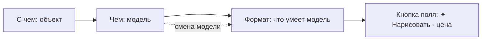

# «Формат» — размер и пропорции картинок и видео · записка к макету v1

Макет — [media-format-v1.html](media-format-v1.html): открывается без сети, есть обе темы, переключатель
«Компьютер / Телефон 360» и 11 сценариев. Шаги кликаются по порядку, а внутри макета всё нажимается и руками.
Справа живая панель «Что уходит в модель»: в ней видно тело запроса при текущем выборе.

Основа — решения Андрея от 2026-10-06 (постановка задачи `13eb6c1b`) и строка контекста из
[ADR-023](../adr/ADR-023-turn-context.md). **Все цены и размеры в макете иллюстративные**: настоящие придут из
каталога моделей и котировки.

## Суть

- **Размер задаётся в одном месте — чипом «Формат» в строке контекста.** Чип стоит сразу за «Чем», потому что
  набор форматов зависит от выбранной модели. В свёрнутом виде виден итог: «16:9 · 1792×1024» у картинки,
  «9:16 · 720p» у видео, «Как у исходника · 4:3» у правки.
- **Раскрытый чип** (всплывашка над строкой, на телефоне шторка) содержит:
  - пропорции кнопками с силуэтом кадра, только те, что умеет модель;
  - ступень качества: «Стандарт / Высокое / Макс». Под каждой ступенью мелко написан размер для выбранной
    модели («1792×1024», «720p · 1280×720») и цена;
  - ссылку «Точно… ширина × высота ›»: поля, пресеты и строку «Уйдёт в модель: 1920×1088». Если модель так не
    рисует, размер округляется, и рядом пишется причина.
- **Только то, что умеет модель.** После смены модели формат переходит на ближайший доступный, и над строкой
  появляется объяснение: «16:9 нет у GPT Image — взяли 3:2». **Выбор человека при этом не теряется:** вернёшь
  модель с 16:9, и вернётся 16:9 (сценарий 2).
- **Правка картинки:** по умолчанию «Как у исходника», это прежний `matchSourceSize`. Если выбраны другие
  пропорции, интерфейс спрашивает явно: «Дорисовать края» (ИИ, цена, итоговый размер) или «Обрезать»
  (без ИИ, бесплатно, рамка «Слева / По центру / Справа»). Сама модель пропорции не тянет и не режет.
  **Обрезка даёт новую версию картинки**, а не шаг текущей. Агент обрезает тем же путём (`op = crop`), и в
  ленте видна та же строка и та же карточка, только вместо «Вы» стоит «✦ Claude» (сценарии 4 и 11).
- **«Макс» у локального видео (MiniMax H3)** — 1440p в два прогона на своей видеокарте: съёмка 1344×768, затем
  увеличение до 2528×1440. Время обоих прогонов видно в подписи ступени. В карточке съёмки увеличение идёт
  отдельной стадией, и его можно отменить. 768p вместо 1440p молча не подставляется (сценарий 10). У остальных
  моделей «Макс» без родного размера остаётся серой с причиной.
- **Память:** формат запоминается на проект, отдельно для картинок и отдельно для видео. **У фильма формат
  один**: его задаёт первая сцена, остальные сцены за ней следуют (на чипе замок). Сцена в другом формате даёт
  заметное предупреждение в чипе и в строке фильма и кнопку «Привести к 16:9».
- **Агент** задаёт формат теми же параметрами. Если формат сменил агент, на чипе стоит «✦», а в ленте
  появляется тихая строка. Ручная правка метку снимает.

## Как «Формат» ложится рядом с «Чем»

- «Формат» **зависит** от «Чем», а не наоборот: модель задаёт допустимые пропорции, ступени и сетку размеров,
  а формат приводится к ним. Обратного хода нет: из «Формата» модель не меняется. Единственное исключение —
  пустое состояние, где есть ссылка «Сменить модель в «Чем»».
- Цена на кнопке поля и в подписи ступени — одна и та же котировка: формат входит в `quote` наравне с `op`.
- **Чип «Формат» виден и в режиме «Чат»**, в отличие от «Чем» (§Р2 ADR-023). Агент по умолчанию тоже рисует в
  формате проекта, и человек должен видеть, в каком именно. Это предложение макета, см. открытый вопрос 1.
- В панели «Контекст» «Формат» становится секцией под «Чем» с тем же содержимым. Закрытый набор
  `LaunchParam` получает вид `format` вместо `aspect`. Этим решение «схемы модели в панели нет» сохраняется:
  у формата фиксированная форма, и вертикаль отдаёт только данные.

### Тексты чипа

| Состояние | Свёрнутый чип | Телефон |
|---|---|---|
| Новая картинка | `16:9 · 1792×1024` | `16:9 · 1792` |
| Точный размер | `1920×1088 · точно` (жёлтый, если было округление) | так же |
| Правка | `Как у исходника · 4:3` | так же |
| Правка → дорисовать | `1:1 · дорисовать · 1600×1600` | `1:1 · дорисовать` |
| «Увеличить» | `×2 · 3200×2400` (приглушён: размер задаёт операция) | `×2` |
| Видео-сцена | `9:16 · 720p`, при подрезке кадров добавляется ⚠ | так же |
| Сцена фильма | `16:9 · 720p 🔒` | так же |
| Сцена не в формате фильма | `9:16 · 720p ⚠` (жёлтый) | так же |
| Формат поставил агент | `… ✦` | так же |
| Модель не сообщила размеры | `Формат Как у модели` (приглушён) | так же |

## Сценарии макета

| № | Сценарий | Что проверяет |
|---|---|---|
| 1 | Новая картинка: «Формат» → 16:9 → «Высокое» (подпись «1792×1024 · $0.08») → «Нарисовать» | основной путь; кнопка поля берёт цену ступени |
| 2 | «Чем» → GPT Image (только 1:1, 3:2, 2:3) → «16:9 нет у GPT Image — взяли 3:2» → возврат FLUX → снова 16:9 | автопереход с объяснением; желание помнится |
| 3 | «Точно…» → 1920×1080 → «Модель рисует кратно 64: 1920×1088»; 2600×1400 → «до 2048 px по длинной стороне»; «Вернуться к пропорциям» | округление с пометкой |
| 4 | Правка `кот.png` 4:3 → 1:1 → «Дорисовать края» (1600×1600, $0.04) и, вторым путём, «Обрезать» (1200×1200, рамка «Слева») → версия 2 | явный выбор вместо молчаливого растяжения или обрезки; обрезка — новая версия |
| 5 | Видео-сцена → 9:16 · 720p; кадры 16:9 → «кадры будут подрезаны» с превью и якорем рамки; смена модели на MiniMax H3 → ступени 480p / 768p / 1440p | видео тем же чипом, превью подрезки |
| 6 | Сцена 2 фильма: «16:9 · 720p 🔒» → 9:16 → «Оставить 16:9 / Всё равно 9:16» → предупреждение в чипе и в строке фильма → «Привести к 16:9» | один формат на фильм |
| 7 | Ход агента `image_generate(aspect "9:16", quality "high")` → чип с ✦ и тихая строка → ручная «Макс» снимает ✦ | метка агента |
| 8 | Телефон 360: строка прокручивается, тап по чипу открывает шторку, «Точно…» с полями 16 px, «Готово»; правка с вопросом «Дорисовать / Обрезать» в шторке | мобильная раскладка |
| 9 | «Чем» → Soul (Higgsfield, размеров не сообщает) → только «Как у модели» с причиной → «Сменить модель в «Чем»» | пустое состояние |
| 10 | Сцена на MiniMax H3 → «Макс» («1440p · 2528×1440 · бесплатно · ~21 мин») → «Снять» → стадия «Снимаем» → «Увеличиваем до 1440p… ещё ~15 мин» → отмена, повтор, сбой, готово | «Макс» локального видео в два прогона; 768p не подставляется молча |
| 11 | «Обрежь до 1:1» → ход агента `image_generate(op "crop", aspect "1:1", anchor "center")` → строка «✦ Claude обрезал без ИИ…» и карточка `кот.png · v2` | обрезка агентом выглядит как обрезка человеком |

## Тексты интерфейса

| Место | Текст |
|---|---|
| Заголовок всплывашки | «Формат новой картинки» · «Формат · кот.png» · «Формат сцены» · «Формат сцены · фильм «утро-в-горах»» |
| Подписи групп | «Пропорции» (справа — имя модели), «Качество», «Точно», у правки — «Другие пропорции» |
| Ступени | «Стандарт» / «Высокое» / «Макс»; под ними размер и цена; если ступени нет — «нет у модели» и подсказка «Модель рисует один размер ~1,6 Мп — «Высокое» и «Макс» у неё недоступны» |
| Ступени local MiniMax H3 | «Стандарт» — «480p · 864×480 · бесплатно · ~1,5 мин»; «Высокое» — «768p · 1344×768 · бесплатно · ~5,5 мин»; «Макс» — «1440p · 2528×1440 · бесплатно · ~21 мин». У 9:16 стороны меняются местами: «768×1344», «1440×2528». Время — для ролика 5 с |
| «Макс» у H3, подсказка под ступенями | «„Макс“ — два прогона на вашей видеокарте: съёмка 1344×768 (~5,5 мин), затем увеличение до 2528×1440 (~15 мин). Увеличение можно отменить.» |
| «Макс» у H3, ролик длиннее 5 с | «1440p · 2528×1440 · бесплатно · время не замерено» (котировка не отдаёт `eta`, число не выдумываем) |
| Кнопка поля, H3 «Макс» | «✦ Снять · бесплатно · ~21 мин» |
| Запуск (лента) | «Вы запустили: Снять · MiniMax H3 · 16:9 · 1440p · съёмка + увеличение» |
| Карточка съёмки: заголовок | «Рассвет · съёмка» · «MiniMax H3 · локально · 16:9 · 1440p · бесплатно» |
| Карточка съёмки: стадия 1 | идёт — «Снимаем · 1344×768…» · «~5,5 мин» · «Отменить»; готова — «Съёмка · 1344×768» · «готово» |
| Карточка съёмки: стадия 2 | ждёт — «Увеличение до 1440p · 2528×1440» · «следом · ~15 мин»; идёт — «Увеличиваем до 1440p…» · «ещё ~15 мин» · «Отменить увеличение»; готова — «готово» и под превью «Версия 1 · 1440p · 2528×1440» |
| Увеличение не удалось | стадия 2 — «не удалось» (жёлтый); ниже, жёлтым, «Увеличение до 1440p не удалось. Съёмка 768p сохранена версией 1 — в 1440p её нет.» — «Повторить». Решено (Андрей, 2026-10-06): 768p сохраняется версией |
| Увеличение отменено | стадия 2 — «отменено» (приглушён); ниже, нейтрально, «Увеличение отменено. Съёмка 768p сохранена версией 1 — в 1440p её нет.» — «Увеличить до 1440p» (та же ручка повтора). С неудачей не смешивать, см. «Сверка текстов Б4», п. 4 |
| Версия 768p, когда повтор уже дал 1440p | кнопки нет; нейтрально, без значка ⚠: «Съёмка 768p сохранена версией 1, а в 1440p — версией 3.» Одинаково после неудачи и после отмены |
| Ссылка | «Точно… ширина × высота ›» |
| Итог «Точно» | «Уйдёт в модель: 1920×1088» |
| Округление | «Модель рисует кратно 64: 1920×1088.» · «Модель рисует до 2048 px по длинной стороне; Модель рисует кратно 64: 2048×1088.» |
| «Точно» недоступно | ««Точно…» недоступно: GPT Image рисует только три размера — 1024×1024, 1536×1024 и 1024×1536.» |
| Смена модели | «16:9 нет у GPT Image — взяли 3:2.» · «Точный размер 1920×1080 GPT Image не умеет — взяли 16:9.» · «У MiniMax H3 другие ступени: «Высокое» — 768p.» |
| Правка, умолчание | «Как у исходника · 4:3 — 1600×1200 — модель работает своим размером, результат вернётся к исходнику» |
| Вопрос пропорций | «4:3 → 1:1. Как получить 1:1?» — «Дорисовать края · ИИ · FLUX.1 Fill · $0.04 · 1600×1600» / «Обрезать · Без ИИ · бесплатно · 1200×1200 · новой версией»; «Рамка обрезки: Слева · По центру · Справа»; «Сама модель пропорции не тянет и не режет — только то, что выберете здесь. Отмена» |
| После обрезки (лента) | человек — «Вы обрезали без ИИ: 1200×1200 · 1:1 · бесплатно · версия 2»; агент — «✦ Claude обрезал без ИИ: 1200×1200 · 1:1 · бесплатно · версия 2» |
| После обрезки (карточка) | «кот.png · v2» · «1200×1200 · 1:1 · обрезано без ИИ»; у агента в конце « · ✦ Claude». Объект в строке контекста — «кот.png · v2» |
| Чип «Дорисовать» без формата | ««Дорисовать»: выберите в «Формате» пропорции, до которых дорисовать.» |
| «Увеличить» | «У «Увеличить» размер задаёт сама операция: ×2 → 3200×2400. Пропорции не меняются.» |
| Кадры видео | «Кадры A и B — 16:9, сцена — 9:16: кадры будут подрезаны по бокам до модели.» + превью + «Слева · По центру · Справа»; при подрезке по высоте — «Сверху · По центру · Снизу». Остальные варианты — «Сверка текстов Б4», п. 1 и 5 |
| Фильм | «Формат фильма «утро-в-горах» — 16:9, его задала сцена 1. Остальные сцены следуют за ней, иначе при склейке пойдут чёрные полосы.» |
| Попытка сменить у сцены фильма | «Фильм «утро-в-горах» — 16:9. Сцена в 9:16 даст чёрные полосы по бокам при склейке.» — «Оставить 16:9» / «Всё равно 9:16» |
| Сцена не в формате | «Сцена в 9:16, а фильм «утро-в-горах» — 16:9. При склейке пойдут чёрные полосы.» — «Привести к 16:9» |
| Пустое состояние | «Как у модели — Higgsfield не сообщил, какие размеры умеет Soul, — рисуем её размером по умолчанию.» · «Пропорции и качество появятся, когда выберете модель с известными размерами.» · «Сменить модель в «Чем»» |
| Низ всплывашки | «Запомнится для картинок проекта «AI Home».» · «… · поставил Claude ✦» · «Только для этой правки — исходник не меняется, пока не сохраните.» · «Один формат на все сцены фильма «утро-в-горах».» |
| Агент (лента) | «✦ Claude сменил формат картинок проекта: 16:9 → 9:16» |

## Сверка текстов Б4 (видео, 2026-10-07)

Кира вывела часть текстов видео-«Формата» сама, потому что в записке их не было дословно. Ниже итог
сверки. Тексты из этого раздела равны по силе таблице «Тексты интерфейса».

1. **Подрезка кадров.**
   - Подрезан один кадр: «Кадр B — 9:16, сцена — 16:9: кадр будет подрезан сверху и снизу до модели.»
     **Подтверждаю как есть.** «Сверху и снизу» — пара к «по бокам», тоже подтверждаю.
   - Подрезаны оба, пропорции разные, сторона одна. Было: две фразы подряд, вторая повторяет первую
     («Кадр A — 4:3, сцена — 16:9: кадр будет подрезан … Кадр B — 9:16, сцена — 16:9: кадр будет подрезан …»).
     **Заменить** одной фразой: «Кадр A — 4:3, кадр B — 9:16, сцена — 16:9: кадры будут подрезаны сверху и снизу
     до модели.»
   - Подрезаны оба, в разные стороны (бывает у сцены 1:1). **Заменить:** «Сцена — 1:1: кадр A (16:9) будет
     подрезан по бокам, кадр B (9:16) — сверху и снизу до модели.»
2. **Подвал вне фильма:** «Запомнится для видео проекта «…».» и «… · поставил Claude ✦». **Подтверждаю как
   есть**: та же форма, что у картинок, и тот же вариант «личных чатов».
3. **Пояснение у «Макс», когда время не замерено.** В подписи ступени «время не замерено» — **подтверждаю**
   (строка «ролик длиннее 5 с» выше). В подсказке под ступенями скобки со временем просто опускаются:
   «„Макс“ — два прогона на вашей видеокарте: съёмка 1344×768, затем увеличение до 2528×1440. Увеличение можно
   отменить.» **Подтверждаю как есть**: второе «не замерено» рядом с подписью ступени было бы повтором.
4. **«Отменено» и «не удалось» — различать: да.** Человек, который сам нажал «Отменить увеличение», не должен
   видеть жёлтое «не удалось»: это читается как сбой видеокарты. Тексты — строки «Увеличение не удалось» и
   «Увеличение отменено» в таблице выше: разные значок стадии, тон предупреждения и подпись кнопки
   («Повторить» и «Увеличить до 1440p»). Ручка у обеих кнопок одна. Отличить можно уже сейчас: при отмене
   бэкенд пишет в `upscaleError` ровно «Увеличение отменено» (`LocalVideoEngine`). Но сравнение строки хрупкое,
   поэтому Денису стоит отдать явный признак (например, `upscaleCancelled: true`), а фронту — перейти на него.
5. **Якорь при подрезке по высоте: да.** Сервер уже понимает `top` / `bottom` (`CropAnchors`). Набор зависит
   от стороны: режем бока — «Слева · По центру · Справа», режем верх и низ — «Сверху · По центру · Снизу».
   Якорь у сцены один, поэтому, если кадры режутся в разные стороны, выбора нет: оба режутся по центру, а под
   превью пишется «Рамка — по центру: кадры режутся в разные стороны.»
6. **Версия 768p, когда повтор уже дал 1440p.** «Повторить» прячем, текст — нейтральный, без ⚠: «Съёмка 768p
   сохранена версией 1, а в 1440p — версией 3.» Номер берётся у версии 1440p, которую дал повтор этой съёмки.
   Значок стадии 2 на карточке остаётся честным («не удалось» или «отменено»): это история запуска. В макете
   после «Повторить» под превью стоит «Версия 1 · 1440p», но повтор даёт **новую** версию (ADR-022), так что
   верно «Версия 2 · 1440p» (номер — следующий свободный).

## Где было → где стало

| Было | Где | Стало |
|---|---|---|
| Новая картинка (`generate`): размер не задаётся, модель рисует по умолчанию | — | Чип «Формат»: пропорции, ступень, «Точно…» |
| Галочка «Размер оригинала» (`matchSourceSize`) | полоса «Картинки»; в строке контекста её нет, UI шлёт умолчание (ADR-023 §Д3) | Пункт «Как у исходника» в чипе «Формат». В API поле остаётся, это `format.mode = source` |
| Вопрос «Пропорции: 16:9 · 9:16 · 1:1 · 4:3» у «Дорисовать» (`outpaint`) | строка-вопрос под чипами действий (ADR-023 §Д2.2) | **Вопрос уходит.** «Дорисовать» берёт пропорции из «Формата»; без них чип открывает «Формат» с подсказкой. Выбор пропорций в «Формате» при правке сам предлагает «Дорисовать края» |
| `Edit.Ratio` в префах режима «Править» (`image-panel-v5`) | панель «Картинки» v5 | Формат правки в префы не пишется: он живёт одну правку. В префах — формат картинок проекта |
| «Размер в пикселях» в правках без ИИ | редактор картинки, «Без ИИ» | Остаётся в редакторе как инструмент над файлом. В модель не уходит, и это честно: это не формат генерации. Обрезка из «Формата» и `op = crop` у агента идут тем же `transform`, но дают **новую версию**, а не шаг |
| Пропорции сцены | настройки сцены (`VideoSceneSettings.Aspect`), параметр `aspect` в `LaunchParam` | Чип «Формат» сцены. Поле `Aspect` остаётся носителем значения |
| Разрешение видео | нигде; у fal это частный `params.resolution`, у local — `size: full/half` | Ступень качества в «Формате»: маппинг в частный параметр модели делает каталог |
| Пропорции фильма | «Как у фильма — 16:9» текстом в настройках сцены (v7) | Замок на чипе, вопрос при попытке сменить, предупреждение в строке фильма |

## Что нужно от бэкенда (по коду на 2026-10-06)

- **В каталоге картинок нет возможностей по размеру.** `ImageEditCaps` знает операции, маску и лимиты
  **входа** (`MaxInputSide`, `MaxInputMegapixels`), но не знает выходных пропорций, ступеней и сетки. Нужны
  поля `Aspects`, `Tiers` (размер и множитель цены на пропорцию), `SizeStep` и `MaxOutputSide`. Без них
  модель честно попадает в «Как у модели» (сценарий 9). `aspect_ratio` уже уходит в fal, Higgsfield и local
  (`ImageEditRequest.AspectRatio`), так что пропорции подключаются малой кровью, а ступени и точный размер —
  уже работа.
- **У видео есть `VideoCaps.Aspects`, а разрешения нет:** у fal это `resolution` в `ParamNames` и
  `Defaults`, у local — `size` (`full`/`half`) плюс отдельный `local_video_upscale`. Нужен список ступеней в
  `VideoCaps` с маппингом ступени в частный параметр.
- **Фильм собирается в 1280×720** (`FilmFormat.AspectSize`, `FilmAssembler`): сцена в 1080p при склейке
  уменьшится. Смотри открытый вопрос 3.
- **Подрезка кадров A/B** до модели — новое: сейчас кадр уходит как есть, и модель сама решает, что с ним
  делать. Нужен `frameFit { mode: crop, anchor }` в котировке сцены.
- **MCP:** `image_generate` получает `aspect`, `quality` (`standard` | `high` | `max`), `width`/`height`;
  `video_new`, `video_scene_set` и `video_shoot` получают `quality` (`aspect` у них уже есть). Если агент
  передал формат, это меняет формат проекта с `By = Agent`. Отсюда ✦ и тихая строка. Состав `tools/list` не
  меняется, растут только схемы аргументов (`McpToolsetStabilityTests` не задевается).
- **Память:** формат картинок и формат видео проекта — новые поля в префах проекта
  (`ImageProjectPrefs`, префы видео). Формат фильма — поле `Aspect` в `.film`, оно уже есть.

## Открытые вопросы

1. **Чип «Формат» в режиме «Чат».** Макет показывает его всегда, пока основной объект — картинка или сцена.
   Агент тоже рисует в формате проекта, и человек должен видеть, в каком. Но это расходится с §Р2 ADR-023,
   где в «Чате» чип «Чем» не рисуется. Вариант: в «Чате» показывать только формат, без «Чем».
2. **Память при автопереходе.** В макете смена модели меняет только действующий формат, а желание
   (16:9) помнится и возвращается на подходящей модели. Альтернатива — переписывать память на 3:2. Тогда
   проще объяснять, но 16:9 молча теряется после одного захода в GPT Image.
3. **Качество у фильма.** Решение Андрея — «формат один на все сцены». В макете один на все сцены только
   **пропорции**: от них зависят чёрные полосы. Качество у сцен может быть разным, склейка приводит его к
   размеру фильма. При этом фильм сейчас собирается в 720p, и 1080p у сцены пропадает. Варианты: (а) у фильма
   своя ступень качества, и сборка идёт в ней; (б) фильм собирается в максимальном качестве своих сцен;
   (в) оставить 720p и честно писать это под ступенями.
4. **Ступени у модели с одним размером.** У local Qwen-Image «Высокое» и «Макс» серые. Можно сделать «Макс»
   = генерация плюс увеличение ×2 (у видео так и сделано: 1440p = съёмка плюс `local_video_upscale`). Это
   честнее, чем серая кнопка, но это два прогона и другое время.
5. **Цена «Точно…».** У fal цена часто за мегапиксель, а у ступеней она фиксированная. Для точного размера
   макет показывает «~$0.10». Нужно, чтобы котировка умела считать цену по произвольному размеру, иначе
   «Точно…» останется без цены.
6. **«Обрезать» из «Формата» — сразу или выбор до запуска?** В макете «Обрезать» сразу делает новую версию без
   ИИ (бесплатно и мгновенно), и дальше правка идёт уже по 1:1. Альтернатива: отложить обрезку до «Изменить», но
   тогда до запуска не видно, что получится.
7. **Решено (Андрей, 2026-10-06):** у агента есть `op = crop`, результат — новая версия, сценарий 11.
   **Где спрашивать «Дорисовать / Обрезать» при правке агентом.** Если агент передал `aspect` в
   `image_generate` с `op = edit`, явного выбора нет. Предложение: агент обязан выбрать сам
   (`outpaint` или шаг `transform`), а `edit` с чужими пропорциями — отказ с подсказкой.
8. **Кадры видео: подрезать или вписать с полями?** В макете только подрезка с якорем. Вписывание с
   размытыми полями — частый приём в соцсетях, но это ещё один режим.
