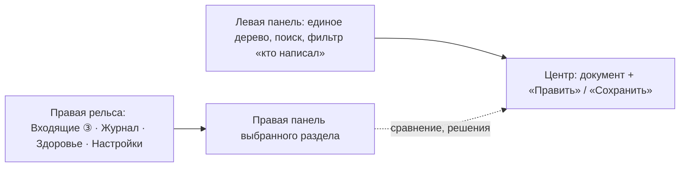

# Заметки + Вики v1: один раздел, навигация только в боковых панелях

- **Фича:** 05c5938f-98ae-4726-884f-d7140c91b937
- **Статус:** черновик
- **Файлы:** notes-wiki-unified-v1.html

Макет: [notes-wiki-unified-v1.html](notes-wiki-unified-v1.html). Один файл, сеть не нужна. Это кликабельный прототип:
дерево открывает страницы, поиск и фильтр «кто написал» фильтруют, рельса переключает панели, на 360 открываются
шторки. Сценарии проходятся действиями: «Править» → «Сохранить» (с галкой «409» — сравнение по разделам), плашка
«ИИ предлагает» → «Входящие» → принять или отклонить, «Изменили снаружи» → принять, «Журнал» → «Откатить мою правку».
В служебной полосе сверху (вне макета) — «Перейти к состоянию» (9 штук, включая загрузку и пусто), событие
«Изменить страницу снаружи», галка 409, ширина 1280 / 360, тема, секция «Заметки» и показ меток решений.
Кнопки, которые уводят из раздела (рельса продукта, граф, «Открыть в чате»), отвечают подсказкой «в прототипе не
работает». Диплинки: `#s=prop`, `#s=conflict&t=dark`, `#s=edit&w=m`, `#s=drift`, `#s=page&n=1`. Метка с пунктиром `C.planBorder` и подписью
«зависит от решения N» показывает место, которое ждёт ответа Андрея. Номера совпадают с вопросами из разреза Александра.

**Привязка.** Эпик `05c5938f-98ae-4726-884f-d7140c91b937`, задача дизайна `5dc008cc`. Модель взята из разреза
Александра (задача `ef7a0732`), рекомендованный вариант Б. Страница — один текст, файлы пишет только Хранитель, правка
человека идёт через него под именем автора, у каждого утверждения есть происхождение. Шаги ещё не нарезаны. Шаг
«навигация в боковые панели» от ADR-038 не зависит, его можно делать первым. Остальное ждёт ADR-038.

## Проблема

Андрей открывает «Заметки → Вики» и видит в центре колонку дерева (`TREE_W = 300`) и `PillSwitch` «Страницы / Входящие /
Журнал / Здоровье / Настройки». Документ ужат до трети ширины, а навигация живёт в трёх местах: сайдбар, полоса
вкладок, второе дерево. Заметки и вики при этом разные миры: свои заметки человек правит, а вики правит только ИИ.

## Решение

Одно правило: **в контентной зоне только документ и его действия.** Всё, что переключает, живёт в боковых панелях.

| Где | Десктоп 1280 | Мобила 360 |
|---|---|---|
| Дерево заметок и вики | левый остров 280 px (`IslandScaffold.sidebar`) | левая шторка 304 px по кнопке `PanelLeft` в шапке экрана |
| Переключатель «Входящие / Журнал / Здоровье / Настройки» | правая рельса раздела: 4 × `RailIconButton`, у «Входящих» `CountBadge` | `IconSegmented` в шапке правой шторки 330 px; открывает её кнопка `Inbox` с бейджем в шапке экрана |
| Содержимое раздела | правый остров 330 px (`PanelShell`, крестик сворачивает); повторный клик по активной кнопке рельсы тоже сворачивает | тело правой шторки |
| Сноска | поповер по наведению или клику | шторка снизу (bottom-sheet) |
| Действия документа | в шапке документа: «Править», `⋯` | под заголовком: «Править» во всю ширину, `⋯` в шапке экрана |

Нижней навигации нет нигде. «Назад» и крошек нет. Путь к странице виден в дереве: раскрытые узлы и выделенная строка.
Шапка экрана на 360 — это рамка приложения, а не контент: в ней две кнопки шторок, заголовок и `⋯`.

## Экраны и состояния (спецификация для Киры)

Токены — `C.*` из `design.ts`, размеры — `FS`, `SP`, `R`, `SHADOW`. В макете CSS-переменные `--c-*` один в один
отвечают ключам `C` (`--c-info-bg` — это `C.infoBg` и т. д.). Сырых значений в `.tsx` нет. Все строки — по-русски, с «ё».

### 0. Значок происхождения — новый `OriginGlyph` в `ui/`

Один компонент на дерево, строку утверждения, бейдж страницы и журнал. Пропы: `kind`, `size` (`xs` 10 / `sm` 12).
Подложка 18×18 (в строке утверждения 16×16), `R.sm`.

| kind | Иконка lucide | Цвет / подложка | Подсказка (`title`) |
|---|---|---|---|
| `note` | `FileText` | `C.textMuted` / без подложки | «Заметка» |
| `ai` | `Sparkles` | `C.info` / `C.infoBg` | «Ведёт ИИ» |
| `me` | `PenLine` | `C.textSecondary` / `C.bgSelected` | «Написали вы» |
| `mix` | `Users` | `C.info` / диагональ `C.infoBg` + `C.bgSelected` | «Ведёте вместе с ИИ» |
| `ext` | `TriangleAlert` | `C.warningText` / `C.warningBg` | «Изменена снаружи» |

Значение передаёт форма иконки, цвет только подсказывает: оттенки различимы и в тёмной теме, и для дальтоника.
`C.accent` в значках не используем, он остаётся за главным действием.

### 1. Левая панель: единое дерево

- Шапка: «Заметки» (PT Serif, `FS.lg`, 700), `IconButton` «Граф связей» (`Share2`), `Button primary xs` «＋ Заметка».
  На 360 вместо «＋ Заметка» внизу шторки стоит `Button primary sm` «Новая заметка» во всю ширину.
- `IconField` «Поиск по заметкам и вики» (32 px, на 360 — 40).
- Фильтр «кто написал»: `Chip toggle` «Все 24 · Заметки 9 · ИИ 8 · Вместе 5 · Мои 2», у каждого `OriginGlyph xs`.
  Выбор одиночный. На 360 ряд прокручивается вбок без переноса, высота чипа 32.
- `SidebarSection` «Разделы» с подписью справа «видны только вам». Узлы разделов (Проекты → проект / Общее / Личное)
  взяты из v2. В одном узле вперемешку заметки и страницы вики, у каждой строки слева `OriginGlyph`. Строка 30 px
  (на 360 — 44), выбранная строка — `C.bgSelected` и 600. Hover — `C.bgCard`. Если у страницы есть предложение ИИ,
  справа стоит `CountBadge` с числом.
- Подвал: легенда значков (`FS.xs`, `C.textMuted`): «заметка · ИИ · вместе · вы».
- Состояния:
  - загрузка — 9 скелетон-строк (значок + полоса разной ширины, пульс);
  - пусто — одна строка «Здесь будут ваши заметки и страницы, которые ведёт ИИ.»;
  - ничего не нашлось — `EmptyState compact`: «Ничего не нашлось», «Среди ваших записей нет «апскейл». Поищите во всех — ИИ мог записать это у себя.» и `Button secondary xs` «Искать во всех».

### 2. Правая рельса и правая панель

- Рельса справа от правого острова: `RailIconButton` `Inbox` «Входящие», `History` «Журнал», `Activity` «Здоровье»,
  `Settings` «Настройки». Активная кнопка — `C.bgWhite`, иконка `C.accent`, `SHADOW` thumb (как у левой рельсы).
  У «Входящих» `CountBadge` (`C.accent` / `C.onAccent`). У «Здоровья», когда страницу изменили снаружи, — точка
  `C.warning`.
- Остров: `PanelShell`, заголовок раздела (`FS.base`, 600), у «Входящих» рядом приглушённый `CountBadge`, крестик
  «Свернуть панель». Открытость и раздел хранятся в `cc_notes_side_panel`.
- 360: правая шторка. В шапке `IconSegmented` из четырёх иконок (44×36, бейдж на «Входящих») и крестик, ниже
  заголовок раздела.

**Входящие.** Сверху подпись «3 предложения ИИ ждут вас. Остальное он применил сам — это видно в «Журнале».» Карточка
предложения: `OriginGlyph` + название страницы, «из чата «…» · сегодня 09:20», `Badge warning` с причиной («Меняет ваше
утверждение», «Источники противоречат друг другу»), число правок. В раскрытой карточке у каждой правки есть заголовок
(«Заменить ваше утверждение · Решения», «Добавить · Факты»), дифф (было — `C.diffRemBg`/`C.diffRemText`, станет —
`C.diffAddBg`/`C.diffAddText`) и источник курсивом. Кнопки: `primary xs` «Заменить», `secondary xs` «Оставить моё»,
`ghost xs` «Открыть в чате»; для добавления — «Добавить» и «Не добавлять». Пусто: `EmptyState` «Спорного нет» —
«Сюда приходят только предложения ИИ, которые без вас применять нельзя.»

**Журнал.** Фильтр `Chip`: «Все · ИИ · Мои». Записи сгруппированы по дням (`FS.xxs`, uppercase). В строке время,
`OriginGlyph`, «ИИ дописал «…»» или «Вы поправили «…»», подстрока («2 утверждения: 1 новое, 1 переформулировано»).
У своих записей — `Button secondary xs` «Откатить мою правку», у записей ИИ — `ghost xs` «Откатить» и «Открыть в
чате». «Откатить мою правку» раскрывает подтверждение прямо в строке: «Вернуть страницу как было до 09:14? Ваши 2 правки
уйдут в «Историю». Записи ИИ, сделанные после, останутся.» Кнопки `danger xs` «Откатить» и `ghost xs` «Отмена».

**Здоровье.** «Проверено сегодня в 06:00» и `secondary xs` «Проверить сейчас». Строки: `Badge` с числом и пояснение
(«Ссылки ведут в никуда», «Источник пропал», «Страница без ссылок на неё»). Когда страницу изменили снаружи, сверху
стоит раскрытая карточка с диффом и теми же двумя решениями, что на плашке (см. 5е).

**Настройки.** Строки с `Toggle`: «Ночной разбор», «Бесспорное — применять сразу», «Показывать сноски ИИ», а также
«Ваши утверждения — только через вас» с пометкой «Выключить нельзя» (зависит от решения 2).

### 3. Страница, которую ведут вместе

- Заголовок — PT Serif `FS.h1` (на 360 — `FS.h2`), `C.textHeading`. Под ним сводный `Badge info` «Ведёте вместе»
  (`Users`) и строка «8 утверждений: 5 записал ИИ, 3 — вы · обновлено сегодня в 09:14». У страницы ИИ бейдж —
  «Ведёт ИИ», у страницы человека — «Написали вы», у изменённой снаружи — `warning` «Изменена снаружи».
- Действия: `Button secondary sm` «Править» (`PenLine`) и `IconButton` `⋯` («История страницы», «Перенести…»,
  «Скопировать ссылку»). Колонка текста — не шире 680 px, по центру.
- Разделы страницы — `FS.lg` 700. Утверждение — `FS.md` и line-height 1.6, слева `OriginGlyph` 16, hover `C.bgCard`.
- Сноска ИИ — плашка с номером (`C.infoBg`/`C.info`, `FS.xxs` 700). По наведению или клику открывается поповер
  340 px (`SHADOW.dropdown`, `R.xl`): «Сноска 3 · записал ИИ, 28.10», цитата с полосой `C.info` слева, «Источник: чат
  «…»», `secondary xs` «Открыть в чате» (у заметки — «Открыть заметку»), `ghost xs` «Показать в журнале».
- Сноска человека — плашка «✎ Андрей, 02.11» (`C.bgSelected`/`C.textSecondary`). Поповер: «Написал Андрей, 02.11 в
  09:12», «Ваша правка. ИИ её не меняет — если он с ней не согласен, предложение придёт во «Входящие».», «Показать в
  журнале» (открывает журнал в правой панели).
- Внизу: «В «Истории» страницы — 4 прежние формулировки» и ссылка «Открыть историю».
- 360: сноска открывает шторку снизу с тем же содержимым; цель нажатия — 22 px плашка плюс отступы строки, кнопки в
  шторке по 40 px.

### 4. Правка той же страницы

- Над текстом — липкая полоса: `Badge` «Правка» (на 360 скрыт, в шапке экрана и так написано «Правка»), «Изменено 3
  места», `ghost xs` «Отмена», `primary xs` «Сохранить». На 360 полоса переносится, кнопки встают справа.
- Подзаголовок: «Утверждения ИИ можно переформулировать — тогда они станут вашими. Убранное не удаляется, а уходит в
  «Историю».»
- Каждое утверждение — своё поле. Hover даёт рамку `C.border`, фокус — рамку `C.accent`, `SHADOW.focus` и фон
  `C.bgCard`. Справа — `IconButton xs` «Убрать в «Историю»» (`Archive`); видна по hover и фокусу, на 360 видна всегда.
- В фокусе формулировка ИИ → под полем `C.warningBg`/`C.warningText`: «Это формулировка ИИ. После сохранения прежняя
  уйдёт в «Историю» страницы, а утверждение станет вашим — сноска 3 сменится на «✎ Андрей».»
- Убранное зачёркнуто, текст `C.textMuted`, фон `C.bgCard`, под ним «Уйдёт в «Историю» с пометкой «убрано вами» — не
  удаляется.» и ссылка «Вернуть».
- `Button dashed xs` «＋ Добавить утверждение» в конце раздела.
- **Отказ ссылки вбок или вниз**: ссылка подчёркнута волной `C.danger`, под полем `C.dangerBg`/`C.dangerText`:
  «**Эту ссылку не сохранить.** Страница «Замеры видео на даче» лежит в проекте «Дача», а эта — в «AI Home». Чаты
  проекта «AI Home» её не увидят. Ссылаться можно на страницы этого раздела и разделов выше: «Проекты», «Общее».»
  «Сохранить» остаётся доступной: при сохранении ссылка станет простым текстом, и это сказано в тосте.

### 5. Состояния

**а. Пусто** (ни заметок, ни вики) — `EmptyState` в центре: «Здесь будут ваши записи и вики» / «Пишите заметки сами
— а ИИ после разговоров соберёт из них и из чатов страницы со ссылками на источники. Вести страницу можно вместе.»
Кнопки `primary sm` «Новая заметка» и `secondary sm` «Завести вики». Ничего не выбрано: «Выберите запись слева».

**б. Загрузка** — скелетон документа: заголовок 62 %, мета 40 %, затем три блока «раздел + 2–3 строки» разной ширины.
Фон `C.bgSelected`, пульс 1,4 с, `aria-busy`.

**в. Конфликт 409** «Страница изменилась, пока вы правили» — в центре, это состояние документа, а не навигация.
- Полоса: `Badge warning` «Нужно решить», «Решено 1 из 2 разделов», `ghost xs` «Отменить мою правку», `primary xs`
  «Сохранить» (неактивна, пока есть нерешённые разделы).
- `Notice warning`: «Сегодня в 09:20 ИИ дописал её после ночного разбора. Ваш текст не потерян: выберите, что
  оставить там, где вы с ИИ правили одно и то же. Остальное сольётся само.»
- Карточка на раздел (`R.xl`, рамка `C.border`): шапка «Факты · сноска 3» и «изменили и вы, и ИИ» (`C.warningText`).
  Три колонки: «Моё» (фон `C.accentLight`), «ИИ · сегодня 09:20», «Было, когда вы начали»; отличия — `C.diffAdd*`.
  Кнопки `secondary xs` «Оставить моё», «Взять их», `ghost xs` «Слить вручную» (`GitMerge`) — откроет раздел для
  правки с обоими вариантами рядом.
- Раздел без расхождений — свёрнутая карточка `C.successBg`: «решено: правили только вы — ваши правки применятся».
- 360: три колонки встают столбиком, подписи колонок сохраняются.

**г. Предложение ИИ к вашему утверждению** (зависит от решения 2): `Notice info` в начале страницы — «ИИ предлагает
заменить ваше утверждение» / «В разделе «Решения». Без вашего согласия ваш текст не изменится. Там же — ещё одно новое
утверждение.» и `secondary xs` «Открыть во «Входящих»» (раскрывает правую панель на этом предложении). Строка,
которую хотят заменить, обведена пунктиром `C.info`, под ней подсказка «ИИ предлагает заменить эту формулировку.
Посмотреть во «Входящих»». Новое утверждение показано бледно на `C.infoBg` с меткой «предлагает ИИ». Сравнение
и кнопки решения — только в правой панели, в центре их нет.

**д. Изменили снаружи** (страницу поправили в Obsidian): `Notice warning` «Страницу изменили снаружи» / «Сегодня в
08:47 её поправили не в AI Home — например, в Obsidian. Пока вы не решите, что с этим делать, ИИ страницу не трогает.»
Кнопки: `primary xs` «Принять как мою правку» (зависит от решения 4), `secondary xs` «Принять как есть», ссылка «Что
изменилось» (открывает «Здоровье» с диффом). Под кнопками пояснение: «Как мою правку — изменённые места станут вашими (✎
Андрей). Как есть — текст останется, а у этих мест будет пометка «изменено снаружи».» Изменённое место в тексте выделено
`C.diffAddBg` и подписано «изменено снаружи».

**е. Заметка** — в том же дереве и том же центре: бейдж «Заметка», «изменена вчера в 22:10», `secondary sm`
«Перенести в вики» (зависит от решения 3). Внизу подсказка: «Заметку пишете только вы. ИИ читает её как источник: на неё
уже ссылаются 2 страницы вики.»

### 6. Секция «Заметки» внизу страницы (зависит от решения 1)

Под «Открытыми вопросами» идёт раздел «Заметки» с подписью «свободный текст · ИИ его не меняет, но читает». Тело — на
`C.bgCard`, `R.lg`, без сносок, допускает таблицу. В режиме правки это одно поле без кнопки «Убрать». В макете
включается флажком «секция «Заметки»».

## Тексты без жаргона

| Внутри системы | На экране |
|---|---|
| пакет ИИ | предложение ИИ |
| дрейф, drift | страницу изменили снаружи |
| adopt as is / as mine | принять как есть / принять как мою правку |
| supersede, retract | уйдёт в «Историю», откатить |
| 409 wiki_page_changed | страница изменилась, пока вы правили |
| claim, origin | утверждение, кто написал |
| ссылка вбок/вниз | эту ссылку не сохранить: чаты проекта «…» её не увидят |

## Что зависит от решений Андрея

1. Секция «Заметки» на странице — раздел 6.
2. ИИ меняет утверждения человека только через «Входящие» — плашка 5г и строка в «Настройках».
3. Существующие заметки переносятся кнопкой «Перенести в вики» — экран 5е.
4. Правка снаружи принимается «как мою правку» — кнопка на плашке 5д.

Без решений можно делать навигацию: дерево слева, рельса с панелью справа, пустой центр под документ. Это закроет
видимую половину запроса Андрея и не тронет модель вики.

## Проверка макета

Скриншоты всех 9 экранов на 1280 и ключевых на 360 в обеих темах сняты Playwright. Ошибок консоли нет. Горизонтальной
прокрутки нет, обрезан только намеренно укороченный многоточием текст.
