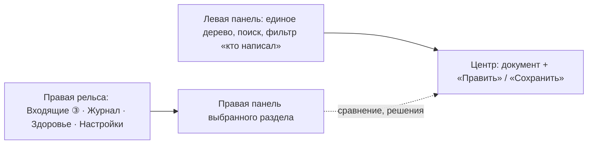

# Заметки + Вики v2: один раздел, навигация только в боковых панелях

- **Фича:** 05c5938f-98ae-4726-884f-d7140c91b937
- **Статус:** черновик
- **Файлы:** notes-wiki-unified-v1.html

Макет: [notes-wiki-unified-v1.html](notes-wiki-unified-v1.html) (имя файла прежнее, внутри — v2). Один файл, сеть не
нужна. Это кликабельный прототип: дерево открывает страницы, поиск и фильтр «кто написал» фильтруют, рельса
переключает панели, на 360 открываются шторки. Сценарии проходятся действиями: плашка «ИИ заменил вашу формулировку»
→ «Вернуть мою», «ИИ оспаривает» → «Оставить моё» / «Взять формулировку ИИ», «Входящие» → «Заменить» / «Оставить
моё», «Журнал» → фильтр «ИИ поменял моё», «Править» → «Сохранить» (с галкой «409» — сравнение по разделам),
«Изменили снаружи» → принять, «Настройки» → «Ночной разбор чатов».
В служебной полосе сверху (вне макета) — «Перейти к состоянию» (15 штук), события «Изменить страницу снаружи» и
«Утреннее уведомление», галка 409, «Итог ночи» (4 исхода), ширина 1280 / 360, тема. Кнопки, которые уводят из
раздела (рельса продукта, граф, «Открыть в чате»), отвечают подсказкой «в прототипе не работает». Диплинки:
`#s=page`, `#s=dispute&t=dark`, `#s=inbox`, `#s=journal&w=m`, `#s=settings`, `#s=nightoff`, `#s=clsoff`,
`#s=morning`, `#s=conflict`, `#s=drift`. В песочнице просмотра из дерева файлов диплинков нет: состояние живёт в памяти.

**v2 (02.11)** — под принятый [ADR-038](../adr/ADR-038-notes-wiki-human-ai-coauthoring.md): ИИ сам заменяет и
оспаривает утверждения человека, постфактум и с «Вернуть мою»; секции страницы — по ADR-035 §3; метки «зависит от
решения» сняты; в «Настройках» — блок «Ночной разбор чатов» из среза Ф2 ([llm-wiki-v2-proposal.md](llm-wiki-v2-proposal.md),
раздел «Срез Ф2 02.11»).

**Привязка.** Эпик `05c5938f-98ae-4726-884f-d7140c91b937`, задача дизайна `5dc008cc`. Модель взята из разреза
Александра (задача `ef7a0732`), рекомендованный вариант Б. Страница — один текст, файлы пишет только Хранитель, правка
человека идёт через него под именем автора, у каждого утверждения есть происхождение. Шаги ещё не нарезаны. Шаг
«навигация в боковые панели» можно делать первым. Блок «Ночной разбор чатов» — компонент `WikiNightlyBlock` шага F2
эпика Ф2 `7f63f1bd-fc8f-4b1d-8a73-d8db423872e1`; здесь он живёт секцией панели «Настройки», а не отдельной страницей.

## Проблема

Андрей открывает «Заметки → Вики» и видит в центре колонку дерева (`TREE_W = 300`) и `PillSwitch` «Страницы / Входящие /
Журнал / Здоровье / Настройки». Документ ужат до трети ширины, а навигация живёт в трёх местах: сайдбар, полоса
вкладок, второе дерево. Заметки и вики при этом разные миры: свои заметки человек правит, а вики правит только ИИ.

## Решение

Одно правило: **в контентной зоне только документ и его действия.** Всё, что переключает, живёт в боковых панелях.

| Где | Десктоп 1280 | Мобила 360 |
|---|---|---|
| Дерево заметок и вики | левый остров 280 px (`IslandScaffold.sidebar`) | левая шторка 304 px по кнопке `PanelLeft` в шапке экрана |
| Переключатель «Входящие / Журнал / Здоровье / Настройки» | правая рельса раздела: 4 × `RailIconButton`, у «Входящих» `CountBadge` | `IconSegmented` в шапке правой шторки 330 px; открывает её кнопка `Inbox` с бейджем в шапке экрана |
| Содержимое раздела | правый остров 330 px (`PanelShell`, крестик сворачивает); повторный клик по активной кнопке рельсы тоже сворачивает | тело правой шторки |
| Сноска | поповер по наведению или клику | шторка снизу (bottom-sheet) |
| Действия документа | в шапке документа: «Править», `⋯` | под заголовком: «Править» во всю ширину, `⋯` в шапке экрана |

Нижней навигации нет нигде. «Назад» и крошек нет. Путь к странице виден в дереве: раскрытые узлы и выделенная строка.
Шапка экрана на 360 — это рамка приложения, а не контент: в ней две кнопки шторок, заголовок и `⋯`.

## Экраны и состояния (спецификация для Киры)

Токены — `C.*` из `design.ts`, размеры — `FS`, `SP`, `R`, `SHADOW`. В макете CSS-переменные `--c-*` один в один
отвечают ключам `C` (`--c-info-bg` — это `C.infoBg` и т. д.). Сырых значений в `.tsx` нет. Все строки — по-русски, с «ё».

### 0. Значок происхождения — новый `OriginGlyph` в `ui/`

Один компонент на дерево, строку утверждения, бейдж страницы и журнал. Пропы: `kind`, `size` (`xs` 10 / `sm` 12).
Подложка 18×18 (в строке утверждения 16×16), `R.sm`.

| kind | Иконка lucide | Цвет / подложка | Подсказка (`title`) |
|---|---|---|---|
| `note` | `FileText` | `C.textMuted` / без подложки | «Заметка» |
| `ai` | `Sparkles` | `C.info` / `C.infoBg` | «Ведёт ИИ» |
| `me` | `PenLine` | `C.textSecondary` / `C.bgSelected` | «Написали вы» |
| `mix` | `Users` | `C.info` / диагональ `C.infoBg` + `C.bgSelected` | «Ведёте вместе с ИИ» |
| `ext` | `TriangleAlert` | `C.warningText` / `C.warningBg` | «Изменена снаружи» |

Значение передаёт форма иконки, цвет только подсказывает: оттенки различимы и в тёмной теме, и для дальтоника.
`C.accent` в значках не используем, он остаётся за главным действием.

### 1. Левая панель: единое дерево

- Шапка: «Заметки» (PT Serif, `FS.lg`, 700), `IconButton` «Граф связей» (`Share2`), `Button primary xs` «＋ Заметка».
  На 360 вместо «＋ Заметка» внизу шторки стоит `Button primary sm` «Новая заметка» во всю ширину.
- `IconField` «Поиск по заметкам и вики» (32 px, на 360 — 40).
- Фильтр «кто написал»: `Chip toggle` «Все 24 · Заметки 9 · ИИ 8 · Вместе 5 · Мои 2», у каждого `OriginGlyph xs`.
  Выбор одиночный. На 360 ряд прокручивается вбок без переноса, высота чипа 32.
- `SidebarSection` «Разделы» с подписью справа «видны только вам». Узлы разделов (Проекты → проект / Общее / Личное)
  взяты из v2. В одном узле вперемешку заметки и страницы вики, у каждой строки слева `OriginGlyph`. Строка 30 px
  (на 360 — 44), выбранная строка — `C.bgSelected` и 600. Hover — `C.bgCard`. Если у страницы есть предложение ИИ,
  справа стоит `CountBadge` с числом.
- Подвал: легенда значков (`FS.xs`, `C.textMuted`): «заметка · ИИ · вместе · вы».
- Состояния:
  - загрузка — 9 скелетон-строк (значок + полоса разной ширины, пульс);
  - пусто — одна строка «Здесь будут ваши заметки и страницы, которые ведёт ИИ.»;
  - ничего не нашлось — `EmptyState compact`: «Ничего не нашлось», «Среди ваших записей нет «апскейл». Поищите во всех — ИИ мог записать это у себя.» и `Button secondary xs` «Искать во всех».

### 2. Правая рельса и правая панель

- Рельса справа от правого острова: `RailIconButton` `Inbox` «Входящие», `History` «Журнал», `Activity` «Здоровье»,
  `Settings` «Настройки». Активная кнопка — `C.bgWhite`, иконка `C.accent`, `SHADOW` thumb (как у левой рельсы).
  У «Входящих» `CountBadge` (`C.accent` / `C.onAccent`). У «Здоровья», когда страницу изменили снаружи, — точка
  `C.warning`. У «Журнала», пока есть замены ваших формулировок моложе 14 дней, — точка `C.info` (выводится из журнала).
  На 360 те же точки — на иконках `IconSegmented` и на кнопке `Inbox` в шапке экрана.
- Остров: `PanelShell`, заголовок раздела (`FS.base`, 600), у «Входящих» рядом приглушённый `CountBadge`, крестик
  «Свернуть панель». Открытость и раздел хранятся в `cc_notes_side_panel`.
- 360: правая шторка. В шапке `IconSegmented` из четырёх иконок (44×36, бейдж на «Входящих») и крестик, ниже
  заголовок раздела.

**Входящие.** Сюда приходит только то, что автомат не смог применить сам (таблица решения 4 ADR-038). Сверху подпись
«3 замены ждут вас: автомат не смог применить их сам. Остальное, включая замену ваших формулировок новыми
источниками, ИИ применил сам — это видно в «Журнале».» Карточка: `OriginGlyph` + название страницы, «из чата «…» ·
ночной разбор», `Badge` с причиной и число правок. Причины и пояснение под шапкой раскрытой карточки (`FS.sm`,
`C.textSecondary`):

| Причина (`Badge`) | Тон | Пояснение |
|---|---|---|
| «Источник старше вашей правки» | `warning` | «Вы поправили это сегодня в 09:14, а разговор — от 29.10. Старый чат не перезаписывает свежую правку сам.» |
| «Вы недавно откатывали эту страницу» | `warning` | «Вы откатили её 31.10. Семь дней ИИ не меняет ваше на этой странице сам — решите здесь.» |
| «Неизвестно, когда написан источник» | `neutral` | «У файла нет даты — не проверить, новее ли он вашей правки.» |
| «Класс выключен» | `neutral` | «Замену ваших формулировок автоматика выключила: 3 возврата за неделю.» + `lnk` «В «Настройки»» |

У правки — заголовок «Заменить вашу формулировку · Сводка», дифф (было — `C.diffRemBg`/`C.diffRemText`, станет —
`C.diffAddBg`/`C.diffAddText`) и источник курсивом. Кнопки: `primary xs` «Заменить», `secondary xs` «Оставить моё»,
`ghost xs` «Открыть в чате», ниже `lnk` «Открыть страницу». Пусто: `EmptyState` «Спорного нет» — «Сюда приходит
только то, что ИИ не смог применить сам. Остальное… — это видно в «Журнале».» и `secondary xs` «Открыть «Журнал»».

**Журнал.** Фильтр `Chip`: «Все · ИИ · Мои · ИИ поменял моё» (у четвёртого — `OriginGlyph mix` и число). На 360 ряд
переносится, чтобы выбранный фильтр не уезжал за край шторки. Записи сгруппированы по дням (`FS.xxs`, uppercase). В
строке время, `OriginGlyph`, «ИИ дописал «…»» или «Вы поправили «…»», подстрока («2 утверждения: 2 новых»).
У своих записей — `Button secondary xs` «Откатить мою правку», у записей ИИ — `ghost xs` «Откатить» и «Открыть в
чате». «Откатить мою правку» раскрывает подтверждение прямо в строке: «Вернуть страницу как было до 09:14? Ваши 2 правки
уйдут в «Историю». Записи ИИ, сделанные после, останутся.» Кнопки `danger xs` «Откатить» и `ghost xs` «Отмена».
Записи фильтра «ИИ поменял моё» (`actor`, `overrodeHuman` в `log.jsonl`):
- «ИИ заменил вашу формулировку «Для черновиков снимаем…»» / ««Очередь локальной GPU» · Сводка · по чату «…». Прежняя
  — в «Истории».» — `secondary xs` «Вернуть мою», `ghost xs` «Открыть в чате». После возврата — `Badge neutral` «вы
  вернули своё». Строка «Вы вернули свою формулировку» / «… · 7 дней ИИ не меняет ваше на этой странице сам» ложится
  в «Мои», а не в этот фильтр: фильтр строится по `overrodeHuman` строк `apply`, строку `restore` бэк так не помечает.
  Фильтра «ваши возвраты» нет.
- «ИИ оспаривает ваше утверждение «…»» / «довод — в «Противоречиях». Пока спор не решён, автоматика страницу не
  трогает.» — `ghost xs` «Открыть страницу».
- Ночной разбор: «14 утверждений из 6 чатов · 1 вашу формулировку заменил, 1 оспорил · 3 замены — во «Входящих»».

**Здоровье.** «Проверено сегодня в 06:00» и `secondary xs` «Проверить сейчас». Строки: `Badge` с числом и пояснение
(«Ссылки ведут в никуда», «Источник пропал», «Страница без ссылок на неё»). Когда страницу изменили снаружи, сверху
стоит раскрытая карточка с диффом и теми же двумя решениями, что на плашке (см. 5е).

**Настройки.** Две секции с подписью `FS.xxs` uppercase `C.textMuted`, своей навигации у них нет: панель просто
прокручивается.

*Применение.* Строки: `Toggle` «Бесспорное — применять сразу»; строка класса «Замена ваших формулировок» —
«ИИ меняет ваше сам, если источник новее вашей правки. Прежняя — в «Истории», на странице — «Вернуть мою».», справа
`Badge success` «применяется само», ниже приглушённо «Выключится само, если за неделю вы трижды вернёте своё». Когда
класс выключен автоматикой: текст `C.warningText` «Выключено автоматикой: 3 возврата за неделю. Пока замены ждут вас во
«Входящих».», `Badge warning` «выключено» и `secondary xs` «Снова применять само». `Toggle` «Показывать сноски ИИ».
Отдельного тумблера «ИИ может менять моё» нет (ADR-038, «чего сознательно нет»).

*Ночной разбор чатов* (из среза Ф2, тексты дословно). Заголовок секции с `Badge` `success` «включён» / `neutral`
«выключен».
- `Toggle` «Разбирать по ночам», **по умолчанию выкл.**: «По умолчанию выключено — включите, когда будете готовы. Без
  него вики пополняется только кнопкой «Разобрать этот чат».» Выкл. — `Notice info` `Clock` «Ночью ничего не
  разбирается. Отбор чатов всё равно считается, а пометки чатов ниже продолжают действовать.»; поля ниже
  `opacity .6`, но правятся.
- «Окно» — два `Select` (часы 00–23), подсказка «Время сервера (MSK). У вас то же: 03:00–06:00. Не успели к концу окна
  — остальное следующей ночью.»
- «Бюджет за ночь» — поле «700 000» токенов, подсказка «Примерно 20–30 длинных разговоров. Кончился — остальное
  следующей ночью.»
- «Пакетов за ночь» — «20 на всю вики», «6 на раздел», подсказка «Чтобы один шумный проект не занял всю ночь. Чатов —
  до 10 на раздел, хроники в лимит не входят.»
- Ошибки поля (`C.dangerText`, рамка `C.danger`): «Начало и конец окна совпадают», «Не больше 20 — иначе ночь упрётся
  в лимит «Входящих»», «Не больше 5 000 000», «На раздел — не больше, чем на всю вики», «Нужно число больше нуля».
- «Чем разбирать» — только чтение у всех: две плашки `C.bgInset` + `Lock` («Разбор», «Отбор спорных чатов»), под ними
  «Назначает администратор в «Поставщиках моделей». Локальная модель работает на нашей видеокарте — текст не покидает
  сервер.»
- «Прошлая ночь · 01 → 02.11» — карточка из четырёх чисел («чатов отобрано», «разобрано», «пакетов применено само»,
  «ждут вас во «Входящих»»), `ProgressBar` (`C.accent` на `C.bgSelected`), моноширинное «≈ 512 000 из 700 000», строка
  времени и `lnk` «Открыть «Журнал»». Исходы: нет файла — «Ночного разбора ещё не было» (вкл./выкл. — два текста из
  Ф2); `budget` — `Notice warning` «Не хватило бюджета на всё»; `open_limit` — `Notice warning` «Остановились: во
  «Входящих» 20 пакетов ждут вашего решения» + `secondary xs` «Открыть «Входящие»».
- «Пометки чатов» — «Ставятся и в меню чата. «Важный» — ночью в первую очередь, минуя отбор. «Не разбирать» — ни ночью,
  ни кнопкой. Повторный клик снимает пометку.» Строка чата: имя, подпись (проект · дата), две кнопки 26 px (на 360 —
  под строкой, по 40 px): «★ Важный» вкл. — `C.accentLight` / `C.accentMuted` / `C.accent`, «⊘ Не разбирать» вкл. —
  `C.bgSelected` / `C.textHeading`, `aria-pressed`. У чата исполнителя задачи обе `disabled` и подпись «Чат
  исполнителя задачи — знание придёт итогом задачи».

Подвал панели: «Настройки — только вашей вики. Какой моделью разбирать, назначает администратор.»

**Сводное утреннее уведомление** — карточка колокольчика продукта поверх окна (не контент документа): `Bell` `C.info`,
«ИИ заменил 1 вашу формулировку», «Ночной разбор 01 → 02.11: дописал 5 страниц, 1 ваше утверждение оспорил. 3 замены
ждут вас во «Входящих».», `secondary xs` «Что поменял ИИ» (открывает «Журнал» с фильтром «ИИ поменял моё») и `ghost xs`
«Закрыть». Одно на проход ночного разбора, не по штуке на замену. 1280 — 320 px у правого края, `SHADOW.dropdown`;
360 — во всю ширину под шапкой экрана.

### 3. Страница, которую ведут вместе

- Заголовок — PT Serif `FS.h1` (на 360 — `FS.h2`), `C.textHeading`. Под ним сводный `Badge info` «Ведёте вместе»
  (`Users`) и строка «8 утверждений: 5 записал ИИ, 3 — вы · обновлено сегодня в 09:14». У страницы ИИ бейдж —
  «Ведёт ИИ», у страницы человека — «Написали вы», у изменённой снаружи — `warning` «Изменена снаружи».
- Действия: `Button secondary sm` «Править» (`PenLine`) и `IconButton` `⋯` («История страницы», «Перенести…»,
  «Скопировать ссылку»). Колонка текста — не шире 680 px, по центру.
- Разделы страницы — `FS.lg` 700. Утверждение — `FS.md` и line-height 1.6, слева `OriginGlyph` 16, hover `C.bgCard`.
- Сноска ИИ — плашка с номером (`C.infoBg`/`C.info`, `FS.xxs` 700). По наведению или клику открывается поповер
  340 px (`SHADOW.dropdown`, `R.xl`): «Сноска 3 · записал ИИ, 28.10», цитата с полосой `C.info` слева, «Источник: чат
  «…»», `secondary xs` «Открыть в чате» (у заметки — «Открыть заметку»), `ghost xs` «Показать в журнале».
- Сноска человека — плашка «✎ Андрей, 02.11» (`C.bgSelected`/`C.textSecondary`). Поповер: «Написал Андрей, 02.11»,
  «Ваша правка. ИИ может заменить её, если найдёт источник новее вашей правки. Прежняя формулировка тогда уйдёт в
  «Историю», а здесь появится «Вернуть мою».», «Показать в журнале» (открывает журнал в правой панели).
- Секции страницы — по ADR-035 §3: «Сводка», «Хронология», «Противоречия» (рисуется, только если не пуста),
  «История»; у хроник — «Что решили» и «Что выяснили». Последней — необязательная «Заметки».
- «История» — заголовок секции и строка «5 прежних формулировок» с `lnk` «Показать». В раскрытой — строки с
  `OriginGlyph`, текстом и подписью «раздел · почему». У прежней формулировки человека подпись «ваша формулировка ·
  заменил ИИ 02.11» и `lnk` «Вернуть» (то же, что «Вернуть мою»).
- 360: сноска открывает шторку снизу с тем же содержимым; цель нажатия — 22 px плашка плюс отступы строки, кнопки в
  шторке по 40 px.

### 4. Правка той же страницы

- Над текстом — липкая полоса: `Badge` «Правка» (на 360 скрыт, в шапке экрана и так написано «Правка»), «Изменено 3
  места», `ghost xs` «Отмена», `primary xs` «Сохранить». На 360 полоса переносится, кнопки встают справа.
- Подзаголовок: «Утверждения ИИ можно переформулировать — тогда они станут вашими. Убранное не удаляется, а уходит в
  «Историю».»
- Каждое утверждение — своё поле. Hover даёт рамку `C.border`, фокус — рамку `C.accent`, `SHADOW.focus` и фон
  `C.bgCard`. Справа — `IconButton xs` «Убрать в «Историю»» (`Archive`); видна по hover и фокусу, на 360 видна всегда.
- В фокусе формулировка ИИ → под полем `C.warningBg`/`C.warningText`: «Это формулировка ИИ. После сохранения прежняя
  уйдёт в «Историю» страницы, а утверждение станет вашим — сноска 3 сменится на «✎ Андрей».»
- Убранное зачёркнуто, текст `C.textMuted`, фон `C.bgCard`, под ним «Уйдёт в «Историю» с пометкой «убрано вами» — не
  удаляется.» и ссылка «Вернуть».
- `Button dashed xs` «＋ Добавить утверждение» в конце раздела.
- **Отказ ссылки вбок или вниз**: ссылка подчёркнута волной `C.danger`, под полем `C.dangerBg`/`C.dangerText`:
  «**Эту ссылку не сохранить.** Страница «Замеры видео на даче» лежит в проекте «Дача», а эта — в «AI Home». Чаты
  проекта «AI Home» её не увидят. Ссылаться можно на страницы этого раздела и разделов выше: «Проекты», «Общее».»
  «Сохранить» остаётся доступной: при сохранении ссылка станет простым текстом, и это сказано в тосте.

### 5. Состояния

**а. Пусто** (ни заметок, ни вики) — `EmptyState` в центре: «Здесь будут ваши записи и вики» / «Пишите заметки сами
— а ИИ после разговоров соберёт из них и из чатов страницы со ссылками на источники. Вести страницу можно вместе.»
Кнопки `primary sm` «Новая заметка» и `secondary sm` «Завести вики». Ничего не выбрано: «Выберите запись слева».

**б. Загрузка** — скелетон документа: заголовок 62 %, мета 40 %, затем три блока «раздел + 2–3 строки» разной ширины.
Фон `C.bgSelected`, пульс 1,4 с, `aria-busy`.

**в. Конфликт 409** «Страница изменилась, пока вы правили» — в центре, это состояние документа, а не навигация.
- Полоса: `Badge warning` «Нужно решить», «Решено 1 из 2 разделов», `ghost xs` «Отменить мою правку», `primary xs`
  «Сохранить» (неактивна, пока есть нерешённые разделы).
- `Notice warning`: «Сегодня в 09:20 ИИ дописал её после ночного разбора. Ваш текст не потерян: выберите, что
  оставить там, где вы с ИИ правили одно и то же. Остальное сольётся само.»
- Карточка на раздел (`R.xl`, рамка `C.border`): шапка «Сводка · сноска 3» и «изменили и вы, и ИИ» (`C.warningText`).
  Три колонки: «Моё» (фон `C.accentLight`), «ИИ · сегодня 09:20», «Было, когда вы начали»; отличия — `C.diffAdd*`.
  Кнопки `secondary xs` «Оставить моё», «Взять их», `ghost xs` «Слить вручную» (`GitMerge`) — откроет раздел для
  правки с обоими вариантами рядом.
- Раздел без расхождений — свёрнутая карточка `C.successBg`: «решено: правили только вы — ваши правки применятся».
- 360: три колонки встают столбиком, подписи колонок сохраняются.

**г. ИИ заменил вашу формулировку** (постфактум, решение 2): `Notice info` `Sparkles` в начале страницы — «ИИ
заменил вашу формулировку» / «В разделе «Сводка», сегодня в 05:48, по чату «Замеры MiniMax H3». Прежняя — в
«Истории».» Кнопки: `secondary xs` «Вернуть мою» (`Undo2`), `ghost xs` «Открыть в чате», `lnk` «Показать прежнюю»
(раскрывает «Историю» и прокручивает к ней). Новое утверждение — обычное утверждение ИИ со сноской и меткой «заменил
вашу · 02.11» (`FS.xs` 600, `C.info`, `title` «Метка видна 14 дней после замены»); в его поповере — «Заменил вашу
формулировку 02.11 в 05:48. Прежняя — в «Истории».» и `secondary xs` «Вернуть мою». Метку и плашку выводит журнал,
своего состояния у них нет. Пунктира и бледного «предлагает ИИ» больше нет.
«Вернуть мою» — сразу, без подтверждения (действие обратимо): ваш текст встаёт на место со сноской «✎ Андрей, 01.11»
(исходная карточка), формулировка ИИ уходит в «Историю» с подписью «формулировка ИИ · вы вернули свою сегодня в …»,
плашка и точка на «Журнале» пропадают, тост «Вернули вашу формулировку. 7 дней ИИ не меняет ваше на этой странице
сам». На 360 плашка та же, кнопки по 40 px и переносятся.

**ж. ИИ оспаривает ваше утверждение** (`conflict`): ваш текст на месте, за сноской — метка `C.warningText`
«⚠ ИИ оспаривает» и `lnk` «в «Противоречиях»» (прокручивает к доводу и подсвечивает его `C.accentMuted`).
Бейдж страницы — `Badge warning` «Есть противоречие». `Notice warning` в начале: «ИИ оспаривает ваше утверждение» /
«Ваш текст на месте. Довод ИИ — в «Противоречиях»: пока вы не решите, автоматика страницу не трогает.» и `secondary
xs` «Показать довод». В «Противоречиях» — строка ИИ со сноской, над ней `FS.sm` `C.textMuted` «Спорит с вашим:
«…»», под ней `secondary xs` «Оставить моё» (довод уходит в «Историю») и `ghost xs` «Взять формулировку ИИ» (ваше
уходит в «Историю», довод встаёт на его место). Оба закрывают спор и пишут строку в «Журнал».

**д. Изменили снаружи** (страницу поправили в Obsidian): `Notice warning` «Страницу изменили снаружи» / «Сегодня в
08:47 её поправили не в AI Home — например, в Obsidian. Пока вы не решите, что с этим делать, ИИ страницу не трогает.»
Кнопки: `primary xs` «Принять как мою правку», `secondary xs` «Принять как есть», ссылка «Что
изменилось» (открывает «Здоровье» с диффом). Под кнопками пояснение: «Как мою правку — изменённые места станут вашими (✎
Андрей). Как есть — текст останется, а у этих мест будет пометка «изменено снаружи».» Изменённое место в тексте выделено
`C.diffAddBg` и подписано «изменено снаружи».

**е. Заметка** — в том же дереве и том же центре: бейдж «Заметка», «изменена вчера в 22:10», `secondary sm`
«Перенести в вики» (подтверждение: заметка станет страницей, на её месте останется ссылка — копий нет). Внизу подсказка: «Заметку пишете только вы. ИИ читает её как источник: на неё
уже ссылаются 2 страницы вики.»

### 6. Секция «Заметки» внизу страницы

Последняя секция, после «Истории»: «Заметки» с подписью «свободный текст · ИИ его не меняет, но читает». Тело — на
`C.bgCard`, `R.lg`, без сносок, допускает таблицу. В режиме правки это одно поле без кнопки «Убрать». Решено
(Андрей, 02.11) — в макете показана всегда, флажка больше нет.

## Тексты без жаргона

| Внутри системы | На экране |
|---|---|
| пакет ИИ | предложение ИИ |
| дрейф, drift | страницу изменили снаружи |
| adopt as is / as mine | принять как есть / принять как мою правку |
| supersede, retract | уйдёт в «Историю», откатить |
| 409 wiki_page_changed | страница изменилась, пока вы правили |
| claim, origin | утверждение, кто написал |
| ссылка вбок/вниз | эту ссылку не сохранить: чаты проекта «…» её не увидят |

## Решения Андрея (02.11, ADR-038)

1. Секция «Заметки» на странице — да (раздел 6).
2. ИИ меняет ваше сам, с пометкой и «Вернуть мою» (5г, 5ж, «Входящие», «Журнал», «Настройки»).
3. Заметки не мигрируют, переносятся кнопкой «Перенести в вики» (5е).
4. Правка снаружи принимается «как мою правку» (5д).

## Что изменилось в v2 по ADR-038 «Что меняется в макете»

| № | Пункт ADR | Где в макете |
|---|---|---|
| 1 | Плашка 5г постфактум, «Вернуть мою», метка «заменил вашу · 02.11», без пунктира и «предлагает ИИ» | 5г, состояние «ИИ заменил ваше» |
| 2 | «ИИ оспаривает», бейдж «Есть противоречие», ссылка в «Противоречия» | 5ж, состояние «ИИ оспаривает» |
| 3 | Поповер сноски человека — новый текст | раздел 3 |
| 4 | «Входящие» — только четыре причины и новая подпись | раздел 2, «Входящие» |
| 5 | «Журнал» — фильтр «ИИ поменял моё», «Вернуть мою», «Вы вернули свою формулировку» | раздел 2, «Журнал» |
| 6 | «Настройки» — строка класса вместо «Только через вас», «Снова применять само» | раздел 2, «Настройки» |
| 7 | «История» — «ваша формулировка · заменил ИИ 02.11» и «Вернуть» | раздел 3 |
| 8 | Точка `C.info` на «Журнале» | раздел 2, рельса |
| 9 | Секции «Сводка / Хронология / Противоречия / История», «Заметки» последней | разделы 3 и 6 |
| 10 | Таблица «Что зависит» снята, метки решений убраны из макета | этот раздел |

## Проверка макета

v2, 02.11, Playwright: макет загружен в `iframe srcdoc` с `sandbox="allow-scripts"` без `allow-same-origin` (как
просмотр из дерева файлов). 15 состояний × 2 темы × 1280 и 360 = 60 экранов отрисованы; 962 клика по каждой
кнопке с `data-a` во всех состояниях на обеих ширинах — 0 ошибок JS и консоли, у каждой кнопки видимое действие
(кроме повторного выбора уже выбранного фильтра или вкладки); в контентной зоне нет `tablist`/`tab`/`nav`;
горизонтального переполнения нет. «Вернуть мою» на 1280 и 360: плашка пропала, ваш текст вернулся, точки
`C.info` больше нет. Скриншоты — `.cc-attachments/notes-wiki/nw2-*.png`.
