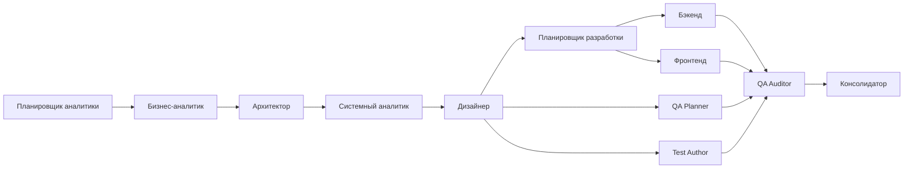

# «AI-Фабрика» — разбор демонстрации и применимость к нам

**Источник:** демонстрационный ролик «AI-Фабрика обзор» (8 мин 02 с, 3526×2160), внутренняя
платформа SDLC-конвейера (`aifa.infra.gboteam.ru`), модель GLM 5.2, дизайн-система «Фрактал».
Разбор сделан по расшифровке речи и покадрово снятым экранам; сами кадры и расшифровка
лежат вне репозитория (`.cc-attachments/ai-fabrika/`).

**Зачем этот документ:** понять, что из чужого конвейера стоит перенести в наш трекер и
конвейер команды, а что у нас уже есть под другими именами и дублировать не надо.

---

## 1. Что показывает демонстрация

Сквозной сценарий: бизнес-формулировка «в карточке заявки показывать историю попыток
оплаты комиссии по QR-коду» проходит через конвейер из 11 фаз и заканчивается ревью
изменений в системе контроля версий, QA-аудитом и консолидацией результата.

Внутри каждой фазы — три роли: **Продюсер** (делает артефакт), **AI-ревью** (проверяет
и возвращает на доработку), **HITL** (человек принимает решение). Оркестратор запускает
роли и фиксирует переходы.

### 1.1 Очередь ревью

Первый экран — сводка состояния конвейера: четыре счётчика (**На ревью 9**, **Выполняется 0**,
**Завершено 41**, **С ошибкой 5**) и подпись «10 фаз ждут вашего решения». Карточка задачи
несёт:

- тип задачи и роль агента («GA Planner», «QA Auditor», «Test Author»);
- статус ИИ-ревью с раундом («ИИ-ревью: раунд 1/2») и сколько дней ждёт;
- краткое содержание результата;
- счётчики артефактов и открытых вопросов, следующего исполнителя («далее Консолидатор»);
- метку «● На вас» — у кого сейчас мяч;
- сегментированный прогресс-бар по фазам.

### 1.2 Создание задачи

Модалка «Новая задача»: название, описание, тип задачи (в примере — «новый функционал»),
проект, параметры запуска. После запуска открывается экран задачи.

### 1.3 Экран задачи: конвейер фаз

Схема-DAG сверху с текущим узлом (подсвечен фиолетовым), статусами «ждёт» / «AI-ревью» /
«принято» и временем по узлам. Кнопки: «Вернуть к фазе», «Оставить отзыв»,
«Остановить задачу».

Под схемой — панель выбранной фазы:

- шапка: кто исполняет, статус, счётчики **принято / AI-ревью / HITL / ошибок**,
  «Технический журнал», прогресс (Продюсер → AI-ревью → HITL);
- «Актуальный результат»: артефакты с версиями (`ANALYTICS_PLAN.md v1`, `ANALYTICS_EVIDENCE.md v2`;
  на дизайн-фазе — `ux_specification.md`, `manifest-v2.json`, `design-handoff.md`, каталоги
  `gates/`, `handoff/`, `patches/`, `preview/`, `scenarios/` с числом файлов);
- таймлайн фазы с метриками на каждый прогон: **время · число ходов · токены**
  («Продюсер 2м 14с · 1 ход · 139,7т ток.», «AI-ревью 1м 35с · 1 ход · 37т ток.»,
  «HITL принято AI-ревью · ожидание 7м 50с»);
- блок «Вход»: что было в промпте, что прочитано из файлов, какие инструменты вызваны
  («reads 2, RAG 0, graph 0»).

### 1.4 AI-ревью и возврат

Отчёт ревьюера открывается отдельным документом: блокеры списком, требования к доработке,
затем повторный проход и принятие. Ревью ограничено раундами (в карточке — «1/2»).

### 1.5 HITL — вопросы человеку

Экран артефакта: слева версии файлов и транскрипты (`_agent_transcript.md`,
`_review_transcript.md`, `analytics_plan-review-rew.md`), в центре — документ плана
(цель, AS-IS → TO-BE, границы «в объёме / вне объёма», план по репозиториям), справа —
панель «Оставить ответ»: вопросы, которые агент не должен решать сам, с готовыми
вариантами ответа и полем свободного ввода. Внизу — «Принять».

Ответ сохраняется в истории и учитывается в следующей версии артефакта.

### 1.6 Дальше по конвейеру

- **Бизнес-аналитик** превращает согласованный план в BRD и оформляет изменение в
  документационном репозитории как запрос на слияние (версии, обсуждения, история).
- **Архитектор и системный аналитик** дают SDD/SRS; команда заранее задаёт архитектурные
  ограничения, стандарты кода и допустимые зависимости.
- **Дизайнер** строит экранные формы в дизайн-системе «Фрактал» — макет и артефакты
  в формате системы, а не свободный рисунок.
- **Планировщик разработки и QA Planner** работают параллельно: план имплементации и план
  тестирования, из требования выводятся проверяемые сценарии, видна трассируемость
  «требование → проверка» и пробелы покрытия.
- **По каждой фазе** доступны транскрипты, логи и отчёты AI-ревью — можно восстановить,
  какие вводные получил агент и что изменилось после доработки. Это же используется для
  онбординга по истории проекта.
- **Фронтенд-разработчик** отдаёт изменения в систему контроля версий; замечания
  возвращаются в фабрику, и агент исправляет сам.
- **QA Auditor → Консолидатор** собирают общий результат; выпуск проходит ревью,
  тестирование и проверку безопасности.

---

## 2. Сопоставление с нашим продуктом

| Возможность фабрики | Что у нас есть | Оценка |
|---|---|---|
| Очередь с 4 счётчиками и «ждут вас» | Kanban-доска проекта (`BoardColumns`), статусы задач | Частично: счётчиков по конвейеру и «с ошибкой» нет |
| Карточка с ролью агента и следующим шагом | `TaskItem`: `Role`, `StepRef`, `PersonaId`, `ReviewOf` | **Есть** |
| AI-ревью с блокерами и возвратом | роль `review`, вердикты `returned` / `accepted`, ревьюер Глеб | **Есть** |
| Лимит раундов ревью в карточке («1/2») | правило двух кругов — в промпте оркестратора | Нет в данных задачи |
| Метрики фазы: время · ходы · токены | `SpendRecord` по ходу, `ClaudeStartedAt`, `AwaitingHumanSince` | Разрозненно, агрегата на шаг нет |
| HITL-вопросы с вариантами ответа | `AwaitingHumanReason/Since`, вопрос текстом в чате | Частично: формы ответа нет |
| DAG конвейера фаз | `PlanMap` (граф плана с `DependsOn`), `featureId` + `stepRef` + «После:» | **Есть** на уровне плана; сводной схемы эпика нет |
| Артефакты с версиями и диффом | файлы проекта, git diff | **Есть**, но не в карточке шага |
| Изменения документов через MR | worktree + git + merge | **Есть** |
| Трассируемость требование → тест | `acceptance` + `evidence` в трекере | **Есть**, сводки покрытия нет |
| Транскрипты и отчёты по фазам | история чатов CLI, паспорта изменений (dossier) | **Есть** |
| Онбординг по истории проекта | вики, память команды, заметки | **Есть** |
| Дизайн в рамках стандартов | `design.ts` + `lint:design` + роль дизайнера | **Есть** |
| Финальная консолидация | финал (`role=final`, Александр) + merge (Марк) | **Есть** |

Вывод: наш конвейер functionally не беднее. Отстаём не в возможностях, а в
**представлении состояния**: у фабрики одна карточка, где рядом вход, результат, ревью,
ожидание человека и цена в токенах; у нас это разложено по задачам, чатам, файлам и тратам.

---

## 3. Что стоит взять

### 3.1 Высокий приоритет

**1. Метрика «ждёт человека».**
На очереди — «10 фаз ждут вашего решения», в фазе — «HITL · ожидание 7м 50с». Это самое
дешёвое и самое полезное: показывает узкое место, которого не видно в задачах. У нас
`AwaitingHumanSince` уже пишется — нужен агрегат и вывод на доску.
*Ценность:* ответ на «почему фича стоит» без чтения переписки.

**2. Агрегат стоимости шага: время, ходы, токены — раздельно по исполнителю, ревью и человеку.**
У нас траты есть на уровне хода, но не на уровне шага конвейера. Фабрика показывает
именно разрез трёх ролей.
*Ценность:* «сколько стоит шаг», «где дорогие возвраты», сравнение локальной и облачной
модели на одном шаге.

**3. Блок «Вход» шага.**
Что было в промпте, какие файлы прочитаны, какие инструменты вызваны. Почти бесплатно:
всё это уже есть в транскрипте. Позволяет разбирать «агент сделал не то» по факту, а не по
догадке.

**4. Раунд ревью как данные, а не правило промпта.**
«ИИ-ревью: раунд 1/2» на карточке. У нас лимит кругов знает только оркестратор; человек
и трекер — нет. Поле `reviewRound` + отображение закрывают разрыв и делают правило
проверяемым.

### 3.2 Средний приоритет

**5. Сводка очереди поверх существующей доски:** на ревью / выполняется / завершено /
с ошибкой / ждут меня. Не новый экран, а шапка над Kanban.

**6. Отчёт «требование → проверка»:** какие acceptance-критерии закрыты evidence, какие
проверок не имеют. У нас evidence уже собирается — не хватает сводки по шагу.

**7. Артефакт шага в карточке задачи:** версия, кто сформировал, дифф с предыдущей.
Сейчас это ищется по файлам и git-истории.

### 3.3 Что не брать

- **Свою платформу-оркестратор с собственным DAG-рантаймом** — у нас Claude Code CLI плюс
  трекер; второй рантайм удвоит стоимость поддержки.
- **Отдельного «консолидатора»** — роль закрыта финалом и merge.
- **Жёсткий полный цикл для всех задач** — у нас размер задачи определяет маршрут
  (мелкое идёт коротким путём). Один конвейер на всё — это лишние фазы и ожидания.
- **Генератор макетов с манифестами** — идея «агент работает в рамках дизайн-системы»
  у нас уже закрыта `design.ts` + `lint:design` + ролью дизайнера; копировать формат
  артефактов незачем.

---

## 4. Главный вывод

Заимствовать имеет смысл не конвейер, а **карточку фазы как единый экран состояния шага**:
вход → результат → AI-ревью → ожидание человека → цена. Наши данные для этого уже есть
(`AwaitingHuman`, `ReviewOf`, `SpendRecord`, транскрипты, `PlanMap`); не хватает сведения
их в одно место и одного нового поля — раунда ревью.

Если делать один вещь — это метрика «ждёт человека». Она единственная из списка, которая
сразу меняет решения: показывает, что конвейер стоит не из-за агентов.

## 5. Открытые вопросы

1. Считать ли «ожидание человека» отдельным показателем в статистике фичи или достаточно
   счётчика на доске?
2. Хватит ли карточки задачи с блоками «вход / ревью / метрики», или нужен отдельный экран
   шага как у фабрики?
3. Раунд ревью — поле задачи или вычисляемый счётчик из связанных review/rework? Вычисляемый
   не расходится с историей, но дороже в запросе.
