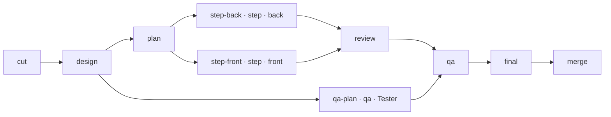

# Процессы фичи — разрез 2: параллельные этапы маршрута и наследование секций промпта

Разрез к эпику «Процессы фичи» (`a149e308`), задача `19989015` (role=cut). Продолжение основного разреза `docs/research/ai-fabrika-workflow-cut-2026-11.md` (дальше — «разрез 1»). Основание — два требования Андрея после просмотра макетов 12.11.

**Оба требования отменяют решения разреза 1 из §7 «Что НЕ делаем»:** «ветвления в маршруте» и «персональный override секций промпта специальности». Отмечаю это явно: остальное в разрезе 1 остаётся в силе.

## 0. Главное до деталей

1. **Этапу нужен собственный id, а роль может повторяться.** Параллельные ветки — это почти всегда этапы с разными настройками: план разработки (Егор) и план тестирования (Вера), бэк (Тимур) и фронт (Полина). У этапа ровно один `PersonaId`/`Prompt`/матрица. Значит, вариант «этап = уникальная роль, параллельность внутри этапа» отпадает: в одном этапе нельзя развести двух исполнителей с разными промптами.
2. **Граф задаётся рёбрами `After` только на более ранние этапы списка.** Порядок списка остаётся топологическим порядком, поэтому цикл невозможен по построению, а валидатор остаётся линейным проходом. `After = null` — «после предыдущего в списке», и сегодняшние линейные шаблоны валидны без правки.
3. **Для линейных шаблонов id этапа равен роли.** Тогда подтверждённый маршрут, слепки и проекция линейной фичи дают те же значения, что сейчас. Поэтому B5 и C1b, которые сейчас в работе, не надо останавливать: линейный случай — частный случай графа. Останавливать стоит только C3a (граф): рисовать его сразу по графу.
4. **Жёсткий гейт «все предшественники завершены» — только в узлах слияния (≥2 предшественника) и только на запуске исполнителя.** На создании задачи гейта нет: Софья заводит шаги пачкой заранее, ревью идёт по шагу конвейером (Глеб смотрит шаг 1, пока идёт шаг 2), а доработки и дефекты рождаются в любой момент. Барьер на каждом ребре сериализовал бы весь конвейер.
5. **Секции промпта персоны — третий слой той же попараметрной схемы, что уже работает у специальности** (код → админ). Новой системы наследования нет: слой персоны накладывается той же функцией, тем же правилом «null = как у слоя ниже». Миграции нет: на проде у всех 288 персон слой пуст, и это байт в байт сегодняшнее поведение.
6. **Контракт персоны (`Характер`/`Тон`/`Всегда`/`Никогда`/`Формат ответов`/`Примеры`/`Инструкция`) уже и есть её подразделы.** Его не переделываем и с секциями специальности не сливаем: это разные оси (кто я ⇄ как работает моя роль).

## 1. Модель данных — ветвление маршрута

### 1.1 Шаблон (`Core/Models/WorkflowTemplate.cs`)

Поля добавляются, существующие не меняются:

```
WorkflowStage
  + Id?: string           // slug [a-z0-9-]{1,32}; null → Role. Уникален в шаблоне
  + After?: List<string>  // id этапов, ТОЛЬКО стоящих раньше в списке; null → [предыдущий в списке]; [] → корень
  + Lane?: string         // только у Role=step: back | front | other (лексика FeatureProjector.NormalizeLane)
    Role, Presence, Specialty, PersonaId, Prompt, Tier*, DefaultTier, DisallowedTools, McpAllow, Stall*  — без изменений
```

### 1.2 Подтверждённый маршрут эпика

`FeatureWorkflow.Route: List<role>` заменяется на граф, который замораживается при подтверждении и дальше не зависит от шаблона. Шаблон может быть удалён или изменён, а проекция и гейт читают только маршрут.

```
FeatureWorkflow
  - Route: List<role>                      // удаляется
  + Stages: List<RouteStage>               // топологический порядок = порядок запуска
    Skipped: List<stageId>                 // было List<role>; у линейных значения те же
    TemplateId, Scope, ConfirmedVersion, ConfirmedAt, ConfirmedByUser — без изменений

RouteStage { Id, Role, Lane?, After: List<stageId> }   // After уже после обхода снятых этапов
```

Два хранилища одного факта (`Route` рядом со `Stages`) не держим. Членство и порядок — это `Stages.Select(s => s.Id)`. Данных на проде нет (`WorkflowTemplate` не влит в master), поэтому замена бесплатна: правятся тесты B2 и фронт-типы C1a.

`WorkflowProposal.Skipped` тоже переходит на id этапов.

### 1.3 Слепок этапа на задаче (`StageSnapshot`)

```
StageSnapshot
  + StageId: string           // этап маршрута, к которому привязана задача
  + Lane?: string             // из этапа
  + After: List<stageId>      // предшественники из МАРШРУТА эпика на момент создания (не из шаблона)
    Role и остальные поля — без изменений
```

При нескольких предшественниках в слепок идут только их id. Содержимое предшественников (артефакты, вердикты) в слепок не копируется: экран этапа (D1a) показывает их ссылками. Слепок — вход исполнителя, а не архив фичи.

### 1.4 Одна точка правды — `WorkflowGraph` (вертикаль Tasks, чистые функции)

| Функция | Что делает | Кто зовёт |
|---|---|---|
| `Normalize(stages)` | `Id ??= Role`, `After ??= [prev]` (у первого — `[]`), trim | `WorkflowRules.Validate`, `Resolve` |
| `Resolve(template, skipped)` → `List<RouteStage>` | убирает `off` и снятые `optional`; рёбра обходят убранный этап: `After` наследника = ∪ `After` убранного (транзитивно) | подтверждение (B4b), рекомендатель (проверка), валидатор (проверка «всё снято — граф жив») |
| `Columns(route)` → `Dict<stageId,int>` | глубина = длиннейший путь от корня | проекция |
| `StageFor(route, role, lane, explicitStageId)` → stageId \| ошибка | однозначный выбор этапа задачи (правила §1.5) | `TaskManager.Create`, `Update`, проекция (без исключения) |
| `States(route, tasks)` → состояние каждого этапа | done/active/pending/absent/skipped по DAG | проекция, гейт слияния (B3) |

Вторую реализацию «какой этап у задачи» или «пройден ли этап» нигде не заводим. Сторож — тест-рефлексия: `FeatureProjector` и `TaskExecutionService` не содержат собственных сравнений `Stage.Role == …` для выбора этапа.

### 1.5 Правило выбора этапа задачи (`StageFor`)

1. Передан `stageId` (новый необязательный параметр `tasks_create` и `POST /api/tasks`): этап обязан быть в маршруте, и его роль обязана совпадать с `StageRoleOf(task.Role)`; иначе 400.
2. Иначе кандидаты — этапы маршрута с ролью `StageRoleOf(task.Role)`. Ноль → 400 «этап пропущен маршрутом» (текст B2 сохраняется). Один → он.
3. Несколько этапов `step` (включая `rework`): выбор по `NormalizeLane(task.Lane)`. Если совпадения нет, берётся этап `step` без `Lane`, если он один. Иначе 400 со списком id.
4. Несколько этапов другой роли: 400 «в маршруте несколько этапов роли X: укажите stageId (…)». Молча выбирать нельзя.
5. Неявная роль дефекта (`qa` без явной роли) слепка не получает, как и сейчас: дефект не теряем.

`stageId` в `tasks_update` не принимается: слепок неизменен (И3/И4 разреза 1). Смена роли или фичи в `Update` проходит `StageFor` только как проверку, как сейчас `EnsureRoleChangeInRoute`.

Параметр `stageId` у `tasks_create` — статическая часть схемы инструмента, от хода не зависит (`McpToolsetStabilityTests` не задет).

### 1.6 Правила валидатора (`WorkflowRules.Validate`, дополнение)

- id уникальны и соответствуют slug; дубль **id** — ошибка. Нынешняя ошибка «роль встречается дважды» заменяется правилом одиночных ролей.
- **Одиночные роли:** `cut`, `final`, `merge` — не больше одного этапа. Повторяться могут `design`, `plan`, `step`, `review`, `qa`.
- `After` ссылается только на id этапов, стоящих раньше в списке; ссылка на себя или вперёд — ошибка. Отсюда ацикличность по построению.
- **Нет висящих веток:** каждый этап, кроме последнего в списке, должен быть в `After` какого-то более позднего этапа. Все ветки сходятся, у графа один сток.
- `Lane` только у `step`, значение из `back|front|other`. Два этапа `step` с одной линией — ошибка.
- Потолок — 16 этапов в шаблоне.
- `Resolve` при всех `optional`, снятых разом, не даёт ошибок (проверка, а не допущение).

### 1.7 Проекция (`FeatureProjector`, `Tasks/Projector/FeatureRun.cs:261 FeatureStage`)

- `FeatureStage` получает `Id`, `Role`, `Lane?`, `After: List<string>`, `Column: int`. Нынешний `Key` для легаси-фич остаётся ключом стадии.
- Задача попадает в этап по `task.Stage.StageId`. У задачи без слепка (создана до подтверждения) — по `StageFor` без исключения; неоднозначность → первый подходящий этап в порядке маршрута.
- **Активных этапов может быть несколько.** Активен этап с идущей задачей. Если идущих задач нет нигде, активен «готовый» этап: все предшественники done, сам не done. «Текущая стадия» шапки и Ганта (`FeatureBrief.CurrentStageOf`) — первый активный в топологическом порядке. Шапка и Гант получают один ответ, как требует FS-V1.
- `absent` («нет в трекере») считается по наследникам в графе, а не по «любому более позднему в списке»: пустой план тестирования не становится `absent` оттого, что начался фронт.
- **Прогресс не меняется:** процент фичи по-прежнему считается по шагам (`StepProgress`). Новое — только счётчик «этапов пройдено N из M», где M = `route.Stages.Count`. Учёт линий (`accounting.Lanes`) не трогаем.
- Эпик без `Workflow` — нынешний фиксированный список `stageDefs`, без изменений.

### 1.8 Гейт слияния (в B3, `TaskExecutionService.ExecuteAsync`)

Отказ запуска исполнителя, если у этапа задачи `After.Count ≥ 2` и хотя бы один предшественник по `WorkflowGraph.States` не `done`. Пустой предшественник (ноль задач) — тоже не `done`: текст «ветка «X» не начата; если она не нужна — обновите маршрут фичи». Обновление маршрута — новое подтверждение человека.

Исключения (гейт не действует): роль `review` (ревью привязано к шагу через `ReviewOf` и идёт конвейером), `rework`, `consult`, `Kind=defect`.

Линейные рёбра не гейтятся: там конвейер ведёт оркестратор, как сейчас.

### 1.9 Граф на экране (C3a)

Колонки по `Column`, рёбра по `After`. Внутри колонки этапы идут в порядке маршрута. Библиотеку графов не берём: колонок ≤ 16, рёбра — SVG-линии между карточками фиксированного размера. На мобиле — вертикальный список колонок, параллельные этапы колонки объединены скобкой «параллельно».

### 1.10 Третий встроенный пресет `parallel-cycle`



`full-cycle` и `fast-track` не меняются: у них id = роль, `After = null`.

## 2. Модель данных — секции промпта персоны

### 2.1 Инвентаризация текста хода исполнителя

| Кусок | Где живёт | Кто пишет | Как доезжает | Наследуется / копируется |
|---|---|---|---|---|
| Каталог секций (`history`, `codeGraph`, `processes`, `roleRules`), дефолты вкл/выкл и типовые тексты | `Core/Services/SpecialtyPromptPresets.cs` | код | — | дефолт кода |
| Настройка секций специальности (`Id, Enabled, Text`) | `SpecialtySettingsStore` → `data/specialty-settings.json`, `Global.Specialties[*].PromptSections` | админ, `PUT /api/specialties/settings/global` | `EffectivePromptSectionStates` (`Llm/SpecialtySettingsStore.cs:255`) → шов `IPromptSectionProvider` → `Turn/PromptSectionsContributor.cs` (Order 400, только персонные не групповые сессии) | **наследуется попараметрно** (код → админ). На проде у всех 14 специальностей слой пуст |
| Идентичность (роль, имя, описание, пол) | `Persona.Role/Name/Description/Gender` | владелец персоны | `PersonaPromptBuilder.BuildCore` (`ClaudeHomeServer/Services/PersonaPromptBuilder.cs:33`) | своё |
| Контракт: `Character, Tone, MustDo, MustNot, OutputFormat, SpeechExamples, Instructions` | `Persona.Contract` (`Core/Models/PersonaContract.cs`) | владелец; нормализует `PersonaManager.NormalizeContract` в `Create`/`Update` | `PersonaPromptBuilder` секциями `## Характер` … `## Инструкция` | своё. На проде контракт у 281 персоны, `Instructions` — у 0 |
| Легаси-характер одним блоком | `Persona.SystemPrompt` (читается, только если контракт пуст) | владелец | `PersonaPromptBuilder` | своё. На проде таких 0 |
| Дисциплина под провайдера (`Объём`, `Достоверность`, …) | `PersonaPromptBuilder.DisciplineFor` | код | слой персоны | код, не настраивается |
| Приветствие, мост командных механик, голосовая оговорка, свой personaId | `PersonaPromptBuilder` | код + `Persona.Greeting` | слой персоны | — |
| `## ЗАДАЧА` | `TaskItem.Title/Description` | постановщик | текст хода, `TaskExecutionService.BuildPersonaPrompt` | — |
| `## ПРАВИЛА` · `## ДЕЛЕГИРОВАНИЕ` | `docs/task-executor-rules.md` проекта, иначе `SystemPrompts/task-executor-rules.md`, иначе встроенный фолбэк | репозиторий проекта / код | текст хода (`ReadRulesTemplate`) | проект перекрывает сервер **файлом целиком** |
| `## ЭТАП` | `StageSnapshot.Prompt` ← `WorkflowStage.Prompt` | владелец шаблона | текст хода, после ПРАВИЛА/ДЕЛЕГИРОВАНИЕ (B3) | **копируется** в слепок при создании задачи (И4 разреза 1) |
| `## КОНТЕКСТ` | задача, вложения, заметки | — | текст хода | — |

Два канала: секции специальности и контракт персоны едут **системным промптом**, а ЗАДАЧА/ПРАВИЛА/ЭТАП/КОНТЕКСТ — **текстом хода**. Это важно для вопроса о конфликте (§2.4).

Сабагентский файл персоны (`BuildForSubagent`) и `persona_ask` секций специальности не получают и сегодня. Слой персоны туда тоже не поедет. Это известный пробел, в этот разрез он не входит (§5).

### 2.2 Слой секций персоны

```
Persona
  + PromptSections?: List<PromptSectionOverride>    // null/пусто = всё как у специальности

PromptSectionOverride (Core)  { Id: string; Enabled?: bool; Text?: string }
  // Id — только из каталога SpecialtyPromptPresets.Sections
  // Enabled null — как у специальности; false — секцию выключить; true — включить, даже если у специальности выключена
  // Text null/пусто — текст специальности; иначе свой, ≤ SpecialtyPromptPresets.SectionTextLimit (1024)

SectionSource + Persona       // новое значение в конец enum (wire-контракт фронта)
```

**Одна точка наложения — `PromptSectionOverlay.Apply(baseStates, overrides, source)` в Core.** Её зовут:
- `SpecialtySettingsStore.EffectivePromptSectionStates` для слоя админа. Это рефакторинг без изменения поведения: сейчас там инлайновый цикл, а golden-тест эффективных секций до и после обязан совпасть;
- `PromptSectionsContributor.BuildAsync` для слоя персоны поверх того, что отдал `IPromptSectionProvider`. Шов `IPromptSectionProvider` не расширяем: персона уже есть в `PromptSessionContext`.

Правило одно на оба слоя: **параметр задан — перекрывает, не задан — не затирает**. Персона переопределяет одну секцию, не копируя остальные; правка админом соседней секции до персоны доезжает.

### 2.3 Специальность сменилась

Тексты секций ролевые (`roleRules` ревьюера бессмысленны у исполнителя). Поэтому `PersonaManager.Update` со сменой `Specialty` сбрасывает `PromptSections` — тем же путём, где `SpecialtyTemplatesService.Apply` переприменяет права. REST- и MCP-ответ сообщают «свои секции промпта сброшены: сменилась специальность». Фронт перед сохранением показывает подтверждение. У `Specialty=None` слой хранится, но не действует: секций нет, редактор скрыт.

### 2.4 Три уровня и что сильнее

Итоговый порядок для исполнителя:

```
системный промпт:  … recall (300) → [секции специальности ⊕ слой персоны] (400) → … → слой персоны: идентичность, контракт, дисциплина
текст хода:        ## ЗАДАЧА → ## ПРАВИЛА → ## ДЕЛЕГИРОВАНИЕ → ## ЭТАП → ## КОНТЕКСТ
```

Приоритет: **ПРАВИЛА > ЭТАП > контракт персоны > секции (персона поверх специальности)**. Правило «конкретнее — сильнее» совпадает с порядком: ход позже системного промпта, контракт позже секций.

Явную строку приоритета модели даём одним местом: фиксированной первой строкой секции `## ЭТАП` (B3). Текст: «Требования этапа уточняют твою роль в этой фиче и сильнее инструкций специальности и персоны; ПРАВИЛА выше этапа». ПРАВИЛА остаются байт в байт (сторож И6 разреза 1 не меняется).

**Конфликта `## ЭТАП` с новыми секциями нет.** Каналы разные: слой персоны живёт в системном промпте и в текст хода не пишет. Id секций — закрытый каталог, своих заголовков персона не заводит. Содержательный конфликт возможен: персона выключила `processes` (DoD), а этап `step` требует сборку. Его решает строка приоритета.

Этап секции специальности не переопределяет и не выключает: только добавляет (И6 разреза 1).

### 2.5 Миграция

Не нужна. Прод на 12.11: 288 персон; `SystemPrompt` без контракта — 0; контракт — у 281; пустых — 7; `Instructions` — 0; слой секций админа пуст у всех 14 специальностей. Новое поле `PromptSections = null` у всех — это ровно сегодняшний промпт. Контракт остаётся как есть: он и есть «свои подразделы» персоны. Легаси-путь `SystemPrompt` не трогаем и в контракт не конвертируем: на проде его нет, а конвертер — код без потребителя. `BackupSchema.Version` не растёт: поле аддитивное.

### 2.6 Редактор (форма персоны, вкладка «Промпт»)

- **«От специальности»** — четыре секции каталога. У каждой трёхпозиционный переключатель: «как у специальности» / «своё» / «выключено».
  - «Как у специальности» — текст серым, только чтение, бейдж источника («по умолчанию» / «настроено админом»).
  - «Своё» — `TextArea` со счётчиком `N / 1024`. Переход в «своё» копирует текущий эффективный текст как стартовый черновик; сохраняется только то, что отличается.
  - «Выключено» — `Enabled=false`.
- **«Свои подразделы»** — существующие слоты контракта без изменений.
- **«На этапах»** — только чтение: список шаблонов, где персона назначена на этап, с текстом `## ЭТАП`. Чтобы человек видел все три уровня в одном месте. Если этот блок не влезает в шаг, он первым уходит в хвосты.
- Эффективное состояние даёт новая ручка `GET /api/personas/{id}/prompt-sections` → `EffectivePromptSection[]` с источниками. Фронт наложение не повторяет (тот же урок, что `MediaFormatResolver`).

## 3. Инварианты и пути записи

**Г1. Маршрут ацикличен, связан и сходится в один сток; одиночные роли не дублируются.**

| Путь записи | Закрытие |
|---|---|
| `POST/PUT` глобальных и проектных шаблонов (B1c), сброс встроенного к коду | `WorkflowTemplateStore.Save` → `WorkflowRules.Validate` (единственная точка) |
| Посев встроенных пресетов в `WorkflowTemplateStore` (`full-cycle`, `fast-track`, `parallel-cycle`) | тест: каждый пресет проходит `Validate` и `Resolve` при всех снятых `optional` |
| `epic.Workflow` | только `TaskManager.ConfirmWorkflow`; граф строит `WorkflowGraph.Resolve` в ручке подтверждения (B4b), а не принимается от клиента |
| `TasksController` PUT, MCP `tasks_update` | `Workflow` не принимают (И7 разреза 1, без изменений) |

**Г2. Слепок задачи указывает на этап маршрута эпика, выбранный однозначно.**

| Путь создания или смены роли/фичи задачи | Закрытие |
|---|---|
| `POST /api/tasks` (`TasksController.cs:146`), MCP `tasks_create` (`TasksToolset.cs:344`) | `TaskManager.Create` → `ApplyWorkflowStage` → `StageFor` |
| Кнопка мержа (`TasksController.cs:1816`) | роль `merge` одиночная — `StageFor` однозначен |
| `TaskManager.Update` (REST PUT, MCP `tasks_update` с `role`/`featureId`/`lane`) | `StageFor` как проверка, слепок не переписывается |
| `PlanSteps` (`EnsurePlanStepsInRoute`) | `review/qa/final` — роль есть в маршруте; `Kind=step` с линией при маршруте, где все `step`-этапы привязаны к линиям, — линия обязана совпасть, иначе 400 |
| Дефект с неявной ролью `qa` | слепка нет (как сейчас) |
| `TeamWaveService`, `ArchitectureAgentLauncherAdapter`, `TaskBridge`, `NoteTaskSyncService` | создают задачи без `FeatureId` — маршрут не применяется; сторож — тест, что `ApplyWorkflowStage` no-op без `FeatureId` (уже есть в B2) |

Сторож: тест на каждый путь и тест «два этапа `qa` без `stageId` → 400, не первый попавшийся».

**Г3. Гейт слияния нельзя обойти запуском.**

| Путь запуска исполнителя | Закрытие |
|---|---|
| MCP `tasks_run_executor` (`TasksToolset.cs:822`), `POST /api/tasks/{taskId}/execute` (`TasksController.cs:1993`) | `TaskExecutionService.ExecuteAsync` — единственная точка гейта |
| `features/{featureId}/merge` (`TasksController.cs:1729, 1829`) | роль `merge`: предшественник один (`final`) — гейт не срабатывает, но идёт той же точкой |
| Планировщик `TaskSchedulerService.cs:108`, `TeamWaveService.cs:376, 778`, `ArchitectureAgentLauncherAdapter.cs:65`, шов `TaskExecutorAdapter` | все — через `ExecuteAsync`; задачи волн и архитектора без `FeatureId` гейт не задевает |
| Толкач простоя (`ClassifyStall` → nudge) и возобновление | продолжают уже запущенного исполнителя: гейт стоит только на старте, идущего не останавливает |

Исключения гейта (`review`, `rework`, `consult`, `defect`) перечислены в коде одним списком; тест на каждое.

**Г4. Слой секций персоны пишется только через `PersonaManager` и только из каталога.**

| Путь записи `Persona.PromptSections` | Закрытие |
|---|---|
| `POST /api/personas`, `PUT /api/personas/{id}` | принимают поле; нормализация в `PersonaManager.Create/Update` (по образцу `NormalizeContract`): неизвестный id → 400, текст > 1024 → 400, дубли id схлопываются, пустой override удаляется |
| MCP `personas_create`, `personas_update` (`PersonasToolset.cs:205, 235`) | новый необязательный параметр `promptSections`; та же нормализация в менеджере |
| `pantheon/connect`, `ai/quick-create`, `ai/team`, `ai/character`, `OnboardingController`, `DefaultAssistantProvisioner` | поле не задают (null) — остаётся «как у специальности» |
| `PersonaBindingsService`, `bindings/*`, `automation/*`, `voice`, `avatar/*`, `memory/*`, `make-default` | поле не трогают; сторож — тест «правка через эти ручки не меняет `PromptSections`» |
| Смена `Specialty` (REST, MCP) | сброс в `PersonaManager.Update` (§2.3) |
| Бэкап/restore | файл `personas.json` целиком, без изменений |

**Г5. Слой персоны не пишет в профиль специальности** — это И1 разреза 1, дополненный новым полем. Тест: сохранение персоны с `promptSections` не меняет хеш `specialty-settings.json`.

**Г6. Наложение секций — одна функция.**

| Путь чтения эффективных секций | Закрытие |
|---|---|
| Промпт хода | `PromptSectionsContributor` → `PromptSectionOverlay.Apply` |
| Ручка `GET /api/personas/{id}/prompt-sections` | та же функция |
| Слой админа | `SpecialtySettingsStore.EffectivePromptSectionStates` → та же функция |

Сторож: IL-скан — `Persona.PromptSections` читают только `PersonaManager` (нормализация/сброс), `PromptSectionsContributor` и ручка выдачи; `IPromptSectionProvider` зовёт только контрибьютор.

### Риск «второй системы наследования»

Сейчас у персоны четыре оси наследования и у каждой — своя единственная точка:

| Ось | Семантика | Точка правды |
|---|---|---|
| Права | группа целиком, флаг `InheritsAccess` | `PersonaManager.Hydrate` |
| Модели | пустая ячейка = как у специальности | `ModelAssignmentResolver` → `UserModelTierResolver.ModelFor` |
| Skill-умения | наследуются, гасятся привязкой `Mode=Off` | `PersonaBindingsService` |
| **Секции промпта** | **попараметрно, null = ниже** | **`PromptSectionOverlay.Apply`** |

Новая ось семантику не изобретает: она повторяет уже существующую семантику секций у специальности. Разные семантики у разных осей — осознанное решение разреза 1, его не трогаем. Эту таблицу нужно перенести в `docs/architecture/personas.md` в шаге P1: без неё следующая ось заведёт пятую семантику.

## 4. Что переделывается в уже принятом

| Шаг | Статус | Что меняется | Цена |
|---|---|---|---|
| B1a (модели + `WorkflowRules`) | принят | +`Id/After/Lane` у этапа; правило «роль дважды» → «id дважды» + одиночные роли; новые правила графа. Существующие тесты линейных шаблонов зелёные без правки, кроме одного (дубль роли `plan` становится допустимым) | S |
| B1b (стор, пресеты) | принят | пресеты не меняются; +`parallel-cycle` | S (в G5) |
| B1c (REST шаблонов) | принят | DTO — модель целиком, новые поля проходят сами. Проверить и закрыть тестом круговой проезд `After/Lane/Id` | XS |
| B2 (маршрут, слепок, `Create`) | принят | `Route` → `Stages`; `ApplyWorkflowStage`/`BuildStageSnapshot`/`EnsureRoleChangeInRoute`/`EnsurePlanStepsInRoute` переходят на `StageFor` по id; `stageId` в create; поиск этапа в шаблоне по id, а не по роли (`TaskManager.cs:594`) | M — около половины B2, в основном тесты |
| B4a (рекомендатель) | в работе | `skipped` — id этапов (у линейных значения те же); каталог шаблонов отдаёт `id/role/after` | XS, догоняющей правкой после G1 |
| B4b (ручки подтверждения) | не начат | строит `Stages` через `Resolve` | лучше стартовать после G1, иначе двойная работа |
| B5 (проекция) | в работе | **не останавливать**: линейная проекция по маршруту — частный случай; DAG-расширение — G3 | M (G3), переписывается выбор активной стадии и `absent` |
| B3 (исполнение) | не начат | +гейт слияния, +строка приоритета в `## ЭТАП` | +S в карточку B3 до старта |
| C1a (фронт-типы) | принят | +поля в `types.ts`, `RouteStage` | XS |
| C1b (редактор шаблонов) | в работе | **не останавливать**; поля графа — отдельный шаг G6 | M (G6) |
| C2 (подтверждение маршрута) | не начат | снятие по id этапов, мини-граф маршрута | +XS |
| C3a (граф фичи) | не начат | **придержать до G3** и строить сразу по `Column/After` | ноль переделки, если придержать |
| A3b (форма персоны) | не начат | вкладка «Промпт» — отдельный шаг P2 после A3b тем же исполнителем (тот же файл формы) | — |
| D1a (экран этапа) | в работе | новые поля слепка приходят сами; «Вход: после X, Y» — данные уже в `StageSnapshot.After` | XS |

Итог переделки уже принятого: B1a S + B2 M + B1c/C1a XS. Это примерно полтора шага масштаба B2. Остальное — новые шаги, а не переделка.

## 5. Нарезка

| Шаг | Линия | Что | Оценка | Зависит |
|---|---|---|---|---|
| **G1** | бэк | модели (`Id/After/Lane`, `RouteStage`, `FeatureWorkflow.Stages`, поля слепка); `WorkflowGraph` (`Normalize/Resolve/Columns/StageFor/States`); правила `WorkflowRules`; unit-тесты графа, включая обход снятых этапов | M | — |
| **G2** | бэк | `TaskManager`: `StageFor` в `Create`/`Update`/`PlanSteps`, `stageId` в REST и MCP `tasks_create`, слепок по id; правка тестов B2 | M | G1 |
| **G3** | бэк | `FeatureProjector`: этапы из `Stages`, `Column/After`, несколько активных, `absent` по DAG, счётчик этапов | M | G1, B5 влит |
| **G4** | бэк | в карточку **B3**: гейт слияния с исключениями + строка приоритета в `## ЭТАП` | +S к B3 | G1 |
| **G5** | бэк | пресет `parallel-cycle` + тест «все пресеты валидны и разрешимы» | S | G1 |
| **G6** | фронт | редактор шаблона: id этапа, «после» (мультивыбор только среди более ранних), линия у `step`, мини-превью графа | M | G1, C1b |
| C3a | фронт | граф фичи сразу по `Column/After` (переписать карточку) | M | G3 |
| C2 | фронт | снятие по id, мини-граф | +XS | G1, B4b |
| **P1** | бэк | `PromptSectionOverride`, `PromptSectionOverlay.Apply` (+рефакторинг стора под неё с golden-тестом), `Persona.PromptSections`, нормализация и сброс в `PersonaManager`, контрибьютор, REST/MCP приём, `GET …/prompt-sections`, сторожа Г4–Г6, таблица осей в `personas.md` | M | — |
| **P2** | фронт | вкладка «Промпт» формы персоны (§2.6) | M | P1, A3b |

**Что сдать первым:** G1 и P1 параллельно — они независимы и не трогают общих файлов. G1 разблокирует B4b и G2–G6, поэтому он критичный путь. P1 сразу даёт ценность: персоне можно поправить одну секцию.

**Узкие места:** G2 трогает `TaskManager` рядом с уже принятым кодом B2 — отдать тому же исполнителю, что делал B2. B3 по-прежнему сильной модели и не дробить: гейт слияния живёт в той же точке, что гейт подтверждения.

**Что сказать Софье по идущим шагам:** B5 и C1b не останавливать; C3a не запускать до G3; B4b запускать после G1; в карточку B3 до старта дописать G4.

## 6. Что НЕ делаем

- Условные ветки («если бэк — то…») и ветвление по результату этапа: граф статичен, выбор — только снятием `optional` при подтверждении.
- Барьер на каждом ребре и гейт на создании задачи: только гейт слияния на запуске.
- Автодвижок, который сам заводит задачи и запускает следующие этапы: конвейер ведёт оркестратор (разрез 1, §0.2).
- Новые роли сверх `TaskRoles`: «план тестирования» — этап роли `qa` со своим id.
- Копирование артефактов предшественников в слепок: только id.
- Своё процентное исчисление прогресса по графу: процент по-прежнему по шагам.
- Библиотеку графов на фронте.
- Свои (некаталожные) секции промпта у персоны: свободный текст персоны живёт в контракте (`Instructions`).
- Слоты контракта у специальности («типовой характер роли»): ролевые правила уже живут в секции `roleRules`.
- Переопределение и выключение секций специальности этапом: этап только добавляет `## ЭТАП`.
- Конвертацию легаси `SystemPrompt` в контракт: на проде таких персон 0.
- Доставку секций специальности и слоя персоны в сабагентские `.md` и в `persona_ask` — известный пробел, отдельная задача.
- Перенос секций при смене специальности: слой сбрасывается.

## Открытые вопросы Андрею

1. Гейт слияния: исключение для `review` (ревью конвейером по шагу) — ок? Без него join-ревью ждало бы все шаги.
2. Сброс своих секций персоны при смене специальности — ок, или переносить `Enabled` (без текстов)?
3. Третий пресет `parallel-cycle` встроенным (нельзя удалить, можно сбросить) или только примером в документации?
