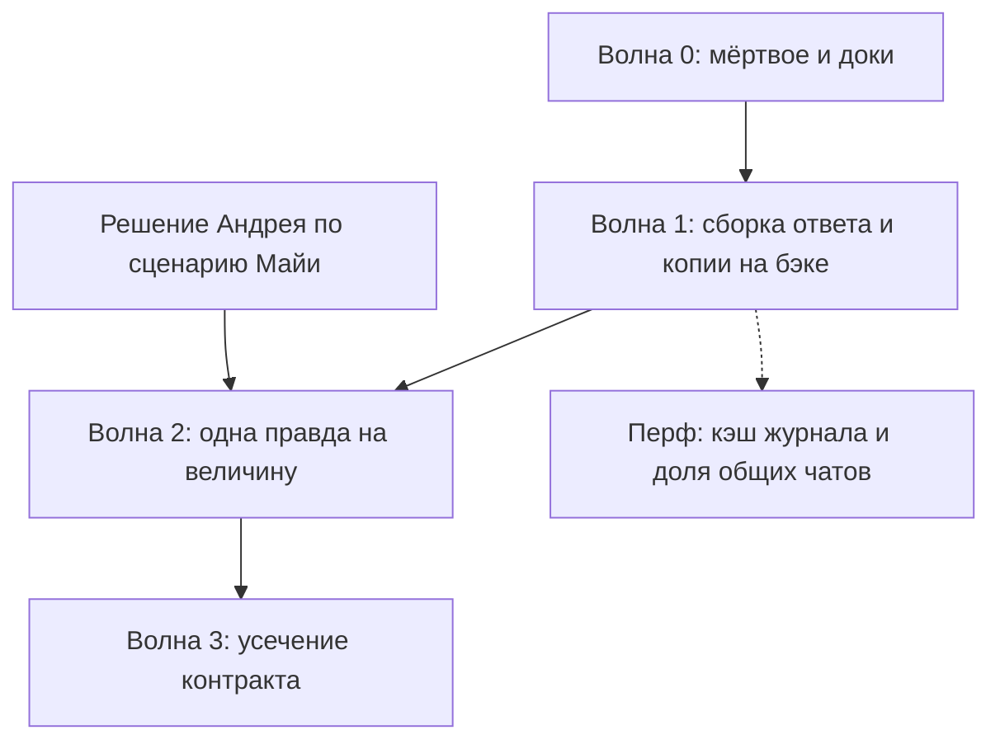
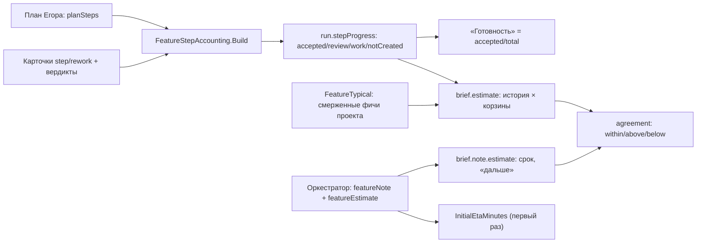
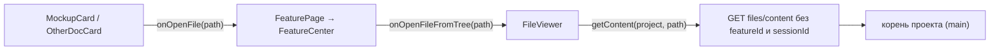

# Раздел «Фичи»: что лишнее в контракте и слоях (Александр, 10.11)

Эпик `11041582` «Фичи: упрощение и прозрачность раздела», задача `fca4af08` (consult).
Код не правим. Здесь только разбор и порядок упрощения. Парный документ — аудит экрана Майи
[feature-page-simplify-v1-proposal.md](../mockups/feature-page-simplify-v1-proposal.md):
противоречия П1–П14 и шаги Ш1–Ш8. Этот разбор отвечает на вопрос, **что под ними лишнее
в данных и слоях**, и связывает свои пункты с её номерами.

Все утверждения сверены с master на 10.11 (`d8c117511`). «0 потребителей» означает grep
по `frontend/src` без `*.test.ts`, `types/` и комментариев. Ветка `feat/feature-progress-truth`
уже в master.

## Итог в пяти строках

1. Страница живёт на **одной ручке** `GET features/{id}`: девять верхних ключей, все вкладки
   из одного ответа. Это хорошо, и это сохраняем. Плохо другое: ответ собирается **≈235 строками
   бизнес-логики прямо в контроллере** (`TasksController.cs:870–1106`). Самый дорогой путь —
   доля общих чатов: `ProjectFull` и чтение журнала с диска на **каждую** фичу-соседку.
2. Дубли идут не от вариантов отображения, а **от контракта**. Одна величина приходит в
   2–7 полях: состояние, прогресс, «сейчас», стадия, возвраты, время. Фронт выбирает из них
   по-разному, отсюда П1–П3. «Четыре варианта разбивки» — не дубль: это одна оболочка, две
   раскладки (мобила и десктоп) и общие части.
3. Мёртвое есть, но его немного: 4 поля `run` и ≈10 полей вложенных блоков без читателей,
   ≈10 фронтовых экспортов без прод-потребителей, ручка `GET features` без `sessionId`
   без потребителя на фронте.
4. Порядок: **волна 0** (мёртвое, без видимых изменений) и **волна 1** (вынести сборку
   ответа из контроллера, свести копии на бэке) можно делать **до решения дизайнера**.
   Волны 2–3 (одна правда на величину в UI и усечение контракта) — только **после**
   выбора сценария Андреем.
5. Размер: ≈6–8 шагов бэка и ≈8–10 шагов фронта. Новый фич-флаг не нужен: волны 0–1
   невидимы, а для волны 2 хватает ветки и QA на копии данных (обоснование в §5).

## 1. Карта слоёв: блок → данные → источник → цена

### 1.1. Запросы страницы

| Запрос | Кто зовёт | Когда |
|---|---|---|
| `GET /api/tasks/features/{id}?eventsLimit=` | `lib/featurePage.ts` (стор) | открытие; повтор по `task_changed` своего fid с дебаунсом 1,5 с; «Показать все» повторяет ту же ручку с `eventsLimit=all`. Поллинга нет |
| `GET /api/tasks/features/index?projectId=` | `lib/featuresIndex.ts` (общий стор со списком чатов) | заголовок, ветка, ведущий, ключевой чат, фолбэк тега |
| `POST features/{id}/summary` | `FeatureAnalysisLine.tsx:98` | только по кнопке (LLM, кэш по отпечатку) |
| `api.files.getContent`, `api.tasks.get` | `FeaturePlanReader.tsx:219,281` | открытие текста плана |
| `POST/DELETE …/hold`, `POST …/merge`, `PUT …/note`, `api.tasks.update(epic)` | шапка, диалог мержа | действия |
| `GET /api/tasks/features?sessionId=` | `lib/featureRuns.ts:338` | панель фичи в чате (`FeatureBanner`, `ChatPanel`), не страница |

Вкладки своих запросов не делают. Монтирование: `WorkspacePage.tsx:2539` /
`DesktopWorkspace.tsx:546` → `FeatureCenter` → `FeaturePage`. Фич-флага у раздела нет.
Единственный гейт — подсистема `Tasks` (503 → состояние `disabled`, `featurePage.ts:246`).

### 1.2. Блоки страницы

| Блок | Компонент | Поля ответа | Клиентская модель |
|---|---|---|---|
| Тулбар, тег | `FeaturePageHeader` → `FeatureStatusTag` | `run.state/hold/queue`, `brief.now.stage`; фолбэк — индекс | `featurePageStatusTag`, `chatGroups.featureStatusTag` |
| Тревога | `FeaturePageAlert` (Header:928) | `run.attention` (+`mergeRisks`), `quiet`, `lastActivityAt`, `hold` | `analysisLineState` |
| Вкладки | `FeaturePageTabs` | счётчики `plans`, `chats[]`, `run.stepProgress.total`, `eventsTotal` | — |
| Сводка | `FeatureBriefBlock` (+Active, +Timeline) | `brief.*`, `stats.timeline.totals`, `run.summary.mergedAt`, `run.stepProgress` | `FeatureBriefModel` (830 строк) |
| Гант этапов | `FeatureTimelineTab` → `StageLane`, `LaneAxis`, `LanePopover`, `ProdCardsView` | `run.stages[]`, `stepChains`, `merges`, `waveAfterMerge`, `postMergeTails`, `activePlanIds`, `stats.timeline.intervalsByStage` | `buildStageLanes`, `buildProdCards`, `featureListFold` |
| Материалы | `FeaturePlansTab` → `PlanReader`, `Mockups` | `plans`, `mockups`, `mockupsUnavailable` | `visiblePlans` |
| Чаты | `FeatureChatsTab` | `chats[]` | `sortFeatureChats` |
| Шаги | `FeatureTasksTab` | все задачи `run.*`, `stepChains` | `buildStepsTab` → снова `buildProdCards` |
| История | `FeatureEventsTab` | `events`, `eventsTotal` | `groupEventsByDay`, `eventPhrase` |
| Статистика | `FeatureStatsTab` → `AnalysisLine`, `StatsTiles`, `StatsLosses`, `BreakdownBlock` | `stats.*`, `run.*` | `buildTimelineModel`, `tilesModel`/`lossesModel`, `analysisLineState`, `FeatureBreakdownModel` |
| Диалог мержа | `FeatureMergeDialog` | `run.attention.mergeRisks` | — |

### 1.3. Цена сбора `GET features/{id}` (один запрос)

`TaskManager.GetByOwner` при каждом вызове проходит весь стор, сортирует и копирует.
Кэша нет. Ниже порядок работ внутри одной ручки:

| # | Что | Где | Цена | Кэш |
|---|---|---|---|---|
| 1 | Снимок сессий владельца | `FeatureChatDoor.SnapshotVisible` | O(сессии) | нет |
| 2 | Агрегат фичи | `ProjectFull` | скан задач владельца | нет |
| 3 | Журнал фичи | `journal.Read` (TC:894) | **диск**: `File.ReadAllLines` до 20 000 строк плюс JSON-разбор каждой | нет |
| 4 | Лента, планы, чаты | `BuildEvents`, `BuildPlans`, `BuildFeatureChats` | линейно по run | — |
| 5 | Членство «чат → фичи» | `GetByOwner` (второй скан) + `FeatureChatMembership.Build` | все задачи и сессии | нет |
| 6 | Расход | `spend.Slice` / `Records` | память, окно дат | нет |
| 7 | **Доля общих чатов** | TC:976–1054 | на **каждую** фичу-участницу общих чатов: `ProjectFull` (ещё скан) плюс чтение её журнала с диска | словарь журналов на время запроса |
| 8 | Типичная фича | `FeatureTypical.Build` | задачи и журналы смерженных фич проекта | **есть** (LRU 256, ключ — ревизия) |
| 9 | Таймлайн, разбивка | `FeatureTimeline`, `FeatureBreakdown` | по журналу из п. 3 | — |
| 10 | Оценка старта в очереди | `ProjectAll` (TC:1099) | `Build` **всех** фич, если фича в очереди | нет |
| 11 | Макеты | `BuildMockups` | `git worktree list` (подпроцесс) при `WorktreePath` + `File.Exists` на файл | индекс docs кэшируется |
| 12 | Маска чатов | `MaskRunChats` | на каждую задачу run | — |

Вывод по цене. У одиночной фичи цена приемлемая. Растёт она от двух вещей:
**оркестратор, общий для многих фич** (п. 7: N × `ProjectFull` + N чтений файлов) и
**фича в очереди** (п. 10). А запрос повторяется на каждый `task_changed` своей фичи — то есть
на каждое изменение каждой её задачи, примерно раз в 1,5 с при живой фиче. Бенчмарк
`TasksControllerTests.cs:4771` только печатает замер, порога в нём нет. Регресс цены не
ловит ничто.

Остальные ручки: индекс — линейно, без кэша (ADR-031:715), сторож от O(E×T) есть
(`FeatureIndexMembershipTests.cs:313`). `GET features?sessionId=` — `Build` на каждую фичу
чата. Без `sessionId` — `ProjectAll` с **полными** `TaskItem`. `POST hold` — 4–5 полных
сканов. `merge` — git на каждый вызов. Для действий человека это нормально.

## 2. Дубли и мёртвое

### 2.1. Одна величина — несколько полей контракта

Это главный источник шума. ADR-031 держит инвариант «бэк считает, фронт показывает» (§4, §6),
и он соблюдён. Но бэк отдаёт **несколько готовых ответов на один вопрос**, и каждый блок
фронта берёт свой.

| Величина | Поля в ответе (бэк) | Кто на фронте что берёт | Противоречие у Майи |
|---|---|---|---|
| **Состояние** | `run.state` (11 значений, `ComputeState` FP:1828) → `bucket` (5) → `chips` → `brief.kind` = `row.kind` (9, `KindOf`); рядом `closed`, `ready`, `quiet`, `attention.kind`, `stages[].state/tone`, `rail` | 5 путей к тегу: шапка — `run.state`, сводка — `brief.kind`, фолбэк — `bucket/state` индекса, тревога — `analysisLineState`, глиф — `featureDisplayState` (`chatGroups.ts:483`) | П13 и косвенно П2 |
| **Прогресс** | `run.progress` (доля витков), `run.stepsAccepted/Total` (копия `stepProgress`), `run.stepProgress`, `run.lanes` (те же корзины по линиям), `brief.done` (копия), плоские поля строки индекса, `summary.steps/stepsOpen` | `stepProgress` (сегменты, строка над гантом), `brief.done` (фолбэк «Готовность», `FeatureBriefModel.ts:463`), `note.estimate` (база «Готовности», П1) | П1 |
| **Текущая стадия** | `run.now[].stage`, `run.stages[].state=active`, `brief.now.stage`, `FeatureBrief.ActiveStageOf` (штамп голоса), `rail`, `row.now0.stage` | тулбар — `brief.now`, гант — `stages[].state` | **П2**: правила расходятся на бэке. `ActiveStageOf` и `stages[].active` — «первая активная стадия», `brief.now` — «стадия первой идущей задачи» |
| **«Сейчас»** | `run.now[]`, `brief.now` (документ сам называет его «для совместимости», `FeatureBrief.cs:141`), `brief.active[]`, `row.now0`, `row.nowPersonaIds`, `stages[].runningSince`, `stages[].executors[].status`, `stats.longestNow`, `timeline.current` | сводка, раскрытый этап, «Сейчас работают» и «Дольше всех» в статистике | повтор ×4 |
| **Время** | `summary.durationMinutes`, `stage.approxMinutes`, `lane.totalMinutes` (фронт), `totals.elapsed/workWall/agentsSum`, `brief.elapsedMinutes` (= `workWall`) | мета считает от `createdAt` сама; сводка — `brief.elapsedMinutes`; hero — `totals.elapsed` | П3, П4, П6 |
| **Возвраты** | `verdicts.loops`, `returnsBySource`, `stepChains[].loops`, `lanes[].returns`, `stages[].passes`, `summary.loops` | крупно — `loops` (витки), хвост — `returnsBySource` (задачи) | П5 |
| **Срок** | `brief.estimate` (история), `brief.note.estimate` (оркестратор), `brief.initialEtaMinutes`, `brief.queueStartEstimate` | «Готовность» берёт `note.estimate` | П1, П7 |
| **Очередь** | `run.queue` (Position, Length) и `brief.queue` — **всегда `null`** (`FeatureBrief.cs:189`, ADR-031:389) | `briefTag` читает `brief.queue` — читает пустоту | — |
| **Стадии во времени** | `run.stages[]` (FirstStartedAt, BarEnd, ApproxMinutes) и `stats.timeline.stages[]` (StartedAt, BarEnd) | гант — `run.stages` + `intervalsByStage`; `timeline.stages` никто не читает | П6 |

На бэке тот же дубль виден в коде. Список «все задачи run» собирается **четыре раза**:
`TasksController.AllRunTasks` :1413, inline `allFeatureTasks` :904–915,
`FeatureBrief.AllTasksOf` :542 и внутри `FeatureChatDoor.MaskRunChats`. Хвосты волны 3 из
ADR-031 §5 не закрыты: копия правила активности в `FeatureTimeline`, `AllTasks` в двух модулях,
пять inline-копий «вернули» вместо `IsReturn`.

На фронте — параллельные модели:
- **Имена стадий — три функции.** `stageName` (`FeatureTimelineBits.tsx:36`) и `stageLabel`
  (`FeatureStatsBits.ts:140`) — обёртки над одним `STAGE_NAME`. `stageLabelShort`
  (`FeatureAnalysisModel.ts:63`) держит **свою** таблицу: без `design`, «Финал» вместо
  «Финальное ревью».
- **Модели времени — две.** `buildTimelineModel` (по `segments`) осталась в «Статистике»
  только ради кнопок задач. Гант строит `buildStageLanes` (по `stages` + `intervalsByStage`).
- **`formatDuration` — два** (`chatGroups.ts:337` и `FeatureStatsBits.ts:78`), плюс свои форматы (П11).
- **Состояние шага выводится дважды:** `FeatureProdCards.bucketOf` (в проде) и
  `stepStatusView` (мёртвый, см. ниже).

**«Четыре варианта разбивки» — не дубль.** `FeatureBreakdownBlock` — оболочка (оси и мера).
`Cards` — мобильная раскладка, `Table` — десктопная, `Chats` — раскрытие группы, `ShareRing` —
кольцо. Модель одна (`FeatureBreakdownModel`), данные — `stats.breakdown`, все пять файлов
смонтированы. Упрощать здесь можно только по решению дизайнера (скажем, убрать ось или меру),
архитектурного дубля нет.

### 2.2. Мёртвое и почти мёртвое

Проверено grep'ом 10.11. Первое число — строк в прод-коде, считая объявление; второе — число тест-файлов.

**Фронтовые экспорты без прод-потребителей:**

| Символ | Где | Прод / тесты | Вердикт |
|---|---|---|---|
| `kindTextColor` | `FeatureStatsBits.ts:126` | 1 / 0 | мёртв |
| `useBackNavFrom` | `lib/featureBackNav.ts:315` | 1 / 0 | мёртв |
| `chatRoleLabel` | `lib/featureChatRole.ts:17` | 1 / 0 | мёртв |
| `ProdFold`, `ListFold` (типы) | `featureListFold.ts:103,160` | 1 / 0 | мёртвы |
| `stepStatusView` | `FeatureTimelineBits.tsx:219` | 1 + комментарий «не используется» (`FeatureProdCardsView.tsx:11`) / 1 | живёт только тестом |
| `briefNextText` | `FeatureBriefModel.ts:237` | 1 + 2 комментария / 1 | живёт только тестом |
| `nowFraction`, `nowCompressedFraction` | `FeatureStatsBits.ts:260,283` | 1 / 1 | живут только тестом |
| `sharePercent` | `FeatureStatsFormat.ts:29` | 1 / 1 | живёт только тестом |
| `getTurnPlanMode`, `getSelectedFeatureId` | `lib/featureRuns.ts:179,208` | 1 / 1 | живут только тестом |
| `BRIEF_MODEL_WORDS` | `FeatureBriefModel.ts:754` | 1 / 1 | **данные сторожа, оставить** |

Ещё ≈100 экспортов существуют только ради тестов (Props, `buildStepsTab`, `eventPhrase`…).
Это не мёртвый код, трогать не нужно.

**Поля контракта без читателей на фронте:**

| Поле | Бэк-потребители кроме ответа | Вердикт |
|---|---|---|
| `run.progress` (доля витков) | только копия в `SlimRun` (FP:910) | убрать: тест «0 читателей» плюс ADR-строка «процент только из `stepProgress`» |
| `run.lanes` | только `SlimRun` (FP:920); на фронте `lanesModel.lanes` — своя модель, не это поле | убрать из `SlimRun`; в проекторе `accounting.Lanes` оставить, если нужен индексу |
| `run.stepsAccepted/stepsTotal` | `brief.done` (FeatureBrief:185) и индекс | из ответа `run` убрать; источник для `brief.done` брать из `StepProgress` |
| `run.awaitingHumanSince/Reason` | — (фронт читает их у задач) | кандидат, но проверить MCP/промпт |
| `stats.typical` | **нужен бэку** (`brief.estimate`) | из ответа убрать, вычисление оставить |
| `stats.timeline.stages[]` | — | убрать из ответа |
| `totals.longestWait`, `totals.errorMinutes` | — | ждут решения дизайнера («Главные потери»): убрать или начать показывать |
| `stages[].passes/longestStepRef/taskCount/barEnd` | — | убрать после волны 2 (гант может начать их читать) |
| `brief.queue` | всегда `null` | убрать вместе с чтением в `briefTag` |
| `note.stateAtWrite` | `StaleOf` на бэке | из ответа убрать; штамп нужен только бэку |
| индекс: `keyArchived`, `keyProjectId`, `taskCount`, `createdAt`, `loops` | — | убрать после проверки чат-панели и MCP |
| TS-тип без бэк-поля | `interrupted`, `design`, `unroled` есть в `FeatureRun`, нет в `types/featureRun.ts` | не дубль, просто неполное зеркало; не трогать |

**Ручка без потребителя:** `GET /api/tasks/features` **без** `sessionId` (`ProjectAll`,
полные `TaskItem`). Фронт всегда шлёт `sessionId` (`featureRuns.ts:338` — единственный вызов).
В `turn-plan-feature-mode.md:244` она описана как «единственный эндпоинт», док устарел.
Кандидат на удаление ветки, после grep по MCP и тестам.

### 2.3. Попутные находки (не упрощение, но рядом)

- **Второй снимок сессий расходится с первым.** `FeatureChatDoor.SnapshotVisible`
  (`FeatureChatDoor.cs:59–63`) не передаёт `ContinuedInSessionId`, а `Snapshot` (:48–53)
  передаёт. Страница фичи и индекс идут через `SnapshotVisible`. Похоже, «ключевой чат»
  (`KeySession`, FP:1702) там не переходит к продолжению чата, тогда как в MCP переходит.
  Рантаймом не проверял. Это **вторая точка правды** снимка, а не стиль — завести дефект.
- **Сторож делегированного хода на мерже держится только на атрибуте.** `[DenyOnDelegatedTurn]`
  стоит на `MergeFeature` (TC:1483), но тест, читающий атрибут, есть только для `Execute`
  (`SessionManagerTestBase.cs:1111`). В `TasksHttpDelegationGateTests` нет ни hold, ни merge.
  Hold и note закрыты отказом сервисному токену (403, тесты есть). Перед любой правкой ручки
  мержа добавить сторож атрибута.
- **Документы разошлись с кодом:** «девять состояний» (`features-overview.md:52`, ADR-031 §3.1)
  против 11 в коде (`paused`, `draft`); ответ `{run, events, eventsTotal}`
  (`turn-plan-feature-mode.md:185`) против 9 ключей; `docs/architecture/api.md` ручек фич не
  описывает. Номер ADR-031 занят дважды (`feature-as-dimension` и `plugins`).
- Устаревший комментарий про «гейт по флагу» — `WorkspacePage.tsx:551`.

## 3. Что трогать нельзя, осторожно, свободно

### Нельзя (инварианты, оплаченные инцидентами и ревью)

| Что | Почему | Сторож |
|---|---|---|
| `ComputeState` — единственная функция состояния; `bucket`, `kind`, `OccupiesSlot` выводятся из неё | ADR-031 §3.1, «одна точка правды» | `FeatureBriefTests` (перебор `FeatureStates` рефлексией), тесты `OccupiesSlot` |
| `IsAcceptance` / `IsFinalAccepted` — единственное решение о принятии | ADR-031 §3.2 | мутация `accepted_with_remarks` → три красных теста |
| Формула `total = accepted + review + work + notCreated`, `FeatureStepAccounting.Build` — один проход | там же | `FeatureStepProgressTests` (61) |
| Сумма долей общего чата равна расходу чата **ровно** (наибольший остаток, `decimal`) | ADR-031 §3.4 | `SharedSpendSplitterTests` (30) |
| `Work + Waiting + Error + Idle + Queued = Elapsed` ровно | ADR-031 §«Время в очереди» | `FeatureTimelineJournalTests` |
| Изоляция владельца: owner из claim, один 404 на «нет/чужой/удалён», белый список id фичи, `SafePath.Join` у журнала, снимок сессий fail-closed, `MaskRunChats` | per-owner, общие проекты (S2d-4j) | `GetFeature_ЧужаяФича_404`, `_Chats_ЧужойЧат`, `_Mockups_ЧужойПроект`, `PostHold_…_404`, `PutNote_…_404`, `FeatureIndexMembershipTests` |
| `brief` — чистая функция над теми же `run/timeline/typical`, без второго `Build` | ADR-031 §6 | `GetFeature_НетВторогоРасчёта_БазовыеЧислаВызовов` (TC-тесты :1387) — **сторож исходника: при выносе сборки из контроллера его придётся переписать, а не удалить** |
| `stats` и `brief` только на странице, индекс и список лёгкие | ADR-031 §3.4, §1 сводки | `GetFeature_Stats_Страница_ИндексИСписокБез`, `_Brief_ИндексИСписокБез` |
| Пауза — только человек (403 сервисному токену), мерж — `[DenyOnDelegatedTurn]` | lifecycle-разрез, решения Андрея 23.10 | `PostHold_ServiceToken_Returns403` и соседи; для merge сторожа нет (см. 2.3) |
| Членство «чат → фича» вычисляется одним правилом `FeatureChatMembership` | ADR-031 §1, W4-CHT-B | membership-тесты |
| Локальный проект: `mockupsUnavailable = device` до обращения к Docs | ADR-016, G10 | `ProjectCapabilitiesGuardTests` |
| Границы вертикалей: `Tasks` не видит `Spend` и `SessionManager` (только `ISpendFeatureReader` и узкий снимок) | ADR-014 | `SubsystemBoundaryTests` |

### Осторожно (можно, но со сменой сторожа и одним пакетом фронт+бэк)

| Что | Риск | Как |
|---|---|---|
| Набор верхних ключей ответа и ключи `brief` | Снапшот и `FeatureBriefJsonContractTests` красятся — это задумано. Старый фронт в открытой вкладке читает пропавшее поле | Сначала фронт перестаёт читать, потом бэк убирает поле, оба в одной ветке. Снапшот правится осознанно |
| `featurePage.contract.ts` (`BRIEF satisfies FeatureBrief`) | `tsc -b` красит переименование | Правится вместе с типом. Заодно дописать в литерал аддитивные поля, которых там нет: `note.estimate`, `active`, `initialEtaMinutes`, `queueStartEstimate` |
| `SlimRun` | Каждое поле копируется явно, новое теряется молча (ADR-031 §3.1) | Удаление из `SlimRun` — это и есть способ убрать поле из ответа; `FeatureSlimRunContractTests` держит `Acceptance/Evidence/PlanSteps` |
| Правило «текущая стадия» (П2) | `ActiveStageOf` используется в штампе голоса и `StaleOf`. Смена правила меняет «устарел» у старых голосов | Выбрать одно правило на бэке (рекомендую «стадия первой идущей задачи, иначе первая активная»); `stages[].active`, `brief.now.stage` и `ActiveStageOf` выводить из него |
| Вынос сборки ответа из контроллера | Сторож исходника, `InternalsVisibleTo` на Main (ADR-031 «Шов»), швы `ISpendFeatureReader`, `MockupCatalog` (Docs) | Сервис чтения в вертикали `Tasks`, контроллер передаёт ему опциональные швы. Мокапы остаются склейкой в контроллере (ADR-031 «Склейка в контроллере, не в проекторе» — решение осознанное) |
| `FeatureAnalysisModel.test.ts:290`, `FeatureBriefBlock.test.ts:616` | Сторожа исходника на фронте | Править вместе с блоками; смысл сохранять: «шапка не держит своей логики тега», «сводка не трогает `run.state`» |

### Свободно (нет потребителей, ничего не держит)

- Фронтовые мёртвые экспорты из §2.2 (кроме `BRIEF_MODEL_WORDS`) и их тесты.
- `run.progress`, `run.lanes`, `stats.timeline.stages[]`, `brief.queue` из ответа (`SlimRun`/DTO
  плюс TS-тип). Снапшот верхних ключей это не задевает: ключи вложенные.
- Дубль `stageName`/`stageLabel` → одна функция; `stageLabelShort` → общий словарь (П13 и Майин Ш1).
- Хвосты ADR-031 §5: копия правила активности, `AllTasks` ×4 → одна функция, `IsReturn` вместо inline.
- Доки: число состояний, форма ответа, раздел ручек фич в `api.md`.

## 4. Порядок упрощения волнами

| Волна | Что | До решения дизайнера? | Риск | Размер |
|---|---|---|---|---|
| **0. Мёртвое** | Фронт: удалить экспорты из §2.2 и их тесты; свести `stageName`/`stageLabel`. Бэк: убрать `run.progress`, `run.lanes`, `stats.timeline.stages`, `brief.queue` из ответа (и из TS-типов). Доки: состояния, форма ответа, `api.md`. Плюс сторож атрибута `[DenyOnDelegatedTurn]` на merge и дефект `SnapshotVisible` | **да** | низкий: потребителей нет, видимых изменений нет. Единственный риск — MCP или промпт читают поле; grep по `backend/` перед удалением каждого | бэк 1–2, фронт 1 |
| **1. Слои бэка** | Вынести сборку `GET features/{id}` из контроллера в сервис чтения вертикали `Tasks` (`FeaturePageReader`: run → events, plans, chats, stats, brief), контроллер = owner + 404 + швы + мокапы. Одна функция «все задачи run». Закрыть хвосты ADR-031 §5. Сторож «нет второго расчёта» перевести на сервис. Бенчмарку дать порог | **да** | средний: сторож исходника, швы вертикалей; поведение не меняется, защищают снапшоты и сотни тестов фичи на бэке | бэк 2–3 |
| **1п. Цена** (по замеру, не впрок) | Журнал фичи читается целиком на каждый `task_changed`: кэш по `(owner, featureId, длина/mtime файла)`. Доля общих чатов: `Build` вместо `ProjectFull` на участницу (нужны только интервалы и `CreatedAt`). ADR-031 §3.4 говорит «глобального кэша нет», поэтому кэш журнала — **новое решение**, нужна строка в ADR | да, но только если замер на боевом объёме (оркестратор Софьи общий для десятков фич) покажет сотни мс | средний: кэш журнала — второй вид данных, инвалидация по append | бэк 1–2 |
| **2. Одна правда на величину** | По выбранному сценарию: одно правило текущей стадии на бэке (П2); процент только из `stepProgress` (П1, `note.estimate` не в процент); время — `elapsed` и `workWall` с одной подписью (П3); возвраты одной базой (П5); длительность этапа одна, с «≈», гант и статистика из одного поля (П6); тег из одного источника (`run.state`/`brief.kind`), фолбэк индекса — только до загрузки; `analysisLineState` — в общую тревогу (П9) | **нет**: какие величины остаются на экране — решает сценарий | средний: меняется видимое, у части старых голосов меняется «устарел» (П2); QA на копии данных (две фичи Майи), обе темы, 360 px | бэк 2, фронт 4–5 |
| **3. Усечение контракта** | Что после волны 2 никто не читает — уходит из ответа: копии прогресса (`run.stepsAccepted/Total`, `brief.done` → ссылка на `stepProgress`), `brief.now` «для совместимости» или `brief.active`, копии «сейчас» в статистике, `stages[].passes/…` (если гант не взял), `stats.typical` из ответа, поля индекса. Удалить фронтовые модели без потребителей (`buildTimelineModel`, если «Статистика» потеряла кнопки) | **нет**, только после волны 2 | средний: снапшоты и JSON-контракт `brief` правятся осознанно; одна ветка фронт+бэк, не вливать по отдельности (как Б1b + Ф-mk в ADR-031 §3.1) | бэк 1–2, фронт 2–3 |

Майины шаги ложатся так: Ш1 (словарь и форматы) — волна 0/2 фронта; Ш2 и Ш3 — волна 2;
Ш4–Ш7 — волна 2, их бэк-часть (корзина на задачу, единая база возвратов, `≈` у
`approxMinutes`) — тоже волна 2; Ш8 (мерж против трекера) не зависит ни от чего.
`mergeRisks` в `attention` уже есть, нужна только строка в диалоге мержа.

Чего **не** предлагаю:
- Резать ответ на ручки по вкладкам. Одна ручка даёт согласованный срез (ADR-031 §6: те же
  экземпляры `run/timeline/typical`). Разрезанные ручки вернут расхождение «вкладка A
  посчитана раньше вкладки B» и умножат проходы по стору.
- Переносить вычисления на фронт ради «тонкого» контракта — против инварианта «бэк считает».
- Сливать индекс и страницу: у индекса другой бюджет (лёгкий путь), сторожа это держат.

## 5. Размер и флаг

| | Бэк | Фронт |
|---|---|---|
| Волна 0 | 1–2 | 1 |
| Волна 1 (+1п по замеру) | 2–3 (+1–2) | 0 |
| Волна 2 | 2 | 4–5 |
| Волна 3 | 1–2 | 2–3 |
| **Итого** | **≈6–8 (до 10 с перфом)** | **≈8–10** |

Шаг — карточка исполнителя на 1–4 файла с тестом. Фронтовые шаги волны 2 для локальной Киры
резать по одному блоку (сводка, тулбар, гант, статистика).

**Флаг.** Новый фич-флаг не рекомендую:
- волны 0, 1, 3 невидимы для человека, флаг там только раздвоит контракт;
- волна 2 меняет уже работающий экран. Под флагом пришлось бы держать **оба** набора
  полей в ответе и обе логики тега, то есть ровно ту вторую правду, которую убираем.

Страховка вместо флага: ветка, QA Веры на копии данных (те же две фичи, что в аудите
Майи), правило «фронт и бэк одной волны не вливаются по отдельности». Если Андрей всё же
захочет откат без релиза, флаг ставить **только на фронт** волны 2 (`feature-page-v2`,
переключает блоки), а усечение контракта (волна 3) — после снятия флага.

## 6. Объём и срок: карточки, модель или гибрид (Александр, 10.11, задача `5d3edba3`)

Повод: интервью Андрея (эпик `11041582`). Главная боль — непонятно, **сколько сделано,
сколько осталось и когда закончим**. Карточки заводятся не всегда и не везде правильно,
поэтому Андрей предлагает поручить оценку объёма модели. Код не правим, сверено с рабочим
деревом на 10.11.

### Итог в пяти строках

1. «Модель вместо карточек» в чистом виде не лечит боль. Других источников, кроме карточек,
   плана, итогов задач и диффов, у модели нет. Она будет пересказывать те же карточки, только
   без проверки, и процент начнёт «гулять» от хода к ходу.
2. Боль на самом деле в **знаменателе**. Факт («принято N шагов») трекер считает честно,
   ломается «из скольких». Его задают план Егора и заведённые карточки, а их неполноту никто не
   оценивает.
3. Рекомендую **гибрид**. Карточки дают факт и процент, как сейчас (одна формула, решение B1/Ш3
   сохраняется). Модель-оркестратор даёт **ожидаемый объём** (сколько ещё шагов будет, включая
   незаведённые) и срок. Бэк сводит их по одному правилу и сверяет с фактом на мерже.
4. «Ждём Андрея» сейчас фактически не работает: у поля `AwaitingHumanSince` **нет ни одного
   продюсера** в бою (MCP его не принимает, блокер его не ставит). Чинится одним шагом бэка, и это
   самое дешёвое и самое ценное из всего раздела.
5. Размер: бэк ≈7–9 шагов, фронт ≈2–3. Всё на бэке, кроме показа, можно делать **до решения
   дизайна**.

### 6.1. Как считается сейчас

| Величина | Как считается | Код |
|---|---|---|
| **Объём, факт** | Единица — шаг (`stepRef`, без него — id задачи). Корзины: `accepted` (последний виток принят и нет открытой доработки), `review`, `work`, `notCreated` (шаг плана без карточки). `total = accepted + review + work + notCreated` | `FeatureStepAccounting.cs:12–92`, итог `:424` |
| **План** | Действующие планы — не снятые и не вытесненные более поздним планом с пересекающимися ключами. `planState`: `pending` (шагов в плане нет), `partial` (списки есть не у всех планов), `cut`, `done` | `ActivePlans` `:72`, состояние `:133` |
| **Процент** | Только по трекеру: `trackerPercent(accepted, total)`, подпись «Готовность · по трекеру». Оценка оркестратора в процент не входит (решение B1/Ш3, паспорта `e960986`, `266867c`) | `FeatureBriefModel.ts:455–494`, `TaskItem.cs:264–269` |
| **Срок по истории** | `≈ stepMinutes × (work + notCreated + 0,5 × review) + tailMinutes`, медиана и p25–p75 по смерженным фичам того же проекта. Нет оценки: `queued/paused/closed/draft/merged`, план `pending/partial`, выборка < 3 фич | `FeatureBrief.EstimateOf` `:400–430`, `FeatureTypical.cs:161` |
| **Срок оркестратора** | `featureEstimate {remaining ≤8, etaMinutes, why}` пишется только вместе с голосом (`tasks_update` эпика). `etaEndsAt = note.At + eta`; на паузе, в очереди и в «ждёт вас» срок не отдаётся | `TasksToolset.cs:366–396`, `FeatureBrief.EstimateOfNote` `:450` |
| **Сверка двух сроков** | `agreement`: вне [p25, p75] истории и разница ≥ 30 мин → `above/below` | `AgreementOf` `:462` |
| **Базовый срок** | `InitialEtaMinutes` — `etaMinutes` первой оценки, записанной после старта фичи. Пишется один раз | `TaskManager.SetFeatureNote` `:1699–1711` |
| **Напоминание оркестратору** | В ключевом чате: «голоса нет» или «голос устарел». Устаревание — **только смена активной стадии** | `FeatureVoiceReminderContributor.cs:87–89`, `StaleOf` `:481`, `ActiveStageOf` |
| **Полнота трекера** | Сверка `run.Tracker`: `unplanned_step`, `unreviewed`, `returned_no_rework`, `dead_verdict`, `reported_open`, `orphans_in_closed` (вид `epic_open_after_merge` убран 11.11 по решению Андрея: открытый эпик после мержа не расхождение) | `FeatureTracker.cs:33–38` |

Получается, что гибрид в зачатке **уже есть**: факт по карточкам, срок по истории, срок модели
и сверка между ними. Не хватает двух вещей. Модель не участвует в **объёме**, а сверка не
доведена до проверки честности задним числом.

### 6.2. Где данные ломаются

| Случай | Что происходит | Что видит Андрей |
|---|---|---|
| **Шаги без плана** (план не нарезан, карточки заводят по ходу) | `planState = pending`, `total` = только заведённые карточки. 2 из 2 принято — 100 % | Ложные 100 %, срока по истории нет |
| **План частичный** (бэк нарезан, фронт нет) | `partial`: `notCreated` считает только нарезанные планы, срок по истории — `null` | Процент завышен, срока нет |
| **Шаг вне плана** | Карточка с новым `stepRef` входит в `total` (`unplanned_step` в трекере) | Процент **падает** без видимой причины |
| **Новый план вытеснил старый** | `ActivePlans` берёт только поздний: знаменатель прыгает | Скачок процента в обе стороны |
| **Пропущенная карточка** при полном плане | Шаг плана без задачи — `notCreated`, учтён | Здесь всё честно, единственный защищённый случай |
| **Ревью, QA, финал, мерж** | В знаменатель не идут (`IsStep`), в срок по истории — `tailMinutes` | «100 %», а до конца ещё ревью, QA, финал и мерж |
| **Доработки** | Шаг не прибавляется, корзина откатывается в `work`/`review` | Процент стоит, срок растёт — ожидаемо, но без объяснения |
| **Разный размер шагов** | Все шаги равны (`stepMinutes` — медиана средней цепочки) | Шаг «переименовать поле» весит как «вынести сервис» |
| **Пауза, очередь** | Срок истории `null`, срок оркестратора скрыт | Срока нет совсем, хотя объём известен |
| **«Ждёт человека»** | `etaEndsAt = note.At + eta` идёт по стенным часам, ожидание Андрея съедает срок | Фича «опаздывает» по вине ожидания |
| **Голос внутри стадии** | Устаревание только по смене стадии. `prod` длится днями, срок может быть суточной давности и не помечен устаревшим | Старый срок выглядит свежим |
| **Базовый срок** | `InitialEtaMinutes` — первая оценка после старта, часто **до** нарезки плана | Сравнивать с ней «опоздали на X» бессмысленно |
| **Новый проект** | Смерженных фич < 3 — истории нет | Есть только срок модели, без сверки |
| **Явное ожидание** | `AwaitingHumanSince` никто не ставит (см. 6.5) | «Ждёт тебя» видно только на мерже и при остановке исполнителя |

### 6.3. Три варианта

**(а) Только карточки, но с гарантией полноты плана.**
Сторожа: шаг без действующего плана не создаётся (или создаётся с флагом «вне плана» и
пере-нарезкой плана); `partial` — тревога трекера, а не молчаливое `null`; эпик без плана
не уходит дальше стадии `plan`.

- Плюсы: одна правда, детерминизм, проверяется тестами, процент не скачет сам по себе.
- Минусы: лечит дисциплину, а не неизвестность. Объём фронта, который ещё не нарезан, план не
  знает **по построению**. Поэтому `partial` честнее показывать как «оценки нет», чем выдумывать.
  Гейт на создание шага ломает живой конвейер (доработки, срочные шаги Софьи), будут обходы.
- Цена: бэк 2–3 шага. Видимый эффект для Андрея небольшой: «срока нет» сменится на
  «план неполный».

**(б) Оценка моделью вместо карточек.**
Кто пишет: оркестратор (Софья) в каждом ходе или фоновый one-shot (`LocalActionRouter`) по
событиям фичи. Где хранится: `FeatureNote.Estimate` плюс журнал оценок. Как не скакать: потолок
изменения за запись, обязательное `why` при сдвиге больше порога, сглаживание. Как проверить
честность: на мерже сравнить первую и среднюю оценку с фактом.

- Плюсы: модель видит смысл плана и умеет сказать «фронт ещё не нарезан, будет 4–5 шагов».
  Карточки этого не скажут никогда.
- Минусы:
  - нет факта: «сделано 60 %» от модели нельзя проверить, а процент без проверки — ровно то,
    что убрали решением B1;
  - дрейф и скачки: разные ходы и модели (локальная Софья против облачной) дают разные числа на
    одних данных;
  - модель читает те же карточки, их ошибки она унаследует, только тише;
  - фоновый one-shot — ещё одна точка правды и ещё один расход.
- Цена: бэк 3–4 шага (хранение, журнал, анти-скачки, калибровка), промпт. Риск высокий.

**(в) Гибрид: карточки — факт, модель — объём впереди и срок.**
Принцип разделения: **что сделано — считает трекер, сколько ещё будет — оценивает модель,
формула одна и на бэке.**

- Факт: `accepted` и корзины — как сейчас, без изменений.
- Ожидаемый объём: оркестратор пишет в `featureEstimate` новое поле `expectedSteps` —
  сколько всего шагов, по его оценке, будет в фиче, включая ещё не нарезанные. Это не
  процент, а **оценка знаменателя**.
- Знаменатель для показа: `max(total по трекеру, expectedSteps)`. Модель может только
  **расширить** знаменатель, сузить его — нет. Значит, трекерные 100 % при неполном плане
  исчезнут, а процент не превысит факт.
- Процент считается одной функцией на бэке (`stepProgress` получает поле `expectedTotal` и
  источник знаменателя `tracker | estimate`). Подпись честно говорит: «7 из ≈12 шагов,
  оценка Софьи». Инвариант «процент один» сохраняется: формула одна, у неё просто два входа.
- Срок: `etaMinutes` оркестратора — главный, `brief.estimate` по истории — сверка, как сейчас.

Анти-скачки и честность:

| Механизм | Как |
|---|---|
| Монотонность | `expectedSteps` не может стать меньше `total` трекера (валидация на записи, как `Validate`) |
| Порог сдвига | Изменение `expectedSteps` больше 25 % или `etaMinutes` больше 50 % без `why` — отказ записи |
| Журнал оценок | Каждая запись — событие `estimate_set` в журнале фичи (`expectedSteps`, `eta`, стадия). Сейчас оценка перезаписывается, история теряется |
| Свежесть | Устаревание ещё и по возрасту: в `prod` старше N часов или после M принятых шагов — «устарел», напоминание в ключевой чат. Сейчас только по смене стадии |
| Базовый срок | `InitialEtaMinutes` фиксировать **после** нарезки плана (`planState = cut`), а не после старта |
| Проверка честности | На мерже: ошибка `expectedSteps` (первый vs факт) и `InitialEta` vs длительность. Копится в `FeatureTypical` как точность оценок проекта — видно, врёт ли оркестратор систематически |
| Ожидание человека | `etaEndsAt` сдвигается на время, пока фича ждёт Андрея (интервалы `waiting` уже есть в таймлайне), — опоздание по его вине не записывается в опоздание команды |

- Плюсы: факт проверяемый, неизвестность названа честно, процент не прыгает вверх сам по
  себе, решения B1/Ш3 не отменяются, а уточняются.
- Минусы: два входа у процента требуют внятной подписи, иначе снова «непонятно». Оценка зависит
  от дисциплины оркестратора, но её видно (журнал, свежесть) и можно мерить (калибровка).
- Цена: бэк 4–5 шагов, фронт 2 (после дизайна).

### 6.4. Рекомендация

**Вариант (в).** Аргументы:

1. Факт и прогноз — разные вещи с разной проверяемостью. Смешивать их в одном числе от модели —
   ровно та ошибка, которую убрали в B1. Разделять их нужно по смыслу, а не отказываться от модели.
2. Модель полезна там, где карточек **нет по построению**: ненарезанный объём и срок. Там, где
   карточки есть, она хуже трекера.
3. Почти всё уже построено: корзины, история, сверка, напоминание. Добавляется одно поле и
   четыре правила, нового хранилища и второй точки правды нет.

Отмечаю явно: это **уточнение** решения B1/Ш3 («процент только по трекеру»). Числитель
остаётся трекерным, а знаменатель при неполном плане может прийти от оценки. Нужна строка в
ADR-031 и согласие Андрея.

**Что уже пишет оркестратор и чего не хватает.** Сейчас Софья пишет `featureNote` плюс
`featureEstimate {remaining, etaMinutes, why}` через `tasks_update` эпика (`TasksToolset.cs:366`).
Пример с этого эпика: `remaining` из 3 пунктов, `eta 45`, `why` есть. Не хватает:

| Нет | Зачем |
|---|---|
| `expectedSteps` | Единственный способ назвать незаведённый объём числом |
| Журнала оценок | Без него нечем проверить честность и видно только последнее число |
| Устаревания по возрасту и по принятым шагам | Сейчас срок суточной давности в `prod` выглядит свежим |
| Правила «оценку писать после плана» | `InitialEtaMinutes` фиксируется до нарезки и бесполезен как база |
| Запрета молча сдвигать | Сдвиг без `why` сейчас проходит. `why` по схеме нужен только «при расхождении», но сервер его не требует |
| Способа сказать «жду Андрея» | См. 6.5 — это главный пробел |

**Риски рекомендации:**

- Оркестратор завышает `expectedSteps` «на всякий случай» — процент искусственно низкий.
  Лечится калибровкой на мерже и видимой подписью «оценка Софьи».
- Локальная Софья пишет оценку хуже облачной (её карта процессных действий слабее, см.
  заметку «Промпты локальной модели»). Валидация на сервере обязательна, промпту не доверяем.
- Подпись с двумя источниками может снова стать «неочевидной». Это решает Майя: одна строка,
  без второй полоски.

### 6.5. Эскалация: «ждём Андрея» и «что именно»

**Как сейчас.** Состояние `waiting_you` и тревога `wait` выводятся из трёх источников
(`FeatureProjector.cs:156–212`):

| Источник | Кто ставит | Фраза «что нужно» | Работает? |
|---|---|---|---|
| `stopped`: `ExecutorStoppedAt` у задачи в работе | сервер при падении или остановке исполнителя | `ExecutorStopReason` — технический текст | да, но фраза не для человека |
| `wait`: `AwaitingHumanSince/Reason` у эпика или задачи | **никто**: в MCP `tasks_update` поля нет, контроллер его не выставляет, фронт не шлёт, `report_up(blocker)` его не ставит (`SessionMessagingService.cs:172`, `TeamTurnCompletionService`). Снимается при старте исполнителя и при Done (`TaskManager.cs:1164, 1416`) | `AwaitingHumanReason` | **нет: мёртвый канал** |
| `merge`: финал принят, мержа нет или он не запущен | вычисляется | «мерж» | да |
| Пауза и черновик (`hold: manual/draft`) | только человек | код причины | это не «ждём тебя», а решение Андрея |

Отдельно живут эскалации штаба (`GetOpenTeamEscalationsAsync`) — блокеры в истории чата, к
фиче не привязаны. Это вторая точка правды «кто чего ждёт».

**Что предлагаю (одна правда — поля задачи):**

1. **Продюсер.** В MCP `tasks_update` добавить `awaitingHuman: { ask }` (≤120 символов, одна
   фраза «что нужно от Андрея») и `awaitingHuman: null` для снятия. Ставит любой исполнитель
   фичи на своей задаче, оркестратор — на эпике. Сервер штампует `Since` сам.
2. **Блокер ставит ожидание.** `report_up(blocker: true)` из чата-исполнителя задачи ставит
   `AwaitingHumanSince/Reason` этой задаче (текст доклада, обрезанный до фразы). Так блокер штаба
   и тревога фичи становятся одним фактом, а не двумя.
3. **Снятие.** Уже есть: старт исполнителя, Done. Добавить: ответ человека в чате задачи
   (событие хода человека) и явное снятие кнопкой. Иначе ожидание висит после ответа.
4. **Фраза для человека.** `brief.ask` — одна строка с приоритетом: явное `ask` → «Нужно
   решение по мержу» (merge) → «Исполнитель встал: …» (stopped, с переводом кода причины в
   человеческий текст словарём, а не моделью). Источник называется (`source: wait|merge|stopped`),
   чтобы фронт не выводил его сам.
5. **Время ожидания** вычитается из срока (6.3, последняя строка таблицы).

Таблица путей входа для инварианта «ожидание человека ставится и снимается только так»:

| Путь | Сейчас | После |
|---|---|---|
| MCP `tasks_update` | нет поля | шаг Э1 |
| MCP `tasks_create` | нет поля | не нужно, ставят на живой задаче |
| REST `POST/PUT /api/tasks` (`CreateTaskRequest`/`UpdateTaskRequest`) | поле в теле принимается молча, фронт не шлёт | закрыть: принимать только от человека (снятие) либо убрать из тела |
| `report_up(blocker)` (MCP и `SessionMessagesController:235`) | не ставит | шаг Э2 |
| `TaskExecutionService.ReportPregateEscalationAsync` (`⛔`-доклад о втором красном предгейте, `:211`) | доклад постановщику, ожидания не ставит | без изменений: адресат — оркестратор, не Андрей |
| Остановка исполнителя (`ExecutorStoppedAt`) | ставит сервер | без изменений: это `stopped`, не `wait` |
| `MarkClaudeStarted`, переход в Done | снимают | без изменений |
| Ход человека в чате задачи | не снимает | шаг Э3 |
| `features/{id}/hold` | не трогает ожидание | без изменений |

### 6.6. Размер и порядок

| # | Шаг | Слой | До дизайна? | Размер |
|---|---|---|---|---|
| Э1 | `awaitingHuman.ask` в MCP `tasks_update`, штамп `Since` сервером, закрыть REST-лазейку | бэк | **да** | 1 |
| Э2 | `report_up(blocker)` ставит ожидание задаче чата-исполнителя | бэк | **да** | 1 |
| Э3 | Снятие по ходу человека в чате задачи | бэк | **да** | 1 |
| Э4 | `brief.ask` + `source`, словарь причин `stopped` | бэк | **да** (поле аддитивное) | 1 |
| О1 | `expectedSteps` в `FeatureEstimate`: валидация (≥ трекерного `total`, порог сдвига с `why`), схема MCP | бэк | **да** | 1 |
| О2 | Журнал `estimate_set`, `InitialEtaMinutes` после `planState = cut`, устаревание по возрасту и по принятым шагам, напоминание | бэк | **да** | 1–2 |
| О3 | `stepProgress.expectedTotal` + источник знаменателя, вычет ожидания человека из `etaEndsAt`, строка в ADR-031 | бэк | **нет**: меняет видимый процент, нужно согласие Андрея | 1 |
| О4 | Калибровка на мерже: точность первой оценки в `FeatureTypical` | бэк | да, но польза после 3+ смерженных фич | 1 |
| Ф1 | Центр страницы: «сделано N из ≈M, осталось, срок» по макету v2 | фронт | **нет** | 1–2 |
| Ф2 | Строка «ждём тебя: <ask>» с переходом в чат | фронт | **нет** | 1 |
| П1 | Промпт оркестратора: когда писать `expectedSteps`, когда `ask` | промпт | да | — |

**Итого:** бэк ≈7–9 шагов (Э1–Э4, О1–О4), фронт ≈2–3. С волнами раздела 4 не
конфликтует: Э и О — аддитивные поля, волна 2 (одна правда на величину) встраивает О3 и Ф1
в свой пакет. Порядок: **Э1–Э4 первыми** — это самая короткая дорога к требованию «сразу
понятно, что нужно от меня», и она не зависит ни от дизайна, ни от решения про модель. Затем
О1–О2 (невидимо, копят данные для калибровки), затем после решения Андрея и макета — О3, Ф1,
Ф2 одной веткой.

Вопросы к Андрею для сводки:

1. Согласен ли, что модель оценивает **объём впереди и срок**, а «сделано» остаётся по трекеру?
2. Знаменатель от оценки: показывать «7 из ≈12» или прятать процент, пока план неполный?
3. Должно ли время ожидания тебя вычитаться из срока команды?

### 6.7. Дополнение по макету v5: карточка фичи в шапке чата (Егор, 10.11, задача `a0bd05f4`)

Макет — `docs/mockups/feature-page-simplify-v5-chat-header.md`. Карточка читает строку индекса и
run чата (`features?sessionId=`), а не `features/{id}`. Новых бэк-шагов нет:

- `ask` и `eta.clockStopped` — в строке индекса, шаг FS-V4 (уже в плане, второй потребитель
  дописан в карточку);
- `initialEtaMinutes` уже на проводе: `run.epic` — полный `TaskItem` (`TaskItem.cs:194`), нужен
  только TS-тип (FS-FT).

Пути, которых в таблицах разреза не было:

| Инвариант | Путь | Шаг |
|---|---|---|
| `ask` строки индекса = `brief.ask` | карточка фичи в шапке чата читает `row.ask` (FS-FCb) | FS-V4 (бэк), FS-FCb (фронт) |
| Слова «Нужно от тебя / Что мешает» одни на страницу и чат | плашка `FeatureAskBlock` и карточка `FeatureChatCard`: подпись только через `ASK_LABEL` | FS-FY, FS-FCb |
| В шапке чата одна кнопка возврата к фиче | чип `FeatureBackChip` в тулбаре (`ChatHeaderBar.tsx:1726`) скрывается, если фича указателя — фича карточки; кнопка «К фиче» карточки зовёт тот же `returnToFeature` | FS-FC-chip, FS-FC, FS-FCi |
| — исключение | экран открытой задачи (`taskId`, дефект 4c4645e2): карточки нет, чип остаётся | вне шагов |
| В чате, где ждут или стоят, нет кнопки перехода в этот же чат | `action` модели карточки; при `wait` — «Ответить здесь» (фокус в поле), при `stopped` — кнопки нет | FS-FCm |
| В карточке нет раскрытия (`aria-expanded`) | рендер `FeatureChatCard`; `FeatureTruthBody`/`FeatureTruthFooter` остаются только в попапе пилюли (П2) | FS-FC |

## 7. Материалы и ветки (Александр, 10.11, задача `f5f7c23f`)

Вкладка «Материалы» (в коде — `plans`, компонент `FeaturePlansTab`). Два вопроса Андрея из
интервью эпика: вкладка перегружена, а документ, лежащий только в ветке фичи, не открывается.
Код не правим. Цифры — по `data/tasks.json` прода на 10.11 (74 эпика, 6380 задач фич).

### Итог в пяти строках

1. Во вкладке четыре группы. Шум даёт одна: **«Прочие документы»**. Туда без разбора едут
   `LinkedFiles` задач-документов, а **204 из 365** таких путей — код и тесты. У одной фичи
   их 110. При этом документы, которые написали шаги (`docs/research`, ADR), во вкладку не
   попадают вовсе: такие ссылки есть у 677 задач-шагов.
2. Правило материала: **текст задачи-документа, макет по шапке, файл под `docs/` из
   `LinkedFiles` любой задачи фичи**. Код, тесты, `CHANGELOG.md` и индексы — не материал.
   Фильтр ставим в одном месте: `FeatureProjector.MockupPaths`.
3. Бэк уже умеет читать из дерева: `?featureId=` (строго дерево эпика), `?sessionId=` и
   `POST files/locate` (поиск по main и всем worktree). Ломается шов на фронте:
   **`onOpenFile(path)` несёт только путь**, и `FileViewer` читает корень проекта.
   Второе: строгий `?featureId=` смотрит только в дерево эпика, а оно задано у **14 из 74**
   эпиков и живо на диске у **одного**. Документы пишутся в деревья шагов и чатов.
4. Рекомендация: заякорить чтение на **задачу-автора** (`?taskId=`) и отдать поиск
   существующему `ProjectTreeLocator`. Для веток со снесённым worktree — запасной путь
   `git show <ветка задачи>:<путь>`. Копию в `data/` и снимок при закрытии шага не делаем.
5. Размер: бэк 2–3 шага, фронт 2. До решения по дизайну можно делать всё, кроме подписи
   «из ветки …» в карточке.

### 7.1. Что сейчас попадает во вкладку

| Группа | Источник | Правило отбора | Откуда содержимое |
|---|---|---|---|
| Документы | задачи `cut`/`design`/`plan`/`consult` фичи (`FeatureProjector.BuildPlans`) | роль как есть. Из планов фронт показывает только последний (`latestPlan`) | `ResultMarkdown` задачи, по клику `GET /api/tasks/{id}`. Ветка не нужна |
| Макеты | `MockupCatalog.Find`: записки `docs/mockups/*.md` с шапкой `**Фича:** <id>` плюс запасной путь — `.html` под `docs/mockups/` из `LinkedFiles` **всех** задач фичи | шапка главнее. Каталог читает дерево эпика (если оно проверено) и main, запись дерева побеждает (W4-5) | файл на диске, по клику `onOpenFile(main)` |
| Прочие документы | `plans[].mockupPaths` минус пути, покрытые макетами (`otherDocPaths`) | пути `docs/mockups/…` из текста документа плюс **любые** `LinkedFiles` задачи-документа. Отброс только пустых и путей с `..`, потолок 20 на задачу | файл на диске, по клику `onOpenFile(p)` |
| Ссылки внутри документа | `FeaturePlanReader`, `featurelink:` | путь внутри дерева фичи | `api.files.getContent(…, featureId)`, при отказе — корень проекта |

**Что лишнее.** `LinkedFiles` задач-документов по видам:

| Вид пути | Число |
|---|---|
| код и тесты (`frontend/`, `backend/`, `mcp/`, `scripts/`) | 204 |
| `docs/mockups` | 76 (дублируют группу «Макеты», фронт их вычитает) |
| `docs/research` | 35 |
| `docs/adr` | 27 |
| прочее (корень, конфиги) | 13 |
| `docs/architecture`, `features`, `operations`, `processes` | 10 |

Разрез честно прикладывает файлы, которые затронет. Это полезно исполнителю, но это не
материал фичи. Код фичи виден в диффе и коммитах ветки, во вкладке он только шумит.

**Чего не хватает.** У 677 задач-шагов и доработок в `LinkedFiles` есть пути под `docs/`.
Это отчёты исследований, ADR и записки, которые пишет исполнитель. Во вкладку они не
попадают: `BuildPlans` берёт `LinkedFiles` только у ролей-документов.

**Правило «что считается материалом»** (предложение):

1. Текст задачи-документа (`cut`/`design`/`plan`/`consult`): как сейчас.
2. Макет по шапке `**Фича:**`: как сейчас, это единственный явный признак принадлежности.
3. Файл из `LinkedFiles` **любой** задачи фичи (состав `AllRunTasks`), если он лежит под
   `docs/` и не входит в список исключений: `docs/CHANGELOG.md`, `docs/README.md` и прочие
   индексы, `docs/mockups/**` (это уже группа «Макеты»).
4. Код, тесты, конфиги и файлы вне `docs/` материалом **не являются** никогда.
5. Порядок и потолок: дубли схлопываются регистронезависимо, общий потолок на фичу — 30,
   свежие сверху. Сейчас потолок 20 стоит на задачу, и у фичи их набегает 110.

Фильтр — в одной точке, в бэке: `FeatureProjector.MockupPaths` (переименовать в
`MaterialPaths`, имя JSON-поля `mockupPaths` оставить, это контракт). Фронт его не
повторяет: `otherDocPaths` лишь вычитает макеты, как сейчас. «Упомянут в» у карточки макета
читает те же `mockupPaths` и от фильтра не страдает: код в нём и так не участвует.

Отдельный вопрос, не мой: «Документы» показывают все `consult` (144 на 74 фичи) равными
карточками. Свернуть ли закрытые консультации — решает Майя в макете.

### 7.2. Почему материал из ветки не открывается

Цепочка клика для «Макетов» и «Прочих документов»:

Причин три, по весу:

1. **Шов на фронте.** `onOpenFile` принимает только путь (`FeaturePlansTab.tsx:279`,
   `FeatureMockups.tsx:349,364`). `FileViewer` понимает `sessionId`, а `featureId` не
   принимает намеренно (комментарий `FileViewer.tsx:778`). Значит, любой файл, которого
   ещё нет в main, даёт 404 — даже когда каталог макетов нашёл его в дереве эпика и
   показал `exists: true`. Читалка документа (`FeaturePlanReader`) этот шов обходит:
   у неё свой `featurelink:` с `featureId`.
2. **Не то дерево.** `?featureId=` строгий: только дерево эпика (`FeatureTreeRootForAsync`
   → `VerifiedFeatureTreeAsync`). Оно задано у 14 из 74 эпиков, а существует на диске у
   одного. Документы пишутся в другие деревья: у задач-документов своё дерево есть в 109
   случаях из 297, и в 85 из них оно не совпадает с деревом эпика. У шагов не совпадает в
   4390 случаях. Значит, даже правильно проброшенный `featureId` не нашёл бы большинство
   файлов.
3. **Дерево снесли.** После мержа worktree удаляют. Если файл смержен, он лежит в main и
   открывается. Если ветку бросили или файл в мерж не попал, на диске его нет, но он
   остаётся в коммите ветки, пока жива сама ветка.

Права и изоляция в причинах **не участвуют**. `[ProjectScope]` пропускает только проект
владельца или участника, `SafePath.Join` (`FileService.SafeJoinPublic`) держит путь внутри
корня, `ForeignPrivateDenied` срабатывает дважды: по корню проекта и по фактическому корню
чтения. Каталог макетов для локального проекта отказывает до диска (`device`, сторож G10).

### 7.3. Варианты показа файла из ветки

| Вариант | Как | Цена | Безопасность | После мержа или сноса worktree |
|---|---|---|---|---|
| **А. Якорь «задача-автор» + локатор** | `GET files/content?taskId=` (и `stream`): анкер — `WorktreePath` задачи, поиск через `ProjectTreeLocator` по main и всем worktree проекта, ответ несёт `branch`/`isAnchor`. Хелпер `TaskTreeRootForAsync` уже есть | бэк 1 шаг (повтор ветки `?sessionId=`), фронт 1 шаг: `onOpenFile(path, { taskId })` до `FileViewer` | новых корней нет: только деревья из `git worktree list` этого проекта, задача проверяется по `GetByOwner(TenantId)` и `ProjectId` | смержено — читается из main; снесено и не смержено — 404 |
| **Б. `git show <ветка>:<путь>`** | запасной путь к А: дерева нет, а ветка задачи жива — читаем blob. Примитив почти готов: `GitService.FileAtCommitAsync` (принимает sha, нужен резолв ref через `rev-parse --verify refs/heads/<ветка>`) | бэк 1 шаг. Только текст: бинарь и html с относительными ресурсами (картинки, css) не покажет | ветку берём **из задачи**, не от клиента. Имя проверяется белым списком и `check-ref-format`, путь — `ValidateRel` | живёт, пока жива ветка. Удалили ветку — честное «материал удалён вместе с веткой» |
| В. Снимок при закрытии шага | на `tasks_complete` копировать `LinkedFiles` под `docs/` в хранилище | новое хранилище, бэкап, `BackupSchema`, политика удаления; файл замерзает на момент закрытия, правки после ревью не видны | вторая точка правды: копия и файл в ветке расходятся | переживает всё, но показывает устаревшую версию |
| Г. Копия в `data/` | то же, что В, по запросу или по таймеру | то же плюс синхронизация | то же | то же |

**Риски варианта А, которые надо закрыть явно.**

- **Чужие деревья внутри общего проекта.** Локатор ищет по всем worktree проекта, в том
  числе по деревьям чужих приватных чатов участника. Это уже так для `?sessionId=`, новый
  путь окна не расширяет, но таблица путей должна это назвать. `ForeignPrivateDenied` по
  фактическому корню остаётся обязательным.
- **Неоднозначность.** Один путь лежит в нескольких деревьях. Анкер (дерево задачи) идёт
  первым, `alternatives` из `files/locate` даёт фронту сам факт. Фолбэк не должен быть тихим:
  подпись «из ветки X» показываем всегда, когда файл прочитан не из main.
- **Запись.** `taskId`, как и `featureId`, — только чтение. `PUT content` запрос с ним
  отвергает, иначе правка в просмотрщике молча уйдёт в чужое дерево.

**Инвариант:** «материал читается только из деревьев своего проекта, найденных git'ом, и
никогда не пишется через якорь». Пути входа:

| Путь | Сейчас | Что закрывает |
|---|---|---|
| `GET files/content?featureId=` | строгое дерево эпика | не трогаем |
| `GET files/content?sessionId=` | локатор, анкер — дерево чата | не трогаем, образец для А |
| `GET files/content?taskId=` (новый) | — | шаг Б1: владение задачей, `ProjectId`, локатор, двойной `ForeignPrivateDenied` |
| `GET files/stream?taskId=` (новый) | `stream` знает только `sessionId` | шаг Б1: то же; нужен для картинок и видео материала |
| `POST files/locate` | анкер только `sessionId` | шаг Б1: `taskId` анкером, для подписи «из ветки» в карточках без чтения файла |
| `PUT files/content` | `featureId`/`sessionId` не принимает | шаг Б1: `taskId` тоже не принимать, сторож-тест |
| `GET files/content` по ветке (`git show`) | — | шаг Б2: ветка из задачи, ref по белому списку, только текст |
| `GET tasks/features/{id}` → `MockupCatalog.Find` | дерево эпика и main | шаг Б3: `exists` считать через локатор, иначе карточка говорит «не в master» про файл, который открывается |
| `FeaturePlanReader` → `featurelink:` | `featureId`, при отказе — корень | шаг Ф1: тот же якорь `taskId` документа |

### 7.4. Рекомендация и порядок

**Рекомендую А + Б.** А покрывает основной случай (файл в живом дереве шага или уже в main)
без новых сущностей. Это третий потребитель уже существующего локатора, а не новая логика
резолва. Б закрывает «ветку бросили или дерево снесли до мержа» одной командой git. В и Г
отвергаю: это вторая точка правды о содержимом файла, а цена (хранилище, бэкап, удаление)
несоразмерна выгоде. Если ветка удалена, материала больше нет, и честно сказать об этом
лучше, чем показывать замёрзшую копию.

Почему якорь — задача, а не фича: у фичи нет одного дерева. Автор материала однозначно
известен бэку: для документа это сама задача, для макета `OwnerTask`, для `LinkedFiles`
задача, которая его приложила. Значит, `taskId` можно отдать в контракт рядом с путём,
и фронту не придётся угадывать.

| # | Шаг | Слой | До дизайна? | Размер |
|---|---|---|---|---|
| Б0 | Правило материала в `MockupPaths` (§7.1): только `docs/` минус исключения, источник — `AllRunTasks`, потолок на фичу | бэк | **да**: меняет состав «Прочих», но не вид | 1 |
| Б1 | `?taskId=` в `content`/`stream`/`locate`, отказ в `PUT`, сторожа владения и `ForeignPrivateDenied` | бэк | **да** | 1 |
| Б2 | Запасной путь `git show` по ветке задачи (только текст) | бэк | **да** | 1 |
| Б3 | Контракт: у пути материала — `taskId` автора; `exists`/`branch` у макета — через локатор | бэк | **да** (поля аддитивные) | 1 |
| Ф1 | `onOpenFile(path, { taskId })` до `FileViewer`; читалка документа переходит на `taskId` | фронт | **да** | 1 |
| Ф2 | Подпись «из ветки X» / «удалён вместе с веткой» в карточке и во вьюере, вместо «не в master» | фронт | **нет**: тексты и место — в макете Майи | 1 |

Порядок: Б0 сразу и отдельно, это чистый выигрыш по шуму. Затем Б1 → Ф1: после них
материал из живой ветки открывается. Затем Б2 и Б3, затем Ф2 после макета. С волнами §4
не пересекается: Б0 и Б3 трогают ту же сборку ответа, что волна 1. Если волна 1 идёт
раньше, правило переезжает в вынесенный сборщик, а не в контроллер.

Вопросы к Андрею:

1. Согласен ли, что код и тесты из `LinkedFiles` во «Материалах» не нужны совсем, даже
   свёрнутой группой?
2. Материал из брошенной ветки: показываем «удалён вместе с веткой» или прячем карточку?

## 8. Закрытие хвоста шагов при финале и мерже (Александр, 10.11, задача `d8abaeb3`)

Повод: отчёт Тимура ([features-progress-accuracy-2026-11.md](features-progress-accuracy-2026-11.md),
«Решение»). К закрытию фичи 217 шагов из 1067 не приняты: 126 «ждут ревью», остальные
«возвращены без доработки». Андрей поставил это в волну 2. Код не правим, сверено с рабочим
деревом на 10.11.

### Итог в пяти строках

1. Механизм снятия шага **уже есть и он один**: вердикт `withdrawn` на задаче шага или на
   последнем витке. Корзина `withdrawn` в знаменатель не входит (`FeatureStepAccounting.cs:315–317`).
   Новой корзины, нового правила проекции и второй точки правды не нужно, не хватает только
   продюсера в нужный момент.
2. Рекомендую **(в)**: кнопку «снять хвост» в диалоге мержа. Решение принимает человек, сервер
   выполняет его одной операцией вместе с заведением задачи мержа. От (б) берём одну дешёвую
   часть: напоминание оркестратору, когда финал принят, а хвост есть. Сама обязанность (б) без
   кнопки не работает: оркестратор и так может снимать шаги, но не снимает.
3. Кнопка снимает только **закрытый хвост**: цепочки, где все задачи сданы, но шаг не принят.
   Это ровно 217 шагов Тимура. Живую работу (идущий исполнитель, открытая доработка, идущий
   виток) и шаги плана без карточки (`notCreated`) кнопка не трогает, диалог их только показывает.
4. Попутно нашёлся открытый путь: снять **свой** шаг вердиктом `withdrawn` сейчас может любой
   агент, включая исполнителя этого шага (`TasksToolset.cs:481, 630` → `TaskManager.cs:1131`).
   Так шаг уходит из знаменателя мимо ревью. Закрываем тем же пакетом.
5. Размер: бэк 3 шага, фронт 1. До решения по дизайну можно всё, кроме текста в диалоге.

### 8.1. Что есть сейчас

| Что | Как | Код |
|---|---|---|
| Снятие шага | Корзина `withdrawn`: последний виток `withdrawn` **или** задача-шаг с вердиктом `withdrawn`. В `total` не входит, считается отдельным счётчиком `Withdrawn` | `FeatureStepAccounting.cs:315–325`, счётчик `:435`, `total` — `:424` |
| Вердикт только у закрытой задачи | При уходе из Done вердикт обнуляется. Значит, снять открытый шаг можно только вместе с переводом в Done | `TaskManager.cs:1215–1220` |
| Кто ставит вердикт | Любой путь `Update`: MCP `tasks_update`/`tasks_complete`, REST `PUT /api/tasks/{id}`. Ограничение одно: снятая человеком задача (`DroppedByHumanAt`) на агентском пути | `TaskManager.cs:952–978`, `TasksController.cs:625–644` |
| Журнал | Смена вердикта пишет `kind=verdict` с `TaskId` и `Verdict`. Кто и почему, в журнал не попадает | `TaskManager.cs:265–272` |
| Риски мержа | `not_created`, `open` (= `Work + Review`), `tracker`. Диалог печатает их как есть | `FeatureProjector.cs:982–990`, `FeatureMergeDialog.tsx:40–44` |
| Ручка мержа | `POST features/{id}/merge` без тела. Гарды: смержена, закрыта, финал не принят, worktree, DevOps. Шаги не трогает | `TasksController.cs:1482–1600` |
| После мержа | Открытые дочерние задачи становятся `postMergeTails`, тревога гаснет. Закрытый непринятый шаг (`Review` по корзине, Status Done) в хвосты **не попадает**, он просто навсегда держит процент ниже 100 | `FeatureProjector.cs:89–100`, `:267` |
| Трекер | `unreviewed` и `returned_no_rework` видят тот же закрытый хвост. Снятый шаг трекер уже пропускает | `FeatureTracker.cs:32–33, 156` |

Важная деталь последней строки: 217 шагов Тимура — это не `postMergeTails`. Хвосты после
мержа — открытые задачи. Шаги Тимура закрыты, но не приняты. Поэтому чинить нужно корзину
шага, а не список хвостов.

### 8.2. Три варианта

**(а) Только показ и запрет мержа без явного решения.**
`POST merge` при закрытом хвосте отвечает 409 `tail_decision_required`, пока тело не несёт
`{ tail: "keep" }`. Диалог показывает список и требует отметку «мержить с хвостом».

- Знаменатель: не меняется. Процент смерженной фичи остаётся ниже 100 навсегда.
- Журнал: одна запись о решении (`merge_with_tail`, число шагов), иначе решение нигде не видно.
- Оценка: лечит невнимательность, а не данные. Единственный выбор в диалоге — «оставить», то
  есть знаменатель Тимура остаётся завышенным. Самостоятельной ценности нет. Полезно только
  как часть (в): без явного выбора мерж не идёт.

**(б) Снятие хвоста оркестратором до финала.**
Обязанность в промпте Софьи плюс напоминание в ключевой чат: «финал принят (или создан), а у
фичи N непринятых закрытых шагов». Снимает Софья через `tasks_update` с вердиктом `withdrawn`
по каждому шагу.

- Знаменатель: сужается до финала, процент на финале честный.
- Журнал: по записи `verdict` на шаг, атрибуция — персона в `Verification.PersonaId`.
- Оценка: механизм уже есть, но им не пользуются. 217 из 1067 — это и есть результат
  «обязанности без кнопки». Локальная Софья процессные действия держит хуже (заметка «Промпты
  локальной модели»). Хуже другое: снятие шага агентом убирает его из знаменателя **без
  человека**, а пути проверки нет. Поэтому как единственный механизм (б) отвергаю.
- Напоминание дешёвое и полезное: оно сокращает хвост к моменту мержа, и кнопке остаётся меньше.
  Его берём.

**(в) Кнопка «снять хвост» в диалоге мержа.**
Диалог показывает закрытый хвост поимённо и даёт выбор: «снять и мержить» или «мержить, хвост
оставить». Сервер в той же операции, под тем же `MergeGates`, после всех гардов и до создания
задачи мержа ставит закрытым непринятым шагам вердикт `withdrawn` с пометкой «снят при мерже».

- Знаменатель: сужается на закрытый хвост. `accepted` не меняется, процент смерженной фичи
  становится `accepted / (accepted + живые + notCreated)`. Если живого и `notCreated` нет — 100 %.
- Журнал: запись `verdict` на каждый шаг (как сейчас) плюс признак происхождения (см. 8.3).
  Факт «смержено без ревью» не теряется: он остаётся счётчиком, а не исчезает в `withdrawn`.
- Оценка: решение принимает человек, одна точка записи, проверяется тестом ручки. Новых
  сущностей нет, используется существующий вердикт.

**Отвергнутая альтернатива (г).** Правило проекции «финал принят ⇒ закрытые непринятые цепочки
считаются покрытыми финалом». Записей не нужно, но это неявный второй путь ухода из знаменателя:
вердикта на шаге нет, а шаг не считается. Ровно такой путь трекер потом не видит. Отвергаю.

### 8.3. Рекомендация: (в) + напоминание из (б) + закрыть самоснятие

**Что снимает кнопка.** Цепочки, где **все** задачи в Done, нет открытой доработки, шаг не
принят и не снят. По корзинам это `Review` без идущего витка (`outcome = pending`, «ждёт ревью»)
и `Work` с `outcome = returned` («закрыт без повторного ревью»). Признак уже считает
`FeatureStepAccounting`, второго предиката не заводим: учёт отдаёт список ключей закрытого
хвоста тем же проходом.

**Что кнопка не трогает:**

- живую работу (`Work` с `running`, идущий виток): снимать исполнителя на лету при мерже
  нельзя, это решение человека отдельной кнопкой «снять задачу» (`DroppedByHumanAt`);
- `notCreated`: у шага плана нет задачи, и вердикт ставить не на что. Заводить
  задачи-заглушки ради снятия — шум в списке; переписывать `planSteps` плана — потеря истории
  плана. Оставляем риском в диалоге. Если Андрей захочет и их снимать, то через заглушку: она
  укладывается в существующую механику без новых полей (вопрос 3 ниже);
- открытые ревью и проверки, нацеленные на снимаемый шаг. После снятия цели трекер покажет их
  как `dead_verdict` (`FeatureTracker.cs:156`). Кнопка закрывает их вердиктом `withdrawn` с той же
  пометкой, но только если **все** их цели уходят в хвост. Иначе виток живой и остаётся.

**Признак происхождения.** Свободный текст `Notes` для метрик не годится. Добавляем
аддитивное nullable-поле `TaskVerification.Origin` (по образцу `ReturnReason`): значение
`merge_tail` ставит **только** серверный метод снятия хвоста. MCP и REST его не принимают,
поле затирается так же, как `VerifiedAt` (`TasksController.cs:625–644`). Из него получаются:

- счётчик `stepProgress.withdrawnAtMerge`, ортогональный корзинам, как `Withdrawn`;
- запись журнала `verdict` с `Origin` (поле в `FeatureJournalEntry` аддитивное);
- в `FeatureTypical` и скриптах Тимура доля «смержено без ревью» считается отдельно от снятых по
  существу.

`Notes` = «снят при мерже», `PersonaId = null` (снял человек).

**Атомарность.** Порядок в `MergeFeature`: все гарды → `gate` → свежий снимок → снятие хвоста →
создание задачи мержа. Если создание падает (400), снятие уже записано. Это допустимо: решение о
составе фичи не зависит от того, запустился ли Марк. При повторном нажатии снимать уже нечего,
идемпотентность сохраняется. Снятие делает один метод `TaskManager.WithdrawMergeTail(featureId,
keys, ownerId)` под своим локом, а не цикл `Update` из контроллера: журнал, `Origin` и обход
гарда `DroppedByHumanAt` (человеческий путь) в одном месте.

**Запрет мержа без решения.** Если закрытый хвост не пуст, тело `{ tail: "withdraw" | "keep" }`
обязательно, иначе 409 `tail_decision_required` с числом шагов. Фронт — единственный
вызывающий (`api.ts:87`), совместимость ломается только у него, и он меняется тем же пакетом.
`keep` пишет в журнал запись `merge_with_tail` с числом шагов: решение «оставить» тоже видно.

**Напоминание (из б).** `FeatureVoiceReminderContributor` получает третий повод: финал принят,
мержа нет, закрытый хвост не пуст. Текст: «у фичи N закрытых непринятых шагов: заведи ревью или
сними с причиной». Это сокращает хвост к мержу, кнопка остаётся страховкой.

**Самоснятие.** Исполнитель шага (`callerIsExecutor`) вердикт `withdrawn` на своей задаче шага
или доработки ставить не может: 400 с текстом «снять шаг может постановщик или человек». Плюс
`withdrawn` на `step`/`rework` с агентского пути требует непустые `Notes`. Это продолжение уже
действующего правила «исполнитель не меняет критерии приёмки» (`TaskManager.cs:996`).

### 8.4. Инвариант «шаг уходит из знаменателя только так»

Формулировка: **шаг выходит из `stepProgress.total` только по вердикту `withdrawn` (шаг или
последний виток), поставленному человеком, оркестратором или кнопкой мержа, либо пересмотром
плана планировщиком**. Исполнитель своего шага из знаменателя не выводит.

| # | Путь | Как шаг уходит из `total` | Сейчас | После | Шаг |
|---|---|---|---|---|---|
| 1 | MCP `tasks_complete` с `verification.verdict=withdrawn` | вердикт на задаче шага | любой агент, включая исполнителя своего шага | исполнителю своего шага — отказ; агенту — только с `Notes` | Х3 |
| 2 | MCP `tasks_update` с `verification` + `status=done` | то же | то же | то же | Х3 |
| 3 | REST `PUT /api/tasks/{id}` с `Verification` | то же | человек или агент через REST под токеном | гард в `TaskManager.Update` общий для обоих путей, отдельной правки контроллера не нужно | Х3 |
| 4 | Вердикт `withdrawn` на последнем витке (review/qa/final) | последний виток решает | ревьюер или оркестратор | без изменений: ревьюер вправе снять шаг по существу, это не самоснятие. Исполнитель шага витком не владеет | — |
| 5 | MCP/REST создание шага сразу в Done с `withdrawn` (`TaskManager.Create`, `:438`) | вердикт при создании | `Create` принимает вердикт у закрытой задачи | тот же гард Х3 на `Create`: снятый при рождении шаг — только с `Notes`, не от исполнителя | Х3 |
| 6 | `POST features/{id}/merge` с `{ tail: "withdraw" }` | новый путь | — | только человек (ручка под `DenyOnDelegatedTurn`, `Origin = merge_tail` ставит только сервер) | Х1 |
| 7 | MCP `tasks_update` `planSteps` плана | шаг `notCreated` пропадает из плана | планировщик и оркестратор | без изменений: пересмотр плана — легальный путь. Журнал пишет его как правку плана, отдельного учёта не нужно | — |
| 8 | Новый план с пересекающимися ключами (`tasks_create role=plan`) | `ActivePlans` вытесняет старый | автоматически, `WithdrawPlan` (`TaskManager.cs:560–574`) | без изменений | — |
| 9 | `withdrawn` на задаче плана | план не в `ActivePlans` | любой путь `Update` | без изменений: это снятие плана, а не шага. Шаги с карточками остаются в `total` | — |
| 10 | Удаление задачи шага (MCP `tasks_delete`, REST `DELETE /api/tasks/{id}`) | цепочка исчезает целиком | автор задачи или владелец проекта (`TaskAuthorGate`) | **вопрос, не закрываем этим пакетом**: удаление — отдельная семантика (ошибочно заведённая карточка). Фиксирую как известный обход, трекер его не видит | — |
| 11 | Смена `featureId`, `role` или проекта у шага (`Update`) | шаг уходит в другую фичу или перестаёт быть шагом | любой путь `Update` | без изменений, тот же класс, что 10: перенос, а не снятие | — |
| 12 | Снятая доработка (`withdrawn` на `rework`) | **не** уводит шаг: доработка исключается из цепочки (`:204`) | — | без изменений, шаг остаётся в `total` | — |
| 13 | Уход шага из Done (переоткрытие) | вердикт обнуляется, шаг **возвращается** в `total` | `TaskManager.cs:1215–1220` | без изменений: обратное направление | — |

Пути 10 и 11 оставляю вне пакета сознательно. Они уводят шаг из фичи целиком, вместе с числителем,
а не только из знаменателя, и закрывать их гардом значит ломать чистку ошибочных карточек. Если
Андрей хочет закрыть и их, это отдельный шаг со своим вопросом.

### 8.5. Разрез на шаги

| # | Шаг | Слой | Файлы (≤4) | Критерий |
|---|---|---|---|---|
| Х0 | Учёт отдаёт ключи закрытого хвоста; поле `TaskVerification.Origin`; счётчик `withdrawnAtMerge`; риск `tail` в `BuildMergeRisks` (закрытый хвост) отдельно от `open` (живое) | бэк | `ClaudeHomeServer.Tasks/Projector/FeatureStepAccounting.cs`, `ClaudeHomeServer.Core/Models/DefectTypes.cs`, `ClaudeHomeServer.Tasks/Projector/FeatureProjector.cs` (`BuildMergeRisks`), `ClaudeHomeServer.Tasks/Projector/FeatureRun.cs` (`FeatureMergeRiskKinds.Tail`, поле прогресса) | тесты в `FeatureStepProgressTests.cs`: `pending` и `returned` попадают в хвост, `running` и открытая доработка — нет; `open + tail` = прежний `open` |
| Х1 | `TaskManager.WithdrawMergeTail` (шаги + витки, у которых все цели в хвосте; `Origin = merge_tail`, журнал) и тело `MergeFeature` `{ tail }` с 409 `tail_decision_required`, запись `merge_with_tail` | бэк | `ClaudeHomeServer.Tasks/TaskManager.cs`, `ClaudeHomeServer/Controllers/TasksController.cs`, `ClaudeHomeServer.Tasks/Journal/FeatureJournalStore.cs` (поле `Origin`, вид записи) | тесты в `TasksControllerTests.cs` (`Host`): без тела при хвосте — 409; `withdraw` — шаги в `withdrawn`, `total` сузился, задача мержа заведена; `keep` — шаги не тронуты, запись журнала есть; повтор идемпотентен; `Origin` из тела `PUT` затирается |
| Х2 | Напоминание оркестратору: финал принят, мержа нет, хвост есть | бэк | `ClaudeHomeServer.Tasks/FeatureVoiceReminderContributor.cs`, его тесты | тест: повод появляется при хвосте > 0 и гаснет после снятия |
| Х3 | Гард самоснятия: исполнитель своего `step`/`rework` не ставит `withdrawn`; агентский `withdrawn` на шаге — только с `Notes`; то же на `Create` | бэк | `ClaudeHomeServer.Tasks/TaskManager.cs` (`Update`, `Create`), `ClaudeHomeServer/Services/Mcp/Http/TasksToolset.cs` (`callerIsExecutor` уже передаётся в оба пути, `:566, :665`; правка — только текст отказа в описании схемы) | тесты в `TaskManagerTests.cs`: исполнитель — отказ, оркестратор с `Notes` — проходит, человек — проходит; мутация гарда краснит тест |
| Ф1 | Диалог мержа: список закрытого хвоста поимённо, выбор «снять и мержить» / «мержить, хвост оставить», тело запроса; живое и `notCreated` — как риски без выбора | фронт | `frontend/src/components/feature/FeatureMergeDialog.tsx`, `FeatureMergeDialog.test.ts`, `frontend/src/components/feature/FeaturePage.tsx`, `frontend/src/features/tasks/api.ts` | vitest: без выбора кнопка «Мерж» неактивна при хвосте; выбор уходит в тело; без хвоста диалог как сейчас |

Порядок: **Х0 → Х1 → Ф1** одной веткой: Х1 без Ф1 ломает единственного вызывающего (409
на каждый мерж с хвостом), поэтому мержатся вместе. Х3 и Х2 независимы, их можно делать
параллельно с Х0. Х1 и Х3 оба трогают `TaskManager.cs`, но разные методы. Если идут параллельно,
второй ребейзится, конфликт ожидается только в `using`.

Шов, который проверю в финале: учёт (`FeatureStepAccounting`) — **единственное** место, где
решается «закрытый хвост». `WithdrawMergeTail` берёт ключи из него, `BuildMergeRisks` — из него,
диалог — из риска. Если исполнитель Х1 перепишет предикат у себя в `TaskManager`, это вторая
точка правды, и фичу верну.

С волнами §4 и шагами §6 не конфликтует: Х0 добавляет поля аддитивно, О3 (знаменатель от
оценки) применяется уже к суженному `total`.

### 8.6. Вопросы к Андрею

1. **Хвост снимать автоматически или только показывать?** Моя рекомендация — ни то ни другое:
   не автоматически и не только показ, а **явный выбор в диалоге мержа**. Автоматическое снятие
   прячет факт «смержено без ревью», показ без выбора оставляет знаменатель завышенным.
2. Согласен ли, что мерж с закрытым хвостом **без явного выбора** не запускается (409)?
3. Шаги плана без карточки (`notCreated`) при мерже: оставить риском или тоже снимать (тогда
   через задачи-заглушки)?
4. Удаление и перенос шага (пути 10–11) остаются известным обходом инварианта. Закрывать ли их
   отдельным шагом?

## Источники

- Код: `backend/ClaudeHomeServer/Controllers/TasksController.cs:758–1106, 1158–1550`,
  `backend/ClaudeHomeServer.Tasks/Projector/*` (FeatureProjector 2009 строк, FeatureTimeline 916,
  FeatureBrief 548, FeatureRun 513), `FeatureChatDoor.cs`, `frontend/src/components/feature/*`
  (14,4 тыс. строк прод-кода, 21 тыс. строк тестов), `lib/featurePage.ts`, `featuresIndex.ts`,
  `featureRuns.ts`, `types/feature*.ts`.
- [ADR-031 «фича как сквозное измерение»](../adr/ADR-031-feature-as-dimension.md),
  [features-overview.md](../features/features-overview.md),
  [turn-plan-feature-mode.md](../features/turn-plan-feature-mode.md),
  [аудит экрана Майи](../mockups/feature-page-simplify-v1-proposal.md).
