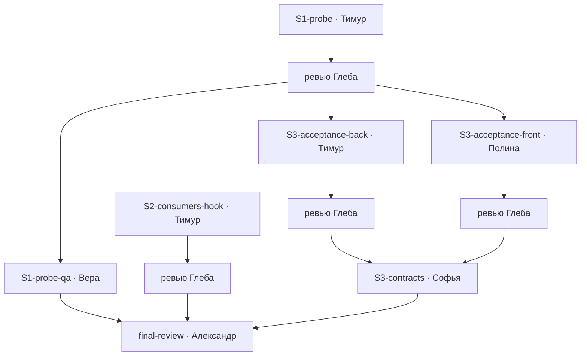

# План: локальные модели на фронтовых задачах, шаги 1–3 (2026-10-22)

Автор — Егор (планировщик). Основа — разрез Александра
[local-models-frontend-tasks-cut-2026-10.md](local-models-frontend-tasks-cut-2026-10.md).
Срез во времени, после написания не поддерживается.

Все шаги ниже — облачным исполнителям (Тимур, Полина, Вера, Глеб, Александр). Локальным
(Кира, Денис, Кузьма) в этой фиче не отдаём ничего: это инструменты для них, а не работа для них.

## Развилки, которые исполнитель закрывает до кода

1. **Шаг 2 — граф по пути файла.** `GET /api/codegraph/neighbors` принимает узел-тип
   (`node`), а хук знает только путь правленого файла. У TS-узлов путь входит в имя
   (`frontend/src/lib/api.ts::api`), у C#-типов — нет. Рекомендация: режим «по файлу» в
   `CodeGraphQueryService` (все узлы, объявленные в файле → входящие связи, дедуп, лимит 20),
   ручка — параметром `file` у `neighbors` или отдельным `GET .../consumers`. Не через `find`
   по подстроке: для C# он промахнётся.
2. **Шаг 2 — чем хук авторизуется.** `CodeGraphController` под `[Authorize]`, а файл
   per-run настроек кешируется статически по `(TempDir, Browser, DisableHooks)` и не знает
   ни хода, ни проекта. Значит, URL, сервисный JWT и `projectId`/`rootPath` скрипт хука
   берёт из env процесса CLI (или из stdin хука: там есть `cwd` и `session_id`). Новая
   переменная в env хода — согласовать с Александром до кода (`ClaudeSession` вычищает
   унаследованный env, список того, что ставит сервер, — его зона).
3. **Шаг 3 — где живёт гейт.** Одна точка проверки в `TaskManager` (вертикаль Tasks), тулсет и
   контроллер — тонкие. Две копии проверки (тулсет + контроллер) — дефект: REST-паритет
   разъедется на первой правке.

## Шаги

### 1. `S1-probe` · lane=back · Тимур · инструмент `ui_probe`

- **Читать:** `Services/Mcp/Http/TestsToolset.cs` (образец инструмента с очередью и «Стоп»),
  `Services/Mcp/Http/DevToolset.cs` (резолв `service` → URL стенда), `ClaudeHomeServer.TestRuns/TestRunService.cs`,
  `TestRunsSubsystem.cs`, `TestRunsOptions.cs`, прокси `/preview/**` (вход по JWT стенда),
  `appsettings.json` ~:472 и ~:506 (`KeepMcpTools`).
- **Править:** `TestsToolset.cs` (новый инструмент), новый сервис в `ClaudeHomeServer.TestRuns`
  (`UiProbeService.cs` + скрипт замера для headless Playwright из `frontend/node_modules`),
  `TestRunsSubsystem.cs` (регистрация), `appsettings.json` (два профиля), тесты в
  `ClaudeHomeServer.TestRuns.Tests`.
- **Готово, когда:**
  - выход — только числа JSON по пяти классам находок из разреза, без скриншотов и оценок;
    пороги и `viewports` — параметры с умолчаниями (40 px, `[360, 1280]`);
  - вызов встаёт в общую очередь сборок, потолок 9 минут, «Стоп» его гасит; сам процессов
    стенда не порождает (нет стенда — понятный отказ, а не таймаут);
  - юнит-тест разбора выхода скрипта красный на мутации «порог не применяется»;
  - `KeepMcpToolsConfigTests` зелёный с новым именем в обоих профилях;
  - живой прогон по одному маршруту стенда на 360 и 1280 приведён в отчёте выводом.

### 2. `S1-probe-qa` · role=qa · Вера · сверка с ручным замером

- **После** S1-probe и его ревью.
- **Что:** на 2–3 маршрутах (один — с известной тач-целью меньше 40 на 360) сравнить
  `ui_probe` с ручным замером Playwright; отдельно — что Глеб и исполнитель по одному маршруту
  получают одинаковые цифры.
- **Готово, когда:** таблица «маршрут → находка `ui_probe` → ручной замер», расхождений нет
  или каждое заведено дефектом.

### 3. `S2-consumers-hook` · lane=back · Тимур · хук `PreToolUse` на `Edit|Write`

- **Читать:** `ClaudeHomeServer.Llm/Claude/ClaudeRuntimeSettings.cs` (уже есть хук на `Bash` —
  образец, ~:136–150), `IrreversibleCommandGuard.cs`, `Controllers/CodeGraphController.cs:167`,
  `Services/Mcp/Http/CodeGraphToolset.cs` (`BuildingNote`, ответ по основному дереву при
  прогреве worktree).
- **Править:** `ClaudeRuntimeSettings.cs` (matcher + скрипт рядом с файлом настроек),
  `CodeGraphController.cs` и `CodeGraphQueryService` (режим «по файлу», развилка 1), тесты.
- **Готово, когда:**
  - первая правка файла в ходе → `additionalContext` с потребителями и покрывающими тестами,
    ≤ 20 строк, дальше «ещё N»; повторная правка того же файла в ходе — молчание;
  - нет графа, файл вне графа, ответ дольше 3 с, ошибка авторизации — молчание, правка не
    блокируется никогда;
  - тест: скрипт на файле с 50+ зависимыми обрезает до 20 с «ещё N»; на мутации «таймаут
    снят» тест падает;
  - живое свидетельство: транскрипт хода, где перед правкой `frontend/src/pages/WorkspacePage.tsx`
    стоит список его потребителей.
- **Параллельно с S1-probe**: файлы не пересекаются.

### 4. `S3-acceptance-back` · lane=back · Тимур · критерии и свидетельства в задаче

- **После** S1-probe (принят ревью). Можно не ждать S1-probe-qa.
- **Контракт JSON фиксирую здесь**, чтобы фронт шёл параллельно:
  `acceptance: [{ id, text }]`, `evidence: [{ criterionId, how, result }]` в DTO задачи.
- **Читать/править:** `ClaudeHomeServer.Core/Models/TaskItem.cs` (поля + record'ы
  `AcceptanceCriterion`, `AcceptanceEvidence`), `ClaudeHomeServer.Tasks/TaskManager.cs` (гейт
  закрытия и запрет персоне-исполнителю удалять/менять критерии; образец — `DefectRules.cs` и
  гейт `verification`), `Services/Mcp/Http/TasksToolset.cs` (`acceptance` в create/update,
  `evidence` в complete; образец — разбор `verification` ~:329), `Controllers/TasksController.cs`
  (REST-паритет), `Services/TaskExecutionService.cs` (`BuildDelegationReportText` ~:1914 —
  markdown-таблица «критерий → свидетельство» в тексте доклада), тесты в `ClaudeHomeServer.Tasks.Tests`.
- **Готово, когда:**
  - задача с тремя критериями не закрывается без трёх свидетельств: `Deny` с перечнем
    незакрытых, одинаково через MCP и REST;
  - задача без `acceptance` закрывается как раньше; старый `tasks.json` читается;
    `BackupSchema.Version` не тронут;
  - персона-исполнитель через `tasks_update` не может убрать критерий (отказ), постановщик и
    человек — могут;
  - доклад постановщику содержит таблицу;
  - тест на мутацию «пропустить проверку evidence» — красный.

### 5. `S3-acceptance-front` · lane=front · Полина · таблица в карточке задачи

- **Параллельно с S3-acceptance-back** — по контракту JSON из шага 4, файлы не пересекаются.
- **Читать/править:** `frontend/src/types/index.ts` (поля задачи), `frontend/src/features/tasks/TaskDetailsPane.tsx`
  (секция «Критерии приёмки» рядом с блоком `verification` ~:614/780, образец — он же),
  `frontend/src/components/chat/DelegationReportCard.tsx` — **только проверить**, что
  markdown-таблица из доклада рендерится; правка — если нет.
- **Готово, когда:** секция видна при непустом `acceptance` и отсутствует без него; критерий
  без свидетельства явно помечен; мобила 360 и обе темы; `npx tsc -b` и `npm run lint:design`
  зелёные; vitest на пустой/частичный/полный набор.
- Редактирование критериев в форме (`TaskEditForm.tsx`) — **не в шаге** (см. «За скобками»).

### 6. Ревью Глеба — после каждого шага

`S1-probe-review`, `S2-consumers-hook-review`, `S3-acceptance-back-review`,
`S3-acceptance-front-review` — отдельные задачи `role=review`. На S3 Глеб сверяет обе стороны
по одному контракту JSON.

### 7. `S3-contracts` · Софья · контракты Егора, Глеба, исполнителей

- **Появляется вместе с шагом 3, не раньше**: после приёмки S3-acceptance-back и
  S3-acceptance-front, до финального ревью. Тексты контрактов в этом плане не пишем.

### 8. `final-review` · Александр · финальное ревью собранной фичи

После всех ревью и S3-contracts. Сверка с инвариантами разреза: `ui_probe` только читает и
отдаёт числа; хук не блокирует; гейт fail-closed и обходится только человеком/постановщиком.

## Порядок и параллель

- S1-probe и S2-consumers-hook — параллельно по файлам, но у них один исполнитель: если
  Тимур один, порядок S1-probe → S2 → S3-back (S1 первым — он держит шаг 3).
- S3-back и S3-front — параллельно, связаны только контрактом JSON.
- S1-probe-qa не держит шаг 3, но держит финальное ревью.

## Бюджет контекста

Локальных шагов нет. Самый широкий — S3-acceptance-back (Core + Tasks + тулсет + контроллер +
доклад, ~6 файлов плюс тесты): облачному Тимуру это по силам, дробить не стал — разрез по
слоям дал бы три ревью одного контракта.

## Риски

- `ui_probe` скатится в «посмотри скриншот» — критерий S1 явно требует только числа.
- Хук тормозит ход — 3 с и молчание; S2 не принимается без теста на таймаут.
- Хук не работает там, где `--settings` не передаётся: container-среда и Windows-хост
  (`HostRequiresHooksOff`). Для локальных исполнителей на Linux-хосте это не мешает, но в
  отчёте S2 Тимур подтверждает, что ходы Киры/Дениса получают этот файл настроек.
- Неизмеримые критерии обесценят гейт — качество на мне, Глеб проверяет на первых трёх задачах.

## За скобками

- Тест на тач-цели под наш репозиторий, смена локальной модели, полный Playwright исполнителю
  на шаге — по разрезу.
- Редактирование критериев в форме задачи на фронте: критерии ставлю я через MCP, человеку
  хватит показа. Нужна форма — отдельный шаг Полине после метрики.
- Шаг 4 разреза (лимит размера шага) — уже в моём контракте, работы нет.
- Замер метрики успеха через неделю после выкатки — отдельная задача Софье.
