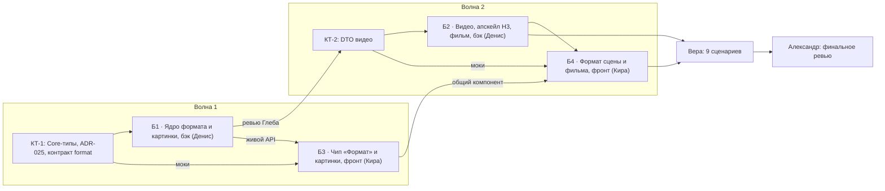

# План реализации «Формата»: 4 блока, 2 волны

«Формат» — единое место, где человек и агент задают пропорции и размер картинок и видео. Выбранный размер реально уходит в модель и в цену.

**Источники:**
- архитектурный разрез Александра (черновик ADR-025, итог задачи `1b391b6b`);
- макет [media-format-v1.html](../mockups/media-format-v1.html) и записка [media-format-v1-proposal.md](../mockups/media-format-v1-proposal.md) с 9 сценариями приёмки;
- решения Андрея от 2026-10-06.

Нарезку Александра (Б1–Б4) я оставил: блоки крупные, исполнители сильные. Изменения относительно разреза:
- **«Макс» у local MiniMax H3 = 1440p через апскейл** (решение 1). Это работа блока Б2.
- **У агента есть обрезка `op = crop`** (решение 4). Это работа блока Б1. Строка разреза «Инструмента обрезки у агента нет» отменена.
- Вопросы 2 и 3 разреза закрыты так, как он рекомендовал: явный формат от агента пишется в проект с ✦, умолчание — «Как у модели».

Пути и имена сторожей я сверил в worktree на `eee3b7893`.

## 0. Общие правила для всех блоков

- **Где работаем.** Все блоки идут в одном worktree `/home/an/Sources/ClaudeCodeServer-media-format` на ветке `feat/media-format`. Каждый исполнитель коммитит **свои** файлы локально, как только критерии блока зелёные (Conventional Commits по-русски, трейлер `Co-Authored-By`). Пуш, PR и мерж делаются только по просьбе Андрея.
- **Безопасность процессов.** Убивать можно только **свой** PID и только после проверки `readlink /proc/<pid>/cwd`: каталог должен лежать внутри этого worktree. `pkill` и `killall` по имени запрещены, и `kill` по шаблону `ClaudeHomeServer.dll` тоже: на хосте живёт боевой инстанс (инцидент 28.09). Дев-стенд поднимается только через `dotnet run` или с явным `ASPNETCORE_ENVIRONMENT=Development`.
- **Облачные траты минимальные.** Тела запросов fal и Higgsfield, котировки и пробы проверяются на **фейках драйверов и HTTP** в юнит-тестах. Живые облачные вызовы делаются только при приёмке Веры, по одному на сценарий, где без них нельзя. Живые схемы моделей (`get_model_schema` у fal, `models_explore` у Higgsfield) читать можно: это бесплатно. Локальная GPU тоже бесплатна, но очередь у неё общая, поэтому живой прогон H3 + апскейла делается **один раз** на блок.
- **Тексты интерфейса берутся из записки макета**, раздел «Тексты интерфейса» и таблица «Тексты чипа». Это подписи ступеней, причины серых, заметки о подмене, предупреждение о подрезке, строки ленты. Своих формулировок исполнители не пишут. Если нужной строки в записке нет (сейчас так со стадией апскейла, см. Б2 и Б4), исполнитель просит Майю дописать её в записку, а не придумывает сам.
- **Фразы `Note` резолвера** (округление, подмена) пишет бэкенд, но дословно по записке. Фронт показывает `Note` как есть и свою арифметику не ведёт.
- **Место на диске.** Сейчас на `/` почти ноль, Марк чистит его отдельной задачей. Если `dotnet build` или `npm` падают с `No space left`, это не дефект блока: исполнитель останавливается и сообщает постановщику.

## 1. Волны и зависимости



| Волна | Денис (бэкенд) | Кира (фронтенд) | Старт |
|---|---|---|---|
| 1 | **Б1** Ядро формата и картинки | **Б3** Чип «Формат» и картинки | Б1 сразу. Б3 после коммита КТ-1, сначала на моках |
| 2 | **Б2** Видео, апскейл H3, фильм | **Б4** Формат сцены и фильма | Б2 после ревью Б1 Глебом. Б4 после Б3 и КТ-2 |
| финал | — | — | приёмка Веры → правки → финальное ревью Александра |

- **На стенде одновременно не больше двух исполнителей: Денис и Кира.** Второго бэкендера не ставим. Один worktree на двоих бэкендеров даёт общие `bin/obj` и ложные красные; так же решили в [плане видеоредактора](video-editor-implementation-plan-2026-10.md).
- **Глеб ревьюит каждый блок** по готовности: чтение и точечный `dotnet test --filter`, стенд он не занимает. Следующий блок того же исполнителя стартует только после «блокеров нет». Замечания уровня minor исполнитель закрывает отдельным коммитом в начале своего следующего блока, а после последнего блока — до приёмки Веры.
- **Приёмка Веры** проходит по 9 сценариям записки, в обеих темах, на ширинах 360/1024/1440. После неё и правок идёт **финальное ревью Александра**: фича крупная. Отдельными блоками эти этапы не расписаны.
- **«Что нового»** пишется после приёмки отдельной мелкой правкой, исполнители блоков его не пишут.

## 2. Контрольные точки

### КТ-1 — первый коммит Б1 (Денис), до любой другой работы блока

Пока КТ-1 не закоммичена, Денис не начинает остальную часть Б1, а Кира не начинает Б3. Состав:

1. **`docs/adr/ADR-025-media-format.md`** — текст разреза Александра с решениями Андрея:
   - §4: у агента есть `op = crop`;
   - §5 и таблица ступеней: «Макс» у local H3 = 1440p через апскейл;
   - §10 переписан в «Решения» (четыре пункта).

   Отдельный файл **`docs/adr/ADR-025-contracts.md`** содержит JSON-примеры:
   - ответ `GET …/image-editor/format?provider&model&op`;
   - `FormatModel` для фронта;
   - тело запуска с `format`;
   - `MediaFormat` в префах.
2. **Core-типы** в `backend/ClaudeHomeServer.Core/Services/Media/`: `MediaFormat.cs` (`FormatTier`, `FormatTierSpec`, `ExactSizeSpec`, `MediaFormatCaps`, `MediaFormat`, `ResolvedFormat`), сигнатуры `MediaFormatResolver.Resolve` и `AspectCrop.Rect`. Тела могут быть заглушками, сигнатуры и JSON-имена полей должны быть окончательными.
   - У `FormatTierSpec` сразу есть поле **пост-шага** (рабочее имя `PostStep`, значение `upscale`). Оно нужно Б2 для local H3, и вводить его на этапе КТ-2 было бы поздно: контракт тогда сломается.
3. **Строка флага `media-format`** в `FeatureFlagCatalog.All` (`backend/ClaudeHomeServer.Core/Models/FeatureFlag.cs`): `Default: false`, stage — эксперимент. Ключ в TS-`FLAGS` добавляет Кира первым коммитом Б3. Сервер под флагом ничего не прячет, флаг держит только фронт.
4. **Тест контракта:** JSON-примеры из `ADR-025-contracts.md` десериализуются в Core-типы и сериализуются обратно без потерь, по образцу `VideoContractExamplesTests`.

Ревью Глеба по КТ-1 делается в тот же день: контракт дальше двигать дорого.

### КТ-2 — первый коммит Б2 (Денис)

Это контракт видео для Б4. Состав:
- `VideoSceneSettingsDto.Format` (желание) и зеркало `Aspect`;
- `frameFit {anchor}`;
- в DTO сцены: `lockedBy {filmPath, aspect}`, `formatMismatch`, `framesCropped`;
- в DTO строки фильма: `formatMismatch`;
- код отказа `409 film_format_locked` и параметр `force`;
- новая стадия хода съёмки **`upscaling`** в `VideoEditProgressMessage.Stage` и в `VideoJobDto`;
- `Eta` котировки как сумма съёмки и апскейла.

Изменения в `VideoContractExamplesTests` идут отдельным коммитом `refactor(videoEditor): контракт формата сцены и фильма`.

## 3. Блоки

### Б1. Ядро формата и картинки, бэкенд — Денис

**Что делает:**
1. **КТ-1** (см. выше).
2. **`MediaFormatResolver`** — единственная арифметика формата:
   - выбор ближайшей пропорции по |log(w/h) − log(w'/h')|;
   - ступень того же номера или ближайшая ниже;
   - для «Точно…»: кратность `Step`, затем `MinSide`..`MaxSide`, затем `MaxMegapixels`;
   - фразы `Note` по записке;
   - флаг `Substituted`;
   - серая «Макс» с причиной там, где у модели нет родного размера и нет `PostStep`.
3. **`AspectCrop.Rect(w, h, aspect, anchor)`**.
4. **Каталог картинок:** поле `Format` (`MediaFormatCaps?`) в `ImageEditCaps`. Таблицы ступеней лежат в статических каталогах трёх драйверов: `FalImageEditor`, `HiggsfieldImageEditor` (живой каталог: `aspect_ratios` и enum `resolution` схемы) и `LocalImageEditor` (`ComfyWorkflows.ImageSizes`). Значения fal и Higgsfield берутся из живых схем, не по памяти. Для модели без данных `Format = null`: это «Как у модели», сценарий 9.
5. **Как формат доходит до модели:**
   - в `ImageEditRequest` появляется `ResolvedFormat? Format`, а `AspectRatio` становится производным;
   - fal получает `aspect_ratio` и `image_size {width,height}` (ступень — по схеме модели);
   - Higgsfield получает `params.aspect_ratio` и `params.resolution`;
   - local: `LocalImageRequest.Width/Height` (Core, аддитивно) → `EmptyLatentImage`, кратно 16.
6. **Котировка:**
   - fal за мегапиксель считается по целевому размеру у `generate` и по исходнику у «Как у исходника»;
   - `get_cost` Higgsfield вызывается с `aspect_ratio` и `resolution`, проба кешируется на 10 минут по ключу (модель, пропорция, ступень);
   - если прайс по ступеням не различается, цена = прайс × `PriceFactor` с пометкой `Approx`;
   - цена «Точно…» — по формуле за мегапиксель или ближайшая ступень с `~`.
7. **Ручка формата** `GET …/image-editor/format?provider&model&op` (проект и личная область): `{caps, wish, resolved, tiers[{tier,label,size,price,disabledReason}], exact}`.
8. **Хранение:**
   - новое поле `ImageProjectPrefs.Format` (`MediaFormat?`), аддитивно; PUT сливает, `Validate` проверяет белый список значений; событие `image_prefs_changed`;
   - `Edit.Ratio` больше не пишется, поле остаётся ради отката;
   - **храним только желание**, действующий формат считается на каждом чтении.
9. **Правка картинки:**
   - у `edit`, `inpaint` и `removeBackground` умолчание — `mode = source` (бывший `MatchSourceSize = true`); `matchSourceSize` остаётся синонимом и в API, и в MCP;
   - «Дорисовать края» = `outpaint` с пропорциями из формата (`OutpaintSpec.ForAspect`);
   - у `upscale` формат задаёт сама операция.
10. **Обрезка — одна серверная точка для человека и агента (решение 4).**
    - Новый метод сервиса нити, рабочее имя `ImageThreadService.CropToAspectAsync(…, aspect, anchor, initiator)`. Он считает прямоугольник по `AspectCrop.Rect` и выполняет существующий `transform` (`crop`) через `ImageEditSteps`. Результат — **новая версия картинки**, как у других операций, плюс строка ленты по записке («Обрезано без ИИ: 1200×1200 · 1:1 · …»).
    - REST-путь для «Обрезать» в «Формате» — новое необязательное поле `ImageTransformRequest.FitAspect {aspect, anchor}` или отдельная ручка; превью — `dryRun=true`. **Оба пути (REST и MCP) зовут один и тот же метод**, поэтому карточка в ленте одна и та же. Так выполняется требование Андрея: действие агента выглядит так же, как действие человека.
    - Сейчас правка без ИИ ложится **шагом текущей версии без карточки** (`ImageThreadService.AddStepAsync`). Этот путь у инструментов «Без ИИ» в редакторе остаётся без изменений. Новая версия появляется только у обрезки из «Формата» и у `op = crop`.
    - В записке у строки ленты стоит хвост «шаг v1·2». Его Денис сверяет с Майей до коммита, раз результатом обрезки стала версия.
11. **MCP `image_generate`:**
    - новые аргументы: `aspect`, `quality` (`standard|high|max`), `width`, `height`, `anchor` (`left|center|right|top|bottom`); в enum `op` добавляется `crop`;
    - у аргументов формата в описании стоит оговорка `NotWithoutAsk`;
    - **схема статична:** пропорции модели в `enum` не попадают, описание постоянное («одна из пропорций модели — смотри `image_state`»);
    - `op = crop` бесплатен, провайдера не трогает и котировки не тратит; без `aspect` — отказ с подсказкой;
    - `op = edit` с пропорциями, которые отличаются от исходника, — отказ с подсказкой «дорисовать — `op = outpaint`, обрезать — `op = crop`»;
    - явный `aspect`/`quality`/`width`/`height` у `generate` записывает формат проекта с `By = Agent` (решение 2): ✦ и тихая строка «✦ Claude сменил формат картинок проекта: 16:9 → 9:16». Запись идёт из сервиса префов, а не из тулсета. `op = crop` формат проекта не меняет.
12. **Хвост хода и `*_state`:**
    - в `IContextKindProvider` добавляется `DescribeFormat(scope, primary) → string?` с реализацией по умолчанию;
    - `TurnContextContributor` и `context_state` выводят строку «Формат: …», **и в режиме «Чат»** тоже;
    - `ChoiceRule` картинок получает правило «не передавай формат без просьбы человека»;
    - `image_state` перечисляет пропорции и ступени текущей модели.

**Владеет файлами:**
- `backend/ClaudeHomeServer.Core/Services/Media/MediaFormat*.cs`, `AspectCrop.cs` (новые), `ILocalImageMedia.cs`;
- `backend/ClaudeHomeServer.Core/Models/FeatureFlag.cs` — одна строка флага;
- строка контекста и хвост: `backend/ClaudeHomeServer.Core/Services/ChatContext/IContextKindProvider.cs`, `ChatContextState.cs`, `backend/ClaudeHomeServer.Turn/TurnContextContributor.cs`, `backend/ClaudeHomeServer/Services/Mcp/Http/TurnContextToolset.cs` (`context_state`);
- `backend/ClaudeHomeServer.ImageEditor/` по теме: `Contracts/IImageEditor.cs`, `Contracts/ImageEditDtos.cs`, `Contracts/ImageEditCatalog.cs`, три драйвера в `Providers/`, `ImageEditQuoting`, `Jobs/ImageEditLaunchAssembler.cs`, `Jobs/ImageEditJobService.cs`, `Jobs/ImageEditSteps.cs`, `Jobs/InputFitter.cs`, `Prefs/ImageProjectPrefs*`, `Threads/ImageThreadService.cs`, `Controllers/ImageEditorEndpoints.cs` (+ два контроллера), `Mcp/ImageEditorToolset*`, `Chats/ImageEditorStateContributor`, `ChatContext/*`;
- `backend/ClaudeHomeServer.Images/Services/LocalMedia/ComfyWorkflows.cs` (картиночные шаблоны), `LocalImageMediaAdapter.cs`;
- `docs/adr/ADR-025-media-format.md`, `docs/adr/ADR-025-contracts.md`;
- тесты в `ClaudeHomeServer.ImageEditor.Tests/`, `ClaudeHomeServer.Images.Tests/`, `ClaudeHomeServer.Tests/Services/ChatContext/`, `ClaudeHomeServer.Tests/Services/` (сторож паритета схем).

**Зависит:** ни от чего. **Параллельно с ним:** Б3, после КТ-1.

**Готово, когда:**
- зелёные команды:
  ```bash
  cd backend && dotnet build ClaudeHomeServer.slnx
  dotnet test ClaudeHomeServer.ImageEditor.Tests
  dotnet test ClaudeHomeServer.Images.Tests
  dotnet test ClaudeHomeServer.Tests --filter "FullyQualifiedName~McpToolsetStability|FullyQualifiedName~SubsystemBoundary|FullyQualifiedName~IlBoundaryRegression|FullyQualifiedName~TurnContextParity|FullyQualifiedName~ChatContextContracts|FullyQualifiedName~McpSchemaParity"
  ```
  Перед сдачей Глебу — полный `dotnet test ClaudeHomeServer.slnx`.
- новые тесты есть, и каждый доказан мутацией (без исправления тест краснеет):

  | Тест | Что доказывает |
  |---|---|
  | юниты `MediaFormatResolver` | сценарии 2, 3 и 9 записки дословно: «16:9 нет у GPT Image — взяли 3:2.», «Модель рисует кратно 64: 1920×1088.», «до 2048 px по длинной стороне», `Format = null` |
  | **хранится желание** | модель A(16:9) → B(без 16:9) → A: в префах всё время 16:9, `resolved` у B = 3:2 с `Note` |
  | тела запросов трёх драйверов на фейках HTTP | ступень и точный размер реально уходят: fal `image_size`/`aspect_ratio`, Higgsfield `params.*`, local `EmptyLatentImage`; мутация «убрать параметр» → красный |
  | котировка | `High` дороже `Standard` там, где прайс различается; проба Higgsfield несёт `aspect_ratio` |
  | `op = crop` | REST-путь и MCP-путь дают одинаковые запись версии, событие и строку ленты; `op = crop` не вызывает ни драйвер, ни котировку |
  | отказ `edit` с чужими пропорциями | текст подсказки содержит `outpaint` и `crop` |
  | **сторож паритета схем** (новый, `McpSchemaParityTests`) | `ToolsFor` у `image-editor` при двух разных каталогах и префах даёт побайтно одинаковые схемы; мутация «подставить `enum` пропорций из каталога» → красный |
  | агентская запись формата | `By = Agent`, ✦ и тихая строка; ручная запись снимает ✦ |
  | хвост | строка «Формат: …» есть и в режиме «Чат»; `TurnContextParityTests` расширен |
  | совместимость | старые префы и нити без `Format` → «Как у модели», регрессии нет |

- `McpToolsetStabilityTests`, `SubsystemBoundaryTests` и `SubsystemBoundaryCoverageTests` проходят **без правок и без новых allow**;
- сценарии записки на уровне API (через `curl` на дев-стенде или интеграционные тесты): **1, 2, 3, 4 и 9**, а для агента **7**. Ответ ручки `format` совпадает с примерами `ADR-025-contracts.md`;
- процессы: свой дев-стенд гасится только своим PID после проверки `/proc/<pid>/cwd`, `pkill`/`killall` не используются.

### Б2. Видео, апскейл local H3 и фильм, бэкенд — Денис

**Что делает:**
1. **КТ-2** (см. выше).
2. **Каталог видео:**
   - `VideoCaps.Format` (`MediaFormatCaps?`) у всех движков; у fal `WireParam = resolution`, `Defaults` (`768P`) становится ступенью «Стандарт»;
   - у Higgsfield `Aspects` берутся из `aspect_ratios`, ступени — из enum `resolution` схемы, если он есть, иначе `Tiers = []`;
   - частный параметр, которым теперь управляет формат (`resolution` у fal, `size` у local), уходит из `ParamNames`; если агент передал его в `params`, ответ — отказ «размер задаётся `quality`».
3. **Решение 1: «Макс» у local MiniMax H3 = 1440p через апскейл.**
   - **Ступени local H3:**

     | Ступень | Размер | Как получается |
     |---|---|---|
     | «Стандарт» | 480p = 864×480 | `half` |
     | «Высокое» | 768p = 1344×768 | `full` |
     | «Макс» | 1440p = 2528×1440 | съёмка `full`, затем латентный апскейлер на своей GPU |

     Это совпадает со сценарием 5 записки («ступени 480p / 768p / 1440p»). У портретной сцены стороны меняются местами. В каталоге у «Макс» стоит `PostStep = upscale`, поэтому резолвер её **не** гасит.
   - **Для всех остальных моделей решение «автоматического апскейла нет» остаётся в силе.** «Макс» без родного размера у модели — серая, причина по записке. Апскейл включается только из таблицы ступеней local H3, общего механизма «доувеличить что угодно» нет. Сторож: резолвер даёт `disabledReason` у «Макс» любой модели без `PostStep`.
   - **Шов.** В `ILocalVideoMedia` (Core) аддитивно добавляется апскейл по тикету завершённой съёмки (рабочее имя `SubmitUpscaleAsync(ticket, target, ct)`) и его оценка времени. Реализация лежит в адаптере вертикали Images:
     - шаблон `ComfyWorkflows.UpscaleVideo` и таблица `Upscale1440` уже есть;
     - латент съёмки сохраняется до конца апскейла, по образцу `keepForUpscale` в `LocalMediaCleanup`;
     - VideoEditor на Images не ссылается (ADR-014).
   - **Ход задачи.** `LocalVideoEngine.RunAsync` при ступени «Макс» после съёмки запускает апскейл тем же вариантом. Вариант один, и версией сцены становится только 1440p-ролик.
     - Прогресс идёт новой стадией `upscaling` в `VideoEditProgressMessage`, с отдельными процентом и ETA. Человек видит в карточке и в ходе съёмки, что идёт **вторая тяжёлая задача GPU**.
     - Отмена во время апскейла снимает именно тикет апскейла.
   - **Время в подписи ступени.** Котировка `Eta` = съёмка + апскейл. Оценка апскейла — `LocalMediaService.Upscale1440Eta` (замерено для роликов до 5 с: ≈ 15–18 мин сверх съёмки). Для более длинных роликов таблица отдаёт `null`. Тогда ручка формата помечает «Макс» как «время не замерено», а не выдумывает число; режет ли шаблон 10-секундный ролик, Денис проверяет одним живым прогоном.
     - Время и стадию ручка отдаёт **данными** (`postStep`, `eta`), а не строкой. Готовой формулировки подписи «съёмка + увеличение ≈ N мин» и стадии «Увеличение до 1440p» в записке нет: Майя дописывает их в записку до начала Б4, бэкенд от формулировки не зависит.
   - **Сбой апскейла.** Вариант завершается ошибкой с понятным текстом. 768p-ролик **не** подставляется молча вместо 1440p, иначе нарушится правило «подмена только с объяснением». Сохранять ли такой ролик отдельной версией, решает Андрей при приёмке; по умолчанию не сохраняем.
4. **Как формат доходит до модели:**
   - у fal в тело идут `body[model.Aspect]` и `body[WireParam] = WireValue`;
   - у Higgsfield — `aspect_ratio` и `resolution` из схемы;
   - у local H3 ступень даёт `size` (`half`/`full` и апскейл), а пропорция — ориентацию, через подрезку кадра.
   - Котировка: `ProbeRequest` несёт ступень (сейчас `Params` = null, `VideoEditJobService.cs:234`).
5. **Кадры A/B.** Если пропорции кадра не совпадают с форматом сцены, `VideoFrameReader` подрезает его **до модели** по `AspectCrop.Rect` с якорем `frameFit.anchor` (по умолчанию центр) через Core-шов `IImageRaster`. Шов необязательный: без Images ответ — `dsp_unavailable`. Превью — тот же расчёт через `dryRun`. Для local H3 это единственный способ получить 9:16 из 16:9-кадра.
6. **Хранение:**
   - `VideoPrefsDto.Format`; новая сцена засевает своё `VideoSceneSettingsDto.Format`;
   - `Aspect` остаётся **зеркалом** `Format.Aspect`, его пишут оба пути (читают `FilmSceneSaver` и старый фронт);
   - `.film` остаётся в `schema` 1, нового поля нет.
7. **Замок фильма на бэкенде.** `VideoSceneService` ставит `lockedBy` сценам фильма на позиции > 0. Смена пропорций у такой сцены без `force` отвечает `409 film_format_locked` с текстом из записки, и это одинаково для ручки и для инструмента агента. Добавляются `formatMismatch` у сцены и у строки фильма и действие «Привести к 16:9»: оно меняет формат сцены, а переснимать или нет, решает человек.
8. **Сборка фильма в формате первой сцены:**
   - `FilmAssembler.PlanAsync` берёт размер первого клипа по `ProbeAsync`, приводит его к чётному и к потолку 4096;
   - `FilmFormat.AspectSize` остаётся только для проверки пропорций нового фильма;
   - сцены другого формата склеиваются как сейчас (`scale…decrease + pad black`);
   - тяжёлый слот — прежний `BuildConcurrencyGate` через `ProcessSpec.Heavy`, второго семафора не заводим;
   - таймаут сборки = `AssembleTimeoutMinutes × max(1, W·H / (1280·720))` с clamp 1..240;
   - `doc.Aspect` становится кешем, его обновляют `FilmService.PatchAsync` и сборка;
   - фильм с первой сценой 1440p собирается в 2528×1440.
9. **MCP:**
   - `video_new`, `video_scene_set` и `video_shoot` получают `quality`;
   - у `aspect`, `durationSec` и `quality` в описании стоит оговорка `NotWithoutAsk` (сейчас у `aspect`/`durationSec` её нет — это дыра из разреза);
   - схемы статичны, сторож паритета из Б1 расширяется на `video-editor`;
   - явный формат от агента пишется в префы видео с `By = Agent` и тихой строкой;
   - `EditorFirst` получает правило формата, `video_state` перечисляет пропорции и ступени модели (у H3 с пометкой, что «Макс» = съёмка + увеличение);
   - `DescribeFormat` для видео выводит в хвост «Формат сцены …» и, у сцены фильма, замок.

**Владеет файлами:**
- `backend/ClaudeHomeServer.VideoEditor/`: `Engines/*` (в том числе `LocalVideoEngine.cs`, `FalVideoEngine.cs`, Higgsfield), `Catalog/*`, `Jobs/VideoEditJobService.cs`, `VideoFrameReader`, `Prefs/*`, `Scenes/VideoSceneService.cs`, `Contracts/*` (`VideoSceneDto`, `VideoEditorEvents.cs`, `VideoJobDto.cs`, `VideoFilm.cs`), `Films/FilmService.cs`, `Films/FilmFormat*`, `Assembly/FilmAssembler.cs`, `Mcp/VideoEditorToolset*`, `Chats/VideoEditorStateContributor`, `ChatContext/*`;
- `backend/ClaudeHomeServer.Core/Services/Media/ILocalVideoMedia.cs` (аддитивно);
- `backend/ClaudeHomeServer.Images/Services/LocalMedia/LocalVideoMediaAdapter.cs`, `LocalMediaCleanup.cs` (удержание латента). `ComfyWorkflows.cs` — только если шаблон апскейла потребует правки: к этому моменту Б1 его уже закоммитил, конфликта нет;
- тесты в `ClaudeHomeServer.VideoEditor.Tests/` и `ClaudeHomeServer.Images.Tests/`.

**Зависит:** от Б1 (Core-типы, резолвер, `AspectCrop`, сторож паритета) и от ревью Б1 Глебом. **Параллельно с ним:** Б3 до конца, затем Б4 (на моках КТ-2).

**Готово, когда:**
- зелёные команды:
  ```bash
  cd backend && dotnet build ClaudeHomeServer.slnx
  dotnet test ClaudeHomeServer.VideoEditor.Tests
  dotnet test ClaudeHomeServer.Images.Tests
  dotnet test ClaudeHomeServer.Tests --filter "FullyQualifiedName~McpToolsetStability|FullyQualifiedName~McpSchemaParity|FullyQualifiedName~SubsystemBoundary|FullyQualifiedName~IlBoundaryRegression|FullyQualifiedName~TurnContextParity"
  ```
  Перед сдачей — полный `dotnet test ClaudeHomeServer.slnx`.
- новые тесты есть, и каждый доказан мутацией:

  | Тест | Что доказывает |
  |---|---|
  | тела запросов fal и Higgsfield на фейках | ступень уходит в `resolution`; `resolution`/`size` в `params` → отказ |
  | `LocalVideoEngine` на фейке шва | «Стандарт» → `half`, «Высокое» → `full`, «Макс» → `full` + `SubmitUpscaleAsync("1440p")`; стадия `upscaling` и её ETA уходят в `VideoEditProgressMessage`; версия — только 1440p-ролик; отмена во время апскейла снимает тикет апскейла; сбой апскейла не подставляет 768p |
  | резолвер | «Макс» серая у любой модели без родного размера и без `PostStep` (fal MiniMax H3 по живой схеме, Higgsfield без `resolution`) и не серая у local H3 |
  | котировка | `Eta` у «Макс» local H3 = съёмка + апскейл; проба несёт ступень |
  | подрезка кадра | `VideoFrameReader` отдаёт байты с пропорцией сцены и якорем; без `IImageRaster` → `dsp_unavailable` |
  | замок | сцена 2 → 9:16 без `force` → `409 film_format_locked` и у ручки, и у `video_scene_set` |
  | сборка | план фильма с первой сценой 1080p/1440p — в её размере; таймаут масштабируется; старый `.film` без формата читается |
  | совместимость | сцены и префы без `Format` → «Как у модели», `Aspect` зеркалится |

- `VideoContractExamplesTests` обновлён отдельным коммитом. `VideoModuleIsolationGuardTests` и `SubsystemBoundaryTests` зелёные **без новых allow**;
- **один живой прогон** local H3 «Макс» 5 с на своей GPU (бесплатно, общая очередь). Ролик 2528×1440 ложится версией сцены, стадия `upscaling` видна в `video_state` и в событиях. Его же фильм собирается в 2528×1440 (`ffprobe`). Облачных живых прогонов в блоке нет;
- сценарии записки на уровне API: **5** (включая ступени H3 480p / 768p / 1440p и подрезку кадров), **6**, и **7** для видео;
- процессы: только свой PID после проверки `/proc/<pid>/cwd`. Задачи ComfyUI снимаются через `CancelAsync` по своему тикету, а не убийством процессов GPU.

### Б3. Чип «Формат» и картинки, фронтенд — Кира

**Что делает:**
1. Первый коммит: ключ `mediaFormat: 'media-format'` в `FLAGS`. Весь новый UI работает под `useFeature(FLAGS.mediaFormat)`. Без флага остаётся прежнее поведение, старые места (`aspect`, вопрос пропорций у `outpaint`) живут под `!flag` до снятия флага.
2. **Общий компонент** в `frontend/src/components/generation/format/`:
   - `FormatChip.tsx` — свёрнутый вид по таблице «Тексты чипа»: ✦, 🔒, ⚠, жёлтый цвет при округлении, приглушённый вид у «Увеличить» и «Как у модели»;
   - `FormatPopover.tsx` — всплывашка на компьютере, шторка на телефоне. Внутри: пропорции с силуэтом кадра; ступени с размером и ценой; серые ступени с причиной; «Точно…» с полями, пресетами и строкой «Уйдёт в модель»; пустое состояние со ссылкой «Сменить модель в «Чем»»; низ всплывашки (память, ✦).
   - Компонент без бизнес-логики: всё посчитанное приходит в `FormatModel` от ручки. **Своей арифметики кратности и ближайшего на фронте нет.**
3. **Строка контекста:**
   - в `ContextApi`/`ContextKindApi` появляется `format?(ctx, actionId | null) → FormatModel | null`;
   - чип рисуется в `ContextRow`/`ContextRowView` сразу за «Чем», **и в режиме «Чат»** (`actionId = null`);
   - в `ladder.ts` чип занимает свою ширину и сокращается («16:9 · 1792»);
   - в `ContextPanel` появляется секция «Формат» под «Чем»;
   - `LaunchParam` получает вид `{kind:'format'}` вместо `aspect`, набор остаётся закрытым.
4. **Картинки (`features/imageEditor/context/*`):**
   - `FormatModel` строится из ручки `format`, цена на кнопке поля берётся из той же котировки;
   - правка: «Как у исходника · 4:3» по умолчанию, при других пропорциях — диалог «Дорисовать края / Обрезать» с рамкой «Слева · По центру · Справа» и превью (`dryRun`);
   - «Обрезать» зовёт серверную обрезку из Б1, и в ленте появляется та же карточка, что у `op = crop` агента;
   - чип «Дорисовать» без формата открывает «Формат» с подсказкой из записки;
   - у «Увеличить» чип только для чтения.
5. **Удаления (под флагом):**
   - `aspect` в `imageEditor/context/run.ts`;
   - `question` пропорций у `outpaint` (`context/actions.ts`);
   - `getCreateRatio` и пропорции режима в `context/ops.ts`;
   - запись `Edit.Ratio` в `thread/prefs.ts`.
6. **Витрина `#/ui-kit`:** раздел «Формат» со всеми состояниями чипа из таблицы записки.

**Владеет файлами:**
- `frontend/src/components/generation/format/*` (новые), `components/chat/ContextRow.tsx`, `components/chat/ContextRowView.tsx`, `components/generation/ContextPanel.tsx`;
- `frontend/src/lib/chatContext/types.ts`, `lib/chatContext/ladder.ts`, `frontend/src/lib/featureFlags.ts`;
- `frontend/src/features/imageEditor/context/*`, `features/imageEditor/thread/prefs.ts`, `thread/useThreadLaunch.ts`, `features/imageEditor/api.ts`;
- витрина UI-кита;
- `frontend/e2e/media-format-image.spec.ts` (новый), юнит-тесты рядом с компонентами.

**Зависит:** от КТ-1 (моки по `ADR-025-contracts.md`), затем от готового Б1 для живого API. **Параллельно с ним:** Б1, затем Б2.

**Готово, когда:**
- зелёные команды:
  ```bash
  cd frontend && npx tsc -b
  npm run lint:design
  npx vitest run src/components/generation src/features/imageEditor src/lib/chatContext
  npx playwright test e2e/media-format-image.spec.ts e2e/context-actions-image.spec.ts e2e/context-row-exec.spec.ts e2e/context-panel-compact.spec.ts
  ```
  Перед сдачей — полный `npm run build` (собирает и remote-модули).
- e2e проходят сценарии записки **1, 2, 3, 4, 7, 8 и 9** на ширинах 1440 и 360, в обеих темах. API на моках или на дев-стенде с фейковыми драйверами, без живых облачных вызовов;
- с выключенным флагом существующие e2e `context-actions-image` и `context-row-exec` зелёные **без правок**;
- перед коммитом заметного UI Кира **предлагает** прогон через субагента `designer` и дожидается ответа;
- процессы: свой `vite`/`dotnet run` гасится только своим PID после проверки `/proc/<pid>/cwd`, без `pkill`/`killall`.

### Б4. Формат сцены и фильма, фронтенд — Кира

**Что делает:**
1. `FormatModel` видео в `features/videoEditor/context/*`: чип сцены «9:16 · 720p», ступени модели. У local H3 это 480p / 768p / 1440p, и у «Макс» подпись со временем апскейла по записке (её дописывает Майя до старта блока; если `eta = null`, текст «время не замерено»).
2. **Ход съёмки:** стадия `upscaling` видна в карточке сцены и в ленте («вторая тяжёлая задача GPU», ETA, процент), отмена работает на этой стадии.
3. **Кадры A/B:** предупреждение «кадры будут подрезаны» с превью и якорем «Слева · По центру · Справа» (`frameFit`), ⚠ на чипе.
4. **Фильм:**
   - замок 🔒 на чипе сцены фильма;
   - вопрос «Оставить 16:9 / Всё равно 9:16» (`force`), ответ `409 film_format_locked`;
   - предупреждение в чипе и в строке фильма, кнопка «Привести к 16:9».
5. **Удаления (под флагом):** `SegmentedControl` пропорций и текст «Как у фильма» в `editor/SceneEditor.tsx`, запасной список `['16:9','9:16','1:1']` в `scene/model.ts`, `aspect` в `videoEditor/context/run.ts`.

**Владеет файлами:** `frontend/src/features/videoEditor/context/*`, `editor/SceneEditor.tsx`, `scene/*`, `film/*`, `feed/*` (стадия апскейла), `features/videoEditor/api.ts`, `mocks.ts`; `frontend/e2e/media-format-video.spec.ts` (новый). Общий компонент из Б3 Кира использует, но не правит. Если он не подходит, правка идёт отдельным коммитом с пометкой для ревью.

**Зависит:** от Б3 (общий компонент), от КТ-2 (моки), затем от готового Б2. **Параллельно с ним:** Б2.

**Готово, когда:**
- зелёные команды:
  ```bash
  cd frontend && npx tsc -b
  npm run lint:design
  npx vitest run src/features/videoEditor
  npx playwright test e2e/media-format-video.spec.ts e2e/context-actions-video.spec.ts
  npm run build
  ```
- e2e проходят сценарии записки **5** (включая ступени H3 и стадию апскейла на моке прогресса) и **6**, плюс сценарий **8** для сцены на 360, в обеих темах;
- с выключенным флагом `context-actions-video` зелёный без правок;
- `designer` предложен до коммита;
- процессы: только свой PID после проверки `/proc/<pid>/cwd`.

## 4. Решения Андрея от 2026-10-06 — где они в плане

| № | Решение | Где реализуется |
|---|---|---|
| 1 | «Макс» у local H3 = 1440p через `full` + латентный апскейл; время в подписи; апскейл виден в ходе съёмки; у остальных моделей «Макс» без родного размера серая | Б2 п. 3 (шов, стадия `upscaling`, ETA, сторож «серая без `PostStep`»); Б4 п. 1–2 (подпись, карточка) |
| 2 | Явный формат от агента пишется в проект с ✦ | Б1 п. 11 (картинки), Б2 п. 9 (видео); снимается ручной правкой |
| 3 | Умолчание без сохранённого формата — «Как у модели» | Б1 п. 8, тест совместимости в Б1 и Б2 |
| 4 | Агент умеет обрезать: `image_generate(op = crop, aspect, anchor)`, без ИИ, бесплатно, новая версия, та же карточка, что у ручной обрезки; схема статична | Б1 п. 10–11, тест «REST и MCP дают одну и ту же запись»; сторож паритета схем + `McpToolsetStabilityTests` |

## 5. Сторожа и инварианты (сводка)

| Инвариант | Сторож | Блок |
|---|---|---|
| Арифметика формата живёт только в `MediaFormatResolver` | юниты резолвера; на фронте своей кратности нет (ревью Глеба) | Б1, Б3 |
| Хранится желание, а не подмена | тест A → B → A | Б1, Б2 |
| Формат реально уходит в модель | тела запросов каждого драйвера на фейках, с мутацией | Б1, Б2 |
| Цена учитывает размер | тесты котировки | Б1, Б2 |
| Схемы MCP статичны, состав `tools/list` не зависит от хода | `McpSchemaParityTests` (новый) + `McpToolsetStabilityTests` без правок | Б1, Б2 |
| Границы вертикалей | общий тип в Core `Services.Media`; видео режет кадр через `IImageRaster`, апскейл идёт через `ILocalVideoMedia`; `SubsystemBoundaryTests`, `VideoModuleIsolationGuardTests` без новых allow | Б1, Б2 |
| Модель сама не тянет и не режет | отказ `edit` с чужими пропорциями; обрезка только явная | Б1 |
| Автоматического апскейла нет нигде, кроме ступени «Макс» local H3 | резолвер: «Макс» без `PostStep` серая | Б2 |
| Замок фильма держит сервер | `409 film_format_locked` у ручки и у инструмента | Б2 |
| Совместимость старых данных | префы, нити, сцены и `.film` без формата читаются; `BackupSchema.Version` не меняется | Б1, Б2 |

**Следствие, которое надо принять:** первая пересборка старого фильма после выкатки выйдет в размере его первой сцены, а не в 720p. Метка «устарел» при этом не зажигается.

## 6. Что осталось решить по ходу

- **Строки интерфейса для апскейла** (подпись «Макс» со временем, стадия в карточке) и **хвост строки ленты после обрезки** («шаг v1·2» против версии). Их дописывает Майя в записку до Б4 и до коммита обрезки в Б1 соответственно.
- **Сбой апскейла:** по плану вариант падает с ошибкой, и 768p не сохраняется. Если Андрей захочет сохранять 768p отдельной версией с пометкой, это небольшая правка в Б2 до приёмки.
