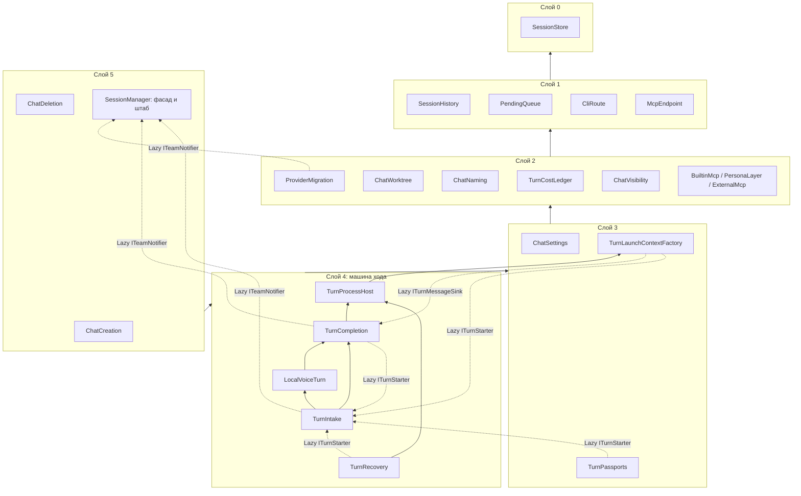

# Разрез SessionManager по ролям (S3-0, ноябрь 2026)

Провёл Александр (тимлид) 2026-11-05 по задаче S3-0 фичи «Внутренняя оптимизация AI Home».
Документ — вход для шагов S3-1…S3-8. Только разметка, кода нет. Предыдущие разведки той же
линии: [session-core-split-2026-09.md](session-core-split-2026-09.md) (слои ядра, «что не
резать») и [team-di-migration-2026-09.md](team-di-migration-2026-09.md) (образец: четыре шва
штаба). Их выводы здесь не повторяются, но соблюдаются: `OnMessageAsync` не режем по типам
сообщений, `SessionEntry` не дробим по слоям, `ClaudeSession.BuildTurnMcpConfig` не трогаем.

## База замера

| | |
|---|---|
| Разобранная версия | `master` @ `e0ed6ea34` (2026-11-05) |
| Строк в `SessionManager.cs` | **11 819** |
| Параметров конструктора | **52** (в постановке 42 — устаревшая цифра) |
| Мест `new SessionManager(` | **44** (тесты 11 проектов + `TestKit.Host`) |
| Продуктовых файлов, упоминающих тип | 202 |

**Ветка `refactor/opt-session-manager` отстаёт от master на 543 коммита, из них 44 трогают
`SessionManager.cs` (+809/−89, почти всё — «Общие проекты»: видимость, приватные чаты, автор
хода).** В ветке файл — 11 098 строк. Разрез сделан по master. **Перед S3-1 ветку нужно
обновить с master**, иначе S3-1 режет файл без `VisibilityLock`/`GetOwnedVisible`, и мерж
обратно превратится в ручной перенос 44 коммитов по переехавшим методам.

Как мерил:

```bash
git show master:backend/ClaudeHomeServer/Services/SessionManager.cs > /tmp/SM.cs
# объявления методов (отступ 0–4, включая явные реализации I*.Method):
grep -nE '^\s{0,4}(public|private|internal|protected)[^=;]*\(' /tmp/SM.cs
# параметры конструктора — разбор сигнатуры без комментариев (52)
grep -rc 'new SessionManager(' --include=*.cs backend | grep -v ':0'   # 44 места
```

Размер метода — от его объявления до следующего, **включая комментарии** (в этом файле их
много, поэтому числа — строки файла, а не строки логики). Роль метода назначена по имени;
граф «кто кого зовёт» построен по вызовам имён методов между ролями; зависимости класса —
по вхождениям полей `_x` в тела его методов. Сумма по ролям сходится с длиной файла до строки.

## Сводка

1. **Пяти ролей постановки недостаточно, но как семейства они верны.** Внутри «хода» и
   «жизненного цикла» лимит «≤ 10 зависимостей на класс» требует дробления: всего выходит
   **23 класса** в пяти семействах (стор, история, рабочая папка, жизненный цикл, ход).
   Средний класс — ~450 строк. Меньше классов можно получить только ослаблением лимита
   зависимостей; цена такого решения — классы на 13–15 зависимостей.
2. **Всё, что выглядело циклами между ролями, кроме трёх рёбер, снимается переносом чистых
   функций вниз** (`EffectiveRoot`, `TranscriptOnServer`, `HasTurnInFlight`, `Busy`,
   `ClaimFirstMessage`, проверки зоны персоны). Остаются **три настоящие рекурсии**, и они
   свойство машины хода, а не дефект разметки: конец хода запускает следующий ход; процесс CLI
   отдаёт события приёмнику конца хода; ход дёргает штаб. Каждая получает один именованный
   ленивый шов, и больше их не заводится.
3. **Штаб отдаёт свои швы без правки вертикали.** `ITeamRunState` целиком реализуем
   стором (все методы читают и пишут `SessionEntry`), `ITeamHistoryStore` — историей,
   `ITeamTurnIntake` — приёмом хода. `ITeamSessionDirectory` остаётся на фасаде тонкой
   переадресацией: один его метод рассылает через вертикаль штаба. Код `Services/Team`
   меняется только в аргументах конструкторов, которые сейчас получают `this`.
4. **Шагов не пять, а восемь**, каждый ≤ 2 000 строк переноса. Порядок — строго снизу вверх:
   новый класс зависит только от уже вынесенных классов, Core-швов и трёх ленивых швов, но
   никогда от `SessionManager`. После S3 в `SessionManager` остаются фасад внешнего API,
   штабная логика ядра и сборка — **≈ 1,7 тыс. строк** вместо 11,8.
5. **Найдены два пробела в тестах инвариантов:** guard смены среды исполнения
   (`UsersController.cs:78` → `HasSessionsOwnedBy`) и «`ErrorMessage` без продолжения →
   `Status=Error`, а не `Finished`» на уровне ядра не покрыты прямым тестом. Характеризационные
   тесты добавляются в шаге, который переносит соответствующий код, **до** переноса.

## 1. Методы и поля → роль

Классы живут в `backend/ClaudeHomeServer/Services/Sessions/` (namespace
`ClaudeHomeServer.Services.Sessions`), все `internal sealed`. Строки — по master. Ниже
таблицы сгруппированы по классам и включают приватные методы; построчная таблица всех
227 публичных и `internal` методов — в [приложении](#приложение-публичные-и-internal-методы--класс).

### Семейство «стор метаданных» (`data/sessions.json`)

| Класс | Строк | Что уезжает |
|---|---:|---|
| `SessionEntry.cs` (типы) | ~530 | вложенный `SessionEntry` целиком (локи и поля не дробим), `QueuedMessage`, `UserTurnSnapshot`, `TurnResult`, `ChatVisibilityResult` |
| `SessionStore` | ~1 050 | реестр `_sessions`; `LoadSessions`, `MigratePersonaChatMode`, `SaveSessions`, `ScheduleDebouncedSave`, `FlushPendingSave`, автосейв-таймер; sweep (`TrySweepStuckActive`, `HasLiveWork`, `ParentSourceSession`, `EffectiveParentSessionId`); `ApplyStatusAsync`; выборки (`GetById`, `GetAll`, `GetByProject`, `GetVisibleByProject`, `CountByProject`, `GetProjectlessChats`, `GetSessionsWithLive*`, `GetAllOwnedBy`, `GetAllOwnedVisibleBy`, `HasSessionsOwnedBy`); **видимость и владелец** (`ResolveOwnerId`, `GetOwned`, `GetOwnedVisible`, `GetWithRight`, `GetAccessible`, `VisibleTo`, `IsVisibleTo`, `IsPrivateChat`, `IsTranscriptReservedForOthers`); автор хода (`NoteTurnActor`, `GetTurnActor`, `GetTurnFrame`, `HumanAuthorOf`, `IsOwnerOrTurnAuthor`, `PendingSentBy`, `ActorRank`, `NarrowerActor`, `ClaimFirstMessage`); наблюдатели (`AddViewer`, `RemoveViewer`, `RemoveConnectionViewers`, `HasViewers`); рантайм-чтения (`HasTurnInFlight`, `HasLiveTurnProcess`, `Busy`, `GetActiveTurnDelegation`, `RunAgentsAlive`, `NoteRunDelegation`, `WithTeamState`); вещание (`BroadcastAsync`, `BroadcastExceptAsync`, `BroadcastSessionMessageAsync`, `BroadcastStatusChangeAsync`); тела методов `ITeamSessionDirectory` (`Get`, `ListChildren`, `ChildrenByParent`, `Persist`, `WriteUnlessPrivate`, `Snapshot`; сам шов остаётся на `SessionManager`, см. §3) и реализация `ITeamRunState` |

### Семейство «стор истории» (`history.json`)

| Класс | Строк | Что уезжает |
|---|---:|---|
| `SessionHistory` | ~380 | `HistoryKeyOf`, `WithFalPersistLockAsync`, `AppendIfNotDuplicateStoredNoLockAsync`, `AppendStoredAsync`, `GetHistoryAsync` (без досчёта цен), `GetWorkflowProgress`, `GetPendingInteraction`, `GetLastRecallManifest`, `ReadStoredTeamPlanAsync`, `MutateStoredAsync`; реализация `ITeamHistoryStore` |
| `TurnCostLedger` | ~170 | `TryTrackFalCost`, `TryTrackGlifCost`, `BackfillFalCosts`, `BackfillGlifCosts`, `PublishFalCostAsync`, `PublishGlifCostAsync`; запись расхода (`ISpendCollector`) и лимитов подписки (`SubscriptionLimitRecorder`) из конца хода |
| `PendingQueue` | ~260 | состояние очереди занятой сессии и его файл: `AttachPendingPersistence`, `PersistPending`, `RestorePending`, `AppendPendingExpiredCardAsync`, `EnqueuePendingAsync`, `GetPending`, `RemovePendingByText`, `BroadcastPendingAsync`, `VisiblePending`, `GetVisiblePending`, `HasPending`, `HasContinuingPending`, `MapQueuedAttachedPaths` |

### Семейство «рабочая папка чата»

| Класс | Строк | Что уезжает |
|---|---:|---|
| `CliRoute` | ~320 | маршрут CLI и транскрипты: `ResolveSubscriptionProvider`, `ResolveDefaultModel`, `UsageKeyFor`, `ConfigRootForProvider`, `ConfigRootFor`, `CwdForOwner`, `TryResolveCwd`, `EffectiveRoot`, `GetChatRoot`, `ResolveChatRoot`, `TranscriptOnServer`, `TranscriptSearchRoots`, `ArchiveTranscriptCopy`, `RestoreTranscriptCopy`, `FindResumeTranscript`, **`DeleteTranscript`**, `CleanupOrphanBranchTranscript`, `TryPoolFailover`, `WorktreesBase` (домашняя папка — через `UserHomeResolver`) |
| `ChatWorktree` | ~260 | `SetWorktreeAsync`, `AttachWorktreeAsync`, `ReleaseWorktreeGraph`, `MarkFilesCommitted`, `UnmarkFileCommitted`, `TryUnmarkCommittedOnToolUse` |

### Семейство «жизненный цикл чата»

| Класс | Строк | Что уезжает |
|---|---:|---|
| `ChatSettings` | ~900 | `SetPinned`, `SetParent`, `IsDescendantOf`, темы (`ApplySubjects`, `ReleaseOrphanedHumanSubjects`, `ApplySubjectWrite`, `GetSubjectCandidates`), архив (`SetArchived`, `SetArchivedAsync`, `ArchiveBatchAsync`, `RestoreArchiveBatchAsync`, `ArchiveLegacyImageChats`, `GetArchiveRuleCandidates`, `MatchesArchiveRule`, `BroadcastChatArchivedAsync`), срок (`SetExpiry`, `FreezeExpiryForHold`, `RestoreFrozenExpiry`), `SetNotificationsMuted`, `SetVoiceMode`, `MarkRead`, `SetWikiMark`, `SetContextAsync`/`GetContext`, `RemapModels`, `SetSummaryNoteId`, `SetArchiveSummary`, `AppendModuleRecordAsync`, `UpdateAsync`, `DropWindow1MAsync`, `SetPersona`, `SetOnboarding*`, `SwitchSpeaker`, `SetParticipants`, `ValidateParticipants`; зона персоны (`PersonaVisibleIn`, `OutOfZoneRefusal`, `EnsurePersonaVisible`, `EnsurePersonasVisibleInFrame`, `EnsureContinuationPersonaAllowed`, `GlobalPersonaInSharedException`) |
| `ChatVisibility` | ~250 | `SetChatVisibility`, `IsTeamOrGroup`, `TrySetExcludeFromDossiers`, вложения (`SaveChatAttachment`, `RewriteMessageAttachedPaths`, `TryRelocateAttachments`), `EvictForeignViewersAsync` |
| `ProviderMigration` | ~235 | `MigrateProviderAsync`, `OfferProviderFallbackAsync`, `SameDir`, `ProviderUnchangedException` |
| `ChatNaming` | ~245 | `MakeChatTitle`, `ExtractTeamMechanicTopic`, `RefineChatTitleAsync`, `RetitleAsync`, `SetChatIconAsync`, `SetChatIconsAsync`, `BroadcastChatRenamedAsync` |
| `ChatCreation` | ~690 | `CreateAsync`, `CreateChatAsync`, `CreatePersonaChatAsync`, `CreateGroupChatAsync`, `GetPersonaChats`, `BranchAsync`, `EnsureSuccessorAllowed`, `CreateSuccessorChatAsync`, `EnsureHandoffAllowed`, `WarmHandoffBlocker`, `CreateHandoffChatAsync`, `ContinuationName`, `CreateContinuationAsync` |
| `ChatDeletion` | ~130 | `DeleteAsync`, `BroadcastChatDeletedAsync` |

### Семейство «ход»

| Класс | Строк | Что уезжает |
|---|---:|---|
| `McpEndpoint` + `BuiltinMcpContexts` | ~450 | `ResolveTasksApiUrl`, `LoopbackApiUrl`, `GetServiceToken`, `HttpEndpointUsable`, `HttpMcpEnabled`, `HttpMcpActive` (первые четыре — в `McpEndpoint`); `Build{Tasks,Notes,Widgets,Watch,WebSearch,Architecture,Higgsfield,ImageEditor,AudioEditor,VideoEditor,Plugins,TurnContext,LocalMedia,Tests,Dify,CodeGraph,Memory,TeamMemory}Context`, `TasksMcpEnabled`, `BrowserEnabled`, `HandsFor`, `ServerContentFor`, `LlmGatewayApiUrlFor` |
| `PersonaLayerBuilder` | ~360 | `BuildPersonaProvider`, `BuildBindingsProvider`, `ResolveOtherPersonas`, `SplitConsultants`, `ConsultantsEnabled`, `PersonasEnabled`, `MentionsToolsEnabled`, `BuildPersonaAgentsProvider`, `BuildMentionsHint`, `AppendPersonaLines`, `BuildPersonasContext`, `BuildExtraDisallowed`, `InvalidatePersonaSessions`, `InvalidateHandsSessions` |
| `ExternalMcpContexts` | ~295 | `BuildWorkspaceContext`, `WorkspaceMcpPlan`, `BuildWorkspacePlan`, `BuildModulesContext`, `BuildChatContextProvider`, `BuildExternalMcpProvider`, `ResolveSecretValues`, `TryApplyAuthHeaders`, `BuildNotificationsContext` |
| `TurnPassports` | ~250 | подписчики шины `HandlePromptAssembled`, `SafePromptSnapshot*`, `HandleSubagentRunCompleted`, `HandleTurnCompleted`, `SubagentRunSinkFor`; `NoteTruncatedBgAgent`, `RefutesTruncation`; регистрация `IPromptSectionContributor` на шине. Решения о добивании (`ShouldNudgeSubagent`, `ResetsNudgeSeries`, `StartsNudgeSeries`) — статикой `SubagentNudgePolicy` |
| `TurnLaunchContextFactory` | ~150 | сборка `LlmSessionContext`, которая сейчас дублируется в `StartNewSessionAsync` и `EnsureProcessCoreAsync`, плюс `BuildEnqueueBypass`, `BuildOrchestrationDone`, `EnqueueBypassTurn` |
| `TurnProcessHost` | ~670 | `StartNewSessionAsync`, `EnsureAccumulatorAsync`, `EnsureProcessAsync`, `EnsureProcessCoreAsync`, `CompactAsync`, `Interrupt`, `InterruptCore`, `RecordUserInterrupt`, `RespondPermission`, `RemoveAutoAllowTool`, `IsStaleInteractionAnswer`, `ResumeAfterInteraction`, `AnswerQuestion`, `RespondPlan`, `KillAllProcesses`, `StopChatsOfRevokedMember`, ожидание устройства (`DeviceWaitGate`, `ParkForDeviceAsync`, `GetDeviceWaitingSessions`, `ReleaseDeviceWaitAsync`, `ExpireDeviceWaitAsync`) |
| `TurnRecovery` | ~300 | `ReviveStuckSession(Async)`, `StopClosedExecutorProcess`, `RestartStuckTurnAsync`, `TurnTranscriptDamagedException`, `StuckTurnRestartResult`, `IsTailIntactForResume`, `SendRestartResumeTurnAsync`, `ResumeAfterRestartAsync`, `ResolveTurnCwd`, `TakeRestartResumeCandidates`, `DrainRestoredPendingAsync` |
| `TurnCompletion` | ~900 | `OnMessageAsync`, `OnMessageQueuedAsync` (одним методом, как есть), `PipelineForTest`, `DrainPipelineAsync`, `GetPipeline`, `EnqueueWorkAsync`, `ProcessPipelineItemAsync`, `ApplyStatusQueuedAsync`, `LastAssistantText`, `FireAndForget`; реализует `ITurnMessageSink` |
| `LocalVoiceTurn` | ~180 | `BuildVoiceContextBlock`, `ShouldRunLocalVoice`, `BuildVoiceMessages`, `TrimVoiceMessage`, `RunLocalVoiceTurnAsync` |
| `TurnIntake` | ~1 540 | `RouteGroupSpeakerAsync`, `SendMessageAsync`, `RefuseTurnAsync`, `SendDirectAsync`, `ChatPreview`, `BuildCliTurnText`, `SendMessageAndWaitAsync`, `SendOrEnqueueAsync`, `ReportUpAsync`, `ReportBlockerAsync`, `PreemptTurnForQueue`, `PreemptForPending`, `CancelPendingAsync`, `FreezePendingAsync`, `DrainNextPendingAsync`, `AwaitPreviousTurnExitAsync`, `DeliverPendingAsync`, `PrivateChatAuthorRevoked`, `SetMode`; цикл «до готово» (`SetWorkLoopAsync`, `ContinueWorkLoopAsync`, `StopIfWorkLoopLimitReachedAsync`, маркеры `<promise>`/`<blocked>`/`<waiting>`, `TickWaitingLoopsAsync`, `AddWorkLoopStoppedNoticeAsync`, `AppendServerRestartCardAsync`, `BroadcastWorkLoopAsync`, `LoopLimitOrDefault`); `NudgeTruncatedSubagentAsync`; реализует `ITurnStarter` и `ITeamTurnIntake` |

### Что остаётся в `SessionManager` (~1,7 тыс. строк)

- **Фасад внешнего API** — все публичные и `internal` члены с прежними сигнатурами,
  тела — делегирование (202 продуктовых файла и 44 места конструирования не меняются).
  `GetHistoryAsync` фасада = `SessionHistory.GetHistoryAsync` + `TurnCostLedger.Backfill*`.
- **Штабная логика ядра** (~960 строк): 10 фасадных обёрток из
  [team-di-migration](team-di-migration-2026-09.md) §1, `ApplyPlanDecisionAsync`,
  `ListOpenEscalationsAsync`, `ResolveEscalationAsync`, `EnterInterviewAsync`,
  `ResetTeamIterationOnUserInput`, `ResumeTeamFromDecisionOnUserInput`,
  `TryAutoResolveTeamBlocker*`, `HandleTeamTurnEndAsync`, `HandleTeamTurnCompletedShim`,
  реализация `ITeamNotifier`. **Штаб в S3 не трогаем** — у него свой курс.
- Конструктор: создание сервисов штаба (`new TeamStateService(...)` и соседи — owning, как
  сейчас) с передачей им ролей вместо `this`.

### Неоднозначные — с решением

| Что | Кандидаты | Решение и почему |
|---|---|---|
| Видимость, владелец, автор хода | отдельный класс / стор | **Стор.** Все читают `SessionEntry` и `Session`, а `VisibleTo` зовётся из самого стора (вещание по наблюдателям). Отдельный класс дал бы цикл «стор ⇄ видимость». Единая точка per-owner изоляции получается сама собой |
| `TrySweepStuckActive` (меняет статус) | ход / стор | **Стор.** Его зовёт каждый `SaveSessions`; если вынести его за таймер, sweep пойдёт реже, а это изменение поведения. Читает только поля записи и `ITaskLookup`, статус пишет `ApplyStatusAsync`, который тоже уходит в стор |
| `ApplyStatusAsync` / `ApplyStatusQueuedAsync` | стор / конец хода | Синхронная — **стор**, через очередь рассылки — **конец хода** (зовёт `EnqueueWorkAsync`) |
| Восстановление очереди при загрузке | стор / очередь | `SessionStore.Load(Action<SessionEntry> onLoaded)`; колбэк передаёт сборка (`PendingQueue.Restore`). Это параметр метода, а не сохранённая обратная ссылка. Порядок старта не меняется |
| `AppendTurnAbortedAsync` в `LoadSessions` | стор / восстановление | Стор возвращает id прерванных ходов, пишет `TurnRecovery` при сборке (там уже `_restartResumeCandidates`) |
| Цены fal/glif | история / отдельно | **Отдельно** (`TurnCostLedger`): `GetHistoryAsync` досчитывает цены, а публикация цены пишет в историю. В одном классе с историей это цикл, раздельно — две зависимости вниз и склейка в фасаде |
| `MigrateProviderAsync` | маршрут / настройки | **Отдельный `ProviderMigration`**: guard смены провайдера должен жить в одном месте, а в маршруте он стал бы одиннадцатой зависимостью |
| `TryPoolFailover` | приём хода / маршрут | **Маршрут.** Приём хода иначе получает одиннадцатую зависимость, а тихий failover — это вопрос пула и профиля |
| Ожидание устройства | очередь / процесс | **Процесс** (`TurnProcessHost`): запуск на устройстве — его вопрос; в приёме хода получалась одиннадцатая зависимость |
| Цикл «до готово» | отдельный класс / приём | **Приём хода.** Цикл шлёт ход через `SendMessageAsync`, а приём зовёт `ContinueWorkLoopAsync` — раздельно это цикл. Вместе 1 540 строк — потолок, дальше не растить |
| `Build*Context` vs `BuildTurnMcpConfig` | — | Переносятся только сборщики контекстов на стороне ядра. `ClaudeSession.BuildTurnMcpConfig` не трогаем (инвариант стабильности `tools/list`) |
| Проверки зоны персоны | создание / настройки / слой персоны | **Настройки**: их зовут и создание, и приём хода, и `SetPersona`; настройки ниже их всех |
| `HandleTeamTurnCompletedShim`, обёртки штаба | — | Остаются в `SessionManager` (см. выше) |

## 2. Зависимости конструктора → класс

| # | Параметр | Куда |
|---:|---|---|
| 1 | `ProjectManager` | стор, маршрут, worktree, настройки, видимость, создание, удаление, контексты MCP (×3), процесс; остаётся у SM (штаб) |
| 2 | `ChatHistoryService` | `SessionHistory`, `PendingQueue` |
| 3 | `IConfiguration` | стор (путь, автосейв, grace sweep), контексты MCP, именование, процесс (`DataPath`), восстановление (`QuietMinutes`), приём (`Loop:*`); SM (штаб) |
| 4 | `ILlmSessionAdapterFactory` | `TurnProcessHost` |
| 5 | `FalCostService` | `TurnCostLedger` (вместе с `OnCostResolved = PublishFalCostAsync`) |
| 6 | `UsageService` | только `SubscriptionLimitRecorder` → регистрируется в DI |
| 7 | `AppSettingsService` | только запасные `new ModelAssignmentResolver`/`UserHomeResolver.WithoutOverrides` → в DI их резолвит контейнер, параметр из SM уходит |
| 8 | `UserStore` | маршрут, контексты MCP, слой персоны |
| 9 | `JwtService` | `McpEndpoint` |
| 10 | `IServer` | `McpEndpoint` |
| 11 | `LlmProviderRegistry` | маршрут, настройки, `ProviderMigration`; SM (`TeamStateService`) |
| 12 | `FeatureFlagService` | встроенные MCP, слой персоны |
| 13 | `PersonaManager` | слой персоны, настройки; SM (штаб, `OnPersonaChanged`) |
| 14 | `PersonaBindingsService` | встроенные MCP, слой персоны, внешние MCP |
| 15 | `ClaudeSubscriptionPool` | маршрут, настройки, `ProviderMigration`, `SubscriptionLimitRecorder` |
| 16 | `ILogger<SessionManager>` | каждый класс получает свой `ILogger<T>` |
| 17 | `ILauncherFactory` | маршрут, встроенные MCP, фабрика контекста запуска, `WorktreeBuildWarmup` |
| 18 | `SandboxManager` | маршрут |
| 19 | `ISessionBroadcaster` | стор (все рассылки); SM (`TeamCoordinator`) |
| 20 | `PersonaAgentFileSync` | слой персоны |
| 21 | `UserHomeResolver` | маршрут |
| 22 | `ICheapTextRunner` | `ChatNaming` |
| 23–24 | `ModuleRegistry`, `ModuleTokenService` | внешние MCP |
| 25 | `GitService` | `ChatWorktree` |
| 26 | `ISpendCollector` | `TurnCostLedger` |
| 27 | `ModelAssignmentResolver` | маршрут, настройки, создание |
| 28–29 | `CodeGraphService`, `FileWatcherService` | `ChatWorktree` |
| 30 | `TeamPlanningService` | SM (штаб) |
| 31 | `SubscriptionActivityTracker` | `SubscriptionLimitRecorder` (DI) |
| 32 | `GlifAccountService` | `TurnCostLedger` |
| 33 | `PromptSnapshotStore` | `TurnPassports`, `ChatDeletion` |
| 34–35, 37 | `McpRegistry`, `McpSecretStore`, `McpOAuthService` | внешние MCP |
| 36 | `McpStatusStore` | `TurnPassports` |
| 38 | `HiggsfieldOAuthService` | встроенные MCP |
| 39 | `SubagentRunLog` | `TurnPassports` |
| 40 | `TurnRunLog` | `TurnPassports` |
| 41–42 | `LocalActionRouter`, `ILocalLlmClient` | `LocalVoiceTurn` |
| 43 | `IEnumerable<IPromptSectionContributor>` | `TurnPassports` (регистрация на шине) |
| 44 | `ITurnEventBus` | `TurnPassports`, `TurnProcessHost` |
| 45 | `TaskManager` | `ITaskLookup` (адаптер `TaskLookupAdapter` → DI) → стор; SM (`TeamTurnCompletionService`) |
| 46 | `ILoggerFactory` | SM (логгеры сервисов штаба) |
| 47 | `IProjectDeviceGate` | `TurnProcessHost` |
| 48 | `IServiceProvider` | встроенные MCP (ленивый `McpToolsetRegistry`, как сейчас), удаление |
| 49 | `SubsystemStateStore` | встроенные MCP |
| 50 | `ISphereDirectory` | слой персоны, настройки |
| 51 | `IPluginDirSource` | фабрика контекста запуска, создание |
| 52 | `ICodeGraphInspector` | `ChatWorktree` |

То, что сейчас создаётся в конструкторе через `new`, уходит в DI (в `AddSessionCore`):
`ArchivedTranscriptStore` (маршрут), `SubscriptionLimitRecorder` (`TurnCostLedger`),
`WorktreeBuildWarmup` (`ChatWorktree`), `TaskLookupAdapter`, `DifyOptions` (через `IOptions`).

### Зависимости по классам

Правило счёта: `ILogger<T>` не считаем, всё остальное считаем, включая `IConfiguration` и
ленивые швы.

| Класс | Зависимости | Число |
|---|---|---:|
| `SessionStore` | config, projects, broadcaster, `ITaskLookup` | 4 |
| `SessionHistory` | `ChatHistoryService`, store | 2 |
| `TurnCostLedger` | falCost, glif, spend, `SubscriptionLimitRecorder`, history, store | 6 |
| `PendingQueue` | store, `ChatHistoryService`, config | 3 |
| `CliRoute` | providers, pool, assignments, users, homes, launchers, sandbox, projects, store, `ArchivedTranscriptStore` | **10** |
| `ChatWorktree` | git, codeGraphs, inspector, fileWatchers, warmup, projects, store, route | 8 |
| `ChatSettings` | store, history, route, `ProviderMigration`, projects, providers, assignments, pool, personas, spheres | **10** |
| `ChatVisibility` | store, history, route, queue, projects | 5 |
| `ProviderMigration` | store, history, route, providers, pool, `Lazy<ITeamNotifier>` | 6 |
| `ChatNaming` | store, history, cheap, config | 4 |
| `McpEndpoint` | config, server, jwt | 3 |
| `BuiltinMcpContexts` | endpoint, flags, bindings, services, subsystemStates, launchers, projects, higgsfieldOAuth, users, config | **10** |
| `PersonaLayerBuilder` | personas, bindings, agentSync, spheres, flags, projects, users, store, endpoint, config | **10** |
| `ExternalMcpContexts` | mcpRegistry, mcpSecrets, mcpOAuth, modules, moduleTokens, endpoint, bindings, projects, store | 9 |
| `TurnPassports` | bus, promptSnapshots, mcpStatus, subagentRuns, turnRuns, contributors, store, queue, `Lazy<ITurnStarter>` | 9 |
| `TurnLaunchContextFactory` | builtin, personaLayer, external, launchers, projects, pluginDir, route, `Lazy<ITurnStarter>`, `Lazy<ITurnMessageSink>`, config | **10** |
| `TurnProcessHost` | adapters, factory, store, history, route, queue, bus, deviceGate, config | 9 |
| `TurnRecovery` | store, history, processHost, queue, settings, `Lazy<ITurnStarter>`, config | 7 |
| `TurnCompletion` | store, history, queue, processHost, route, worktree, `ProviderMigration`, ledger, `Lazy<ITurnStarter>`, `Lazy<ITeamNotifier>` | **10** |
| `LocalVoiceTurn` | router, ollama, store, history, completion | 5 |
| `TurnIntake` | store, history, queue, processHost, completion, settings, naming, voice, `Lazy<ITeamNotifier>`, config | **10** |
| `ChatCreation` | store, history, route, settings, processHost, projects, assignments, pluginDir | 8 |
| `ChatDeletion` | store, history, route, worktree, processHost, promptSnapshots, services, projects | 8 |

Восемь классов стоят ровно на потолке. **Новая зависимость любого из них — сигнал резать
класс, а не поднимать лимит.** В `SessionManager` после S3-8 останется ~20 параметров
(роли, нужные фасаду, плюс штаб). Он не новый класс и под лимит не попадает, но число
надо фиксировать в итоге S3-8.

## 3. Швы и направление вызовов

Слои снизу вверх; стрелка «A → B» означает «A зовёт B». Внутри одного слоя вызовов нет.



Пунктир — три ленивых шва, единственные рёбра вверх. Все три — рекурсия, которая уже есть
в коде (сейчас она идёт вызовом метода внутри одного класса), а не новая связность.

### Три ленивых шва

Интерфейсы — в `Services/Sessions/SessionCoreSeams.cs`, по образцу `TeamCoreSeams.cs`.
Реализация связывается в `AddSessionCore` как `Lazy<T>` от синглтона. До шага, где
вынесен настоящий владелец, интерфейс реализует `SessionManager` (переходный режим).

```csharp
// «Начать ход»: конец хода, добивание, восстановление и делегаты контекста запуска
// запускают следующий ход. Владелец — TurnIntake (с S3-7), до того — SessionManager.
internal interface ITurnStarter
{
    Task SendMessageAsync(string sessionId, string text, /* как сейчас */ ...);
    Task<bool> SendOrEnqueueAsync(string sessionId, string text, /* как сейчас */ ...);
    Task DrainNextPendingAsync(string sessionId);
    Task ContinueWorkLoopAsync(string sessionId);
    Task NudgeTruncatedSubagentAsync(string sessionId, Llm.SubagentRunPassport passport);
    Task AddWorkLoopStoppedNoticeAsync(string sessionId, /* как сейчас */ ...);
    Task AppendServerRestartCardAsync(string sessionId);
}

// Приёмник событий процесса CLI: делегат OnMessage в LlmSessionContext.
// Владелец — TurnCompletion (с S3-5), до того — SessionManager.
internal interface ITurnMessageSink
{
    Task OnMessageQueuedAsync(string sessionId, TurnAccumulator accumulator,
        ServerMessage message, long runId);
}
```

`ITeamNotifier` уже существует (`Services/Team/ITeamNotifier.cs`); его реализует
`SessionManager`, как и сейчас. Новый шов не заводим, достраиваем существующий: конец хода
зовёт в штаб ещё `HandleBgAgentDoneAsync` и `RestoreWaveWatchdogIfPaused`, и эти два метода
добавляются в `ITeamNotifier` в S3-5. Перед добавлением проверить, не читает ли
`AsyncAgentInFlight` только поля записи: если только их, метод уезжает в стор, а не в шов.
Маркеры протокола (`StripTeamProtocolMarkers` и соседи) зовутся напрямую из Core
`TeamProtocolMarkers`, потому что обёртки над ним в ядре статические.

### Швы штаба после S3

| Шов (`TeamCoreSeams.cs`) | Сейчас | После S3 |
|---|---|---|
| `ITeamSessionDirectory` | `SessionManager` | `SessionManager`, тонкой переадресацией в `SessionStore`: `PersistAndBroadcastAsync` рассылает через `TeamStateService.BroadcastTeamImplementAsync`, то есть через вертикаль штаба, и стор этого делать не может |
| `ITeamRunState` | `SessionManager` | `SessionStore` (все 14 методов работают с `SessionEntry`; `TrySetPermissionModeLive` — через `entry.Process`, это тоже поле записи) |
| `ITeamHistoryStore` | `SessionManager` | `SessionHistory` |
| `ITeamTurnIntake` | `SessionManager` | `TurnIntake` |
| `ITeamNotifier` | `SessionManager` | `SessionManager` (без изменений) |

В конструкторе `SessionManager` поля `_teamHistory`/`_teamRunState`/`_teamIntake` и
аргументы `new TeamPlanService(this, this, this, …)` получают экземпляры ролей. Код
вертикали не меняется.

### Что сняли переносом, а не швом

Обратные рёбра из графа вызовов, которые оказались чистыми функциями или чтением записи:
`EffectiveRoot`, `ResolveChatRoot`, `TranscriptOnServer`, `TryResolveCwd` (маршрут ниже
worktree и миграции); `HasTurnInFlight`, `Busy`, `WithTeamState`, `ClaimFirstMessage`,
`NoteRunDelegation` (стор ниже всех); `ShouldNudgeSubagent`/`StartsNudgeSeries` (статика);
проверки зоны персоны (настройки ниже создания и приёма); `FindResumeTranscript`,
`CleanupOrphanBranchTranscript` (маршрут ниже конца хода).

## 4. Инварианты по ролям

| Инвариант | Где живёт после S3 | Шаг | Чем держится сейчас | Пробел |
|---|---|---|---|---|
| Фолбэк хода только по цепочке; `None` фолбэк не запускает, ход кончается `error`, а не finished | `FallbackLlmSessionAdapter` и `TurnErrorClassifier` (Llm, **не переезжают**); маппинг `ErrorMessage` → `SessionStatus.Error` — `TurnCompletion` | S3-5 | `FallbackLlmSessionAdapterTests`: `НеизвестнаяОшибка_ФолбэкНеЗапускается` (:376), `ЦепочкаИсчерпана_АвтоподборНеСрабатывает` (:703), `ЦепочкаИсчерпана_ErrorMessageВердиктаИдётСExpectResultFollows` (:743); `TurnErrorClassifierTests.ОшибкиЗапроса_НеАвторизация_ОстаётсяNone` (:298); на ядре — `SessionManagerTeamLoopTests.КонецХода_ПарнаяErrorИResultОдногоХода_ШинаРазбираетОдинРазНеДубли` (:793), `SessionManagerWorkLoopTests.ContinueWorkLoop_ОшибкаХода_ЯвноеСообщениеИСниманиеЦикла` (:55) | Нет прямого теста «`ErrorMessage` без `ExpectResultFollows` → `Status=Error`, не `Finished`» на ядре. S3-5 добавляет его **до** переноса `OnMessageQueuedAsync` и проверяет мутацией |
| Guard смены провайдера у начатого чата (перенос транскрипта, отказы на текущем ключе, несовместимой модели, пути вне монтирований) | `ProviderMigration`, вызов из `ChatSettings.UpdateAsync` | S3-3 | `SessionManagerCrudTests`: `Update_СменаПровайдераБезТранскрипта_Проходит` (:607), `…БезХодов_Проходит` (:625), `…СТранскриптом_ФайлПереезжаетВПрофильЦели` (:639); `SessionManagerSubscriptionMigrationTests.MigrateProvider_*` (12 тестов, в т.ч. `ТекущийКлюч_БросаетОшибку`, `НесовместимаяСМодельюПодписка_БросаетОшибку`); `SessionManagerContainerMigrationTests.MigrateProvider_Container_ПутьВнеМонтирований_400`; `SessionManagerLocalTranscriptTests.СменаПровайдера_НеПереноситТранскрипт` (:211) | — |
| Guard смены среды исполнения при существующих чатах | `UsersController.cs:78` → `SessionStore.HasSessionsOwnedBy` | S3-1 | **Нет теста** ни на контроллер (409), ни на `HasSessionsOwnedBy` | S3-1 добавляет оба до переноса: чаты проекта владельца, личные чаты, архивные — все считаются |
| Guard привязки worktree к начатому чату | `ChatWorktree.AttachWorktreeAsync` | S3-3 | `SessionManagerHierarchyTests.AttachWorktree_НачатыйЧат_Отказ` (:673) | — |
| Per-owner изоляция и видимость (приватные чаты) | `SessionStore` — единственная точка: `GetOwned`, `GetOwnedVisible`, `GetWithRight`, `GetAccessible`, `IsVisibleTo`, `IsTranscriptReservedForOthers`, `GetTurnFrame` | S3-1 | `SessionManagerCrudTests`: `ПроектнаяСессия_ВладелецРезолвитсяЧерезПроект` (:169), `MarkRead_ЧужойВладелецИлиНесуществующая_False` (:492), `Update_ЧужойВладелец_НеНаходитЧат` (:734); `SessionManagerTeamSetupTests`: `SetTeamImplement_ЧужойВладелец_Null` (:679), `RespondTeamPlan_ЧужойВладелец_Null` (:1140); эндпоинт-тесты «Общих проектов» (`ChatVisibilityEndpointTests` и соседи) | см. таблицу путей ниже |
| `UpdatedAt` не двигают настройки, архивация и возврат | `ChatSettings` (сеттеры), `SessionStore.ApplyStatusAsync(touchUpdatedAt)` и sweep (`touchUpdatedAt: false`) | S3-1, S3-3 | `ChatArchiveFlagTests` (:77, :122, :159, :300, :317), `SessionManagerCrudTests.MarkRead_УстанавливаетLastReadAt_НеТрогаяUpdatedAt` (:194), `MarkFilesCommitted_ПишетПути_ПереживаетПерезагрузку_НеТрогаетUpdatedAt` (:317), `ThreadsEndpointTests.Смена_фокуса_не_двигает_UpdatedAt_и_не_пишет_sessions_json` (:75) | — |
| Удаление чата уносит только `{csid}.jsonl`, не по маске и не папку; `resumeSessionId` по белому списку | `CliRoute.DeleteTranscript` / `CleanupOrphanBranchTranscript`; проверка `TranscriptMigrator.IsSafeSessionId` — `TurnProcessHost.StartNewSessionAsync` | S3-2, S3-6 | `SessionManagerCrudTests.DeleteAsync_УдаляетТранскриптCliИНеТрогаетЧужой` (:907), `DeleteAsync_ОбщийТранскриптДругогоЧата_НеУдаляет` (:1205) | — |
| Состав `tools/list` не зависит от хода | сборщики контекстов MCP | S3-4 | `McpToolsetStabilityTests` (Guards.Tests) | При переносе сигнатуры сборщиков не получают параметров хода |
| Голосовая оговорка — последним блоком слоя персоны | `PersonaLayerBuilder` | S3-4 | golden-фикстуры контрибьюторов промпта (Prompts.Tests), тесты `voice-mode` | Прогнать фикстуры в S3-4 обязательно |
| **Реестр сессий один** (вторая точка правды) | `SessionStore` — синглтон | S3-1 | — (новый риск разреза) | S3-1 добавляет Host-тест: `SessionManager`, получивший стор из DI, держит тот же экземпляр, что `sp.GetRequiredService<SessionStore>()` |

### Пути входа к per-owner изоляции

Разрез не меняет ни одного пути входа: REST, хаб и MCP идут в фасад `SessionManager` с
прежними сигнатурами. Новые пути могут появиться только одним способом: кто-то внедрит
роль напрямую в контроллер, хаб или тулсет и обойдёт фасад. Это закрывается сторожем, а не
договорённостью (см. §6).

| Группа фасада | Проверка владельца | Класс после S3 |
|---|---|---|
| Чтение по id: `GetOwned`, `GetOwnedVisible`, `GetWithRight`, `GetAccessible`, `IsVisibleTo`, `GetSessionInfo`, `GetHistoryAsync` (через контроллер) | сам метод | `SessionStore` (+ `SessionHistory`) |
| Списки: `GetByProject`, `GetVisibleByProject`, `GetAllOwnedBy`, `GetAllOwnedVisibleBy`, `GetProjectlessChats`, `GetPersonaChats`, `GetArchiveRuleCandidates`, `GetSubjectCandidates` | фильтр по владельцу и видимости | `SessionStore`, `ChatSettings`, `ChatCreation` |
| Мутации настроек — 34 публичных метода с параметром `ownerId` по `grep` на master плюс многострочные сигнатуры (`SetParent`, `SetArchivedAsync`, `MarkRead`, `UpdateAsync`, `SetPersona`, `MigrateProviderAsync`…) | `GetOwned`/`GetOwnedVisible` первой строкой | `ChatSettings`, `ChatVisibility`, `ProviderMigration`, `ChatNaming` |
| Создание и продолжение: `Create*`, `BranchAsync`, `CreateHandoffChatAsync`, `CreateContinuationAsync` | `GetOwnedVisible` источника, `IsTranscriptReservedForOthers` | `ChatCreation` |
| Удаление: `DeleteAsync` | владелец и видимость | `ChatDeletion` |
| Ход: `SendMessageAsync`, `SendDirectAsync`, `ReportUpAsync`, `ReportBlockerAsync` | автор хода (`NoteTurnActor`), `PrivateChatAuthorRevoked` | `TurnIntake` |
| Хаб: `AddViewer`, `RemoveConnectionViewers`, `EvictForeignViewersAsync` | видимость при входе в группу | `SessionStore`, `ChatVisibility` |
| MCP-тулсеты: `GetTurnFrame` (рамка хода) | рамка хода | `SessionStore` |
| Штаб: 10 фасадных обёрток | `GetOwned` | `SessionManager` |

Сверка в каждом шаге: список методов фасада с параметром `ownerId` до и после шага совпадает,
и тело каждого начинается с вызова метода стора из первой строки таблицы.

## 5. Порядок шагов

Ролей больше пяти, поэтому **предлагаю восемь шагов вместо пяти**. Каждый шаг меньше
2 000 строк переноса. Порядок задан графом: класс шага зависит только от классов прежних
шагов, Core-швов и трёх ленивых швов, реализованных пока `SessionManager`.

| Шаг | Что выносится | Строк из SM | Риск и обязательная проверка |
|---|---|---:|---|
| **S3-1** Стор метаданных | `SessionEntry.cs`, `SessionStore`, создание `AddSessionCore`, сторож формы ядра (§6) | ~1 580 | порядок старта (`LoadSessions` в конструкторе до таймеров); тест «один реестр»; тесты guard'а среды |
| **S3-2** История, очередь, маршрут | `SessionHistory`, `TurnCostLedger`, `PendingQueue`, `CliRoute` | ~1 130 | гонка `_falPersistLock` (`FalPersistLockDedupTests`, `FalAccumulatorRaceRegressionTests`); транскрипт только `{csid}.jsonl` |
| **S3-3** Рабочая папка и жизненный цикл | `ChatWorktree`, `ChatNaming`, `ProviderMigration`, `ChatSettings`, `ChatVisibility`; первый ленивый шов (`Lazy<ITeamNotifier>`) | ~1 890 | `UpdatedAt` (`ChatArchiveFlagTests`), guard'ы провайдера и worktree, `VisibilityLock` под переносом (`ChatVisibilityEndpointTests`) |
| **S3-4** Контекст запуска | `McpEndpoint`, `BuiltinMcpContexts`, `PersonaLayerBuilder`, `ExternalMcpContexts`, `TurnPassports`; `ITurnStarter` (реализует SM) | ~1 350 | `McpToolsetStabilityTests`, golden-фикстуры промпта, тесты паспортов сабагентов |
| **S3-5** Конец хода | `TurnCompletion`, `LocalVoiceTurn`, `ITurnMessageSink`; два метода в `ITeamNotifier` | ~1 080 | характеризационный тест `ErrorMessage` → `Error`; `SessionManagerTeamLoopTests`, `SessionManagerWorkLoopTests`, `VoiceLocalTurnTests` |
| **S3-6** Процесс, создание, удаление | `TurnLaunchContextFactory`, `TurnProcessHost`, `TurnRecovery`, `ChatCreation`, `ChatDeletion` | ~1 940 | `TurnAutoResume/*`, `SessionManagerQueueTests`, `DeviceWaitTestHost`, `SessionManagerBranchTests`, удаление транскрипта |
| **S3-7** Приём хода | `TurnIntake` (с циклом «до готово»); `ITurnStarter` и `ITeamTurnIntake` переключаются с SM на него | ~1 540 | `SessionManagerHierarchyTests.RunDelegation`, `SessionManagerHumanTextMarkerTests`, `TaskExecutionService*Tests` |
| **S3-8** Сжатие фасада | конструктор SM принимает роли (~20 параметров вместо 52); единая тестовая сборка через `AddSessionCore` в `SessionManagerTestBase` и для 44 мест конструирования; карта проекта и ADR-014 | ~0 (−200 в конструкторе) | механическая правка 44 тестовых мест; без неё запасные `new` в конструкторе SM копят дубль сборки |

Итог переноса ≈ 10 500 строк, в `SessionManager` остаётся ≈ 1 300 строк плюс ≈ 400 строк
делегирующего фасада.

Если Егору нужны ровно пять карточек, допустимая склейка одна: **S3-4 + S3-5** (≈ 2 430,
под потолком 2 500; классы этих шагов друг от друга не зависят). Другие пары превышают
потолок или склеивают слои, между которыми есть зависимость. S3-8 делать отдельной
карточкой обязательно: это единственный шаг, который правит десятки тестовых файлов.

### Переходный режим каждого шага

- Новый параметр конструктора `SessionManager` — **опциональный с запасной сборкой**
  (`store ?? new SessionStore(...)`), по прецеденту `_assignments = assignments ?? new …`.
  Без этого ломаются 44 места конструирования. Запасная сборка снимается в S3-8.
- Публичные сигнатуры фасада не меняются; тесты зовут фасад и переписываются только в S3-8.
- Перенос метода — дословный, вместе с комментариями; поведение не меняется. Правки внутри
  перенесённых тел (переименования, уборка) в те же шаги не входят.

## 6. Регистрация и сторожа

- **`backend/ClaudeHomeServer/Services/Sessions/SessionCoreRegistration.cs`**,
  `public static IServiceCollection AddSessionCore(this IServiceCollection services)`. В
  master файла нет, его создаёт S3-1. Каждый следующий шаг дописывает в него свои классы.
  В `Program.cs` — **одна строка** `builder.Services.AddSessionCore();` рядом с
  `AddSingleton<SessionManager>()` (`Program.cs:790` на master). Других правок `Program.cs`
  нет: его параллельно разбирает S6, и если этот вызов уже переехал к S6, строка ставится
  туда, куда переехала регистрация `SessionManager`.
- Все классы — синглтоны (у `SessionManager` тоже синглтон-время жизни, а состояние общее).
  Ленивые швы — `services.AddSingleton(sp => new Lazy<ITurnStarter>(() => sp.GetRequiredService<…>()))`.
  `ValidateOnBuild` в `Program.cs` не включён, поэтому DI-цикл проявится только при
  резолве — его ловит Host-тест, который резолвит `SessionManager` из
  `TestWebApplicationFactory`.
- **Сторож формы ядра** (S3-1, Guards.Tests или Tests, рефлексией по сборке Main), четыре
  правила:
  1. у типов namespace `Services.Sessions` ни один параметр конструктора не имеет тип
     `SessionManager`;
  2. параметров ≤ 10 (без `ILogger<T>`);
  3. `Lazy<T>` допустим только для `ITurnStarter`, `ITurnMessageSink`, `ITeamNotifier`;
  4. **на типы `Services.Sessions` ссылаются только `SessionManager`, сами
     `Services.Sessions` и тесты** (default-deny). Это правило закрывает обход фасада, то есть
     новые пути входа к per-owner изоляции.

  Сторож обязан пройти мутацией: временный параметр `SessionManager` в `SessionStore`
  должен его покрасить.
- Сторожа границ подсистем (`SubsystemBoundaryTests`) этот разрез не задевает: классы
  остаются в сборке Main, новой строки в `Boundaries` не нужно.

## Чего не делать

1. **Не выносить `Services/Sessions` в отдельный `.csproj`.** Причина та же, что у штаба:
   `Session`, `Protocol` и `SessionEntry` живут в Main.
2. **Не резать `OnMessageQueuedAsync` внутри `TurnCompletion`.** Он переезжает одним
   методом; похудеть он должен за счёт шины, это отдельный курс.
3. **Не делить `SessionEntry` по классам-владельцам** в этой линии: на нём пять локов, и их
   порядок сейчас верен.
4. **Не заводить интерфейс на каждый класс.** Интерфейсы нужны только трём ленивым швам и
   четырём швам штаба. Остальные классы `internal sealed` и внедряются как конкретные типы.
5. **Не переносить одновременно с правкой поведения.** Найденный при переносе дефект —
   отдельная карточка.

## Открытые вопросы (решить в шаге, не до него)

1. `AsyncAgentInFlight`: если метод читает только `entry.Process`, он уходит в стор, и в
   `ITeamNotifier` добавляется один метод, а не два (S3-5).
2. `ChatDeletion` получает `IServiceProvider`. Выяснить, что именно удаление резолвит
   лениво, и по возможности заменить на явную зависимость (S3-6).
3. Ход «Общих проектов» после 05.11 может добавить в файл новые методы. Каждый шаг
   начинается со сверки: методы, появившиеся после `e0ed6ea34`, получают роль по таблицам
   §1, а при неясности — вопрос ко мне до переноса.

## Приложение. Публичные и internal методы → класс

По строке на каждое объявление метода с видимостью `public`/`internal` в `SessionManager.cs`
на master `e0ed6ea34`, перегрузки — отдельными строками. Явные реализации швов штаба
(`ITeamRunState.…` и соседи) сюда не входят: их владельцы указаны в §3. Счёт:

```bash
F=/tmp/SM.cs   # git show master:backend/ClaudeHomeServer/Services/SessionManager.cs > $F
grep -cE '^    (public|internal)\b[^=;]*\(' $F                       # 240 объявлений
grep -E  '^    (public|internal)\b[^=;]*\(' $F \
  | grep -cE '^    (public|internal) (sealed |static )?(record|class|enum)'   # 13 из них — типы
# методов: 240 − 13 = 227 (154 public + 73 internal; конструктор входит) = строк таблицы ниже
```

Колонка «Тело уезжает в»: сигнатура остаётся в фасаде `SessionManager`, тело переезжает
в названный класс. «SessionManager (штаб)» и «SessionManager (сборка)» не переезжают.

| Строка | Видимость | Метод | Тело уезжает в |
|---:|---|---|---|
| 612 | public | `AddViewer` | SessionStore |
| 616 | public | `RemoveViewer` | SessionStore |
| 625 | public | `RemoveConnectionViewers` | SessionStore |
| 635 | public | `HasViewers` | SessionStore |
| 642 | public | `HasLiveTurnProcess` | SessionStore |
| 752 | internal | `SetTaskLookupForTests` | SessionManager (сборка) |
| 754 | public | `SessionManager` | SessionManager (сборка) |
| 1076 | internal | `ResolveTasksApiUrl` | McpEndpoint |
| 1101 | internal | `LoopbackApiUrl` | McpEndpoint |
| 1110 | internal | `TasksMcpEnabled` | BuiltinMcpContexts |
| 1115 | internal | `GetServiceToken` | McpEndpoint |
| 1219 | internal | `BuildHiggsfieldContext` | BuiltinMcpContexts |
| 1238 | internal | `BuildImageEditorContext` | BuiltinMcpContexts |
| 1251 | internal | `BuildAudioEditorContext` | BuiltinMcpContexts |
| 1264 | internal | `BuildVideoEditorContext` | BuiltinMcpContexts |
| 1277 | internal | `BuildPluginsContext` | BuiltinMcpContexts |
| 1289 | internal | `BuildTurnContextContext` | BuiltinMcpContexts |
| 1307 | internal | `BuildLocalMediaContext` | BuiltinMcpContexts |
| 1325 | internal | `BuildTestsContext` | BuiltinMcpContexts |
| 1573 | internal | `MigratePersonaChatMode` | SessionStore |
| 1647 | public | `DrainRestoredPendingAsync` | TurnRecovery |
| 1686 | public | `TakeRestartResumeCandidates` | TurnRecovery |
| 1747 | internal | `AddSessionForTest` | SessionStore |
| 1756 | public | `SaveSessions` | SessionStore |
| 1918 | internal | `EffectiveParentSessionId` | SessionStore |
| 1923 | internal | `RunStuckActiveSweepForTests` | SessionStore |
| 1927 | public | `GetByProject` | SessionStore |
| 1947 | public | `GetVisibleByProject` | SessionStore |
| 1956 | public | `GetSessionsWithLiveAgents` | SessionStore |
| 1966 | public | `GetSessionsWithLiveBgCommands` | SessionStore |
| 1984 | public | `GetArchiveRuleCandidates` | SessionStore |
| 2021 | internal | `MatchesArchiveRule` | SessionStore |
| 2029 | public | `CountByProject` | SessionStore |
| 2036 | public | `GetProjectlessChats` | SessionStore |
| 2048 | public | `SetPinned` | ChatSettings |
| 2063 | public | `SetParent` | ChatSettings |
| 2110 | public | `ApplySubjects` | ChatSettings |
| 2140 | public | `ReleaseOrphanedHumanSubjects` | ChatSettings |
| 2217 | public | `GetSubjectCandidates` | ChatSettings |
| 2273 | public | `SetArchived` | ChatSettings |
| 2300 | public | `ArchiveLegacyImageChats` | ChatSettings |
| 2390 | public | `SetArchivedAsync` | ChatSettings |
| 2430 | public | `ArchiveBatchAsync` | ChatSettings |
| 2448 | public | `RestoreArchiveBatchAsync` | ChatSettings |
| 2473 | public | `SetExpiry` | ChatSettings |
| 2486 | public | `FreezeExpiryForHold` | ChatSettings |
| 2502 | public | `RestoreFrozenExpiry` | ChatSettings |
| 2514 | public | `AppendModuleRecordAsync` | ChatSettings |
| 2560 | public | `SetChatVisibility` | ChatVisibility |
| 2650 | public | `SaveChatAttachment` | ChatVisibility |
| 2764 | public | `EvictForeignViewersAsync` | ChatVisibility |
| 2780 | public | `SetNotificationsMuted` | ChatSettings |
| 2794 | public | `SetVoiceMode` | ChatSettings |
| 2812 | public | `MarkRead` | ChatSettings |
| 2825 | public | `IsPrivateChat` | SessionStore |
| 2840 | public | `TrySetExcludeFromDossiers` | ChatVisibility |
| 2860 | public | `SetWikiMark` | ChatSettings |
| 2876 | public | `SetContextAsync` | ChatSettings |
| 2887 | public | `GetContext` | ChatSettings |
| 2891 | public | `GetAll` | SessionStore |
| 2898 | public | `RemapModels` | ChatSettings |
| 2902 | public | `RemapModels` | ChatSettings |
| 2919 | public | `GetChatRoot` | CliRoute |
| 3011 | internal | `WorktreesBase` | CliRoute |
| 3025 | internal | `CwdForOwner` | CliRoute |
| 3221 | internal | `EffectiveRoot` | CliRoute |
| 3230 | internal | `ReadStoredTeamPlanAsync` | SessionHistory |
| 3253 | internal | `ResolveTeamPlanRoot` | SessionHistory |
| 3336 | internal | `OfferProviderFallbackAsync` | ProviderMigration |
| 3385 | public | `MigrateProviderAsync` | ProviderMigration |
| 3582 | public | `BranchAsync` | ChatCreation |
| 3868 | public | `EnsureHandoffAllowed` | ChatCreation |
| 3877 | public | `WarmHandoffBlocker` | ChatCreation |
| 3894 | public | `CreateHandoffChatAsync` | ChatCreation |
| 3902 | internal | `ContinuationName` | ChatCreation |
| 3919 | public | `CreateContinuationAsync` | ChatCreation |
| 3997 | public | `GetById` | SessionStore |
| 4012 | public | `GetActiveTurnDelegation` | SessionStore |
| 4104 | public | `GetTurnActor` | SessionStore |
| 4122 | public | `GetTurnFrame` | SessionStore |
| 4134 | public | `IsOwnerOrTurnAuthor` | SessionStore |
| 4143 | public | `PendingSentBy` | SessionStore |
| 4157 | public | `HasActiveWorkLoop` | SessionStore |
| 4161 | public | `SetSummaryNoteId` | ChatSettings |
| 4172 | public | `SetArchiveSummary` | ChatSettings |
| 4190 | public | `MarkFilesCommitted` | ChatWorktree |
| 4219 | public | `UnmarkFileCommitted` | ChatWorktree |
| 4253 | public | `CreateAsync` | ChatCreation |
| 4296 | public | `CreateChatAsync` | ChatCreation |
| 4335 | public | `PersonaVisibleIn` | ChatSettings |
| 4339 | public | `OutOfZoneRefusal` | ChatSettings |
| 4355 | public | `CreatePersonaChatAsync` | ChatCreation |
| 4428 | public | `CreateGroupChatAsync` | ChatCreation |
| 4490 | public | `SetParticipants` | ChatCreation |
| 4530 | public | `GetPersonaChats` | ChatCreation |
| 4540 | public | `ResolveOwnerId` | SessionStore |
| 4553 | public | `IsVisibleTo` | SessionStore |
| 4563 | public | `IsTranscriptReservedForOthers` | SessionStore |
| 4569 | public | `HasSessionsOwnedBy` | SessionStore |
| 4575 | public | `GetAllOwnedBy` | SessionStore |
| 4585 | public | `GetAllOwnedVisibleBy` | SessionStore |
| 4643 | public | `InvalidateHandsSessions` | PersonaLayerBuilder |
| 4733 | internal | `ConsultantsEnabled` | PersonaLayerBuilder |
| 4743 | internal | `PersonasEnabled` | PersonaLayerBuilder |
| 4754 | internal | `MentionsToolsEnabled` | PersonaLayerBuilder |
| 4811 | internal | `BuildMentionsHint` | PersonaLayerBuilder |
| 4962 | internal | `BuildWorkspacePlan` | ExternalMcpContexts |
| 5084 | public | `BuildChatContextProvider` | ExternalMcpContexts |
| 5270 | public | `EnsurePersonasVisibleInFrame` | ChatSettings |
| 5286 | public | `EnsureContinuationPersonaAllowed` | ChatSettings |
| 5299 | public | `SetPersona` | ChatSettings |
| 5324 | public | `SetOnboardingCreatedPersona` | ChatSettings |
| 5335 | public | `SetOnboardingFinalized` | ChatSettings |
| 5578 | public | `SendMessageAsync` | TurnIntake |
| 5984 | internal | `ChatPreview` | TurnIntake |
| 6152 | internal | `TrimVoiceMessage` | LocalVoiceTurn |
| 6252 | public | `SendMessageAndWaitAsync` | TurnIntake |
| 6450 | public | `SendOrEnqueueAsync` | TurnIntake |
| 6485 | public | `ReportUpAsync` | TurnIntake |
| 6531 | public | `ReportBlockerAsync` | TurnIntake |
| 6535 | public | `GetPending` | PendingQueue |
| 6574 | public | `PreemptForPending` | TurnIntake |
| 6599 | public | `CancelPendingAsync` | TurnIntake |
| 6623 | public | `RemovePendingByText` | PendingQueue |
| 6840 | internal | `Busy` | SessionStore |
| 6991 | public | `GetDeviceWaitingSessions` | TurnProcessHost |
| 6999 | public | `ReleaseDeviceWaitAsync` | TurnProcessHost |
| 7030 | public | `ExpireDeviceWaitAsync` | TurnProcessHost |
| 7066 | public | `GetVisiblePending` | PendingQueue |
| 7070 | public | `CompactAsync` | TurnProcessHost |
| 7451 | public | `RetitleAsync` | ChatNaming |
| 7486 | public | `SetChatIconAsync` | ChatNaming |
| 7535 | public | `SetChatIconsAsync` | ChatNaming |
| 7598 | public | `HasTurnInFlight` | SessionStore |
| 7611 | public | `UpdateAsync` | ChatSettings |
| 7750 | public | `DropWindow1MAsync` | ChatSettings |
| 7791 | public | `RespondPermission` | TurnProcessHost |
| 7832 | public | `RemoveAutoAllowTool` | TurnProcessHost |
| 7842 | public | `Interrupt` | TurnProcessHost |
| 7927 | public | `StopChatsOfRevokedMember` | TurnProcessHost |
| 7985 | internal | `StopClosedExecutorProcess` | TurnRecovery |
| 8041 | public | `RestartStuckTurnAsync` | TurnRecovery |
| 8203 | public | `ResumeAfterRestartAsync` | TurnRecovery |
| 8257 | internal | `LoopLimitOrDefault` | TurnProcessHost |
| 8269 | public | `SetMode` | TurnIntake |
| 8305 | public | `SetWorkLoopAsync` | TurnIntake |
| 8412 | public | `SetTeamImplementAsync` | SessionManager (штаб) |
| 8424 | public | `TeamImplementSetupError` | SessionManager (штаб) |
| 8431 | public | `SetTeamImplementAutoAsync` | SessionManager (штаб) |
| 8444 | internal | `EnterPlanPhaseMode` | SessionManager (штаб) |
| 8452 | internal | `RestoreUserMode` | SessionManager (штаб) |
| 8458 | internal | `NewTeamImplementBudget` | SessionManager (штаб) |
| 8463 | internal | `BroadcastTeamImplementAsync` | SessionManager (штаб) |
| 8478 | public | `CreateTeamPlanAsync` | SessionManager (штаб) |
| 8488 | public | `RespondTeamPlanAsync` | SessionManager (штаб) |
| 8499 | internal | `ResolveStalePlanCardAsync` | SessionManager (штаб) |
| 8508 | internal | `SupersedeCurrentPlanCardAsync` | SessionManager (штаб) |
| 8525 | public | `GetTeamImplementSessions` | SessionManager (штаб) |
| 8534 | public | `FindActivePlanAsync` | SessionManager (штаб) |
| 8548 | public | `ApplyPlanDecisionAsync` | SessionManager (штаб) |
| 8616 | internal | `WithTeamState` | SessionStore |
| 8623 | public | `ListOpenEscalationsAsync` | SessionManager (штаб) |
| 8681 | public | `RecordToolStages` | SessionManager (штаб) |
| 8687 | internal | `RecordToolStagesAsync` | SessionManager (штаб) |
| 8707 | public | `RecordToolStarted` | SessionManager (штаб) |
| 8720 | public | `MarkEscalationRemindedAsync` | SessionManager (штаб) |
| 8752 | public | `ResolveEscalationAsync` | SessionManager (штаб) |
| 8795 | public | `TryConsumeTeamImplementRun` | SessionManager (штаб) |
| 8803 | public | `RefundTeamImplementRun` | SessionManager (штаб) |
| 8811 | public | `TryConsumeTeamWakeup` | SessionManager (штаб) |
| 8815 | public | `RefundTeamWakeup` | SessionManager (штаб) |
| 8823 | public | `RespondTeamEscalationAsync` | SessionManager (штаб) |
| 8835 | public | `StopTeamImplementAsync` | SessionManager (штаб) |
| 8872 | internal | `ParseEscalationMarker` | SessionManager (штаб) |
| 8875 | internal | `ParseWorkMarker` | SessionManager (штаб) |
| 8878 | internal | `HasTalkMarker` | SessionManager (штаб) |
| 8883 | internal | `HasNoReplyMarker` | SessionManager (штаб) |
| 8886 | internal | `StripTeamProtocolMarkers` | SessionManager (штаб) |
| 8889 | internal | `IsAmbiguousMarkerTail` | SessionManager (штаб) |
| 8892 | internal | `TrimAmbiguousMarkerTail` | SessionManager (штаб) |
| 8895 | internal | `TrimUnresolvedMarkerOpen` | SessionManager (штаб) |
| 8907 | internal | `RestoreWaveWatchdogIfPaused` | SessionManager (штаб) |
| 8935 | public | `HandleTeamTurnEndAsync` | SessionManager (штаб) |
| 8953 | public | `HandleBgAgentDoneAsync` | SessionManager (штаб) |
| 8962 | public | `TryAutoResolveTeamBlockerAsync` | SessionManager (штаб) |
| 8972 | public | `TryResolveBlockerByFactAsync` | SessionManager (штаб) |
| 9015 | internal | `StartTeamWorkAsync` | SessionManager (штаб) |
| 9024 | internal | `RunTeamPlanningAsync` | SessionManager (штаб) |
| 9034 | internal | `CloseTeamTalkAsync` | SessionManager (штаб) |
| 9229 | internal | `EnterInterviewAsync` | SessionManager (штаб) |
| 9693 | internal | `OnAskQuestionStabAsync` | SessionManager (штаб) |
| 9739 | internal | `RaiseCoordinatorEscalationAsync` | SessionManager (штаб) |
| 9764 | public | `SetWorktreeAsync` | ChatWorktree |
| 9877 | public | `AttachWorktreeAsync` | ChatWorktree |
| 9935 | internal | `ShouldNudgeSubagent` | SubagentNudgePolicy (static) |
| 9945 | internal | `TurnInFlight` | TurnPassports |
| 9999 | internal | `ResetsNudgeSeries` | SubagentNudgePolicy (static) |
| 10006 | internal | `StartsNudgeSeries` | SubagentNudgePolicy (static) |
| 10014 | internal | `RefutesTruncation` | TurnPassports |
| 10247 | internal | `ContainsPromiseMarker` | TurnIntake |
| 10259 | internal | `TryExtractBlockedMarker` | TurnIntake |
| 10281 | internal | `TryExtractWaitingMarker` | TurnIntake |
| 10311 | internal | `TickWaitingLoopsAsync` | TurnIntake |
| 10376 | public | `AnswerQuestion` | TurnProcessHost |
| 10406 | public | `RespondPlan` | TurnProcessHost |
| 10437 | public | `DeleteAsync` | ChatDeletion |
| 10615 | public | `GetHistoryAsync` | SessionHistory |
| 10633 | public | `GetWorkflowProgress` | SessionHistory |
| 10641 | public | `GetPendingInteraction` | SessionHistory |
| 10647 | public | `GetLastRecallManifest` | SessionHistory |
| 10650 | public | `GetSessionInfo` | SessionHistory |
| 10662 | internal | `OnMessageAsync` | TurnCompletion |
| 10670 | internal | `PipelineForTest` | TurnCompletion |
| 10675 | internal | `DrainPipelineAsync` | TurnCompletion |
| 10683 | internal | `OnMessageQueuedAsync` | TurnCompletion |
| 11448 | public | `PublishGlifCostAsync` | TurnCostLedger |
| 11499 | public | `PublishFalCostAsync` | TurnCostLedger |
| 11559 | public | `AppendStoredAsync` | SessionHistory |
| 11653 | public | `KillAllProcesses` | TurnProcessHost |
| 11687 | public | `Dispose` | SessionManager (сборка) |
| 11700 | internal | `BroadcastAsync` | SessionStore |
| 11706 | internal | `BroadcastExceptAsync` | SessionStore |
| 11711 | public | `BroadcastSessionMessageAsync` | SessionStore |
| 11722 | public | `GetOwned` | SessionStore |
| 11737 | public | `GetOwnedVisible` | SessionStore |
| 11748 | public | `GetWithRight` | SessionStore |
| 11762 | public | `GetAccessible` | SessionStore |
