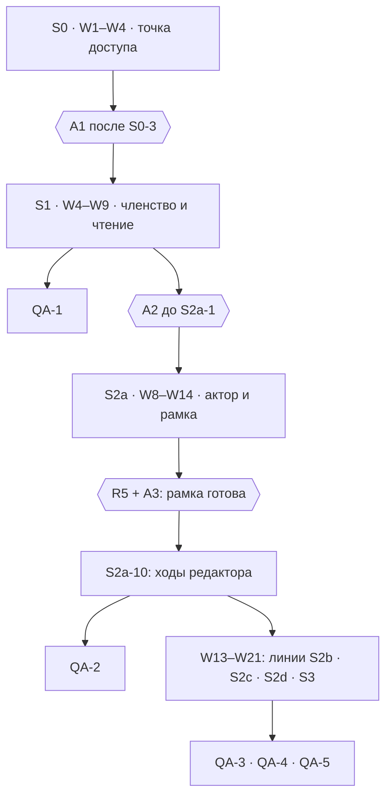

# План: «Общие проекты» — первая поставка S0–S3, вехи S4–S5

> Егор, 28.10.2026. Задача `bb97d9d4` (role=plan), эпик `c926e0e5`. Код не правился, задач-исполнителей не заводил.
> Вход: разрез [shared-projects-cut-2026-10.md](shared-projects-cut-2026-10.md), редакция 2: раздел «И» (И.2 — приватные
> чаты и каналы утечки, И.3 — рамка хода, И.5 — этапы) и §6–§7.4. Макеты — [proposal](../mockups/shared-projects-proposal.md)
> и `docs/mockups/shared-projects-*.html`. Пути файлов сверены с master `d36cb1593`. Новые файлы помечены «(новый)».
> Это план к согласованию с Андреем. Статус — черновик до его «да».
> **Редакция 2 (28.10, задача `ce9d9e5c`):** фронтовые шаги, контракты, волны и вопросы — в
> [shared-projects-plan-v2-2026-10.md](shared-projects-plan-v2-2026-10.md). Где документы расходятся, верна редакция 2.

## 0. Коротко

- Первая поставка — это **S0 → S1 → S2a**, после неё **S2b, S2c, S2d и S3 идут параллельно**.
  - Всего **70 исполнительских шагов**.
  - Ревью: 9 бэковых пачек у Глеба, отдельное ревью на каждый шаг Киры и пачка на этап у Полины.
  - 5 проверок у Веры и 6 точек сверки у Александра.
- Размер — **≈21 волна** до конца S3. Из них срез «посмотреть проект коллеги» (S0+S1) — W1–W9, а ходы участников (S2a) — к W14.
- Узких мест два:
  - **Тимур.** 19 шагов, все широкие: разметка «видимость или владение», рамка, адресация. Параллелить их не с кем.
  - **Правило «не больше двух локальных одновременно».** Денис и Кузьма заняты бэком почти в каждой волне, поэтому фронтовые
    встройки на линиях S2b–S3 я по умолчанию отдал Полине. Если оставить их Кире, выйдет ≈25 волн.
- **Рамка хода участника (И.3) стоит раньше любого хода участника.** Шаг `S2a-10` («редактор запускает ходы») — единственный, который
  открывает участнику кнопку «отправить». Он зависит от `S2a-3`, `S2a-4` и `S2a-5`: рамка в MCP, рамка в подборке и сторож по всему
  `tools/list`. До `S2a-10` композер у любого участника заблокирован (`S1-F6`).
- В план внесены решения Андрея от 28.10 (раздел 1). Из-за них я перенёс два канала утечки раньше, чем в разрезе.
  Это нужно подтвердить у Александра (сверка А4):
  - `ExcludeFromDossiers` у приватных чатов переезжает из S4 в S2d. Иначе между поставками S2d и S4 паспорт пересказывает
    приватный разговор;
  - отсечка плагинов владельца в ходах участников переезжает из S4 в S2a. Иначе с первого хода редактора в его ходы едут
    плагины владельца, а с ними сетевой прокси `net:{host}`.

## 1. Решения Андрея 28.10, ещё не внесённые в разрез

| Решение | Где в плане |
|---|---|
| Приглашение участника, у которого выключен флаг `shared-projects`, — **отказ с подсказкой** | `S1-2` (код ошибки `flag_disabled`), `S1-F3` (текст под полем) |
| Владельцу в дереве чатов **нет** строки «Ещё N приватных чатов»: число видно только в расходе | `S2d-F2` (критерий «строки нет»), `S2a-F4` (подстрока «в приватных чатах (N)») |
| В конфликте 409 главное действие — **«Сохранить мою копией»** | `S2c-F1` |
| Оговорка о пределе приватности на плашке спрятана за **«Подробнее»** | `S2d-F3` |
| *Не подтверждено:* передача владения только между одинаковыми средами исполнения | допущение, раздел 9, вопрос 1; влияет на S5 |
| *Не решено:* можно ли назначить исполнителем задачи читателя (рекомендация — нет) | раздел 9, вопрос 2; в `S2b-2` и `S2b-F1` заложено «нет», ветка «да» — минус один критерий |

Макет `shared-projects-private-chat.html` (строка «Ещё N…») и `proposal.md` (вопросы 1–4) Майе нужно поправить под эти решения.
Отдельный шаг на это не завожу, это правка макета до запуска `S2d-F2`.

## 2. Правила нарезки (напоминание исполнителям и Софье)

- **Локальные** — Денис, Кузьма (бэк) и Кира (фронт):
  - один компонент, стор или сервис на шаг, не больше четырёх файлов вместе с тестом;
  - файлы перечислены поимённо;
  - встройка в родительский компонент и правка общих типов идут отдельным шагом;
  - **одновременно не больше двух локальных** — по этому правилу сдвинуты волны.
- **Облачные** — Тимур (бэк) и Полина (фронт). Им достаются шаги широкого охвата: разметка вызовов, перевод десятков точек,
  экраны из нескольких компонентов.
- В шаги **шире одного файла** на «…» указан **источник перечня**: карта `S0-3` (появится в первой волне). Для облачных так можно,
  для локальных — нет.
- **Мутация** обязательна везде, где в столбце стоит «М». Сломать проверку → тест красный → откат → зелёный. Вывод прикладывается
  к карточке.
- Ревью Глеба: **фронт локальных — после каждого шага**, бэк и облачные — пачками (раздел 7).
- Каждый бэк-шаг закрывается зелёными тестами затронутых проектов (`scripts/tests-affected.sh`). Каждый фронтовый —
  `npx tsc -b` и `npm run lint:design` = 0 находок.

## 3. Фич-флаг и рубильник

- **S0 — без флага.** Поведение не меняется, страхуют существующие тесты плюс сторож.
- **С S1 всё за флагом** `shared-projects` (dark launch, `Default: false`) и рубильником инстанса `SharedProjects:Enabled`
  (по умолчанию `false`). Оба заводятся в `S1-2`.
- Флаг проверяется у **владельца**, когда он добавляет первого участника, и у **участника**, когда ему показывается проект.
  Выключенный флаг членство не отзывает: проект просто не показывается.
- Рубильник `false` даёт участнику 404 на всё и `503 shared_projects_disabled` на добавление. Членство при этом сохраняется.
- Чтение флага — одна точка `SharedProjectsGate.IsOn(userId)` (новая, в `S1-2`). Инлайновых `GetValue` не заводить.

## 4. Волны

Расписание по исполнителям. Прочерк — исполнителю ничего не готово по зависимостям или занят слот локального.
В каждой строке не больше двух локальных (Денис, Кузьма, Кира).

| Волна | Тимур | Денис | Кузьма | Кира | Полина |
|---|---|---|---|---|---|
| W1 | S0-3 | S0-1 | — | — | — |
| W2 | S0-2 (после А1) | — | S0-G | — | — |
| W3 | S0-4 | S0-6 | S0-7 | — | — |
| W4 | S0-5 | S1-1 | — | S1-F1 | — |
| W5 | S1-2 | — | S1-6 | — | — |
| W6 | S1-3a | — | S1-3b | S1-F2 | — |
| W7 | S1-5 | S1-3c | — | S1-F4 | S1-F3 |
| W8 | S2a-1 (после А2) | S1-4 | — | S1-F5 | — |
| W9 | S1-7 | S2a-2 | S2a-6a | — | S1-F6 → **QA-1** |
| W10 | S2a-3 | S2a-7 | S2a-6b | — | S2a-F1 |
| W11 | S2a-4 | S2a-5 | S2a-8 | — | S2a-F4 |
| W12 | S2c-0, S2d-0 | S2a-6c | — | S2a-F2 | — (R5 + А3) |
| W13 | S2a-10 | S2d-1 | S2b-1 | — | — |
| W14 | S2d-2 | S3-1 | — | S2a-F6 | S2a-F3 → **QA-2** |
| W15 | S2d-4 | S2c-1 | S2d-6b | — | S2b-F3 |
| W16 | S2d-7 | S2b-2 | S2d-3 | — | S2c-F1 |
| W17 | S2b-3 | S2d-6 | S2d-5 | — | S2d-F3 |
| W18 | S3-2 (после А6) | S3-4 | S2c-2 | — | S2b-F1, S2b-F2 |
| W19 | — | — | S3-3 | S2d-F1 | S2d-F2, S2d-F4, S2d-F5 → **QA-4** |
| W20 | — | — | — | — | S2c-F2, S3-F1 → **QA-3** |
| W21 | — | — | — | — | S3-F2 → **QA-5** |

Что из этого следует:

- Фронтовые встройки на линиях (`S2b-F1`, `S2b-F3`, `S2c-F2`, `S2d-F2`, `S2d-F4`, `S2d-F5`, `S3-F2`) я по умолчанию отдал
  **Полине**. Кире они по размеру подходят, но с W13 по W18 оба слота локальных заняты бэком, и она встала бы в очередь до W25.
  Резервный исполнитель этих шагов — Кира, если освободится слот.
- Приоритет между линиями: **S2d раньше S3**. В S3 канал «сообщение автокоммита» зависит от проверки `S2d-0`, а в S2d
  приватность без S3 работает целиком.
- Хвост W19–W21 — это фронт одной Полины. Его можно сжать на волну, если Андрей согласится, чтобы S3 (история и blame) вышел
  отдельной поставкой после S2b–S2d.

## 5. Шаги

Номера `S2a-9` и `S2a-F5` пропущены намеренно: шаги слиты с соседними, а перенумеровывать остальные я не стал.
В заголовке шага: **Исп.** — исполнитель; **М** — нужна мутация. Критерии — по формуле «объект, инструмент, порог, условие».
Фильтр `run_tests` указан в виде `~Имя` (это `FullyQualifiedName~Имя`).

### S0. Точка доступа (без изменения поведения)

**S0-1 · back · Денис · М.** Core-примитив доступа (пока «только владелец»).
- Файлы:
  - `backend/ClaudeHomeServer.Core/Services/Access/ProjectAccess.cs` (новый): `ProjectRole`, `ProjectRight`,
    `Check(project, userId)`, `Can(project, userId, right)`;
  - `backend/ClaudeHomeServer.Core/Services/Access/SessionAccess.cs` (новый): `CanSee(session, project, userId)`;
  - `backend/ClaudeHomeServer.Tests/Services/Access/ProjectAccessTests.cs` (новый).
- Образец чистой функции над моделью — `ProjectCapabilities.cs`.
- Критерии:
  1. `run_tests ~ProjectAccessTests` зелёный: владелец → `Owner`, чужой → `null`, `null`/пустой userId → `null`.
  2. Мутация: `Check` возвращает `Owner` для любого userId → тест «чужой» красный; после отката — зелёный.
  3. `SessionAccess.CanSee` для проектного чата совпадает с владением проектом на тех же 3 кейсах (тест в том же файле).
- Зависит от: —.

**S0-3 · back · Тимур.** Карта: разметка вызовов и инвентаризация ключей. Кода нет, результат — документ.
- Файл: `docs/research/shared-projects-s0-map-2026-10.md` (новый).
- Таблица 1 — каждый вызов `ProjectManager.GetByOwner` (41 у проектов) и `SessionManager.GetOwned` (98): файл:строка, «видимость» или
  «владение», для `GetOwned` — каким ключом вызывающий дальше лезет в хранилища (ловушка ключа §6.6 п. 2).
- Таблица 2 — каждое инлайн-сравнение `OwnerId (==|!=) UserId`, сгруппированное по файлам, с номером шага-переводчика
  (`S0-4`, `S0-5`, `S0-6`, `S0-7`).
- Таблица 3 — **инвентаризация всех хранилищ с ключом `{ownerId}`** (для И.4/S5): путь, ключ, кто пишет, нужна ли перекладка
  при передаче.
- Таблица 4 — рассылки `ToOwner` (78) и сырые `Clients.Group("user_"+…)` (13): «проектное» → `ToProject`, «личное» → остаётся.
- Критерии:
  1. Таблицы 1 и 2 сходятся с grep по master по числу строк. Расхождение — 0, команда grep приложена в документе.
  2. В таблице 3 есть все 14 хранилищ, перечисленных в И.4 п. 2, плюс найденные сверх них. Каждое со ссылкой файл:строка.
  3. В таблице 4 у каждой из 91 точки стоит вердикт.
- Зависит от: —.
- После шага — **сверка А1**.

**S0-2 · back · Тимур.** `RequestScope`, `IProjectAccess`, база контроллера.
- Файлы:
  - `backend/ClaudeHomeServer.Core/Services/Access/IProjectAccess.cs` (новый);
  - `backend/ClaudeHomeServer.Core/Services/Access/RequestScope.cs` (новый): `CallerUserId`, `TenantOwnerId`, `Role`;
  - `backend/ClaudeHomeServer/Services/ProjectAccessService.cs` (новый): реализация поверх `ProjectManager`;
  - `backend/ClaudeHomeServer/Controllers/ProjectScopedControllerBase.cs` (новый) или фильтр действия — выбор за Тимуром на сверке А1;
  - регистрация в `Program.cs`;
  - тесты.
- Критерии:
  1. Тест `~RequestScopeTests` зелёный: у проектного эндпоинта `TenantOwnerId` = `project.OwnerId`, а не `sub`.
  2. Полный `run_tests backend/ClaudeHomeServer.slnx` — 0 упавших против 0 до шага.
  3. В `IProjectAccess` нет метода, который отдаёт ключ хранилища из `CallerUserId`. Проверка — ревью, вердикт Глеба.
- Зависит от: S0-1, А1.

**S0-G · back · Кузьма · М.** Сторож-текст инлайн-сравнений.
- Файлы:
  - `backend/ClaudeHomeServer.Guards.Tests/Services/OwnerIdInlineGuardTests.cs` (новый);
  - `backend/ClaudeHomeServer.Guards.Tests/Services/OwnerIdInlineAllowList.txt` (новый, снимок из таблицы 2 карты `S0-3`).
- Образец — `ProjectMapHygieneGuardTests.cs`.
- Охват: `backend/**/Controllers/**`, `backend/**/Services/Mcp/**`, `backend/ClaudeHomeServer/Hubs/**`.
- Критерии:
  1. `run_tests ~OwnerIdInlineGuardTests` зелёный на master с allow-list.
  2. Мутация А: добавить `if (p.OwnerId != UserId)` в любой контроллер вне allow-list → красный; откат → зелёный.
  3. Мутация Б: оставить в allow-list строку, которой больше нет в коде → красный (список только сокращается); откат → зелёный.
- Зависит от: S0-3.

**S0-4 · back · Тимур.** Перевод контроллеров, группа A: файлы группы A из таблицы 2 карты `S0-3` (Main `Controllers/`).
- Критерии:
  1. Allow-list `S0-G` сократился ровно на строки группы A.
  2. `run_tests` затронутых проектов — 0 упавших.
  3. В переведённых файлах `grep -c "string UserId =>"` = 0: все берут `RequestScope`.
- Зависит от: S0-2, S0-G.

**S0-5 · back · Тимур.** Перевод контроллеров вертикалей, группа B: `Controllers/` в `ClaudeHomeServer.*` вне Main. Критерии — как у S0-4.
- Зависит от: S0-4.

**S0-6 · back · Денис · М.** Хаб на точку доступа.
- Файлы:
  - `backend/ClaudeHomeServer/Hubs/SessionHub.cs` — `OwnsProject`/`OwnsSession` (17 мест) через `IProjectAccess`/`SessionAccess.CanSee`;
  - тест `backend/ClaudeHomeServer.Tests/Hubs/SessionHubAccessTests.cs` (новый).
- Критерии:
  1. `run_tests ~SessionHubAccessTests` зелёный: чужой не входит в группы `project_{id}` и `{sessionId}`.
  2. Мутация: `OwnsSession` → `true` → тест красный; откат → зелёный.
  3. Строки `SessionHub.cs` ушли из allow-list `S0-G`.
- Зависит от: S0-2.

**S0-7 · back · Кузьма.** MCP-тулсеты на точку доступа (проверки, не рамка).
- Файлы:
  - `backend/ClaudeHomeServer/Services/Mcp/Http/TasksToolset.cs`;
  - `backend/ClaudeHomeServer.Notes/Services/Mcp/NotesToolset.cs`;
  - `backend/ClaudeHomeServer/Services/Mcp/Http/MemoryToolset.cs`;
  - `backend/ClaudeHomeServer.Core/Services/Mcp/Http/McpCallContextSeams.cs`.
- `WorkspaceToolset.cs` в этот шаг **не входит**: он большой, его берёт Тимур в `S2a-3` вместе с рамкой.
- Критерии:
  1. Строки этих 4 файлов ушли из allow-list `S0-G`.
  2. `run_tests ClaudeHomeServer.Mcp.Tests` и `~NotesToolsetParityTests` — 0 упавших.
  3. `run_tests ~McpToolsetStabilityTests` зелёный.
- Зависит от: S0-2.

### S1. Членство и чтение (флаг)

**S1-1 · back · Денис · М.** Модель членства.
- Файлы:
  - `backend/ClaudeHomeServer.Core/Models/ProjectMember.cs` (новый);
  - `backend/ClaudeHomeServer.Core/Models/Project.cs` (`Members`, необязательное поле);
  - `backend/ClaudeHomeServer.Core/Models/ProjectCapabilities.cs` (`Shareable = FilesOnServer`);
  - `backend/ClaudeHomeServer.Core/Services/Access/ProjectAccess.cs` (роли из `Members`).
- Тесты — дописываются в `ProjectAccessTests.cs` из S0-1 (пятый файл, допустимо: тест уже есть).
- Критерии:
  1. `~ProjectAccessTests`: редактор → `Editor`, читатель → `Reader`, у читателя `Can(Write)` = `false`.
  2. `projects.json` без поля `members` читается, `Members` пуст; сериализация без участников не пишет поле (тест round-trip).
  3. Мутация: `Shareable` = `true` у локального проекта → тест `~ProjectCapabilitiesTests` красный; откат → зелёный.
- Зависит от: S0-1 (шаг трогает только Core и идёт параллельно с `S0-5`).

**S1-2 · back · Тимур.** Флаг, рубильник и сервис членства.
- Файлы:
  - `Core/Models/FeatureFlag.cs` (ключ `shared-projects`);
  - `Services/SharedProjectsGate.cs` (новый);
  - `Services/ProjectMembershipService.cs` (новый);
  - `Controllers/ProjectMembersController.cs` (новый);
  - `appsettings.json` (`SharedProjects:Enabled=false`);
  - тесты.
- Операции: добавить по точному username, сменить роль, убрать, покинуть.
- Отказы ДО записи с кодом:
  - `user_not_found`, `already_member`, `self`;
  - `flag_disabled` у получателя (**решение 28.10: отказ с подсказкой**);
  - `local_project` (через `ProjectCapabilities.Shareable`);
  - `503 shared_projects_disabled`.
- Первое добавление делает `GitService.InitAsync`, если репозитория нет.
- Удаление владельца при живых участниках — отказ (запрет из §2.2; полный жизненный цикл — S5).
- Критерии:
  1. `run_tests ~ProjectMembersControllerTests`: на каждый из 6 отказов — свой код, `projects.json` не изменён (сверка хеша файла).
  2. Не-владелец на любой операции, кроме «покинуть», получает 403. Посторонний — 404.
  3. После первого добавления в папке без git есть `.git`. Тест на временной папке от `Path.GetTempPath()`.
  4. Ответа со списком учёток (перечисления) нет: `GET` по username без точного совпадения не существует (ревью).
- Зависит от: S1-1.

**S1-3a · back · Тимур · М.** Чтение участником в Main.
- Списки проектов: `ProjectManager.GetAccessible`, «Домой».
- Чаты: `SessionManager.GetAccessible`.
- Файлы проекта — чтение.
- Читатель получает 403 на запись.
- Источник перечня — таблица 1 карты `S0-3`, строки «видимость».
- Критерии:
  1. Участник видит общий проект в `GET /api/projects` только при флаге и рубильнике `true` (2 теста на выключенные состояния).
  2. Мутация: `GetAccessible` возвращает только `GetByOwner` → тест «редактор видит проект» красный; откат → зелёный.
  3. Ни один вызов из колонки «владение» карты не переведён (сверка diff с картой, вердикт Глеба).
- Зависит от: S1-2.

**S1-3b · back · Кузьма.** Заметки проекта для участника.
- Файлы:
  - `backend/ClaudeHomeServer.Notes/Services/Notes/NotesService.cs` (`ResolveRoot` и сбор источников через `IProjectAccess`, ключ —
    `TenantOwnerId`);
  - тест в `ClaudeHomeServer.Notes.Tests` (новый файл `SharedProjectNotesAccessTests.cs`).
- Критерии:
  1. Читатель читает заметку проекта (200), пишет — 403.
  2. Посторонний — 404.
  3. Личный vault участника и владельца не смешиваются: участник не видит источник «Личный» владельца (тест).
- Зависит от: S1-2.

**S1-3c · back · Денис.** Задачи и архитектура для участника.
- Файлы:
  - `backend/ClaudeHomeServer/Controllers/TasksController.cs` (только чтение задач проекта);
  - `backend/ClaudeHomeServer.Architecture/Controllers/ArchitectureController.cs` (`OwnedProject` → точка доступа);
  - тест `backend/ClaudeHomeServer.Tests/Controllers/SharedProjectReadTests.cs` (новый).
- Критерии:
  1. Читатель: `GET` задач проекта — 200, `PATCH` — 403; `GET` модели архитектуры — 200, `PUT` — 403.
  2. Посторонний — 404 на все 4 вызова.
- Зависит от: S1-2.

**S1-4 · back · Денис · М.** Реестр соединений пользователя и выкидывание из групп при отзыве.
- Файлы:
  - `backend/ClaudeHomeServer/Hubs/UserConnectionRegistry.cs` (новый);
  - `backend/ClaudeHomeServer/Hubs/SessionHub.cs` (регистрация в `OnConnected`/`OnDisconnected`);
  - вызов из `ProjectMembershipService.cs`;
  - тест.
- Критерии:
  1. После «убрать участника» его соединение не получает событие `project_{id}` (тест с двумя клиентами, ожидание через
     `TaskCompletionSource`, не `Task.Delay`).
  2. Мутация: не вызывать `RemoveFromGroupAsync` → тест красный; откат → зелёный.
- Зависит от: S1-2, S0-6.

**S1-5 · back · Тимур.** Проектные рассылки → `ToProject` по таблице 4 карты `S0-3`.
- Критерии:
  1. Все строки «проектное» переведены: grep `ToOwner` по ним = 0.
  2. Тест: участник получает `file_changed`, `session_status` и события доски общего проекта.
  3. Личные события (уведомления, персоны вне проекта) участнику не приходят — тест-отрицание.
- Зависит от: S1-3a.

**S1-6 · back · Кузьма.** Оверлей личного состояния чата.
- Файлы:
  - `backend/ClaudeHomeServer.Core/Services/ChatUserState/ChatUserStateStore.cs` (новый): `data/chat-user-state/{userId}.json`,
    `LastReadAt`/`IsPinned`/`NotificationsMuted`;
  - тест.
- Встройку в эндпоинты «прочитано / закрепить / заглушить» делает Тимур в `S1-7` (вне окна локального).
- Критерии:
  1. `~ChatUserStateStoreTests`: двое пользователей, отметки одного не видны другому.
  2. Нет файла — значения берутся с `Session`.
  3. Хранилище в `data/` попадает в бэкап. Тест `BackupPaths` или ревью — вердикт Глеба.
- Зависит от: S0 (стор самостоятельный, флаг ему не нужен).

**S1-7 · back · Тимур · М.** Встройка оверлея плюс матрица ролей.
- Файлы: эндпоинты прочитано/закрепить/заглушить; `backend/ClaudeHomeServer.Tests/Integration/SharedProjectRoleMatrixTests.cs`
  (новый).
- Матрица: 4 роли (владелец, редактор, читатель, посторонний) × эндпоинты проектной группы из карты `S0-3` на
  `TestWebApplicationFactory`.
- Критерии:
  1. Посторонний: 404 на 100 % эндпоинтов матрицы.
  2. Читатель: 403 на 100 % записей.
  3. Мутация: снять проверку в одном эндпоинте → ровно его строка матрицы красная; откат → зелёный.
  4. Прочитанность чата у редактора не меняет её у владельца (тест).
- Зависит от: S1-3a…S1-6.

**Фронт S1:**

**S1-F1 · front · Кира.** Компонент `UserAvatar`.
- Файлы:
  - `frontend/src/components/ui/UserAvatar.tsx` (новый): 20/28/36, цвет по хешу userId из 4 пар тонов, нейтральный для бывших;
  - `frontend/src/components/ui/__tests__/UserAvatar.test.ts` (новый);
  - запись в витрину UI-кита.
- Образец — `Badge.tsx`.
- Критерии:
  1. `run_tests kind=vitest` по файлу зелёный: один userId → один тон на 1000 повторов; бывший → `bgInset/textMuted`.
  2. `npm run lint:design` — 0 находок.
  3. `ui_probe path=/#/ui-kit viewports=[360,1280]`: `totals=0` в блоке аватара.
- Зависит от: —.

**S1-F2 · front · Кира.** Типы и API.
- Файлы:
  - `frontend/src/lib/api.ts` (методы участников);
  - тип `Project.members` / `myRole` в `frontend/src/types/`;
  - `frontend/src/lib/featureFlags.ts` (`FLAGS.sharedProjects`).
- Критерии:
  1. `npx tsc -b` — 0 ошибок.
  2. `featureFlags.contract.test.ts` зелёный: ключ совпадает с C#-каталогом.
- Зависит от: S1-2.

**S1-F3 · front · Полина.** Вкладка «Участники» (макет `shared-projects-members.html`).
- Файлы: `frontend/src/features/projects/members/*` (новые: вкладка, форма, список, диалоги), встройка в
  `frontend/src/features/projects/dialogs/EditDialog.tsx`.
- Состояния:
  - пусто;
  - первое включение;
  - 6 ошибок, в том числе `flag_disabled` с подсказкой «попросите включить „Общие проекты“ в экспериментальных функциях»
    (**решение 28.10**);
  - локальный проект;
  - вид участника с «Покинуть»;
  - пункта «Сфера» у участника нет.
- Блок MCP «для участников» здесь не делается, он в `S2a-F6`.
- Критерии:
  1. `ui_probe` вкладки на `viewports=[360,1280]` в светлой и тёмной теме: `totals=0`, `auth` не `skipped`, `truncated=false`.
  2. vitest: на каждый код ошибки — свой текст, введённое значение не стирается.
  3. `lint:design` — 0.
- Зависит от: S1-F1, S1-F2.

**S1-F4 · front · Кира.** Компонент бейджа.
- Файлы: `frontend/src/components/SharedBadge.tsx` (новый: «общий» или имя владельца, размеры `xs`/`sm`, на мобиле только иконка), тест.
- Критерии:
  1. vitest: свой → «общий», чужой → имя владельца.
  2. `lint:design` — 0.
- Зависит от: S1-F2.

**S1-F5 · front · Кира.** Встройка бейджа.
- Файлы: `frontend/src/pages/ProjectListPage.tsx`, `frontend/src/pages/HomePage.tsx`, `frontend/src/components/HubHeader.tsx`.
- Критерии:
  1. `ui_probe path=/ viewports=[360,1280]`: `totals=0`.
  2. В данных с общим проектом бейдж есть в 3 местах (Playwright-проверка от Веры в QA-1).
- Зависит от: S1-F4.

**S1-F6 · front · Полина.** Шапка и режим участника.
- Состав:
  - стопка аватаров (клик → «Участники»);
  - плашка «Проект Андрея — ходы идут по его настройкам»;
  - доступ отозван — `Notice warning` плюс «На „Домой“»;
  - **композер заблокирован у любого участника** до `S2a-10`: читателю — текст про «редактора», редактору — временно тот же блок
    за флагом.
- Файлы: `HubHeader.tsx`, `Composer.tsx`, новые `frontend/src/features/projects/members/MembersStack.tsx`, `OwnerSettingsNotice.tsx`.
- Критерии:
  1. `ui_probe` на 360/1280, обе темы: `totals=0`.
  2. У участника в DOM нет активной кнопки отправки (vitest или Playwright).
  3. `lint:design` — 0.
- Зависит от: S1-F1, S1-F5.

### S2a. Актор и рамка хода — блокер всех ходов участников

**S2a-1 · back · Тимур · М.** Реестр актора хода.
- Файлы:
  - шов `backend/ClaudeHomeServer.Core/Services/Turn/ITurnActorRegistry.cs` (новый);
  - реализация в Main;
  - запись при старте хода в `SessionManager.cs`, при запуске исполнителя в `TaskExecutionService.cs`, у сторожей и автоматики
    персон — инициатор, который их завёл.
- Образец — устройство `DelegatedTurnGate` (свойство хода на бэкенде, `tools/list` не трогаем).
- Критерии:
  1. Тест: ход, отправленный редактором, → `ActorUserId` = редактор; исполнитель, запущенный владельцем, → владелец; автоматика с
     неизвестным инициатором → `null`.
  2. `~McpToolsetStabilityTests` зелёный.
  3. Мутация: не писать актор при запуске исполнителя → тест красный; откат → зелёный.
- Зависит от: S1-2, сверка А2. Остальной S1 реестру не нужен, поэтому он стартует параллельно с хвостом S1.

**S2a-2 · back · Денис · М.** Чистая функция рамки.
- Файлы:
  - `backend/ClaudeHomeServer.Core/Services/Access/TurnFrame.cs` (новый): `Resolve(project, tenantOwnerId, actorUserId) → Wide|Narrow`;
  - тест.
- Критерии:
  1. `~TurnFrameTests`: актор = арендатор → `Wide`; актор ≠ арендатор → `Narrow`; актор `null` в общем проекте → `Narrow`
     (fail-closed); актор `null` в личном проекте → `Wide`.
  2. Мутация: `null` → `Wide` в общем проекте → красный; откат → зелёный.
- Зависит от: S1-1.

**S2a-3 · back · Тимур · М.** Рамка в платформенном MCP.
- Файлы:
  - `backend/ClaudeHomeServer/Services/Mcp/Http/WorkspaceToolset.cs` (заодно — перевод на точку доступа из S0);
  - `TasksToolset.cs`, `NotesToolset.cs`, `MemoryToolset.cs`;
  - `backend/ClaudeHomeServer/Controllers/McpTransportController.cs`.
- При `Narrow`:
  - отказ на `projects_*`, `files_*` чужих проектов, `chats_*` вне проекта, `search_unified`, `source="personal"`, `scope=all`;
  - `chats_*` внутри проекта — через `SessionAccess.CanSee(…, actor)`.
- Критерии:
  1. Тест на каждый из 6 классов отказа: ответ инструмента — отказ, в тексте ответа нет ни одного id или названия из личных данных владельца.
  2. `~McpToolsetStabilityTests` зелёный: состав `tools/list` не меняется.
  3. Allow-list `S0-G` сократился на строки `WorkspaceToolset.cs`.
- Зависит от: S2a-1, S2a-2, S0-7.

**S2a-4 · back · Тимур · М.** Рамка в подборке хода.
- Файлы: реализации `IPromptSectionContributor` (`backend/ClaudeHomeServer.Core/Services/Turn/IPromptSectionContributor.cs`),
  `backend/ClaudeHomeServer/Services/Composition/PromptSeamAdapters.cs`; список секций — из разведки в шаге.
- При `Narrow` в подборке нет личного vault владельца, его личной памяти и памяти глобальных персон.
- Критерии:
  1. Тест: собранный текст хода редактора не содержит заметок источника «Личный» и записей личной памяти владельца
     (фикстура с маркерами-строками, проверка — 0 вхождений).
  2. Мутация: не применять рамку в одном контрибьюторе → тест красный; откат → зелёный.
  3. `~TurnPromptAssemblerTests` зелёный.
- Зависит от: S2a-1, S2a-2.

**S2a-5 · back · Денис · М.** Сторож рамки по всему `tools/list`.
- Файл: `backend/ClaudeHomeServer.Guards.Tests/Services/ParticipantTurnFrameGuardTests.cs` (новый) плюс фикстура.
- Тест data-driven: каждый инструмент платформенного MCP из `tools/list` × ход участника × маркеры личных данных владельца.
  Инструмент без явной пометки «проектный» или «отказывает в узкой рамке» → красный (default-deny, как у `SubsystemBoundaryCoverageTests`).
- Критерии:
  1. Зелёный после `S2a-3`.
  2. Мутация А: добавить в тулсет новый инструмент без пометки → красный.
  3. Мутация Б: убрать рамку у `search_unified` → красный. После отката обеих — зелёный.
- Зависит от: S2a-3.
- Пишет **не Тимур**, чтобы сторож не подтверждал реализацию её же автора.

**S2a-6a · back · Кузьма.** Автор сообщения.
- Файлы:
  - `backend/ClaudeHomeServer.Core/Protocol/StoredMessage.cs` (`SenderUserId`);
  - точка записи сообщения в `SessionManager.cs` — сообщения с отправкой;
  - тест.
- Критерии:
  1. Тест: сообщение редактора → `history.json` содержит `senderUserId` = редактор.
  2. Старая история без поля читается.
- Зависит от: S2a-1.

**S2a-6b · back · Кузьма · М.** Расход по участникам.
- Файлы:
  - `backend/ClaudeHomeServer.Core/Models/SpendRecord.cs` (`ActorUserId`);
  - `backend/ClaudeHomeServer/Services/SpendMapping.cs`;
  - `backend/ClaudeHomeServer.Spend/SpendAccess.cs`;
  - тест в `ClaudeHomeServer.Spend.Tests`.
- Критерии:
  1. Владелец видит разбивку по `ActorUserId`.
  2. Участник видит только свои записи (тест на 2 участников).
  3. Мутация: снять фильтр участника → тест красный; откат → зелёный.
- Зависит от: S2a-1.

**S2a-6c · back · Денис.** Журнал событий v2.
- Файлы:
  - `backend/ClaudeHomeServer/Services/ProjectEventLogService.cs` (`user_version = 2`, колонка `ActorUserId`, чтение по `ProjectId`
    через точку доступа);
  - `backend/ClaudeHomeServer.Core/Models/ProjectEvent.cs`;
  - тест.
- Критерии:
  1. База v1 мигрирует в v2 без потери строк (число до = после).
  2. Участник читает журнал проекта, посторонний — 404.
- Зависит от: S2a-1.

**S2a-7 · back · Денис · М.** MCP владельца — только помеченные «для участников».
- Файлы:
  - модель записи реестра MCP (поле `SharedWithMembers`);
  - `backend/ClaudeHomeServer/Services/Mcp/McpDelivery.cs`;
  - эндпоинт тумблера;
  - тест.
- Критерии:
  1. Ход актора ≠ арендатора не получает непомеченный сервер в конфиге `--mcp-config`.
  2. Помеченный — получает.
  3. Мутация: игнорировать пометку → красный; откат → зелёный.
- Зависит от: S2a-1.

**S2a-8 · back · Кузьма.** Плагины и глобальные персоны в общем проекте.
- Файлы:
  - `backend/ClaudeHomeServer.Plugins/Services/PluginDirSource.cs` (актор ≠ арендатор → пусто; **перенесено из S4**, см. §0);
  - проверка собеседника-персоны (отказ глобальной персоне в общем проекте);
  - тест.
- Критерии:
  1. Ход редактора: `--plugin-dir` отсутствует.
  2. Назначение глобальной персоны чату общего проекта → 400 с кодом `global_persona_in_shared`.
- Зависит от: S2a-1.

**S2a-10 · back · Тимур · М.** Редактор запускает ходы.
- Право `Write` на отправку в хабе и REST, очередь хранит отправителя.
- Критерии:
  1. Матрица `S1-7` дополнена: редактор отправляет (200), читатель — 403.
  2. Тест очереди: второе сообщение другого участника — `Queued` с `senderUserId`.
  3. **Гейт запуска:** шаг не стартует, пока `S2a-3`, `S2a-4` и `S2a-5` не закрыты с зелёным ревью (проверяет Софья при заведении карточки).
- Зависит от: S2a-3, S2a-4, S2a-5.

**Фронт S2a:**

**S2a-F1 · front · Полина.** Автор у сообщений.
- Состав: аватар, имя и время над сообщением человека; отозванный участник; очередь «Сообщение Андрея в очереди» с «Отменить» у своей.
- Файлы: компонент сообщения человека в `frontend/src/components/chat/`, `PendingMessageView.tsx`.
- Критерии:
  1. vitest `PendingMessageView.test.ts` дополнен: чужая очередь — без «Отменить».
  2. `ui_probe` чата на 360/1280: `totals=0`.
- Зависит от: S1-F1, S2a-6a.

**S2a-F2 · front · Кира.** Компонент капсулы идущих ходов.
- Файлы: `frontend/src/features/projects/members/RunningTurnsPill.tsx` (новый), тест.
- Чужой приватный чат — `disabled` строка «X работает в приватном чате» без перехода.
- Критерии:
  1. vitest: 0 ходов — капсулы нет; приватный — без ссылки.
  2. `lint:design` — 0.
- Зависит от: S1-F1.

**S2a-F3 · front · Полина.** Встройка капсулы в `HubHeader.tsx`, снятие блокировки композера с редактора, меню модели участника
(`disabled` «выбирает владелец», «Ваши персоны» `disabled`).
- Критерии:
  1. `ui_probe` шапки на 360/1280: `totals=0`.
  2. У редактора кнопка отправки активна, у читателя — нет (Playwright от Веры в QA-2).
- Зависит от: S2a-F2, S2a-10.

**S2a-F4 · front · Полина.** Расход по участникам (макет `shared-projects-spend.html`).
- Файлы: `frontend/src/features/spend/*` (новая вкладка проекта).
- Подстрока «в приватных чатах (N)» рисуется, если поле пришло. **Это единственное место, где владелец видит число чужих приватных
  чатов (решение 28.10).**
- Критерии:
  1. `ui_probe` на 360/1280, обе темы: `totals=0`.
  2. Участник видит только свою таблицу (vitest на `spendModel`).
- Зависит от: S2a-6b.

**S2a-F6 · front · Кира.** Блок «Подключения для участников».
- Файлы: `frontend/src/features/projects/members/MemberConnectionsSection.tsx` (новый), тест, встройка в вкладку из `S1-F3`
  (одна строка) — допустимо, т. к. родитель уже свой.
- Критерии:
  1. vitest: по умолчанию все тумблеры выключены; у не-владельца блока нет в DOM.
  2. `lint:design` — 0.
- Зависит от: S2a-7, S1-F3.

### S2b. Задачи

**S2b-1 · back · Кузьма · М.** Поля задачи.
- Файлы: `backend/ClaudeHomeServer.Core/Models/TaskItem.cs` (`AssigneeUserId`, `CreatedByUserId`), `backend/ClaudeHomeServer.Tasks/TaskManager.cs`
  (чтение `Me`), тест.
- Инвариант `PersonaId != null ⇒ Assignee = Claude` не трогать.
- Критерии:
  1. Тест: старая задача `Me` без `AssigneeUserId` → исполнитель = владелец.
  2. `~NormalizePersonaAssignee` зелёный.
  3. Мутация: `Me` → актор вместо владельца у старой задачи → красный; откат → зелёный.
- Зависит от: S2a-1.

**S2b-2 · back · Денис.** MCP `assignee` = username.
- Файлы: `backend/ClaudeHomeServer/Services/Mcp/Http/TasksToolset.cs`, тест.
- `me` = актор хода; username участника → `AssigneeUserId`. Читатель → отказ `reader_not_assignable` (**рекомендация, к подтверждению**).
- Критерии:
  1. Тест на 4 значения: `me`, `claude`, username редактора, username читателя.
  2. Неизвестный username → отказ без записи.
- Зависит от: S2b-1.

**S2b-3 · back · Тимур.** «Мои задачи» и календарь по общим проектам, уведомления исполнителю (`TaskSchedulerService.cs`), события
доски → `ToProject` (`TaskExecutionService.cs` — 13 точек, `TasksController.cs` — 9, `TasksToolset.cs` — 8).
- Критерии:
  1. Тест: задача на редактора видна в его «мои задачи» и календаре.
  2. Напоминание уходит редактору, не владельцу.
  3. grep `ToOwner` по событиям доски в трёх файлах = 0.
- Зависит от: S2b-2.

**S2b-F1 · front · Полина (резерв — Кира).** Группа «Участники» в `frontend/src/features/tasks/ExecutorPicker.tsx`, тест. Читателя в списке нет
(по рекомендации). Глобальных персон нет.
- Критерии:
  1. vitest: в общем проекте 3 группы; в личном — как сейчас (снимок).
  2. `lint:design` — 0.
- Зависит от: S2b-2.

**S2b-F2 · front · Полина.** «Мои задачи» и календарь (макет `shared-projects-my-tasks.html`): секции, фильтр-чипы, календарь на `C.infoBg`,
частичная ошибка проекта.
- Файлы: `frontend/src/features/tasks/CalendarPage.tsx` и соседние, список задач.
- Критерии:
  1. `ui_probe` на 360/1280, обе темы: `totals=0`.
  2. vitest фильтра: пустой фильтр → «Показать все проекты».
- Зависит от: S2b-3.

**S2b-F3 · front · Полина (резерв — Кира).** Бейдж «Без исполнителя» и строка «была на Ольге — Назначить» в `frontend/src/features/tasks/TaskCard.tsx`, тест.
- Критерии:
  1. vitest: `AssigneeUserId` бывшего участника → бейдж `warning`.
  2. `lint:design` — 0.
- Зависит от: S2b-1.

### S2c. Конфликт 409 для правок человека

**S2c-0 · back · Тимур.** Проверка OnlyOffice: есть ли собственное соредактирование и где в нашем подключении точка записи.
- Результат: раздел в карте `S0-3`.
- Критерии:
  1. Описан путь записи файла из редактора документов (файл:строка).
  2. Вывод «соредактирование есть/нет» подтверждён ручным опытом с двумя вкладками (лог приложен).
- Зависит от: —. Можно гнать в любой волне.

**S2c-1 · back · Денис · М.** Предусловие записи файла.
- Файлы: `backend/ClaudeHomeServer/Controllers/FilesController.cs` (`If-Match: <sha256>` → `409 file_changed` со свежим содержимым,
  автором и временем из `GitService.LastCommitAsync`), тест.
- Записи агента не затрагиваются.
- Критерии:
  1. Тест: несовпадение хеша → 409, файл не изменён (сверка хеша).
  2. Совпадение → 200.
  3. Мутация: пропустить сравнение → тест конфликта красный; откат → зелёный.
- Зависит от: S1-3a.

**S2c-2 · back · Кузьма.** То же для заметок.
- Файлы: `backend/ClaudeHomeServer.Notes/Services/Notes/NotesService.cs`, контроллер заметок, тест.
- Критерии:
  1. Несовпадение → 409 `note_changed`, заметка не изменена.
  2. Без заголовка `If-Match` — поведение как сейчас (совместимость).
- Зависит от: S1-3b.

**S2c-F1 · front · Полина.** Диалог конфликта (макет `shared-projects-conflict.html`): текст и заметка — две колонки с диффом;
Office и двоичные — карточки версий; мобила — `Segmented`; повторный конфликт.
- **Главное действие — `primary` «Сохранить мою копией» (решение 28.10).** Имя копии: `<имя> (<Имя участника>).<расширение>`.
- Файлы: `frontend/src/features/files/conflict/*` (новые).
- Критерии:
  1. vitest: имя копии для `a.md` и `a` (без расширения).
  2. `ui_probe` на 360/1280, обе темы: `totals=0`.
  3. На 360 кнопка копии — первая в столбце (vitest порядка).
- Зависит от: S2c-1.

**S2c-F2 · front · Полина (резерв — Кира).** Встройка диалога.
- Файлы: `frontend/src/components/CodeEditor.tsx`, `frontend/src/features/notes/NoteEditor.tsx`, `frontend/src/lib/api.ts`
  (отправка `If-Match`).
- Критерии:
  1. `npx tsc -b` — 0.
  2. Playwright от Веры в QA-3: две вкладки, одна сохраняет, вторая получает диалог.
- Зависит от: S2c-F1, S2c-2.

### S2d. Приватные чаты

**S2d-0 · back · Тимур.** Две проверки до кода (§9 разреза):
- (а) есть ли у CLI выключатель авто-памяти на один запуск;
- (б) строит ли `GitAutoCommitService` сообщение коммита из текста разговора.
- Результат: раздел в карте `S0-3`.
- Критерии:
  1. По (а) — ссылка на флаг или env с проверкой на живом запуске либо «нет», тогда пункт уходит в плашку.
  2. По (б) — файл:строка построения сообщения.
- Зависит от: —.

**S2d-1 · back · Денис · М.** Модель и правило видимости.
- Файлы:
  - `backend/ClaudeHomeServer.Core/Models/Session.cs` (`PrivateToUserId`);
  - `backend/ClaudeHomeServer.Core/Services/Access/SessionAccess.cs` (правило И.2);
  - тест в `ProjectAccessTests.cs` или новый `SessionAccessTests.cs`.
- Критерии:
  1. Тест: автор видит, другой редактор — нет, **владелец — нет**.
  2. Мутация: `CanSee` игнорирует `PrivateToUserId` → красный; откат → зелёный.
  3. `Session.OwnerId` не переиспользован (ревью).
- Зависит от: S2a-3, S2a-4, S2a-5: без рамки приватность фиктивна. `S2a-10` для этого шага не нужен.

**S2d-2 · back · Тимур · М.** Адресация `ToChatAudience`.
- Новая функция, перевод 5 рассылок (`SessionManager.cs:2371, 6925, 9916, 11019, 11043` на ревизии разреза) и адресата уведомлений
  «ход завершён» / «нужен ответ».
- Критерии:
  1. Тест: статус с `lastMessage` приватного чата не приходит соединению другого участника.
  2. Уведомление приватного хода получает только автор, общего — инициатор.
  3. Мутация: приватный → `project_{id}` → красный; откат → зелёный.
- Зависит от: S2d-1.

**S2d-3 · back · Кузьма · М.** Сторож адресации.
- Файл: `backend/ClaudeHomeServer.Guards.Tests/Services/ChatAudienceGuardTests.cs` (новый).
- Запрещено: сырой `ToProject` с `ServerMessage`, несущим `sessionId` и текст, вне `ToChatAudience`. Allow-list пуст.
- Критерии:
  1. Зелёный после `S2d-2`.
  2. Мутация: добавить `ToProject(projectId, new SessionStatus…)` → красный; откат → зелёный.
- Зависит от: S2d-2.

**S2d-4 · back · Тимур · М.** `CanSee` во всех списках и каналах таблицы И.2:
- списки и поиск, «Домой», хаб, MCP `chats_*`;
- панели админа («Чат другого пользователя»);
- агрегат приватных в расходе (`SpendAccess` фильтрует `SessionId`);
- заглушки ссылок (`SourceSessionId` задач, `featureNote`, `ProjectFileSessionsIndex`) — DTO без имени и id.
- Критерии:
  1. Матрица `S1-7` дополнена строками «чужой приватный чат»: 404 у всех, кроме автора.
  2. Ответ «Также меняли» для чужого приватного — без `sessionId` и названия (тест).
  3. Мутация: снять фильтр в списке → красный; откат → зелёный.
- Зависит от: S2d-1.

**S2d-5 · back · Кузьма · М.** Без записи в общую память.
- Файлы: `backend/ClaudeHomeServer/Services/ChatTaskExtractionService.cs`, точка автообучения персон, `MemoryToolset.cs` (запись в команду,
  проектную персону и сферу → отказ), тест.
- Чтение памяти работает.
- Если `S2d-0`(а) нашёл выключатель — он ставится здесь же (файл запуска — пятый, тогда шаг уходит Тимуру).
- Критерии:
  1. Тест: `team_memory_remember` из приватного чата → отказ, `team-memory.json` не изменён.
  2. Извлечение задач по приватному чату не запускается (счётчик вызовов = 0).
  3. Мутация: снять проверку в `MemoryToolset` → красный; откат → зелёный.
- Зависит от: S2d-1, S2d-0.

**S2d-6 · back · Денис.** Сводка приватного чата — в личный vault автора; плюс `ExcludeFromDossiers = true` у приватного
(**перенесено из S4**).
- Файлы: точка записи `Session.SummaryNoteId`, точка выставления `ExcludeFromDossiers`, тест.
- Критерии:
  1. Тест: сводка приватного чата лежит в `data/notes/{автор}`, в `notes/` проекта — 0 новых файлов.
  2. У приватного чата `ExcludeFromDossiers == true` сразу после создания.
- Зависит от: S2d-1.

**S2d-6b · back · Кузьма · М.** Закрытое поддерево вложений.
- Состав: вложения приватного чата → `.cc-attachments/private/{userId}/`; файловый API отказывает в этом поддереве всем, кроме автора.
- Файлы: точка сохранения вложений, `FilesController.cs` (проверка пути через `SafePath.Join`), тест.
- Критерии:
  1. Тест: другой участник `GET` файла из поддерева → 404.
  2. Обход через `..` → 400.
  3. Мутация: снять проверку → красный; откат → зелёный.
- Зависит от: S2d-1.

**S2d-7 · back · Тимур.** Жизнь приватного чата:
- создать приватным (только новый чат, редактор или владелец);
- «сделать общим» (одностороннее);
- отказ режимам «фича» (`FeatureChatMembership.cs`), «командная реализация», «совещание»;
- понижение до читателя — чат остаётся автору только на чтение.
- Критерии:
  1. Тест на каждый из 4 режимов-отказов — код ошибки.
  2. Обратного «сделать приватным» у эндпоинта нет (404).
  3. Читатель создать приватный не может (403).
- Зависит от: S2d-4.

**Фронт S2d:**

**S2d-F1 · front · Кира.** Тумблер «Приватный» в `frontend/src/components/chat/NewChatSetup.tsx`, тест. Только общий проект, владелец и
редактор, выключен по умолчанию.
- Критерии:
  1. vitest: у читателя и в личном проекте тумблера нет в DOM.
  2. `lint:design` — 0.
- Зависит от: S2d-7.

**S2d-F2 · front · Полина (резерв — Кира).** Значок `Lock` в `frontend/src/components/ChatTreeRow.tsx`, тест.
- **Строки «Ещё N приватных чатов участников» нет (решение 28.10).**
- Критерии:
  1. vitest: приватный → `Lock`.
  2. В дереве владельца при 3 чужих приватных — 0 строк про них (grep текста в DOM).
- Зависит от: S2d-4.

**S2d-F3 · front · Полина.** Плашка и действия приватного чата.
- Плашка рисуется из признака чата до загрузки сообщений.
- **Пункт о пределе приватности спрятан за «Подробнее» (решение 28.10).**
- В свёрнутом виде — одна строка, совсем плашка не закрывается.
- Остальное: «Сделать общим…» с подтверждением необратимости; выключенные режимы в меню с причиной.
- Файлы: `frontend/src/features/chat/private/*` (новые) и встройка в шапку чата `ChatHeaderBar.tsx`.
- Критерии:
  1. vitest: в свёрнутом состоянии текста о командной строке нет в DOM, после «Подробнее» — есть.
  2. `ui_probe` на 360/1280, обе темы: `totals=0`.
- Зависит от: S2d-7.

**S2d-F4 · front · Полина (резерв — Кира).** Компонент заглушки ссылки.
- Файлы: `frontend/src/components/PrivateChatStub.tsx` (новый), тест.
- Критерии:
  1. vitest: это не ссылка (`a`/`button` в DOM — 0).
  2. `lint:design` — 0.
- Зависит от: S2d-4.

**S2d-F5 · front · Полина (резерв — Кира).** Встройка заглушки.
- Файлы: `frontend/src/features/tasks/TaskDetailsPane.tsx`, компонент «Также меняли» (`MessageOriginChip.tsx` или соседний — уточняет
  разведка в описании карточки до запуска).
- Критерии:
  1. `npx tsc -b` — 0.
  2. Playwright от Веры в QA-4: задача из чужого приватного чата показывает заглушку.
- Зависит от: S2d-F4.

### S3. Версии и авторство

**S3-1 · back · Денис · М.** Автор коммита и `CCS-User`.
- Файлы: `backend/ClaudeHomeServer.Git/Services/Git/GitService.cs` (`CommitAsync` с `GIT_AUTHOR_NAME/EMAIL` по образцу
  `WriteSnapshotAsync`, трейлер `CCS-User`), тест в `ClaudeHomeServer.Git.Tests`.
- Критерии:
  1. Тест на временном репозитории: `git log -1 --format=%an` = имя участника.
  2. Тело содержит `CCS-User: <id>`.
  3. Мутация: не передавать автора → красный; откат → зелёный.
- Зависит от: S2a-1.

**S3-2 · back · Тимур · М.** Автокоммит по путям хода.
- Файлы: `backend/ClaudeHomeServer/Services/GitAutoCommitService.cs`.
- В общем проекте:
  - коммит только путей хода из `SessionChangedPaths` вместо `StageAllAsync`;
  - автор — инициатор, `Co-authored-by` — персона или модель;
  - сообщение у приватного чата — только пути и автор (с учётом `S2d-0`(б));
  - режим включён по умолчанию.
- Критерии:
  1. Тест: два параллельных хода разных участников → в каждом коммите только свои пути.
  2. Мутация: вернуть `StageAllAsync` → тест красный; откат → зелёный.
  3. Личный проект — поведение прежнее (тест-снимок).
- Зависит от: S3-1, сверка А6.

**S3-3 · back · Кузьма.** Коммит правки человека из файлового менеджера с автором (дебаунс).
- Файлы: точка сохранения в `FilesController.cs`, новый `HumanEditCommitter.cs`, тест.
- Критерии:
  1. Тест: 3 сохранения за окно дебаунса → 1 коммит с автором-участником.
  2. Личный проект без git — коммита нет, ошибки нет.
- Зависит от: S3-1, S2c-1.

**S3-4 · back · Денис.** REST истории и blame.
- Файлы: `backend/ClaudeHomeServer/Controllers/GitController.cs`, `backend/ClaudeHomeServer.Core/Services/Composition/IGitFileHistory.cs`, тест.
- Ответ: автор-человек (`CCS-User`), соавтор, источник (чат, заглушка приватного, «внешний коммит»); пагинация по 50.
- Критерии:
  1. Тест: внешний коммит без `CCS-User` → автор из git, флаг `external`.
  2. Чужой приватный источник — без `sessionId`.
- Зависит от: S3-1, S2d-4.

**S3-F1 · front · Полина.** Панель «Версии / Кто менял строки» (макет `shared-projects-history.html`):
- версии с авторами, дифф с текущей, «Восстановить» только редактору и владельцу;
- blame;
- пустые случаи: бинарный, вне git, одна версия.
- Файлы: `frontend/src/features/files/history/*` (новые).
- Критерии:
  1. `ui_probe` на 360/1280, обе темы: `totals=0`.
  2. vitest: у читателя «Восстановить» `disabled` с подсказкой.
- Зависит от: S3-4.

**S3-F2 · front · Полина (резерв — Кира).** Встройка панели в `frontend/src/components/FileViewer.tsx`, тест `FileViewer.test.ts` дополнен.
- Критерии:
  1. `npx tsc -b` — 0.
  2. Для бинарного файла вкладки blame нет (vitest).
- Зависит от: S3-F1.

## 6. S4 и S5 — вехи без разбивки

**S4. Остальные вертикали** (L, режется по вертикалям, параллельно после S2a и S2d). Разбивку делаю отдельным планом, когда закроется S2d.
- Знания: доступ через проект, а не через префикс username.
- Персоны и память команды: права редактора, кроме MCP и плагинов.
- Медиа-редакторы и контекст чата: ключ арендатора плюс автор (`InitiatorUserId`, `ContextActor.UserId`).
- LoRA — в пространстве арендатора.
- Тест ловушки ключа на каждой вертикали.

Из S4 **уже вынесено** в S2a и S2d: плагины и `ExcludeFromDossiers`. До S4 участник получает 404 в этих вертикалях — безопасно, но
«не работает». Андрею это нужно знать при решении о выпуске S0–S3.

**S5. Жизненный цикл** (L).
- Передача владения как перенос арендатора по таблице 3 карты `S0-3`: предусловия, перекладка под замком с журналом и откатом.
  **Допущение «только одинаковая среда исполнения» не подтверждено** (раздел 9).
- Удаление владельца с участниками — UI блока. Серверный запрет уже стоит в `S1-2`.
- Отзыв: задачи «без исполнителя», приватные скрыты и вернутся при повторном приглашении.
- «Покинуть» с удалением своих приватных.
- Тест «после передачи все видят те же ревизии всех хранилищ».
- **Red-team** по углу «изоляция владельцев и приватные чаты».

## 7. Ревью Глеба (пачки) и QA Веры

| Ревью | Что | Когда |
|---|---|---|
| R1 | S0-1, S0-2, S0-G | после W2 |
| R2 | S0-4, S0-5, S0-6, S0-7 | после W3, вместе с прогоном полного `slnx` |
| R3 | S1-1, S1-2, S1-3a/b/c | после W5 |
| R4 | S1-4, S1-5, S1-6, S1-7 | после W7 |
| R5 | S2a-1…S2a-5 (рамка) | **до** `S2a-10`. Отдельная линза — безопасность |
| R6 | S2a-6a/b/c, S2a-7, S2a-8, S2a-10 | после W11 |
| R7 | S2b-1…3, S2c-0…2 | по готовности линий |
| R8 | S2d-0…7 (приватность) | с линзой безопасности |
| R9 | S3-1…4 | по готовности |
| Фронт | **каждый** шаг Киры — отдельное ревью сразу после шага (7 шагов). Шаги Полины — пачкой на этап (S1, S2a, S2b+S2c, S2d, S3). Шаг из «резерва Киры», если его возьмёт Кира, ревьюится отдельно | — |

QA Веры (Playwright, две учётки и выше, 360/1280, обе темы):

- **QA-1 после S1:**
  - 4 роли видят, что положено;
  - посторонний не видит проект в списке;
  - отзыв при открытом проекте показывает `Notice`;
  - флаг выключен у получателя — отказ с подсказкой;
  - локальный проект — отказ.
- **QA-2 после S2a:**
  - агент хода редактора на «покажи мои личные заметки / список проектов / чаты вне проекта» получает отказы, в ответе нет личного
    владельца;
  - расход разбит по участникам;
  - читатель не отправляет.
- **QA-3 после S2b+S2c:** задача на участника видна у него и в календаре; конфликт двух вкладок с «Сохранить мою копией».
- **QA-4 после S2d:** пройти **все 14 каналов** таблицы И.2 — у каждого канала свой пункт чек-листа; строки «Ещё N…» в дереве нет.
- **QA-5 после S3:** два параллельных хода — коммиты с правильными авторами; история и blame; «Восстановить» у читателя выключено.

## 8. Сверки швов у Александра

| № | Где | Что сверяет |
|---|---|---|
| А1 | после `S0-3`, до `S0-2` | карта «видимость/владение» и API `IProjectAccess`/`RequestScope`: база контроллера или фильтр |
| А2 | после `S1-2`, до `S2a-1` | шов `ITurnActorRegistry` и `TurnFrame`: fail-closed, автоматика без инициатора |
| А3 | до `S2a-10` | итог R5: можно ли открывать ходы участникам |
| А4 | до запуска S2a | **переносы из S4**: плагины в S2a, `ExcludeFromDossiers` в S2d (см. §0) |
| А5 | до `S2d-2` | контракт `ToChatAudience` и список сообщений, которые несут содержимое сессии |
| А6 | до `S3-2` | автокоммит по путям при параллельных ходах и внешних коммитах |

Финальное ревью Александра — по каждой поставке: S0+S1 («посмотреть проект коллеги»), S2a («работать вместе»), S2b–S2d+S3.

## 9. Что согласовать с Андреем перед запуском

1. **Передача владения только между одинаковыми средами исполнения** — допущение. Если «нет», S5 вырастает на перенос папки между
   средами (отдельная фича).
2. **Читатель как исполнитель задачи.** Рекомендую «нет»: читатель только смотрит. Если «да», из `S2b-2` и `S2b-F1` уходит по одному критерию.
3. **Переносы из S4 раньше** (плагины в S2a, паспорта в S2d) — согласен ли, что это нужно, чтобы не держать канал утечки между поставками.
4. **Первая поставка без S4:** участник не видит знания, не правит проектных персон и медиа (404). Выпускать так или ждать S4.
5. **Порядок линий после S2a:** S2d раньше S3 (моя рекомендация) или наоборот.
6. **Ёмкость фронта.** Фронтовые встройки на линиях S2b–S3 по умолчанию отданы Полине: Кира упирается в правило «не больше двух
   локальных», и тогда вышло бы ≈25 волн вместо ≈21. Согласен ли? Альтернатива — подключить ещё одного облачного фронтендера.
7. **Предел приватности на уровне ОС** (И.7, в. 1) — принять как есть, текст за «Подробнее».

## 10. Оценка размера

| Этап | Волны | Исполнительских шагов (бэк + фронт) | QA |
|---|---|---|---|
| S0 | W1–W4 | 8 + 0 | — |
| S1 | W4–W9 | 9 + 6 | QA-1 |
| S2a | W8–W14 | 11 + 5 | QA-2 |
| S2b | W13–W18 | 3 + 3 | QA-3 (вместе с S2c) |
| S2c | W12–W20 | 3 + 2 | QA-3 |
| S2d | W12–W19 | 9 + 5 | QA-4 |
| S3 | W14–W21 | 4 + 2 | QA-5 |
| **Итого первая поставка** | **≈21 волна** | **47 + 23 = 70** | 5 |
| S4 | ≈3 волны (оценка до разбивки) | — | — |
| S5 | ≈3 волны (оценка до разбивки) | — | red-team |

Этапы перекрываются: S2a стартует с `S2a-1` в W8, пока у S1 ещё идёт хвост.

- Срез «посмотреть проект коллеги» (S0+S1) готов после W9.
- Ходы участников (S2a) открываются в W13–W14.

Главный риск по срокам — сериализация шагов Тимура: 19 шагов, и все широкие. Второй — разметка `S0-3`: если «видимость или владение»
окажется неоднозначной в десятках мест, `S1-3a` вырастет вдвое и сдвинет всё за ним. Оценка в волнах сделана **без переделок**:
на возвраты с ревью я бы закладывал ещё 20–30 % — это моя оценка, не замер.

### Вне плана

- Лимиты расхода на участника.
- Realtime-соредактирование.
- Совместные сферы (B′).
- Локальные проекты общими.
- Изоляция приватного чата на уровне ОС.
- Справочник пользователей с поиском.
