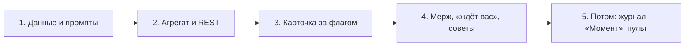

# Режим «Исполнение фичи» в «Плане хода»: разрез реализации

Дата: 2026-10-16. Автор: Александр (архитектор). Срез во времени, после написания не поддерживается.

Целевой образ: [turn-plan-feature-mode-v2.html](../mockups/turn-plan-feature-mode-v2.html) и
[turn-plan-feature-mode-v2-proposal.md](../mockups/turn-plan-feature-mode-v2-proposal.md) (коммит
`2e0b9b6dc`, ревью Глеба принято). Здесь разобрано, чего не хватает, чтобы режим рисовался на живых
данных, по слоям: данные, сервер, фронт, промпты. Порядок работ определяет Егор, здесь только крупные этапы.

## Вывод

1. **Эвристики в живой UI не пускаем.** Макет собран из выгрузки, которую пришлось чинить руками:
   9 задач из 23 по «Истории» потерялись при выборке по ветке, вердикты восстановлены по тексту в
   четырёх форматах. Если перенести этот код в продукт, получится вторая точка правды, и её числа
   будут неверными. Нужны структурные поля, а режим работает только для фич, которые заведены по-новому.
2. **Фича — это задача-эпик в том же трекере, а не новая сущность со своим стором.** Хранение, бэкап,
   граница по владельцу, `task_changed` в реальном времени, доска и `tasks_create` достаются даром.
3. **Добавить нужно шесть nullable-полей у `TaskItem` и одно поле у `TaskVerification`.** Изменение
   аддитивное, `BackupSchema.Version` не растёт, миграция старых задач не нужна.
4. **Агрегат фичи считает сервер одной чистой функцией** в вертикали `Tasks`. Карточка обращается к
   нему по REST и перезапрашивает по `task_changed`. Нового SignalR-события нет. Ту же функцию потом
   возьмёт «Пульт куратора», чтобы правила подсчёта ↺ не разъехались между двумя экранами.
5. **Ценность появится не сразу после выкатки.** Сначала нужно, чтобы оркестратор и ревьюеры начали
   ставить поля, поэтому первым этапом идут данные и промпты, а UI третьим.

## 1. Матрица данных

Легенда: **есть** — поле уже в трекере; **выводится** — считается из имеющихся полей без эвристик по
тексту; **нет** — требуется новое поле. «Что добавить» ссылается на модель из раздела 2.

| Элемент макета | Источник сейчас | Статус | Что добавить |
|---|---|---|---|
| Список фич чата | ветка `worktreeBranch` и заголовки | нет | эпик `Role=feature`, `FeatureId` у задач, связь чата с фичей по `SourceSessionId`/`ExecutorLaunchedBySessionId` |
| Название фичи, ветка | ветка | нет → есть | `Title`/`WorktreeBranch` эпика |
| Правило пилюли (ждёт вас → идёт → последняя активность) | — | выводится | из агрегата, когда появятся поля ниже |
| Строки конвейера (разрез, план, производство, ревью, проверка, финал, мерж) | заголовки «шаг D1c», «ФИНАЛЬНОЕ РЕВЬЮ» | нет | `Role` у задачи, этап выводится из `Role` |
| Этап «нет в трекере» и «ещё не начат» | — | выводится | нет задач этой `Role`, а следующий этап уже идёт → «нет в трекере», иначе «не начат» |
| Линии бэк/фронт | префикс шага в заголовке | нет | `Lane` (необязательное) |
| Шаги и их порядок | заголовки | нет | `StepRef` у задач `step`/`rework` |
| Статус шага: идёт / готов | `Status`, `ClaudeStartedAt`, `CompletedAt` | есть | — |
| «Исполнитель упал» | `ExecutorStoppedAt`/`ExecutorStopReason` | есть | — |
| «Стоит» | `ExecutorStaleAlertedAt`, `DeviceWaitSince` | есть | — |
| Кто делал, сколько шло | `PersonaId`, `ClaudeStartedAt`→`CompletedAt` | есть | — |
| Круги ревью шага, пружина | парсинг `ResultMarkdown` | нет | `ReviewOf` у ревью, `Verification.Verdict` |
| Исход витка: вернул / с правками / принял / идёт | текст итога | нет | `Verdict`: `returned` / `accepted_with_remarks` / `accepted`; «идёт» — ревью не закрыто |
| Ревью пачкой (одно на несколько шагов) | — | нет | `ReviewOf` — список id задач (многие-ко-многим) |
| Источник возврата (с ревью / с проверки / с финала) | — | выводится | `Role` задачи с вердиктом `returned`, последней перед доработкой по тому же `StepRef` |
| ↺ фичи | ручной подсчёт | выводится | число уникальных вердиктов `returned`/`accepted_with_remarks` (не сумма по шагам) |
| Ревью вне трекера (пунктир) | — | выводится | есть `rework` по шагу, но нет предшествующего вердикта |
| Шаг «снят с выкладки» | текст | нет | `Verdict=withdrawn` |
| Витки проверки, дефекты Веры | `Kind=Defect`, `Verification` | частично | `FeatureId` у дефекта приходит наследованием, `Role=qa` у задачи проверки |
| Виток финала | заголовок | нет | `Role=final` + `Verdict` |
| Мерж и «ждёт вас · мерж» | git, задачи мержа нет | нет | эпик закрывается мержем, `AwaitingHumanSince/Reason` у эпика |
| Рекомендации оркестратора | — | нет | `OrchestratorNote` у эпика (этап 4) |
| Чип «Шаг N фичи» на `TaskCreatedView` | — | нет → есть | `FeatureId` + `StepRef` в ответе `tasks_create`: там уже полный JSON задачи |
| «Момент» (прокрутка во времени) | — | только макет | в продукт не берём, журнал переходов отложен |
| Горячесть ↺ | порог ≥ 3 | выводится | правило отображения, данные не нужны (решают Софья и Майя) |

## 2. Минимальная модель

### Поля

Все поля аддитивные и nullable, хранятся в Core `Models/TaskItem.cs`, значения — строки-константы
(без новых enum, см. риск в разделе 5).

| Поле | Тип | У кого | Смысл |
|---|---|---|---|
| `FeatureId` | `string?` | у всех задач фичи | id задачи-эпика |
| `Role` | `string?` | у всех | `feature` · `cut` · `plan` · `step` · `rework` · `review` · `qa` · `final` · `merge` · `consult` |
| `StepRef` | `string?` | у `step`/`rework` | код шага из плана («D1c», «Ш3»), по нему доработка склеивается со своим шагом |
| `Lane` | `string?` | у `step`/`rework` | линия («бэк», «фронт», «D · ввод»), подпись берётся как есть |
| `ReviewOf` | `List<string>?` | у `review`/`qa`/`final` | id задач, которые оценивает ревью. Пусто у `final`/`qa` — значит, вся фича |
| `AwaitingHumanSince` + `AwaitingHumanReason` | `DateTime?` + `string?` | у эпика | «ждёт вас»: с какого момента и почему (`merge`, `decision`) |
| `TaskVerification.Verdict` | `string?` | у задачи с вердиктом | `accepted` · `accepted_with_remarks` · `returned` · `withdrawn`; null = старая семантика «проверено» |

`TaskVerification` обобщается, а не дублируется: у дефектов вердикт уже живёт там же, `VerifiedAt` и
`PersonaId` ставит сервер. Для ревью новые поля не нужны, нужен только `Verdict`. `DefectRules` не
меняется: для `Kind=Task` он no-op.

**Фаза не хранится**, её вычисляет агрегат: этап шага, исход витка «с правками» (вердикт
`accepted_with_remarks` или `accepted`, за которым по тому же шагу шла доработка), источник возврата.

**Чего в модели нет намеренно:** отдельного стора `features.json` (эпик в трекере даёт всё то же, а
стор пришлось бы проводить через бэкап, изоляцию и realtime), журнала переходов (нужен только «Моменту»
и таймлайну, отложен) и поля «исход шага» (`withdrawn` в вердикте покрывает единственный реальный случай,
C1-2).

### Эпик фичи

- Создаёт оркестратор (`tasks_create` с `role: "feature"`) в начале фичи, без `personaId` (см. раздел 5:
  `NormalizePersonaAssignee` сделал бы его задачей Claude). В `WorktreeBranch` — ветка фичи.
- Связь эпика с чатом выводится из уже имеющихся полей: `SourceSessionId` эпика плюс `SourceSessionId`
  и `ExecutorLaunchedBySessionId` задач фичи. Поэтому фича переезжает за оркестратором и при
  `chats_continue`: новый чат запускает следующие задачи и сам попадает в выборку.
- Закрытие эпика означает мерж. Тот, кто вливает ветку (Марк по задаче `role: "merge"` или сам Андрей),
  закрывает эпик с коммитом мержа в `resultMarkdown`. Время мержа берётся из трекера, git не читаем.

### Кто что заполняет (MCP `tasks`)

| Параметр | Инструмент | Кто ставит |
|---|---|---|
| `featureId`, `role`, `stepRef`, `lane` | `tasks_create`, `tasks_update` | оркестратор (Софья) на каждой постановке |
| `reviewOf` | `tasks_create` | оркестратор при постановке ревью, проверки, финала |
| `verification.verdict` (+ `notes` = причина) | `tasks_complete` | ревьюер (Глеб, Александр), Вера по проверке |
| `featureId` | — | **сервер наследует**, если задачу создаёт чат-исполнитель задачи фичи: тот же поиск родителя, что в `ComputeDelegationDepth`. Так дефекты Веры и подзадачи исполнителей не теряются |
| `awaitingHuman*` | — | сервер: финал закрыт с `accepted`/`accepted_with_remarks`, а эпик открыт → `merge`. Снимается закрытием эпика |

Валидация на сервере (fail-closed, с внятным текстом ошибки агенту):
- `featureId` указывает на задачу с `Role=feature` того же `OwnerId`;
- `role` и `verdict` берутся только из списка;
- `reviewOf` ссылается только на задачи той же фичи.

Тихо отбрасывать неверное значение нельзя: агент не узнает, что разметка не легла.

### Миграция и бэкап

- **Миграции нет.** Режим включается только у фич с эпиком, старые чаты остаются в «Плане хода» как сейчас.
  Обратная разметка старых фич по эвристикам противоречит выводу 1. Для обкатки размечаем вручную
  (через `tasks_update`) одну живую фичу, `feat/curator-console`.
- **`BackupSchema.Version` не растёт**: добавлять поля с дефолтом не ломающее изменение (так сказано в
  самом `BackupSchema.cs`, то же сделано в прецедентах `ExecutorLaunchedBySessionId` и `ReportToSessionId`).

## 3. Сервер

- **Агрегат.** Чистая функция `FeatureProjector.Build(epic, tasks, now)` → `FeatureRun` (этапы, линии,
  шаги, витки, ↺ по источникам, состояние, «ждёт вас») в вертикали `ClaudeHomeServer.Tasks`. От сессий
  ей нужны только поля задачи, нового шва нет. Золотые тесты: четыре чата из
  `.cc-attachments/curator/real-chats.json`, вручную размеченные новыми полями, с ожидаемыми числами из
  proposal v2 («История»: 6 шагов, ↺6 = 3/2/1).
- **REST.** `GET /api/tasks/features?sessionId=…` — фичи чата с агрегатом каждой.
  `GET /api/tasks/features/{featureId}` — одна фича. `[Authorize]`, выборка только по `OwnerId` из claim.
  При выключенной подсистеме `Tasks` отвечаем честным 503, а не 500 (правило отключаемости, ADR-014).
- **Живое обновление.** Новое событие не заводим. `task_changed` уже идёт в группу `user_{id}` с полной
  задачей. Фронт смотрит, есть ли у неё `featureId` (или `Role=feature`) из числа открытых, и
  перезапрашивает агрегат с дебаунсом ~500 мс. Цена — один GET на изменение, на наших объёмах это ничто.
- **Граница по владельцу.** Агрегат собирается по `OwnerId`. Задачи фичи могут лежать в разных проектах
  (кросс-проектные привязки персон), поэтому `ProjectId` в выборку не входит. Чужой эпик отсекает
  валидация `featureId` при записи.
- **Почему не считать на фронте.** Стор задач у фронта и так грузит всё (`listAll`) и обновляется сам.
  Но правила подсчёта ↺, «с правками», источника возврата и пачек ревью нужны ещё и «Пульту куратора»,
  а позже, возможно, и оркестратору (сводка по фиче в MCP). Если считать на фронте, правила разъедутся.

## 4. Фронт

Затронутые места (новых панелей нет):

| Файл | Что меняется |
|---|---|
| `components/ChatPanel.tsx` (≈1997, ≈2841) | условие показа пилюли: сейчас `taskTodos.length > 0`, станет «есть todos **или** у чата есть фичи». В чате оркестратора `TodoWrite` бывает редко, без этой правки пилюли там не будет |
| `components/chat/TurnPlanPill.tsx` | переключатель «План хода» · «Исполнение фичи» в шапке меню, подпись фичи и `+N`, правило выбора фичи. Режим по умолчанию: «фича», если она есть, иначе план |
| `components/chat/TodoList.tsx` | не меняется, остаётся телом режима «План хода» |
| новое `components/chat/feature/*` | `FeatureRunView` (конвейер, этапы), `FeatureSteps` (линии, шаги), `ReviewSpring` (пружина, вариант А), `RoundChain` (цепочка кругов), `FeaturePicker` (чипы) |
| `components/chat/ChatItemView.tsx` (`TodoPlanView`) | переключатель только у последней карточки. Прошлые карточки — история пачек `TodoWrite`, им режим фичи ни к чему |
| `components/chat/TaskCreatedView.tsx` | чип «Шаг N фичи», если в ответе `tasks_create` есть `featureId` и `stepRef`. Без них чипа нет (Major 3 Глеба). Клик открывает меню пилюли на этом шаге: нужен маленький стор чата `openFeatureStep(featureId, taskId)` |
| `lib/api.ts`, новый `lib/featureRuns.ts` | клиент REST и стор агрегатов по чату, подписка на `task_changed` |
| `types/` | поля задачи, `FeatureRun` |

- **Фич-флаг** `turn-plan-feature-mode` (каталог C# + `FLAGS`). Флагом закрываем только UI. REST и
  параметры MCP от флага не зависят (см. раздел 5).
- **Не сломать текущий план:** без фичи в чате переключатель не рендерится, а пилюля и меню остаются
  байт-в-байт прежними (кадр «было/стало» для чата без фичи — обязательная проверка Веры).
- Мобила: меню на всю ширину, `maxHeight` 560, липкая шапка (спецификация уже есть в proposal v2).
  Сейчас у `Menu` `maxHeight=340`, для режима фичи его нужно поднять.

## 5. Инварианты под угрозой

| Инвариант | Чем грозит | Как держим |
|---|---|---|
| Стабильность `tools/list` (`McpToolsetStabilityTests`) | схема `tasks_create/update/complete` меняется | новые параметры есть в схеме **всегда**, не по флагу и не по персоне. Флаг пользователя, переключённый посреди чата, сменил бы сигнатуру запуска и убил бы CLI со всеми MCP. Схема меняется раз на выкатку, это допустимо |
| Не плодить однокоренные инструменты | соблазн завести `tasks_review`, `tasks_feature` | вердикт — параметр `tasks_complete` (там уже есть `verification`), разметка — параметры `tasks_create/update`. Новых инструментов нет |
| Длина описаний MCP | каждое слово в схеме `tasks` едет в каждый ход каждого чата | описания параметров по строке, перечни значений — `enum` в схеме |
| `NormalizePersonaAssignee` | эпик с `personaId` стал бы `Assignee=Claude`, и его можно было бы запустить исполнителем | эпик создаётся без персоны, сервер отклоняет `role=feature` вместе с `personaId` и не пускает такую задачу в `tasks_run_executor` |
| `DefectRules` | путаница вердикта ревью с вердиктом дефекта | `Verdict` — новое поле, правила дефекта его не читают. Противоречие `outcome=closedWithoutCheck` + `verification`, замеченное в v1, — отдельный дефект трекера, к этой фиче не относится |
| Откат кода | старый код при чтении игнорирует незнакомые поля, а **при первом сохранении `tasks.json` сотрёт их** у всех задач | принимаем как цену dark launch и пишем в план выкатки: откат = потеря разметки фич. Новых значений enum в сторе не заводим (урок `mcp-servers.json`, ушедшего в `.corrupt`), поэтому все значения — строки |
| Границы подсистем | агрегат в Main или в чужой вертикали | `FeatureProjector` — в `ClaudeHomeServer.Tasks`, контроллер и `TasksToolset` остаются, где были. Сессии агрегату не нужны |
| Per-owner изоляция | `featureId` чужого владельца | валидация при записи, выборка по `OwnerId` при чтении |
| Промпты персон | без промптов поля пусты, и режим не включится ни разу | см. ниже |

**Промпты (главный риск всей фичи).** Структура держится на дисциплине агентов, а часть исполнителей —
локальные модели с узким контекстом. Что делаем:
- Софья (`mustDo`): «фича начинается с эпика; каждая постановка по фиче — с `featureId`, `role`,
  `stepRef`; ревью, проверка и финал — с `reviewOf`».
- Глеб, Александр, Вера: «закрывая ревью, проверку или финал, ставь `verification.verdict`; причина
  пишется в `notes`».
- Где можно, сервер делает работу за агента: наследует `featureId`, по умолчанию ставит `role=qa`
  дефекту внутри фичи, выставляет `awaitingHuman`.
- Если ревью закрыто без вердикта, ревьюер получает мягкое предупреждение в ответе `tasks_complete`
  («у ревью фичи нет вердикта — карточка его не покажет»). Отказом это не делаем: блокировать закрытие
  ради UI нельзя.
- `.claude/delegation-categories.md`: добавить абзац о разметке фичи в профиль оркестратора.

## 6. Развилка: эвристики или структура

| Вариант | Что даёт | Цена и риски |
|---|---|---|
| **А. MVP на эвристиках** (ветка + заголовки + разбор `ResultMarkdown`) за флагом | рисуется сразу и на старых фичах, код из макета есть | теряет треть задач фичи (ревью и дефекты без ветки), вердикт угадывается по четырём форматам, «ждёт вас» почти не срабатывает. Вторая точка правды, которую потом придётся выкорчёвывать, а неверные числа на экране подорвут доверие к режиму |
| **Б. Сразу структурные поля** (рекомендую) | числа верны по построению, ту же модель берёт пульт куратора | ценность после первой фичи, проведённой по-новому; нужна дисциплина промптов |
| В. Структура + эвристический фолбэк для старых фич | закрывает старые чаты | платим за оба варианта сразу, а на экране смешиваются точные и угаданные числа без видимой разницы |

**Рекомендую Б.** Структура стоит немного: шесть аддитивных полей, параметры трёх уже существующих
инструментов, абзац в промптах. Эвристики при этом дают как раз то, что Глеб уже дважды вернул.
Ожидание ценности сокращаем обкаткой: вручную размечаем `feat/curator-console` и ведём по новой схеме
первую следующую фичу.

## 7. Этапы крупно

1. **Данные и промпты.** Поля `TaskItem` и `Verdict`, эпик, валидация, наследование `featureId`, параметры
   MCP и DTO REST, абзацы в промптах Софьи, Глеба, Александра, Веры. Тесты `TaskManager` и тулсета,
   прогон `McpToolsetStabilityTests`. *Ценность:* трекер начинает копить структуру. Это стоит начать
   первым, потому что всё остальное ждёт данных.
2. **Агрегат и REST.** `FeatureProjector` с золотыми тестами на размеченной выгрузке четырёх чатов,
   эндпоинты, 503 при выключенной подсистеме. *Ценность:* числа проверены до того, как появится экран.
3. **Карточка за флагом.** Пилюля, меню, переключатель, конвейер, шаги, пружина, цепочка, выбор фичи,
   чип на `TaskCreatedView`, мобила. Перед коммитом — `lint:design` и ревью `designer`.
4. **Мерж и «ждёт вас».** Роль `merge` или закрытие эпика мержем, `AwaitingHuman*`, сворачивание пустых
   этапов у мелких фич (открытый вопрос 2 proposal), `OrchestratorNote`, порог горячести относительно числа
   шагов.
5. **Потом, отдельными решениями:** журнал переходов (нужен «Моменту» и таймлайну), переиспользование
   агрегата пультом куратора, сводка фичи для оркестратора в MCP.

## Открытые вопросы к Андрею

1. Мерж: задача Марку на каждую фичу или закрытие эпика тем, кто вливает? Я за закрытие эпика:
   дополнительной задачи нет, а сигнал тот же.
2. Повторный финал (вопрос 3 proposal): если Александр должен смотреть правки финала ещё раз, это
   правило оркестратора и ещё одна задача `final`. Модели всё равно, но от ответа зависит, как
   рисовать ожидаемый виток.
3. Ревью без задачи (мелкие фичи): заводить задачу на каждое ревью или оставить пунктир «вне трекера»?
   Модель терпит оба варианта, но точность ↺ обеспечивает только первый.
